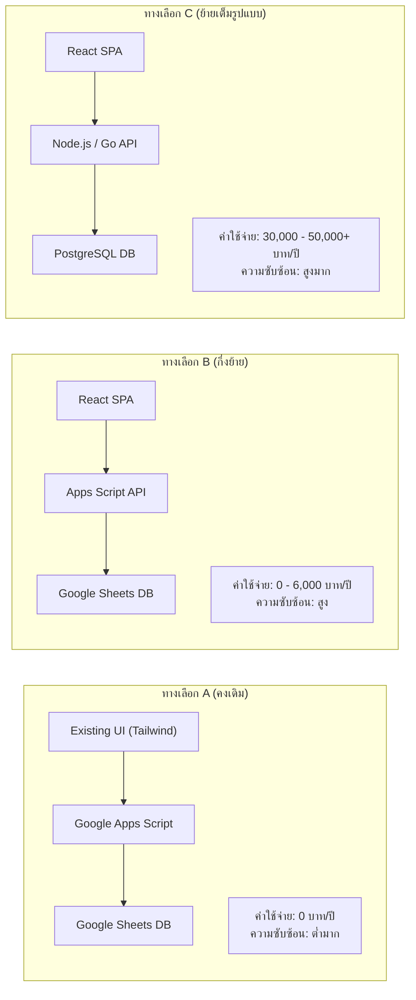
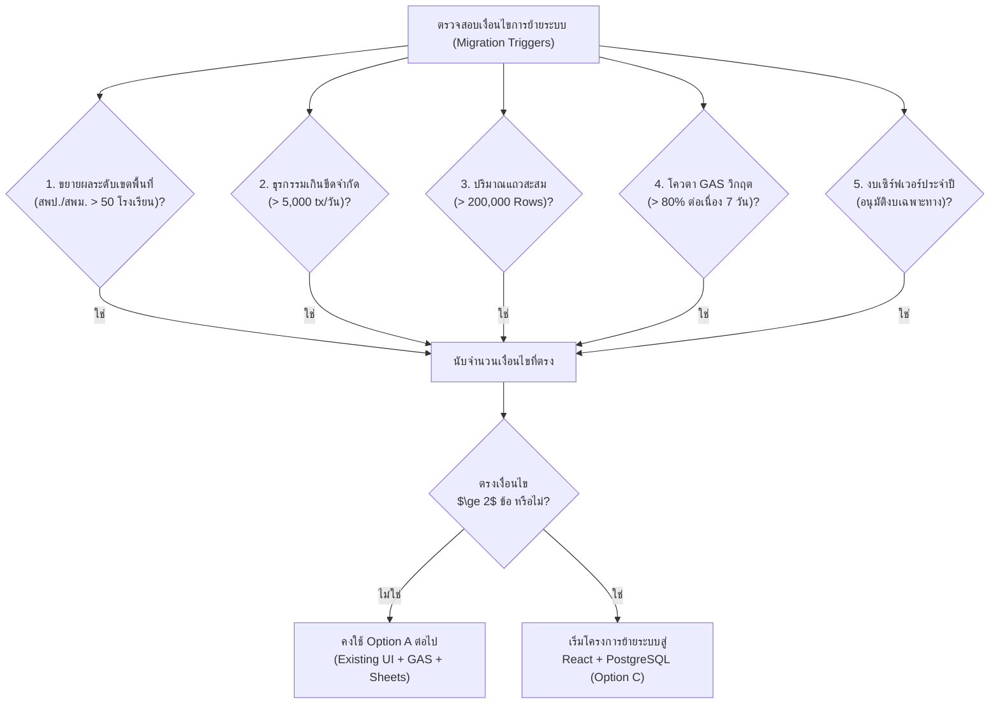

# 🏛️ ARCHITECTURE DECISION RECORD (ADR)
## บันทึกการตัดสินใจเชิงสถาปัตยกรรมระบบบริหารคลังพัสดุสถานศึกษา

**รหัสเอกสาร:** ADR-001  
**ชื่อการตัดสินใจ (Title):** การคงใช้สถาปัตยกรรม Google Workspace Native (Existing UI + Apps Script + Sheets) และการระงับการย้ายไป React/PostgreSQL ในปัจจุบัน  
**สถานะการตัดสินใจ (Status):** 🟢 **ACCEPTED (อนุมัติเห็นชอบอย่างเป็นทางการ)**  
**วันที่ตัดสินใจ (Date):** 27 กันยายน 2569  
**ผู้มีอำนาจตัดสินใจ (Deciders):**  
1. ดร.สมชาย รุ่งเรืองวิทยากุล — ผู้อำนวยการโรงเรียนหรเทพ(รุ่งเรืองประชาสามัคคี)  
2. นายอนันต์ มั่นคง — เจ้าหน้าที่พัสดุและผู้ดูแลระบบสารสนเทศ  
3. คณะกรรมการประเมินเทคโนโลยีสารสนเทศสถานศึกษา  
**เอกสารอ้างอิง:** [PILOT_EVALUATION_REPORT.md](file:///g:/My%20Drive/School%20Inventory%20Management%20System/docs/PILOT_EVALUATION_REPORT.md)

---

## 1. บริบทและปัญหาที่ต้องตัดสินใจ (Context & Problem Statement)

ในการพัฒนาระบบบริหารคลังพัสดุ โรงเรียนหรเทพ(รุ่งเรืองประชาสามัคคี) มีข้อเสนอทางเทคนิคให้พิจารณาว่า **"ควรย้ายสถาปัตยกรรมระบบจาก Google Apps Script และ Google Sheets ไปสู่โมเดิร์นเว็บสแตก เช่น React SPA Frontend และ PostgreSQL Database หรือไม่?"**

คณะทำงานจึงได้จัดทำการทดลองใช้งานจริงในระยะนำร่อง (Pilot Telemetry) เพื่อรวบรวมตัวเลขสถิติ ปริมาณการใช้งาน ปัญหาจริง และต้นทุนรวมในการถือครอง (Total Cost of Ownership - TCO) มาวิเคราะห์เปรียบเทียบระหว่าง 3 ทางเลือกสถาปัตยกรรม

---

## 2. ปัจจัยขับเคลื่อนการตัดสินใจ (Decision Drivers)

1. **งบประมาณสถานศึกษา (Zero Infrastructure Budget):** โรงเรียนเป็นหน่วยงานรัฐขนาดกลาง ไม่มีงบประมาณรายเดือนสำหรับค่าบริการ Cloud Database หรือ Dedicated Server
2. **ความยั่งยืนในการดูแลรักษาระยะยาว (Maintainability & Bus Factor):** โรงเรียนไม่มีวิศวกรซอฟต์แวร์หรือทีม DevOps ประจำ ระบบต้องสามารถดูแล บำรุงรักษา และแก้ปัญหาได้โดยครูคอมพิวเตอร์/เจ้าหน้าที่พัสดุของโรงเรียน
3. **ความเสถียรและความปลอดภัยของข้อมูล (Security & IAM):** ข้อมูลพัสดุเป็นทรัพย์สินของทางราชการ ต้องผูกมัดตัวตนผ่าน Google Workspace for Education ของโรงเรียน และห้ามมีช่องทางเข้าถึงชีตโดยตรง
4. **ความสมบูรณ์ในการปฏิบัติงานจริง (Operational Fit):** ระบบปัจจุบันทำงานได้รวดเร็ว (Response time ~245 ms) ผ่านการทดสอบ UAT 100% และครูผู้สอน 45 คนคุ้นเคยกับส่วนต่อประสานผู้ใช้แล้ว

---

## 3. ทางเลือกที่ได้รับการพิจารณา (Considered Options)



### การประเมินข้อดี-ข้อเสียของแต่ละทางเลือก:

- **ทางเลือก A: Existing UI + Apps Script + Sheets (คงเดิม)**
  - *ข้อดี:* ค่าใช้จ่าย 0 บาท, ทำงานบน Google Workspace ของโรงเรียน 100%, ปลอดภัยสูงด้วย Google SSO, ไม่ต้องมี Build Pipeline, ไม่มีความเสี่ยงในการย้ายระบบ
  - *ข้อเสีย:* ไม่เหมาะกับระบบระดับแสนธุรกรรมต่อวัน (ซึ่งโรงเรียนมีเพียง ~22 ธุรกรรม/วัน)

- **ทางเลือก B: React + Apps Script + Sheets (กึ่งย้าย)**
  - *ข้อดี:* หน้าตาคอมโพเนนต์เป็น React มาตรฐาน
  - *ข้อเสีย:* เกิดความซับซ้อนในการเชื่อมต่อ (CORS / Apps Script iframe wrapper), คอขวดด้านความเร็วยังอยู่ที่เดิม, เพิ่มภาระในการ Compile/Bundle โค้ดโดยไม่ได้ประโยชน์ทางธุรกิจ

- **ทางเลือก C: React + API Backend + PostgreSQL (ย้ายเต็มรูปแบบ)**
  - *ข้อดี:* ประสิทธิภาพสูงมาก (Sub-50ms), รองรับการขยายตัวระดับประเทศ, รองรับ ACID Relational Database แท้จริง
  - *ข้อเสีย:* มีค่าใช้จ่ายเซิร์ฟเวอร์และฐานข้อมูลปีละ 30,000 - 50,000+ บาท, ต้องการทีม DevOps และ Full-stack Developer ดูแลต่อเนื่อง, เพิ่มความเสี่ยงระบบหยุดชะงัก (Downtime) หากงบประมาณขาดตอน

---

## 4. ผลการตัดสินใจ (Decision Outcome)

### มติที่ประชุม: **เลือกทางเลือก A (Option A: Existing UI + Apps Script + Sheets)**

> [!IMPORTANT]
> **คำสั่งการเชิงนโยบายทางสถาปัตยกรรม (Architectural Policy Directive):**  
> **"ห้ามย้ายระบบไปสู่ React หรือ PostgreSQL โดยเด็ดขาด จนกว่าจะมีเงื่อนไขและตัวชี้วัดทางสถาปัตยกรรม (Architectural Triggers) บรรลุเกณฑ์ตามที่กำหนดไว้ในเอกสารนี้อย่างชัดเจน"**

### เหตุผลสนับสนุนการตัดสินใจ (Rationale):
1. **ผลการวัดประสิทธิภาพในระยะ Pilot (Empirical Evidence):**  
   ระบบปัจจุบันตอบสนองคำขอได้ในเวลา **245 ms** มีอัตราการใช้โควตา Apps Script เพียง **13.3%** และใช้ความจุเซลล์ของ Google Sheets ไปเพียง **0.15%** แสดงให้เห็นว่าระบบปัจจุบันมีทรัพยากรเหลือเฟือสำหรับการใช้งานของโรงเรียน
2. **ความคุ้มค่าทางการคลัง (Fiscal Prudence):**  
   การคงใช้ Option A ประหยัดงบประมาณของโรงเรียนได้ **30,000 - 50,000 บาทต่อปี** ซึ่งสามารถนำงบประมาณส่วนนี้ไปจัดซื้อวัสดุการเรียนการสอนและอุปกรณ์การศึกษาให้แก่นักเรียนได้โดยตรง
3. **การพึ่งพาตนเองได้ของสถานศึกษา (Self-Reliance & Sustainability):**  
   โครงสร้างโค้ดแบบรวมศูนย์ทำให้ครูคอมพิวเตอร์และเจ้าหน้าที่พัสดุสามารถตรวจสอบ แก้ไข และสำรองข้อมูลได้ด้วยตนเอง ไม่เสี่ยงต่อปัญหาซอฟต์แวร์ถูกทิ้งร้าง (Abandoned Software)
4. **ความเสี่ยงการเปลี่ยนผ่านเป็นศูนย์ (Zero Migration Risk):**  
   ระบบผ่านการทดสอบ End-to-End, Security Test และ UAT 100% แล้ว การรื้อสร้างใหม่จะนำมาซึ่งความล่าช้าและข้อผิดพลาดใหม่โดยไม่จำเป็น

---

## 5. เงื่อนไขและตัวชี้วัดสำหรับการพิจารณาย้ายระบบในอนาคต (Future Migration Triggers)

คณะทำงานกำหนดเงื่อนไขชี้ขาด (Architectural Triggers) ว่า **จะพิจารณาย้ายระบบไปสู่ทางเลือก C (React + PostgreSQL) ก็ต่อเมื่อเกิดเงื่อนไขข้อใดข้อหนึ่งดังต่อไปนี้อย่างน้อย 2 ข้อขึ้นไป**:



| รหัสเงื่อนไข | ตัวชี้วัดทางสถาปัตยกรรม (Architectural Trigger) | สถานะปัจจุบัน | เกณฑ์ที่จะเริ่มพิจารณาย้าย |
| :---: | :--- | :---: | :---: |
| **TR-01** | **การขยายผลสู่ระดับเขตพื้นที่การศึกษา (Multi-School Multi-tenancy)** | โรงเรียนเดี่ยว (หรเทพฯ) | มีการรวมศูนย์ใช้งานตั้งแต่ **50 โรงเรียนขึ้นไป** |
| **TR-02** | **ปริมาณธุรกรรมประจำวัน (Daily Transaction Volume)** | 22 ธุรกรรม/วัน | ปริมาณธุรกรรมเกิน **5,000 ธุรกรรม/วัน** |
| **TR-03** | **ขนาดตารางสะสมใน Stock Ledger (Data Row Limit)** | 148 แถว | จำนวนแถวสะสมเกิน **200,000 แถว** |
| **TR-04** | **อัตราการใช้โควตา Google Apps Script (Quota Saturation)** | 13.3% ของโควตา | การใช้เวลาประมวลผลเกิน **80% ต่อเนื่องเกิน 7 วัน** |
| **TR-05** | **การจัดสรรงบประมาณซอฟต์แวร์เฉพาะ (Dedicated Cloud Budget)** | 0 บาท (งบปกติ) | ได้รับงบประมาณจัดซื้อ Cloud Server อย่างเป็นทางการ |

---

## 6. ผลกระทบที่ตามมาและแนวทางการพัฒนาต่อ (Consequences & Action Plan)

### ผลกระทบเชิงบวก (Positive Consequences):
- ระบบมีความเสถียร ไม่มีค่าใช้จ่ายรายเดือน (Cost = 0 THB)
- ครูและเจ้าหน้าที่ใช้งานระบบต่อเนื่องได้ทันทีในภาคเรียนปัจจุบันโดยไม่ต้องเรียนรู้ใหม่
- การพัฒนาในอนาคตสามารถทำได้ง่ายผ่านการปรับปรุงโมดูลใน Google Apps Script

### การจัดการข้อจำกัด (Mitigations for Option A Limitations):
1. **การควบคุมขนาดข้อมูล:** กำหนดขั้นตอนการจัดเก็บข้อมูลเก่า (Yearly Archive) เมื่อสิ้นปีงบประมาณ โดยสรุปยอดยกมาเป็น `OPENING` ประจำปี เพื่อให้ขนาดตารางในแต่ละปีมีขนาดกะทัดรัดเสมอ
2. **การป้องกัน Cold Start:** ใช้ Time-driven Trigger อุ่นระบบทุก 15 นาทีตามที่ออกแบบไว้
3. **การรักษาสถาปัตยกรรมโมดูลาร์:** รักษาโครงสร้าง `ApiService`, `ItemApi`, `StockApi`, `RequisitionApi` ให้แยกชั้นจาก UI อย่างชัดเจน เพื่อให้ในอนาคตหากจำเป็นต้องเปลี่ยน Backend จะสามารถเปลี่ยน Service Layer ได้โดยไม่กระทบ UI

---

## 7. การลงนามรับรองมติการตัดสินใจ (Sign-off & Endorsement)

มติการตัดสินใจทางสถาปัตยกรรมฉบับนี้มีผลบังคับใช้ทันทีนับตั้งแต่วันที่ลงนาม และถือเป็นเอกสารอ้างอิงสูงสุดในการกำหนดทิศทางเทคโนโลยีของระบบบริหารคลังพัสดุสถานศึกษา

```
================================================================================
               ARCHITECTURE DECISION RECORD OFFICIAL VERDICT
================================================================================
DECISION              : RETAIN EXISTING UI + APPS SCRIPT + GOOGLE SHEETS (OPTION A)
REACT/POSTGRES MIGRATION : DEFERRED UNTIL ARCHITECTURAL TRIGGERS ARE MET
ANNUAL COST IMPACT    : 0 THB (SAVED 30,000 - 50,000 THB/YEAR)
OPERATIONAL STATUS    : APPROVED FOR FULL PRODUCTION ROLLOUT
================================================================================
```

ลงนามรับรองการตัดสินใจ:  
**นายอนันต์ มั่นคง** — เจ้าหน้าที่พัสดุและหัวหน้าทีมสถาปัตยกรรมระบบ  
**ดร.สมชาย รุ่งเรืองวิทยากุล** — ผู้อำนวยการโรงเรียนหรเทพ(รุ่งเรืองประชาสามัคคี)
