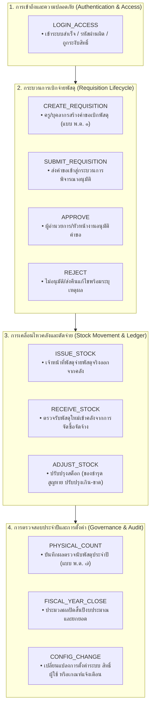
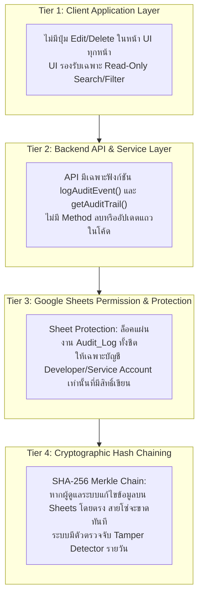
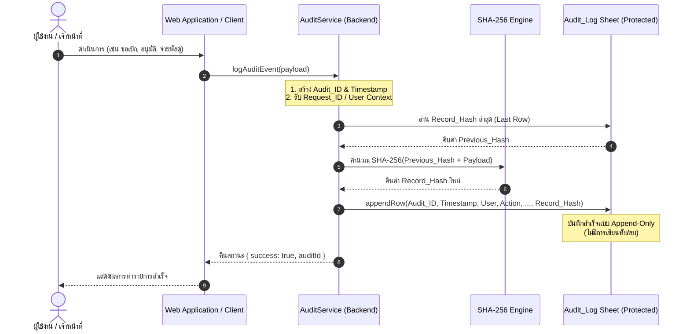

# สถาปัตยกรรมและข้อกำหนดการออกแบบ Audit Trail Logging System (Append-Only)
## ระบบบริหารคลังพัสดุโรงเรียน (School Inventory Management System)
### เอกสารมาตรฐานความปลอดภัยและการตรวจสอบย้อนกลับ (Security & Auditability Standard)

---

## 1. บทนำและปรัชญาการออกแบบ (Design Philosophy & Compliance)

ในระบบบริหารจัดการพัสดุสถานศึกษาภาครัฐ การเก็บบันทึกข้อมูลการปฏิบัติงาน (Audit Trail / Audit Log) ไม่ใช่เพียงแค่บันทึก Log สำหรับการ Debug ทางเทคนิค แต่คือ **"พยานหลักฐานทางอิเล็กทรอนิกส์ (Electronic Evidence)"** ที่ต้องพร้อมรับการตรวจสอบจากหน่วยงานกำกับดูแล:
1. **ระเบียบกระทรวงการคลังว่าด้วยการจัดซื้อจัดจ้างและการบริหารพัสดุภาครัฐ พ.ศ. ๒๕๖๐**: กำหนดให้กระบวนการเบิก จ่าย รับ และตรวจนับพัสดุ ต้องสามารถชี้แจงผู้กระทำ ผู้อนุมัติ และวันเวลาที่เกิดขึ้นจริงได้อย่างโปร่งใส
2. **สำนักงานการตรวจเงินแผ่นดิน (สตง.)**: การตรวจสอบงบดุลและสินทรัพย์โรงเรียน ต้องมีประวัติบันทึกที่พิสูจน์ได้ว่าไม่มีการแก้ไขหรือลบย้อนหลัง
3. **พ.ร.บ. ว่าด้วยการกระทำความผิดเกี่ยวกับคอมพิวเตอร์ (ฉบับที่ ๒) พ.ศ. ๒๕๖๐ (มาตรา ๒๖)**: บังคับเก็บข้อมูลจราจรทางคอมพิวเตอร์และบันทึกเหตุการณ์ไม่น้อยกว่า 90 วัน
4. **พ.ร.บ. คุ้มครองข้อมูลส่วนบุคคล พ.ศ. ๒๕๖๒ (PDPA)**: การบันทึกสิทธิ์การเข้าถึงข้อมูลและการยินยอม

### หลักการสำคัญ 3 ประการ (The 3 Pillars of Audit Log)
* **Append-Only & Zero Mutation**: ข้อมูลที่ถูกบันทึกลงใน Audit Log จะต้องไม่มีการ `UPDATE` หรือ `DELETE` โดยเด็ดขาด บันทึกแถวใหม่ต่อท้ายเท่านั้น (Immutable Ledger)
* **Tamper-Evident & Cryptographic Chain**: ทุกแถวบันทึกเชื่อมโยงด้วย Cryptographic Hash (SHA-256 Chain) หากมีใครแอบแก้ไขข้อมูลย้อนหลังแม้แต่ตัวอักษรเดียว สายโซ่จะขาดทันที (Tamper-evident)
* **Principle of Least Privilege (PoLP)**: ผู้ใช้งานทั่วไป (ครู, เจ้าหน้าที่พัสดุ, หรือแม้แต่หัวหน้างาน) จะไม่มีสิทธิ์เข้าถึงหรือแก้ไขแผ่นงาน Audit Log บน Google Sheets ได้โดยตรง การเขียน Log เกิดขึ้นผ่าน System Service Execution เท่านั้น

---

## 2. โครงสร้างข้อมูล Audit Log Schema

โครงสร้างตาราง `Audit_Log` ประกอบด้วยฟิลด์มาตรฐาน 13 ฟิลด์หลัก พร้อมฟิลด์ความปลอดภัยขั้นสูง:

| ลำดับ | Field Name | Data Type | Constraints | Description & Purpose | ตัวอย่างข้อมูล |
|:---:|---|---|---|---|---|
| 1 | `Audit_ID` | String | PK, Unique | รหัสรายการบันทึกประวัติ อ้างอิงตามปี-เดือน-วัน-ลำดับ | `AUD-25690927-00001` |
| 2 | `Timestamp` | String (ISO) | UTC / GMT+7 | วันที่และเวลาที่เกิดเหตุการณ์อย่างแม่นยำระดับมิลลิวินาที | `2026-09-27T04:58:10.123Z` |
| 3 | `User_ID` | String | Indexed | รหัสประจำตัวผู้กระทำรายการ (Actor) | `USR-ANANT-01` |
| 4 | `Email` | String | Indexed | บัญชีอีเมลทางการของสถานศึกษาของผู้กระทำรายการ | `anant.m@school.ac.th` |
| 5 | `Role` | Enum | Not Null | บทบาท/สิทธิ์ขณะกระทำรายการ | `STAFF_SUPPLY` |
| 6 | `Action` | Enum | Not Null | ประเภทการกระทำสำคัญตามระเบียบพัสดุ (ดูหัวข้อที่ 3) | `ISSUE_STOCK` |
| 7 | `Module` | Enum | Not Null | โมดูลหรือระบบย่อยที่เกิดการกระทำ | `STOCK_LEDGER` |
| 8 | `Entity_Type` | String | Not Null | ชนิดของข้อมูล/เอกสารเป้าหมายที่ได้รับผลกระทบ | `StockLedgerEntry` |
| 9 | `Entity_ID` | String | Indexed | รหัสเอกสารหรือรหัสอ้างอิงของเป้าหมาย | `LED-25690927-0042` |
| 10 | `Old_Value` | JSON String | Nullable | ค่าหรือสถานะเดิมก่อนการกระทำ (Delta Tracking) | `{"stock": 35, "status": "normal"}` |
| 11 | `New_Value` | JSON String | Nullable | ค่าหรือสถานะใหม่หลังการกระทำเสร็จสมบูรณ์ | `{"stock": 30, "status": "low"}` |
| 12 | `Status` | Enum | Not Null | ผลลัพธ์ของการกระทำ (`SUCCESS`, `FAILED`, `DENIED`, `WARNING`) | `SUCCESS` |
| 13 | `Request_ID` | String | Indexed | รหัสติดตามธุรกรรมข้ามระบบ (Distributed Trace / Correlation ID) | `REQ-TRC-7f89a1b2` |
| 14* | `IP_Address` | String | Security | ที่อยู่ IP ของเครื่องไคลเอนต์ที่ส่งคำขอ | `192.168.1.105` |
| 15* | `Previous_Hash` | String | Tamper-Evident | แฮช SHA-256 ของรายการบันทึกแถวก่อนหน้า | `a3f5...9b12` |
| 16* | `Record_Hash` | String | Tamper-Evident | แฮช SHA-256 ของรายการปัจจุบัน: $\text{SHA256}(\text{PrevHash} + \text{Fields})$ | `e8c4...71d0` |

*\* ฟิลด์หมายเลข 14-16 เป็น Enterprise Security Extension ที่ระบบนำมาใช้เพื่อรับประกันการตรวจไม่พบการปลอมแปลง (Non-repudiation)*

---

## 3. ประเภทการกระทำสำคัญที่ต้องบันทึก (Action Taxonomy)

ระบบจำแนกและบังคับบันทึกการกระทำสำคัญ (Mandatory Audited Actions) ออกเป็น 11 ประเภทหลัก:



### คำอธิบายเชิงลึกของแต่ละ Action
1. **`LOGIN_ACCESS`**:
   - บันทึกทุกครั้งที่มีการ Login เข้าสู่ระบบ ทั้งกรณีผ่าน (SUCCESS) และกรณีไม่ผ่าน (FAILED)
   - กรณีรหัสผ่านไม่ถูกต้อง หรือบัญชีถูกล็อก จะบันทึกเป็น Status `DENIED` พร้อมเหตุผลใน `New_Value`
2. **`CREATE_REQUISITION`**:
   - บันทึกเมื่อผู้ขอเบิกกดสร้างคำขอใหม่ (แบบ พ.ด. ๑)
   - `Entity_Type`: `Requisition`, `Entity_ID`: รหัสคำขอ เช่น `REQ-2569/012`
   - `New_Value`: รายการพัสดุและจำนวนที่ต้องการขอเบิก
3. **`SUBMIT_REQUISITION`**:
   - บันทึกเมื่อผู้ขอเบิกกดยืนยันส่งคำขออย่างเป็นทางการเพื่อรอการอนุมัติ
   - มีการเปลี่ยนสถานะจาก `DRAFT` เป็น `PENDING_APPROVAL`
4. **`APPROVE`**:
   - บันทึกการลงนามอนุมัติโดยหัวหน้าเจ้าหน้าที่พัสดุ หรือผู้อำนวยการสถานศึกษา
   - บันทึกเงื่อนไขการอนุมัติ เช่น อนุมัติเต็มจำนวน หรืออนุมัติปรับลดจำนวน
5. **`REJECT`**:
   - บันทึกการปฏิเสธคำขอเบิก พร้อมบันทึก `Old_Value` และข้อความระบุเหตุผลใน `New_Value`
6. **`ISSUE_STOCK`**:
   - บันทึกการตัดจ่ายพัสดุทางกายภาพออกจากคลัง พร้อมเชื่อมโยงกับ `Ledger_ID` ของ Stock Ledger
   - บันทึกจำนวนที่จ่ายจริง (`actualQty`) และยอดคงเหลือหลังการจ่าย
7. **`RECEIVE_STOCK`**:
   - บันทึกการรับพัสดุเข้าคลังจากการจัดซื้อตามสัญญา หรือรับบริจาค
   - บันทึกเลขที่ใบสั่งซื้อ (PO) และคณะกรรมการตรวจรับ
8. **`ADJUST_STOCK`**:
   - บันทึกการปรับปรุงยอดสต็อกนอกเหนือจากการเบิกจ่ายปกติ เช่น พบชำรุด สูญหาย หรือรับคืน
   - ถือเป็นการกระทำความเสี่ยงสูง (High Risk Action) ต้องบันทึกชื่อผู้อนุมัติการปรับปรุงเสมอ
9. **`PHYSICAL_COUNT`**:
   - บันทึกผลการสำรวจและนับพัสดุคงเหลือจริง (Physical Count) สิ้นปีงบประมาณ
   - เปรียบเทียบยอดตามบัญชีกับยอดนับจริงในแบบ พ.ด. ๗
10. **`FISCAL_YEAR_CLOSE`**:
    - บันทึกการตัดยอดปิดบัญชีสิ้นปีงบประมาณ ณ วันที่ 30 กันยายน
    - บันทึกการสร้างยอดยกมา (`OPENING`) สำหรับปีงบประมาณถัดไป
11. **`CONFIG_CHANGE`**:
    - บันทึกการแก้ไขการตั้งค่าระบบ เช่น จุดสั่งซื้อใหม่ (ROP), สต็อกขั้นต่ำ (Min Stock), การเพิ่ม/ลดสิทธิ์ผู้ใช้ในระบบ

---

## 4. มาตรการป้องกันการแก้ไขหรือลบ Audit Log (Tamper-Resistance Architecture)

ข้อกำหนดสำคัญสูงสุด: **"ห้าม User ทั่วไปแก้หรือลบ Audit Log"** 

ระบบป้องกันการทุจริตและการแทรกแซงข้อมูลด้วยกลไก 4 ชั้น (4-Tier Defense-in-Depth):



### รายละเอียดมาตรการแต่ละระดับ:

### ระดับที่ 1: การจำกัดสิทธิ์ในแผ่นงาน Google Sheets (Sheet Protection & Service Account)
* **Sheet-level Protection**: แผ่นงานชื่อ `Audit_Log` จะถูกตั้งค่า Protection ชนิด `ProtectionType.SHEET` โดยนำสิทธิ์ของผู้ใช้อื่นออกทั้งหมด (`removeEditors()`) เหลือเพียง Owner ของ Script
* **Execution Privilege**: เมื่อผู้ใช้เรียกใช้งาน Web App การทำงานจะรันภายใต้สิทธิ์ของ App Creator (Developer Context) ผ่าน Google Apps Script API ทำให้ไคลเอนต์ไม่สามารถส่งคำสั่งลบหรือแก้ไขชีตได้โดยตรง
* **Protected Range Warning**: แม้แต่ผู้ใช้ที่มีสิทธิ์ระดับ Editor ในระดับไฟล์ Spreadsheet หากพยายามคลิกขวา ลบ หรือพิมพ์ทับในชีต `Audit_Log` จะถูกปฏิเสธด้วยระบบแจ้งเตือนสิทธิ์ของ Google Sheets ทันที

### ระดับที่ 2: โครงสร้างโค้ดแบบ Append-Only (Code-Level Immutability)
* ฟังก์ชันการทำงานมีเพียง `appendRow` หรือการเพิ่มรายการต่อท้ายแถวสุดท้าย
* ไม่มีฟังก์ชันจำพวก `deleteRow()`, `deleteRows()`, `clear()`, หรือ `setValue()` บนแถวประวัติที่บันทึกไปแล้ว

### ระดับที่ 3: ห่วงโซ่เข้ารหัสป้องกันการปลอมแปลง (Cryptographic Hash Chaining / SHA-256)
เพื่อให้สามารถพิสูจน์ความบริสุทธิ์ของข้อมูลต่อ สตง. ได้ แม้ผู้ดูแลระบบ (Admin) จะเข้าถึงฐานข้อมูลได้โดยตรง:
* ทุกแถวการบันทึก จะนำ Hash ของแถวก่อนหน้า (`Previous_Hash`) มารวมกับข้อมูลในแถวปัจจุบัน แล้วนำไปคำนวณแฮช:
  $$\text{Record\_Hash}_n = \text{SHA256}(\text{Record\_Hash}_{n-1} + \text{Audit\_ID}_n + \text{Timestamp}_n + \text{User\_ID}_n + \text{Action}_n + \text{Entity\_ID}_n + \text{New\_Value}_n)$$
* **Geneisis Block**: สำหรับแถวแรกสุด กำหนด `Previous_Hash = "0000000000000000000000000000000000000000000000000000000000000000"`
* หากมีบุคคลใดเข้าไปแก้ตัวเลขหรือลบแถวใดแถวหนึ่งออก ค่าแฮชที่คำนวณใหม่ของแถวถัดๆ ไปจะไม่ตรงกันทันที ฟังก์ชัน `verifyAuditIntegrity()` จะตรวจพบความผิดปกติและชี้ระบุแถวที่มีการแก้ไขได้อย่างแม่นยำ

### ระดับที่ 4: การแจ้งเตือนความปลอดภัยทันที (Security Alarm)
* หากเกิดข้อผิดพลาดในการบันทึก Log หรือตรวจพบการแฮชไม่ตรงกัน ระบบจะส่งข้อความแจ้งเตือนความปลอดภัยไปยังผู้บริหารระดับสูงผ่านทาง Email / Alert Webhook ทันที

---

## 5. แผนผังลำดับการทำงาน (Sequence Flow)



---

## 6. ข้อกำหนด API และฟังก์ชันหลัก (Core API Contracts)

### 6.1 `logAuditEvent(payload)`
ฟังก์ชันแกนหลักในการบันทึกเหตุการณ์ลงใน Audit Log

* **Input Payload Specification**:
  ```json
  {
    "userId": "USR-ANANT-01",
    "email": "anant.m@school.ac.th",
    "role": "STAFF_SUPPLY",
    "action": "ISSUE_STOCK",
    "module": "STOCK_LEDGER",
    "entityType": "StockLedgerEntry",
    "entityId": "LED-25690927-0042",
    "oldValue": { "stock": 35, "status": "normal" },
    "newValue": { "stock": 30, "status": "low", "qtyIssued": 5, "reqId": "HRT-INV-REQ-2569/012" },
    "status": "SUCCESS",
    "requestId": "REQ-TRC-9a8b7c6d",
    "ipAddress": "192.168.1.105"
  }
  ```

* **Output Response**:
  ```json
  {
    "success": true,
    "auditId": "AUD-25690927-00128",
    "timestamp": "2026-09-27T05:00:15.892Z",
    "recordHash": "d4e2f9810a95c47b5...3a2b1c"
  }
  ```

---

### 6.2 `getAuditTrail(filterOptions)`
ฟังก์ชันดึงประวัติการตรวจสอบเพื่อจัดทำรายงานและสืบค้น (Read-Only)

* **Filter Options**:
  ```json
  {
    "userId": "USR-ANANT-01",
    "action": "ISSUE_STOCK",
    "module": "STOCK_LEDGER",
    "entityId": "LED-25690927-0042",
    "startDate": "2026-09-01T00:00:00.000Z",
    "endDate": "2026-09-30T23:59:59.999Z",
    "status": "SUCCESS",
    "limit": 50,
    "offset": 0
  }
  ```

---

### 6.3 `verifyAuditIntegrity()`
ฟังก์ชันตรวจสอบความสมบูรณ์และพิสูจน์ความไม่ถูกปลอมแปลงของสายโซ่ Audit Log ทั้งหมด

* **Output Report**:
  ```json
  {
    "isValid": true,
    "totalRecordsChecked": 128,
    "genesisHash": "0000000000000000000000000000000000000000000000000000000000000000",
    "latestHash": "d4e2f9810a95c47b5...3a2b1c",
    "tamperedRows": [],
    "verificationTimestamp": "2026-09-27T05:05:00.000Z"
  }
  ```

---

## 7. โค้ดต้นแบบสำหรับการติดตั้งใช้งาน (Production-Ready GAS Implementation)

```javascript
/**
 * ============================================================================
 * AUDIT LOG MODULE (Append-Only & Cryptographic Tamper-Evident Chain)
 * ระบบบันทึกประวัติการใช้งานและตรวจสอบย้อนกลับ ระบบบริหารพัสดุสถานศึกษา
 * โรงเรียนหรเทพ(รุ่งเรืองประชาสามัคคี)
 * ============================================================================
 */

const AUDIT_CONFIG = {
  SHEET_NAME: 'Audit_Log',
  LOCK_TIMEOUT_MS: 15000,
  GENESIS_HASH: '0000000000000000000000000000000000000000000000000000000000000000',
  HEADERS: [
    'Audit_ID',
    'Timestamp',
    'User_ID',
    'Email',
    'Role',
    'Action',
    'Module',
    'Entity_Type',
    'Entity_ID',
    'Old_Value',
    'New_Value',
    'Status',
    'Request_ID',
    'IP_Address',
    'Previous_Hash',
    'Record_Hash'
  ]
};

const AUDIT_ACTIONS = {
  LOGIN_ACCESS: 'LOGIN_ACCESS',
  CREATE_REQUISITION: 'CREATE_REQUISITION',
  SUBMIT_REQUISITION: 'SUBMIT_REQUISITION',
  APPROVE: 'APPROVE',
  REJECT: 'REJECT',
  ISSUE_STOCK: 'ISSUE_STOCK',
  RECEIVE_STOCK: 'RECEIVE_STOCK',
  ADJUST_STOCK: 'ADJUST_STOCK',
  PHYSICAL_COUNT: 'PHYSICAL_COUNT',
  FISCAL_YEAR_CLOSE: 'FISCAL_YEAR_CLOSE',
  CONFIG_CHANGE: 'CONFIG_CHANGE'
};

/**
 * 1. logAuditEvent(payload)
 * บันทึกประวัติการกระทำลงใน Audit_Log Sheet แบบ Append-Only พร้อมผูก Hash Chain
 */
function logAuditEvent(payload) {
  if (!payload || !payload.action || !payload.userId) {
    throw new Error("AuditValidationException: จำเป็นต้องระบุ action และ userId");
  }

  // กำหนดสิทธิ์และ Concurrency Lock
  const lock = LockService.getScriptLock();
  const hasLock = lock.tryLock(AUDIT_CONFIG.LOCK_TIMEOUT_MS);
  if (!hasLock) {
    console.warn("AuditLockWarning: ไม่สามารถขอ Lock บันทึก Audit Log ได้ทันเวลา บันทึกผ่าน Fallback Logger");
  }

  try {
    const ss = SpreadsheetApp.getActiveSpreadsheet();
    let sheet = ss.getSheetByName(AUDIT_CONFIG.SHEET_NAME);
    if (!sheet) {
      sheet = initAuditLogSheet_(ss);
    }

    const now = new Date();
    const timestampIso = now.toISOString();
    const dateStamp = Utilities.formatDate(now, "GMT+7", "yyyyMMdd");
    const nextSeq = (sheet.getLastRow()).toString().padStart(5, '0');
    const auditId = `AUD-${dateStamp}-${nextSeq}`;

    // อ่าน Previous Hash จากแถวสุดท้าย
    let previousHash = AUDIT_CONFIG.GENESIS_HASH;
    const lastRow = sheet.getLastRow();
    if (lastRow > 1) {
      previousHash = sheet.getRange(lastRow, 16).getValue() || AUDIT_CONFIG.GENESIS_HASH;
    }

    const oldValueStr = payload.oldValue ? (typeof payload.oldValue === 'string' ? payload.oldValue : JSON.stringify(payload.oldValue)) : '';
    const newValueStr = payload.newValue ? (typeof payload.newValue === 'string' ? payload.newValue : JSON.stringify(payload.newValue)) : '';
    const requestId = payload.requestId || `REQ-TRC-${Utilities.getUuid().substring(0, 8)}`;
    const ipAddress = payload.ipAddress || '127.0.0.1';

    // คำนวณ Cryptographic Hash (SHA-256)
    const rawDataToHash = [
      previousHash,
      auditId,
      timestampIso,
      payload.userId,
      payload.email || '',
      payload.role || 'USER',
      payload.action,
      payload.module || 'SYSTEM',
      payload.entityType || 'Entity',
      payload.entityId || '-',
      oldValueStr,
      newValueStr,
      payload.status || 'SUCCESS',
      requestId
    ].join('|');

    const signatureBytes = Utilities.computeDigest(Utilities.DigestAlgorithm.SHA_256, rawDataToHash, Utilities.Charset.UTF_8);
    const recordHash = signatureBytes.map(b => ('0' + (b & 0xFF).toString(16)).slice(-2)).join('');

    // Append แถวใหม่ (Append-Only)
    sheet.appendRow([
      auditId,
      timestampIso,
      payload.userId,
      payload.email || '',
      payload.role || 'USER',
      payload.action,
      payload.module || 'SYSTEM',
      payload.entityType || 'Entity',
      payload.entityId || '-',
      oldValueStr,
      newValueStr,
      payload.status || 'SUCCESS',
      requestId,
      ipAddress,
      previousHash,
      recordHash
    ]);

    return {
      success: true,
      auditId: auditId,
      timestamp: timestampIso,
      recordHash: recordHash
    };

  } finally {
    if (hasLock) {
      lock.releaseLock();
    }
  }
}

/**
 * 2. getAuditTrail(filterOptions)
 * ดึงรายการ Audit Log เพื่อการสืบค้นและรายงาน
 */
function getAuditTrail(filterOptions) {
  filterOptions = filterOptions || {};
  const ss = SpreadsheetApp.getActiveSpreadsheet();
  const sheet = ss.getSheetByName(AUDIT_CONFIG.SHEET_NAME);
  if (!sheet) return { totalRecords: 0, entries: [] };

  const lastRow = sheet.getLastRow();
  if (lastRow <= 1) return { totalRecords: 0, entries: [] };

  const rawData = sheet.getRange(2, 1, lastRow - 1, 16).getValues();
  let entries = rawData.map(r => ({
    auditId: r[0],
    timestamp: r[1],
    userId: r[2],
    email: r[3],
    role: r[4],
    action: r[5],
    module: r[6],
    entityType: r[7],
    entityId: r[8],
    oldValue: r[9],
    newValue: r[10],
    status: r[11],
    requestId: r[12],
    ipAddress: r[13],
    recordHash: r[15]
  }));

  // Filtering
  if (filterOptions.userId) {
    entries = entries.filter(e => e.userId === filterOptions.userId);
  }
  if (filterOptions.action) {
    entries = entries.filter(e => e.action === filterOptions.action);
  }
  if (filterOptions.module) {
    entries = entries.filter(e => e.module === filterOptions.module);
  }
  if (filterOptions.entityId) {
    entries = entries.filter(e => e.entityId === filterOptions.entityId);
  }
  if (filterOptions.status) {
    entries = entries.filter(e => e.status === filterOptions.status);
  }

  const totalRecords = entries.length;
  const limit = filterOptions.limit || 100;
  const offset = filterOptions.offset || 0;

  // คืนค่าเรียงจากล่าสุดย้อนหลัง (Descending)
  const paginatedEntries = entries.reverse().slice(offset, offset + limit);

  return {
    totalRecords: totalRecords,
    limit: limit,
    offset: offset,
    entries: paginatedEntries
  };
}

/**
 * 3. verifyAuditIntegrity()
 * ตรวจสอบความสมบูรณ์ของสายโซ่ Cryptographic Chain (Tamper-Evidence Check)
 */
function verifyAuditIntegrity() {
  const ss = SpreadsheetApp.getActiveSpreadsheet();
  const sheet = ss.getSheetByName(AUDIT_CONFIG.SHEET_NAME);
  if (!sheet) return { isValid: true, totalRecordsChecked: 0 };

  const lastRow = sheet.getLastRow();
  if (lastRow <= 1) return { isValid: true, totalRecordsChecked: 0 };

  const rows = sheet.getRange(2, 1, lastRow - 1, 16).getValues();
  let expectedPrevHash = AUDIT_CONFIG.GENESIS_HASH;
  const tamperedRows = [];

  for (let i = 0; i < rows.length; i++) {
    const r = rows[i];
    const rowNumber = i + 2;
    const currentPrevHash = r[14];
    const recordedHash = r[15];

    // ตรวจสอบความถูกต้องของ Previous Hash
    if (currentPrevHash !== expectedPrevHash) {
      tamperedRows.push({
        row: rowNumber,
        auditId: r[0],
        error: "BrokenPreviousHashLink",
        expected: expectedPrevHash,
        actual: currentPrevHash
      });
    }

    // คำนวณ Re-hash เพื่อตรวจสอบว่าข้อมูลในแถวถูกแอบแก้ไขหรือไม่
    const rawToRehash = [
      currentPrevHash,
      r[0], // auditId
      r[1], // timestamp
      r[2], // userId
      r[3], // email
      r[4], // role
      r[5], // action
      r[6], // module
      r[7], // entityType
      r[8], // entityId
      r[9], // oldValue
      r[10], // newValue
      r[11], // status
      r[12]  // requestId
    ].join('|');

    const digestBytes = Utilities.computeDigest(Utilities.DigestAlgorithm.SHA_256, rawToRehash, Utilities.Charset.UTF_8);
    const computedHash = digestBytes.map(b => ('0' + (b & 0xFF).toString(16)).slice(-2)).join('');

    if (computedHash !== recordedHash) {
      tamperedRows.push({
        row: rowNumber,
        auditId: r[0],
        error: "PayloadTamperedDetected",
        recordedHash: recordedHash,
        computedHash: computedHash
      });
    }

    expectedPrevHash = recordedHash;
  }

  return {
    isValid: tamperedRows.length === 0,
    totalRecordsChecked: rows.length,
    tamperedRows: tamperedRows,
    checkedAt: new Date().toISOString()
  };
}

/**
 * ฟังก์ชันสร้างและตั้งค่าป้องกันแผ่นงาน Audit_Log (Sheet Protection)
 * บังคับใช้สิทธิ์ห้าม User ทั่วไปแก้ไขหรือลบ
 */
function initAuditLogSheet_(ss) {
  let sheet = ss.getSheetByName(AUDIT_CONFIG.SHEET_NAME);
  if (!sheet) {
    sheet = ss.insertSheet(AUDIT_CONFIG.SHEET_NAME);
  }

  // เขียน Header และจัดรูปแบบ
  const headerRange = sheet.getRange(1, 1, 1, AUDIT_CONFIG.HEADERS.length);
  headerRange.setValues([AUDIT_CONFIG.HEADERS]);
  headerRange.setBackground('#1e293b');
  headerRange.setFontColor('#ffffff');
  headerRange.setFontWeight('bold');
  sheet.setFrozenRows(1);

  // ตั้งค่า Protection: ห้ามผู้ใช้อื่นแก้ไข ยกเว้น Script Owner
  const protection = sheet.protect().setDescription('ระบบคุ้มครองความปลอดภัย Audit Log (Append-Only ห้ามแก้ไข)');
  protection.removeEditors(protection.getEditors());
  if (protection.canDomainEdit()) {
    protection.setDomainEdit(false);
  }

  return sheet;
}
