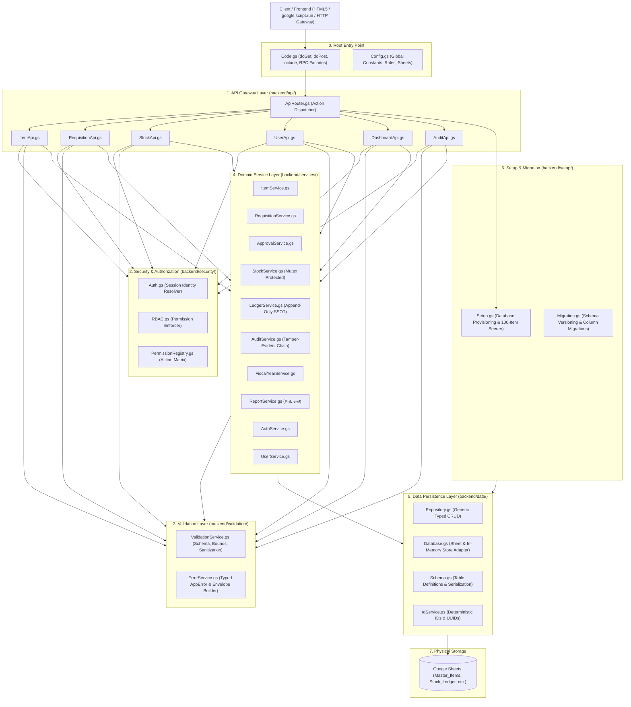
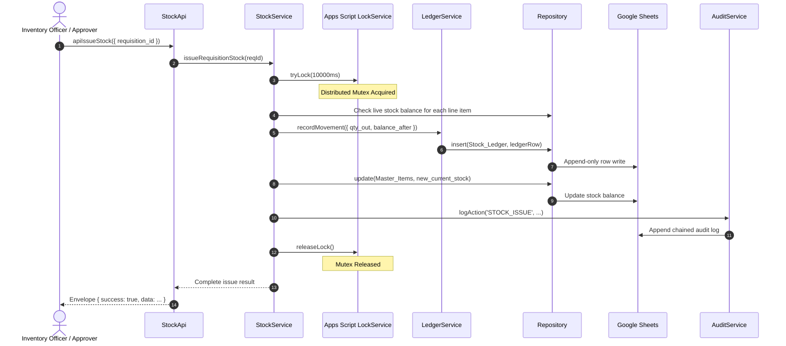

# Google Apps Script Backend Architecture Specification
## HRT School Inventory Management System (ระบบบริหารจัดการพัสดุและคลังวัสดุโรงเรียน)

> **Document Status**: Production Backend Architecture Specification  
> **Target Runtime**: Google Apps Script (V8 Engine) & Modern Web Client  
> **Architecture Pattern**: Layered Clean Architecture & Separation of Concerns (SoC)  
> **Data Integrity**: Double-Entry Immutable Ledger & Concurrency Mutex Control  

---

## 1. High-Level Backend Layer Architecture

The backend implements a strict unidirectional dependency hierarchy. Higher layers may call lower layers, but lower layers never depend on or call higher layers.



---

## 2. Directory & File Inventory

```text
backend/
├── api/
│   ├── ApiRouter.gs           # Central routing gateway for action dispatching
│   ├── ItemApi.gs             # Inventory catalog endpoints & filters
│   ├── RequisitionApi.gs      # Multi-item requisition workflow endpoints
│   ├── StockApi.gs            # Stock receipt, issuance, and adjustment endpoints
│   ├── UserApi.gs             # User identity, directory, and role management endpoints
│   ├── DashboardApi.gs        # 8D analytics metrics and พ.ด. ๑-๗ report compilation
│   └── AuditApi.gs            # Audit trail queries and hash chain verification
│
├── services/
│   ├── AuthService.gs         # Authentication session verification & seed accounts
│   ├── UserService.gs         # User directory queries and updates
│   ├── ItemService.gs         # Master catalog management and stock health evaluation
│   ├── RequisitionService.gs  # Multi-item requisition basket submission & queries
│   ├── ApprovalService.gs     # Requisition approval/rejection state machine
│   ├── StockService.gs        # Mutex-protected stock movements (receive, issue, adjust)
│   ├── LedgerService.gs       # Immutable double-entry ledger calculation & discrepancy auditing
│   ├── AuditService.gs        # Chained cryptographic audit trail logging & integrity checks
│   ├── FiscalYearService.gs   # Thai Buddhist fiscal calendar closing & balance rollover
│   └── ReportService.gs       # Official Comptroller General forms (พ.ด. ๑ through พ.ด. ๗)
│
├── data/
│   ├── Database.gs            # Low-level Google Sheets operations with dual-mode mock fallback
│   ├── Schema.gs              # Explicit table definitions, typed object-row serialization
│   ├── Repository.gs          # Generic typed CRUD repository with immutability guards
│   └── IdService.gs           # Deterministic sequence codes (REQ, LED, TX) & UUIDs
│
├── security/
│   ├── Auth.gs                # Session email resolver & active user context
│   ├── RBAC.gs                # Server-side authorization enforcement guards
│   └── PermissionRegistry.gs  # Role-to-action declarative permission matrix
│
├── validation/
│   ├── ValidationService.gs   # Schema validation, positive bounds, sanitization against injection
│   └── ErrorService.gs        # Standardized error codes & API response envelope builders
│
└── setup/
    ├── Setup.gs               # Automated database provisioning and 100-item seeder
    └── Migration.gs           # Schema versioning and zero-downtime column migrations
```

---

## 3. Standard API Response Envelope

Every API response returned by `ApiRouter`, `Code.gs`, or individual API controllers follows a strict envelope standard:

### Success Response
```json
{
  "success": true,
  "data": { ... },
  "requestId": "REQ-1718293810293-8f2a1b",
  "timestamp": "2026-09-28T07:15:30.123Z"
}
```

### Error Response
```json
{
  "success": false,
  "error": {
    "code": "INSUFFICIENT_STOCK",
    "message": "Insufficient stock for item \"กระดาษ A4\". Requested: 100, Available: 45",
    "details": {
      "requested": 100,
      "available": 45,
      "itemName": "กระดาษ A4"
    }
  },
  "requestId": "REQ-1718293810293-8f2a1b",
  "timestamp": "2026-09-28T07:15:30.123Z"
}
```

---

## 4. Concurrency & Concurrency Mutex Control Pipeline

To prevent race conditions during concurrent stock requests (e.g. multiple teachers requisitioning the same limited stock item simultaneously):



---

## 5. Security & Permission Matrix

The backend enforces server-side role validation using `PermissionRegistry.gs` and `RBAC.gs`:

| Action | Allowed Roles | Description |
| :--- | :--- | :--- |
| `ITEM_VIEW` | `ADMIN`, `OFFICER`, `APPROVER`, `TEACHER`, `REQUESTER` | View items and catalog stock balances |
| `ITEM_CREATE` | `ADMIN`, `OFFICER` | Register new items in master catalog |
| `ITEM_UPDATE` | `ADMIN`, `OFFICER` | Edit item prices, minimum thresholds, specs |
| `ITEM_DELETE` | `ADMIN` | Deactivate/remove item records |
| `REQUISITION_CREATE` | `ADMIN`, `OFFICER`, `APPROVER`, `TEACHER`, `REQUESTER` | Submit multi-item requisition basket |
| `REQUISITION_VIEW_OWN` | `ADMIN`, `OFFICER`, `APPROVER`, `TEACHER`, `REQUESTER` | View personal requisitions |
| `REQUISITION_VIEW_ALL` | `ADMIN`, `OFFICER`, `APPROVER` | View requisitions across all departments |
| `REQUISITION_APPROVE` | `ADMIN`, `APPROVER` | Approve submitted requisitions |
| `REQUISITION_REJECT` | `ADMIN`, `APPROVER` | Reject submitted requisitions with reason |
| `REQUISITION_ISSUE` | `ADMIN`, `OFFICER` | Physical stock issuing & ledger deduction |
| `STOCK_RECEIVE` | `ADMIN`, `OFFICER` | Receive purchase orders into inventory |
| `STOCK_ADJUST` | `ADMIN`, `OFFICER` | Reconcile physical inventory count |
| `STOCK_LEDGER_VIEW` | `ADMIN`, `OFFICER`, `APPROVER` | Inspect running ledger timeline |
| `DASHBOARD_VIEW` | All Roles | View analytics dashboard & charts |
| `REPORTS_GENERATE` | `ADMIN`, `OFFICER`, `APPROVER` | Generate official forms พ.ด. ๑-๗ |
| `FISCAL_YEAR_CLOSE` | `ADMIN`, `OFFICER` | Annual fiscal balance rollover |
| `AUDIT_VIEW` | `ADMIN`, `OFFICER` | View and verify audit log chain |
| `USER_MANAGE` | `ADMIN` | Manage user roles and permissions |
