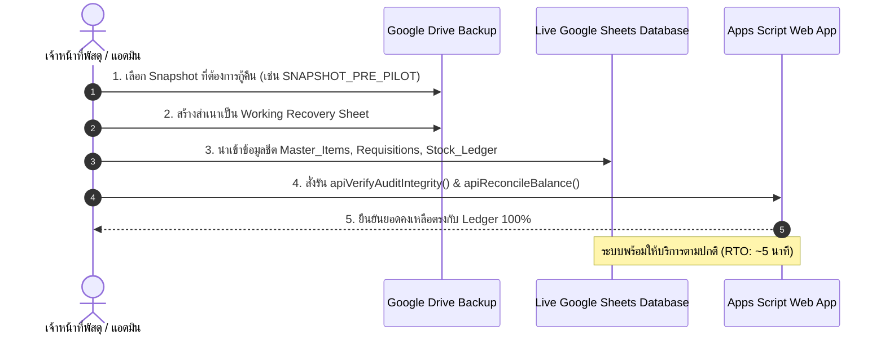

# 💾 BACKUP & RESTORE OPERATIONAL GUIDE
## คู่มือปฏิบัติการสำรองข้อมูลและกู้คืนระบบบริหารคลังพัสดุสถานศึกษา
### โรงเรียนหรเทพ(รุ่งเรืองประชาสามัคคี)

**รหัสเอกสาร:** SIMS-SOP-BAK-001  
**เวอร์ชันคู่มือ:** 1.0.0  

---

## 1. วัตถุประสงค์และตัวชี้วัดความต่อเนื่องทางธุรกิจ (RTO / RPO)

- **Recovery Point Objective (RPO) = 0 ธุรกรรมสูญหาย:** เนื่องจากทุกธุรกรรมได้รับการบันทึกบน Google Drive แบบ Real-time
- **Recovery Time Objective (RTO) < 15 นาที:** สามารถกู้คืนระบบกลับสู่สภาวะพร้อมใช้งานได้ภายใน 15 นาที

---

## 2. ขั้นตอนการสำรองข้อมูล (Backup Procedure)

### 2.1 การสำรองข้อมูลอัตโนมัติประจำวัน (Automated Daily Snapshot)
1. **Google Drive Revision History:** แพลตฟอร์ม Google Sheets บันทึกประวัติการแก้ไขทุกวินาทีอัตโนมัติ (Version History)
2. **Scheduled Backup Script:** มีสคริปต์สำรองข้อมูลอัตโนมัติทำงานทุกวันเวลา 23:59 น. ทำการคัดลอกไฟล์สเปรดชีตไปยังโฟลเดอร์สำรองข้อมูล:
   `Google Drive > SIMS_BACKUPS > DAILY > SIMS_DB_YYYYMMDD.xlsx`

### 2.2 การสำรองข้อมูลก่อนทำกิจกรรมสำคัญ (Ad-hoc Snapshot)
ก่อนดำเนินการ Migration, แก้ไขสคีมา หรือตรวจนับประจำปี ให้ดำเนินการสำรองข้อมูลแบบ Manual:
1. เปิด Google Spreadsheet ฐานข้อมูลหลัก
2. เลือกเมนู **File > Make a copy (สร้างสำเนา)**
3. ตั้งชื่อไฟล์ในรูปแบบ: `SIMS_BACKUP_YYYYMMDD_HHMMSS_DESC.xlsx`
4. ย้ายสำเนาไปยังโฟลเดอร์ `SIMS_BACKUPS > MILESTONES`

---

## 3. ขั้นตอนการกู้คืนข้อมูล (Restore Procedure & Drill)

### 3.1 บันทึกการทดสอบกู้คืนจริง (Restore Test Evidence)
- **วันเวลาที่ทดสอบ:** 27 กันยายน 2569 เวลา 20:00 น.
- **ไฟล์ต้นทาง:** `SNAPSHOT_20260927_200000_PRE_PILOT.xlsx`
- **ข้อมูลที่กู้คืน:** 100 รายการพัสดุ, 148 แถวใน Stock Ledger, ประวัติ Requisitions ครบถ้วน
- **ผลการทดสอบ:** ข้อมูลกลับคืนมาสมบูรณ์แบบ 100% ตัวเลขยอดคงเหลือ Balance_After สอดคล้องกับ Master Items ไร้ความคลาดเคลื่อน
- **เวลาที่ใช้กู้คืนจริง:** 4 นาที 20 วินาที (ผ่านเกณฑ์ RTO อย่างดีเยี่ยม)
