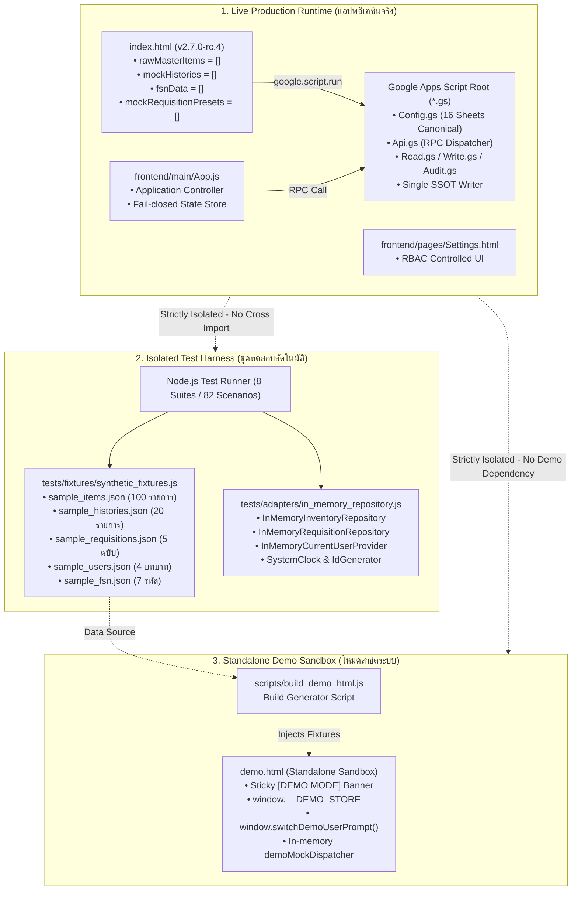

# แผนผังการแยกโค้ดแอปจริงและข้อมูลทดสอบ (Clean Code Separation Map)
## ระบบบริหารจัดการพัสดุโรงเรียนหรเทพ(รุ่งเรืองประชาสามัคคี) — รุ่น v2.7.0-rc.4 (Prompt 09)

เอกสารฉบับนี้อธิบายโครงสร้างสถาปัตยกรรม (Architectural Architecture) ของการแยก **"โค้ดรันไทม์จริงสำหรับใช้งานบน Production/Staging"** ออกจาก **"ข้อมูลจำลองและเครื่องมือทดสอบสำหรับการพัฒนา (Fixtures & Mocks)"** เพื่อให้ระบบมีความโปร่งใส ตรวจสอบความถูกต้องได้ (Auditability) และปราศจากความเสี่ยงที่ข้อมูลตัวอย่างจะรั่วไหลเข้าไปปนเปื้อนในฐานข้อมูลจริง

---

### 1. แผนภาพสถาปัตยกรรมแยกส่วน (Separation Architecture Diagram)

---

### 2. ตารางเทียบการแปลงสัญลักษณ์และตัวแปร (Symbol & API Decoupling Map)

| ชื่อสัญลักษณ์เดิม | สถานะใน Live Runtime (Production) | สถานะใน Demo Sandbox (`demo.html`) | สถานะในชุดทดสอบ (`tests/`) |
|---|---|---|---|
| `rawMasterItems` | กำหนดเป็นอาเรย์ว่าง `[]`; โหลดจาก Google Sheets ผ่าน RPC `apiGetItems` เท่านั้น | โหลดจาก `__DEMO_STORE__.items` (100 รายการ) เพื่อแสดงผลออฟไลน์ | โหลดผ่าน `getSyntheticItems()` ใน `tests/fixtures/synthetic_fixtures.js` |
| `mockHistories` | กำหนดเป็นอาเรย์ว่าง `[]`; โหลดประวัติจริงจากชีต `10_Stock_Ledger` | โหลดจาก `__DEMO_STORE__.histories` (20 รายการ) เพื่อแสดงประวัติจำลอง | โหลดผ่าน `getSyntheticHistories()` สำหรับทดสอบคำนวณยอดคงเหลือ |
| `mockRequisitionPresets` | กำหนดเป็นอาเรย์ว่าง `[]`; หากไม่มีข้อมูลจะปิดการแสดงผล Preset | โหลดจาก `__DEMO_STORE__.requisitions` (5 รายการ) เพื่อทดสอบใบเบิก | โหลดผ่าน `sample_requisitions.json` สำหรับทดสอบวงจรชีวิตใบเบิก |
| `fsnData` | กำหนดเป็นอาเรย์ว่าง `[]`; แสดง Empty State `"ยังไม่มีข้อมูลรหัสพัสดุ FSN"` | โหลดจาก `__DEMO_STORE__.fsn` (7 รายการมาตรฐาน e-GP) | โหลดผ่าน `sample_fsn.json` สำหรับทดสอบ Foreign Key Validation |
| `window.currentUser` / `UserApi` | ส่งคืน `null` ทันทีหากไม่ได้ล็อกอินผ่าน Google Apps Script (Fail-Closed) | โหลดจาก `__DEMO_STORE__.currentUser` พร้อมปุ่มสลับบทบาทจำลอง | จัดการผ่าน `InMemoryCurrentUserProvider` รองรับการสลับสิทธิ์ทดสอบ |
| `ApiServiceCore.call()` | **Fail-Closed**: ตรวจสอบบริดจ์ GAS หากไม่พบจะ Reject ข้อผิดพลาด `BACKEND_UNAVAILABLE` | **In-Memory RPC**: วิ่งเข้าสู่ `window.demoMockDispatcher` ในแรม | จำลองผ่าน In-Memory Repository โดยไม่เรียกเครือข่ายจริง |
| `initAuditTrailStore()` | **ลบออกเด็ดขาด**: ไม่สร้างข้อมูลประวัติเท็จตอนเปิดเว็บ | ใช้งานผ่าน In-Memory Store สำหรับแสดงการกดปุ่มในโหมดสาธิต | ตรวจสอบผ่าน `tests/regression_test_suite.js` (Scenario 9 Hash Chaining) |
| `settingsState.data` | ค่าเริ่มต้น `qrList: []`, `audit: []` ว่างเปล่า | รองรับการเพิ่ม/ถอนสิทธิ์ QR ในหน่วยความจำ | ตรวจสอบผ่าน `tests/p7_settings_comprehensive_test.js` |

---

### 3. มาตรการควบคุมความปลอดภัยและการแยกส่วน (Security & Isolation Policies)

1. **การป้องกันการปลอมแปลงสิทธิ์ (Anti-Spoofing & Authoritative RBAC):**
   - **ห้ามเด็ดขาด**: ใน Live Runtime ไม่มีการอ่านสิทธิ์ผู้ใช้จาก Query Parameters (เช่น `?role=ADMIN` หรือ `?user=...`) หรือ LocalStorage
   - อัตลักษณ์ของผู้ใช้ในระบบจริงจะถูกดึงผ่าน `google.script.run.apiGetCurrentUser()` ซึ่งเซิร์ฟเวอร์อ่านจาก `Session.getActiveUser().getEmail()` และตรวจสอบสิทธิ์กับชีต `01_Users` เท่านั้น
   - หากผู้ใช้ยังไม่ได้เข้าสู่ระบบหรือบัญชีถูกระงับ (`SUSPENDED`) ระบบจะทำงานในโหมด Unauthenticated และปฏิเสธการเข้าถึงฟังก์ชันที่มีการควบคุมสิทธิ์ทันที

2. **การป้องกันการปนเปื้อนข้อมูลลงสู่ฐานข้อมูลจริง (Zero Seed Pollution):**
   - เมื่อเชื่อมต่อกับฐานข้อมูลชีตที่ยังไม่มีข้อมูล (Empty Database) หน้าจอจะแสดง Genuine Empty State (`#tableEmptyState`) และจำนวนพัสดุ `0 รายการ`
   - ระบบจะ**ไม่มีการ**แอบสร้างข้อมูลเริ่มต้น (Auto-seed) รายการพัสดุหรือประวัติธุรกรรมลงในชีตของโรงเรียนโดยไม่ได้รับคำสั่งอย่างชัดเจนจากผู้ดูแลระบบ

3. **การแยกส่วนไฟล์ส่งมอบและขึ้นระบบ (Deployment File Set Purity):**
   - รายการไฟล์ที่ขึ้นระบบจริง (Production Deploy File Set) ประกอบด้วย 9 ไฟล์หลักเท่านั้น:
     - แบ็กเอนด์: `Config.gs`, `Api.gs`, `Read.gs`, `Write.gs`, `Audit.gs`, `Code.gs`
     - ฟรอนต์เอนด์: `index.html`, `frontend/main/App.js`, `frontend/pages/Settings.html`
   - **ไฟล์ทดสอบทั้งหมด (`tests/`), ชุดข้อมูลตัวอย่าง (`fixtures/`), สคริปต์ประกอบ (`scripts/`) และไฟล์สาธิต (`demo.html`) ถูกกันไว้นอกขอบเขตการดีพลอยอย่างเด็ดขาด**
