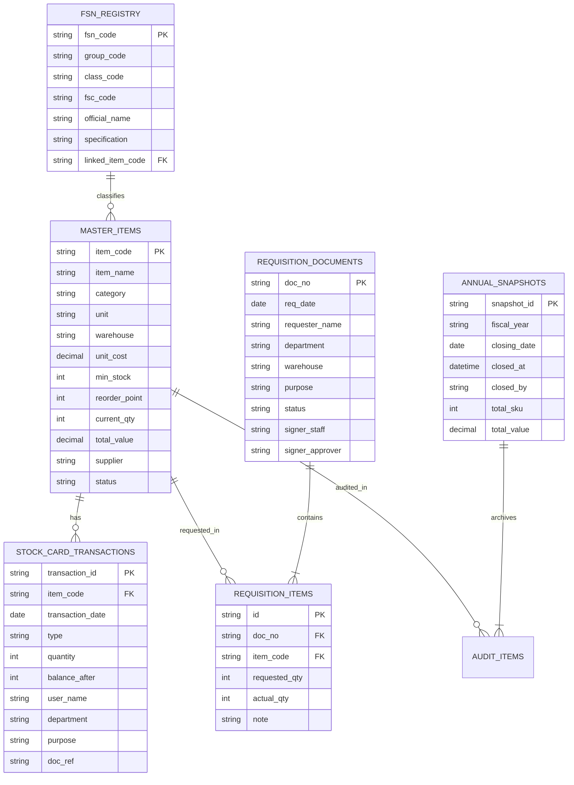

# HRT School Inventory Management System
## CURRENT DATA STRUCTURE & STATE ARCHITECTURE
**Document ID:** `DOC-BASELINE-2026-004`  
**Classification:** Baseline Freeze for Pilot Backend Integration  
**Role:** Senior Software Architect & Configuration Manager  
**Date of Freeze:** 2026-09-26  
**Status:** **FROZEN (SYSTEM LOCKED)**  

---

## 1. Overview of Data Architecture

ระบบ HRT Inventory System ทำงานในรูปแบบ Client-Side In-Memory State โดยใช้ตัวแปร JavaScript Global Objects & Arrays เป็น Single Source of Truth โครงสร้างข้อมูลทั้งหมดถูกออกแบบให้สอดคล้องกับระเบียบพัสดุภาครัฐ พ.ศ. ๒๕๖๐ และแบบฟอร์มเอกสารทางราชการ แบบ พ.ด. ๑–๗

---

## 2. Entity Schemas & Models

### 2.1 Master Item Schema (`allData` / `rawMasterItems` / `Master_Items.csv`)

โมเดลข้อมูลพัสดุหลัก 100 รายการ:

```typescript
interface MasterItem {
  id?: number;                        // รหัสลำดับภายในระบบ
  code: string;                       // รหัสพัสดุภายใน (เช่น "OFF-001", "IT-006", "SPT-001")
  name: string;                       // ชื่อทางการของพัสดุ (เช่น "กระดาษถ่ายเอกสาร A4 70 แกรม Double A")
  category: string;                   // หมวดหมู่วัสดุราชการ 8 หมวด (เช่น "วัสดุสำนักงาน", "วัสดุคอมพิวเตอร์")
  unit: string;                       // หน่วยนับพัสดุ (เช่น "รีม", "ด้าม", "เครื่อง", "กล่อง")
  warehouse: string;                  // สถานที่จัดเก็บ/คลังพัสดุ (เช่น "ห้องเก็บพัสดุ", "ห้องเซิร์ฟเวอร์ อาคาร 2")
  unit_cost: number;                  // ราคามาตรฐานต่อหน่วย (บาท) (เช่น 115.00)
  min: number;                        // ปริมาณสำรองขั้นต่ำ (Minimum Stock Level)
  rop: number;                        // จุดสั่งซื้อซ้ำ (Reorder Point)
  stock: number;                      // ยอดคงเหลือจริงในคลัง (Current Balance)
  total_val: number;                  // มูลค่ารวมคงเหลือ (บาท) = stock * unit_cost
  supplier?: string;                  // ชื่อผู้จัดจำหน่าย/คู่สัญญา (เช่น "บจก. ออฟฟิศเมท")
  status: 'normal' | 'low' | 'critical' | 'out_of_stock'; // สถานะความพร้อมสต็อก
  abc_class?: 'A' | 'B' | 'C';        // การจัดกลุ่มความสำคัญด้านต้นทุน Pareto 70-20-10
  history?: StockCardEntry[];         // ประวัติธุรกรรมการเบิก-รับเข้า (Stock Card Ledger)
}
```

---

### 2.2 Transaction & Stock Card Schema (`item.history` / `Transactions.csv`)

บันทึกประวัติการเคลื่อนไหวรายบรรทัดสำหรับบัญชีคุมพัสดุ (แบบ พ.ด. ๔):

```typescript
interface StockCardEntry {
  id?: string;                        // รหัสธุรกรรม (เช่น "TX-2567-001")
  date: string;                       // วันที่ทำรายการ รูปแบบ YYYY-MM-DD หรือ DD/MM/YYYY
  type: 'in' | 'out';                 // ประเภท: 'in' (รับเข้าสต็อก) หรือ 'out' (เบิกใช้งาน)
  transaction_type?: string;          // ป้ายกำกับภาษาไทย ("รับเข้าสต็อก" หรือ "เบิกใช้งาน")
  qty: number;                        // จำนวนที่ทำรายการ
  in_qty?: number;                    // จำนวนรับเข้า (ถ้ามี)
  out_qty?: number;                   // จำนวนจ่ายออก (ถ้ามี)
  balance?: number;                   // ยอดคงเหลือสะสมหลังทำรายการเสร็จสิ้น
  teacher?: string;                   // ชื่อผู้เบิก หรือ เจ้าหน้าที่ผู้ตรวจรับ
  dept?: string;                      // กลุ่มสาระการเรียนรู้ หรือ ฝ่ายงาน
  purpose?: string;                   // วัตถุประสงค์ในการขอเบิกใช้งาน
  doc_ref?: string;                   // เลขที่เอกสารอ้างอิง (เช่น "REQ-2567/001", "PO-2567/045")
  status?: string;                    // สถานะของธุรกรรม
}
```

---

### 2.3 Requisition Slip Schema (`mockRequisitionPresets` / `multiReqRows`)

โมเดลข้อมูลใบขอเบิกพัสดุ (แบบ พ.ด. ๑):

```typescript
interface RequisitionDoc {
  id: string;                         // เลขที่ใบเบิก (เช่น "REQ-2567/001")
  date: string;                       // วันที่ขอเบิกภาษาไทย (เช่น "15 พฤษภาคม 2567")
  teacher: string;                    // ชื่อ-สกุล ผู้ขอเบิก (ครู/บุคลากร)
  dept: string;                       // กลุ่มสาระการเรียนรู้ / งานบริหาร
  warehouse: string;                  // คลังพัสดุที่ขอเบิก
  purpose: string;                    // วัตถุประสงค์ในการนำไปใช้งาน
  signerStaff: string;                // ชื่อเจ้าหน้าที่พัสดุผู้จ่าย (เช่น "นายอนันต์ มั่นคง")
  signerApprover: string;             // ชื่อผู้มีอำนาจอนุมัติ (เช่น "นายสมศักดิ์ รุ่งเรือง")
  status: 'pending_approval' | 'pending_issue' | 'completed' | 'partial' | 'rejected';
  items: RequisitionItem[];           // รายการพัสดุที่ขอเบิกในใบนี้
}

interface RequisitionItem {
  code: string;                       // รหัสพัสดุ
  name: string;                       // ชื่อพัสดุ
  reqQty: number;                     // จำนวนที่ขอเบิก
  actualQty: number;                  // จำนวนที่จ่ายจริง (หลังการตรวจจ่าย)
  unit: string;                       // หน่วยนับ
  warehouse: string;                  // คลังจัดเก็บ
  note?: string;                      // หมายเหตุการตัดจ่าย
}
```

---

### 2.4 FSN Registry Schema (`fsnData`)

โมเดลรหัสพัสดุมาตรฐานภาครัฐตามระบบ Federal Supply Classification:

```typescript
interface FsnRecord {
  id: number;                         // ดัชนีบันทึก
  fsn_code: string;                   // รหัส FSN 13 หลัก (เช่น "7510-00-582-4112")
  group: string;                      // รหัสกลุ่ม 2 หลัก (เช่น "75")
  group_name: string;                 // ชื่อกลุ่ม (เช่น "75 - เครื่องเขียนและอุปกรณ์สำนักงาน")
  class_code: string;                 // รหัสชั้น 2 หลัก (เช่น "10")
  fsc: string;                        // รหัส FSC 4 หลัก = group + class_code (เช่น "7510")
  name: string;                       // ชื่อมาตรฐานตามประกาศกรมบัญชีกลาง
  spec: string;                       // คุณลักษณะเฉพาะสังเขป (เช่น มอก., วอส., เกรดสินค้า)
  linked_code: string;                // รหัสพัสดุภายในโรงเรียนที่จับคู่ (เช่น "OFF-002")
  linked_name: string;                // ชื่อพัสดุภายในโรงเรียน
  pdf_file: string;                   // ชื่อไฟล์เอกสาร TOR/คุณลักษณะเฉพาะ
  pdf_size: string;                   // ขนาดไฟล์เอกสาร (เช่น "1.8 MB")
  registered_date: string;            // วันที่ขึ้นทะเบียนในระบบ (YYYY-MM-DD)
  status: 'active' | 'inactive';      // สถานะการใช้งาน
}
```

---

### 2.5 Year-End Audit Item Schema (`auditItemsData`)

โมเดลข้อมูลการตรวจนับพัสดุ ณ วันที่ 30 กันยายน (แบบ พ.ด. ๗):

```typescript
interface AuditItemRecord {
  code: string;                       // รหัสพัสดุภายใน
  name: string;                       // ชื่อพัสดุ
  fsnCode: string;                    // รหัสมาตรฐาน FSN 13 หลัก
  category: string;                   // หมวดหมู่วัสดุราชการ
  warehouse: string;                  // สถานที่จัดเก็บ
  bookStock: number;                  // ยอดคงเหลือตามบัญชี ณ 30 ก.ย.
  physicalCount: number;              // ยอดตรวจนับจริงทางกายภาพ
  variance: number;                   // ผลต่าง = physicalCount - bookStock
  unit: string;                       // หน่วยนับ
  unit_cost: number;                  // ราคาต่อหน่วย
  endingVal: number;                  // มูลค่าคงเหลือยกไป = physicalCount * unit_cost
  condition: 'normal' | 'repair' | 'disposed'; // สภาพพัสดุ
  note?: string;                      // หมายเหตุการตรวจสอบ
}
```

---

### 2.6 Fiscal Year Snapshot Schema (`fiscalYearSnapshots`)

โมเดลประวัติการปิดบัญชีประจำปีงบประมาณ:

```typescript
interface FiscalYearSnapshot {
  fiscalYear: string;                 // ปีงบประมาณที่ปิด (เช่น "2569")
  closingDate: string;                // วันที่ปิดบัญชี (เช่น "30 กันยายน 2569")
  timestamp: number;                  // เวลาปิดบัญชีในระบบ (Unix Epoch)
  closedBy: string;                   // ชื่อเจ้าหน้าที่ผู้สั่งปิดบัญชี
  totalSku: number;                   // จำนวน SKU ทั้งสิ้น (100 รายการ)
  totalQty: number;                   // ปริมาณพัสดุคงเหลือรวม
  totalValue: number;                 // มูลค่าทรัพย์สินคงเหลือยกไปรวม (บาท)
  items: AuditItemRecord[];           // Snapshot ข้อมูลพัสดุทั้ง 100 รายการ ณ ขณะปิด
}
```

---

## 3. Global Application State Variables

ตารางแสดงตัวแปร Global ทั้งหมดในโค้ด JavaScript ของ `index.html`:

| ชื่อตัวแปร | ชนิดข้อมูล | ค่าเริ่มต้น | ขอบเขตหน้าที่ (Scope & Purpose) | จุดที่มีการเปลี่ยนแปลง (Mutation Points) |
|---|---|---|---|---|
| `allData` | `Array<MasterItem>` | 100 รายการ | **Single Source of Truth** ข้อมูลพัสดุหลักของทั้งระบบ | `submitRestock()`, `submitRequisition()`, `confirmImportData()` |
| `rawMasterItems` | `Array<Object>` | 100 รายการ | ชุดข้อมูลคงที่ต้นแบบ (Read-only Seed) | ไม่มีการแก้ไข (Immutable Seed) |
| `mockRequisitionPresets` | `Array<RequisitionDoc>` | 5 รายการ | ทะเบียนคำขอเบิกพัสดุ | `submitMultiItemRequisition()`, `executeIssueConfirmation()` |
| `fsnData` | `Array<FsnRecord>` | 7 รายการ | ทะเบียนรหัสพัสดุภาครัฐ FSN | `saveNewFsnItem()` |
| `auditItemsData` | `Array<AuditItemRecord>` | `[]` (100 รายการเมื่อ init) | ข้อมูลตรวจนับพัสดุสิ้นปีงบประมาณ | `initYearEndAudit()`, `updatePhysicalCount()`, `updateItemCondition()` |
| `fiscalYearSnapshots` | `Record<string, FiscalYearSnapshot>` | `{}` | ประวัติการปิดบัญชีย้อนหลังรายปี | `confirmCloseFiscalYear()` |
| `currentFiscalYear` | `string` | `'2569'` | ปีงบประมาณที่กำลังทำงานอยู่ | `onFiscalYearChange()`, `confirmCloseFiscalYear()` |
| `currentUserRole` | `'officer' \| 'teacher'` | `'officer'` | สิทธิ์ผู้ใช้งานตามระบบ RBAC | `switchUserRole()`, `simulateGoogleLogin()` |
| `filteredData` | `Array<MasterItem>` | `[...allData]` | ข้อมูลที่ผ่านการ Filter ในหน้า Inventory | `applyFilters()`, `setQuickStatusFilter()` |
| `currentMainView` | `string` | `'inventory'` | รหัสมุมมองหน้าจอที่กำลังแสดงผล | `switchMainView()` |
| `currentPage` | `number` | `1` | หน้าปัจจุบันของตารางพัสดุ | `changePage()`, `handleSort()`, `applyFilters()` |
| `itemsPerPage` | `number` | `20` | จำนวนรายการที่แสดงต่อหน้า | Event `itemsPerPage.change` |
| `selectedItem` | `MasterItem \| null` | `null` | พัสดุที่กำลังเปิดดูใน Drawer หรือ Modal | `openDrawer()`, `openRequisitionModal()` |
| `chartInstance` | `Chart \| null` | `null` | Instance ของ Chart.js บน Dashboard | `renderChart()`, `switchChart()` |
| `currentChartType` | `string` | `'trend'` | มิติกราฟที่กำลังแสดงผล (8 มิติ) | `switchChart(type)` |
| `sortColumn` | `string` | `'code'` | คอลัมน์ที่ใช้เรียงลำดับตาราง | `handleSort(col)` |
| `sortAsc` | `boolean` | `true` | ทิศทางการเรียงลำดับ (จริง=น้อยไปมาก) | `handleSort(col)` |
| `multiReqRows` | `Array<{code, reqQty}>` | `[]` | รายการชั่วคราวในตะกร้าขอเบิก | `addMultiReqRow()`, `removeMultiReqRow()`, `onMultiReqItemChange()` |
| `parsedImportRows` | `Array<Object>` | `[]` | แถวข้อมูลที่แปลงจากไฟล์ CSV นำเข้า | `processCsvFile()`, `removeSelectedCsv()` |

---

## 4. In-Memory Caching & Performance State

เพื่อป้องกันการ Re-render ซ้ำซ้อนและ Layout Reflow ระบบมีตัวแปรควบคุม Performance:

| ตัวแปร Cache | ชนิดข้อมูล | หน้าที่การทำงาน |
|---|---|---|
| `_masterDataCache` | `Array \| null` | แคชข้อมูล Master สำหรับการเรียกใช้งานบ่อยครั้ง |
| `_cachedDashboardData` | `Array \| null` | แคชผลลัพธ์ของข้อมูลที่ผ่านตัวกรองใน Dashboard |
| `_lastFilterSignature` | `string` | ลายเซ็น Signature ของเงื่อนไขตัวกรอง ป้องกันการคำนวณซ้ำ |
| `_lastQueueSignature` | `string` | ลายเซ็นของ Action Center Queue |
| `_lastInsightsSignature` | `string` | ลายเซ็นของ Management Insights ข้ามการวาดการ์ดเดิมหากข้อมูลไม่เปลี่ยน |
| `_isChartRendering` | `boolean` | Flag ป้องกัน Race Condition ขณะ Chart.js กำลังวาด |
| `_dashUpdatePending` | `boolean` | Flag คิวงาน Render ของ Dashboard |
| `_lastRefreshTime` | `number` | Timestamp ของการกดรีเฟรชล่าสุด (ใช้หน่วงเวลา 2 วินาที) |
| `_lastDataFetchTime` | `number` | Timestamp การอัปเดตข้อมูลล่าสุด |
| `_isDataLoading` | `boolean` | ควบคุม Skeleton Loader ขณะกำลังประมวลผลข้อมูล |

---

## 5. Pilot Backend Database Mapping Blueprint

พิมพ์เขียวการแปลง In-Memory State ไปเป็นตารางฐานข้อมูลจริงในเฟส Pilot Backend:



---

**ลงนามรับรองความถูกต้องของ Data Structure:**  
*Senior Software Architect & Configuration Management Team*  
*วันที่ 26 กันยายน 2569*
