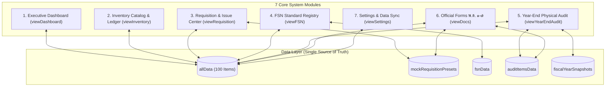

# HRT School Inventory Management System
## CURRENT SYSTEM BASELINE SPECIFICATION
**Document ID:** `DOC-BASELINE-2026-001`  
**Classification:** Baseline Freeze for Pilot Backend Integration  
**Role:** Senior Software Architect & Configuration Manager  
**Date of Freeze:** 2026-09-26  
**Status:** **FROZEN (SYSTEM LOCKED)**  

---

## 1. Executive Summary & Freeze Declaration

ระบบบริหารคลังพัสดุ โรงเรียนหรเทพ(รุ่งเรืองประชาสามัคคี) สังกัดองค์การบริหารส่วนจังหวัดสระบุรี (HRT School Inventory Management System - Version 2026 / 2569) ได้รับการตรวจสอบและบันทึกสถานะโครงสร้างระบบ (Baseline Freeze) อย่างเป็นทางการ

> [!IMPORTANT]
> **FREEZE NOTICE:**  
> ตั้งแต่วันที่ 26 กันยายน 2569 เป็นต้นไป ระบบส่วนหน้า (Frontend UI/UX, DOM Structure, Event Handling, Client Calculation Logic) ถูก **"แช่แข็ง (FROZEN)"** ห้ามมิให้มีการ Refactor, เพิ่ม Feature ใหม่, แก้ไข UI, หรือเปลี่ยนแปลง Business Logic ใด ๆ โดยเด็ดขาด เพื่อใช้เป็นฐานอ้างอิงความถูกต้อง (Ground Truth) ในการพัฒนาและเชื่อมต่อระบบฐานข้อมูล Pilot Backend Integration

---

## 2. System Identification & Environment

| Parameter | Current Specification |
|---|---|
| **System Name** | HRT School Inventory Management System (ระบบบริหารคลังพัสดุ โรงเรียนหรเทพ) |
| **System Version** | `2026.1-FREEZE` |
| **Architecture** | Single-Page Application (SPA) Client-Side In-Memory Engine |
| **Primary Codebase** | `index.html` (12,318 lines, ~897 KB, Single Executable File) |
| **Active Fiscal Year** | พ.ศ. 2569 (1 ตุลาคม 2568 – 30 กันยายน 2569) |
| **Target Pilot Branch** | `pilot-backend-integration` |
| **Regulatory Standards** | ระเบียบกระทรวงการคลังว่าด้วยการจัดซื้อจัดจ้างฯ พ.ศ. ๒๕๖๐ และระบบรหัสพัสดุภาครัฐ (FSN) กรมบัญชีกลาง |

---

## 3. Physical File Structure & Inventory

โครงสร้างไฟล์ทางกายภาพทั้งหมดของโครงการ ณ จุด Freeze:

```
[Project Root]
├── index.html                                   # Single-file SPA รวม UI, Logic, CSS, Chart, Modals (12,318 บรรทัด)
├── Master_Items.csv                             # ทะเบียนพัสดุหลัก 100 รายการ จำแนกตาม 8 หมวดหมู่วัสดุราชการ (102 บรรทัด)
├── Transactions.csv                             # บันทึกประวัติธุรกรรมเบิก-รับเข้าจำลอง 20 ธุรกรรม (22 บรรทัด)
├── School_Inventory_DB_2567_AppsScript.js      # สคริปต์สร้าง Google Sheets DB อัตโนมัติบน Google Drive (259 บรรทัด)
├── generate_inventory.py                        # Python generator สำหรับสังเคราะห์ชุดข้อมูลพัสดุ (280 บรรทัด)
├── README.md                                    # คู่มือระบบและเอกสารมาตรฐานการปฏิบัติงานฉบับสมบูรณ์ (321 บรรทัด)
├── Implementation_Brief_Google_Antigravity.md  # เอกสารข้อกำหนดด้าน Data Analytics & Insights (253 บรรทัด)
└── docs/                                        # โฟลเดอร์จัดเก็บเอกสารสถาปัตยกรรมระบบ Baseline
    ├── CURRENT_SYSTEM_BASELINE.md               # [เอกสารนี้] สรุป Baseline ภาพรวมและการ Freeze
    ├── CURRENT_FEATURE_MATRIX.md                # บัญชี Feature แยก Real / Mock / Simulation
    ├── CURRENT_WORKFLOW.md                      # แผนผังและขั้นตอนการทำงาน 6 เวิร์กโฟลว์หลัก
    └── CURRENT_DATA_STRUCTURE.md                # รายละเอียด Schema, Global State และ In-Memory Caches
```

### รายละเอียดและหน้าที่ของไฟล์:
1. **`index.html`**:
   - เป็น Core Application แบบ Single-File ประกอบด้วย HTML5 Semantic, Tailwind CSS (CDN), Phosphor Icons (CDN), Chart.js (CDN), และ Vanilla JavaScript ทั้งหมด 12,318 บรรทัด
   - ควบคุมหน้าจอ 7 มุมมองหลัก (`viewDashboard`, `viewInventory`, `viewRequisition`, `viewYearEndAudit`, `viewFSN`, `viewDocs`, `viewSettings`)
   - มีชุดคำสั่งจัดการ Print Style `@media print` รองรับแบบฟอร์ม พ.ด. ๑–๗ ครบถ้วน
2. **`Master_Items.csv`**:
   - ฐานข้อมูล CSV ออฟไลน์ 100 รายการ ครอบคลุม 8 หมวดหมู่วัสดุราชการ (กค 0406.4/ว 96)
   - ประกอบด้วยคอลัมน์: `item_code, item_name, category, unit, location, unit_price, min_stock, current_qty, total_value`
3. **`Transactions.csv`**:
   - ฐานข้อมูล CSV บันทึกรายการเคลื่อนไหว 20 รายการ
   - ประกอบด้วยคอลัมน์: `transaction_id, date, item_code, transaction_type, quantity, user_name`
4. **`School_Inventory_DB_2567_AppsScript.js`**:
   - Google Apps Script สำหรับสร้าง Google Spreadsheet ฐานข้อมูลชื่อ `HRT_Inventory_DB_2567` พร้อมฟอร์แมตหัวตาราง กึ่งกลางตัวเลข และสี Theme อัตโนมัติ
5. **`generate_inventory.py`**:
   - สคริปต์ภาษา Python สำหรับสร้างชุดข้อมูล Mock ที่มีความสมจริงทางสถิติของโรงเรียนไทย

---

## 4. Technology Stack & Critical Dependencies

### 4.1 Frontend & Rendering Engine
- **HTML5 Semantic Standard** (พร้อมแท็ก ARIA Accessibility ครบถ้วน)
- **Tailwind CSS v3.x** (ผ่าน CDN `https://cdn.tailwindcss.com` พร้อม custom palette: `anchor: '#1e293b'` และ `brand` 50–900)
- **Phosphor Icons Web** (ผ่าน CDN `https://unpkg.com/@phosphor-icons/web`)
- **Chart.js v4.4.1** (ผ่าน CDN `https://cdn.jsdelivr.net/npm/chart.js`)
- **Typography Scale**: Google Fonts `Noto Sans Thai` (ภาษาไทย) และ `Inter` (ตัวเลขอังกฤษและรหัสทางบัญชี) ผ่าน CSS custom properties แบบ `clamp()`

### 4.2 Scripting & Application Architecture
- **Vanilla JavaScript (ES6+)**: ไม่พึ่งพา Framework (No React, No Vue, No Angular), ไม่พึ่งพา Build Tool (No Vite, No Webpack), รันบนเบราว์เซอร์ได้ทันที
- **In-Memory Store Pattern**: เก็บ State ของระบบไว้ในตัวแปร Global (`allData`, `mockRequisitionPresets`, `fsnData`, `auditItemsData`, `fiscalYearSnapshots`)
- **Performance Optimization Layer**:
  - `debounce(fn, wait)` สำหรับ Search Box (250ms) และ Quick Filter (300ms)
  - `setDomText(el, val)` ตรวจสอบค่าก่อนแก้ไข DOM เพื่อป้องกัน Layout Reflow
  - Dirty-checking signature (`_lastFilterSignature`, `_lastInsightsSignature`, `_lastQueueSignature`) เพื่อข้ามการ re-render ซ้ำซ้อน
  - Chart Instance lifecycle management: ตรวจสอบและ `destroy()` instance เดิมก่อน `new Chart()` เสมอ

---

## 5. Scope & Module Boundary

ระบบแบ่งออกเป็น 7 โมดูลหลักที่เชื่อมโยงถึงกันอย่างสมบูรณ์:



---

## 6. Git Branching & Configuration Management Policy

### 6.1 สถานะการจัดการ Version Control (Git)
เนื่องจากสภาพแวดล้อมปัจจุบันมีการจำกัดสิทธิ์การสั่ง Terminal Command อัตโนมัติ ให้ดำเนินการสร้าง Branch เพื่อการเชื่อมต่อ Backend ด้วยตนเองตามขั้นตอน:

```bash
# 1. ตรวจสอบสถานะการเปลี่ยนแปลงใน Workspace
git status

# 2. บันทึก Commit สถานะ Freeze ระบบปัจจุบัน
git add .
git commit -m "chore(freeze): lock current system baseline 2026.1 before pilot backend integration"

# 3. สร้างและสลับไปยัง Branch ใหม่สำหรับการพัฒนา Pilot Backend
git checkout -b pilot-backend-integration

# 4. ยืนยันว่ากำลังทำงานอยู่บน branch ใหม่
git branch
```

### 6.2 กฎเกณฑ์ความปลอดภัยระหว่าง Pilot Integration
1. **ห้ามแก้ไขไฟล์ `index.html` ในส่วนของ Visual Layout หรือ HTML ID เดิม** เพราะจะทำให้ Selector และ DOM Binding ล้มเหลว
2. **การเชื่อมต่อ Backend ต้องทำในรูปแบบ Service Adapter Layer** โดยแทรกฟังก์ชัน Fetch API เข้ามาแทนที่ In-Memory Array เดิมอย่างปลอดภัย
3. **ต้องมี Fallback Mechanism** เสมอ หาก Backend ไม่พร้อมทำงาน ให้ระบบสามารถ Fallback กลับมาอ่านข้อมูลจาก In-Memory / CSV เดิมได้ทันที

---

**ลงนามรับรองความถูกต้องของระบบ Baseline:**  
*Senior Software Architect & Configuration Management Team*  
*วันที่ 26 กันยายน 2569*
