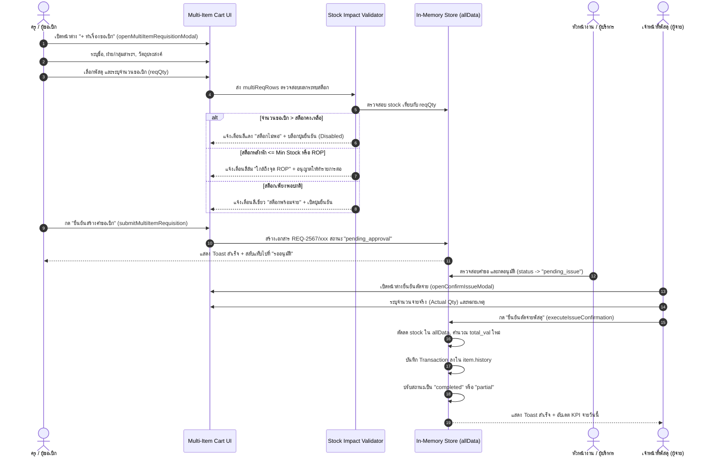
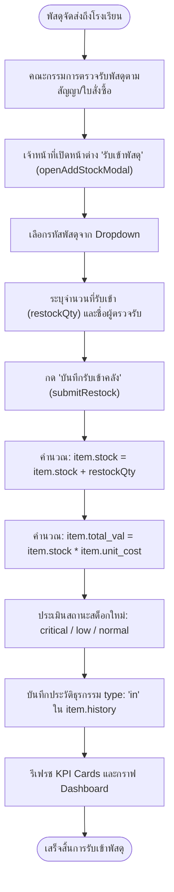
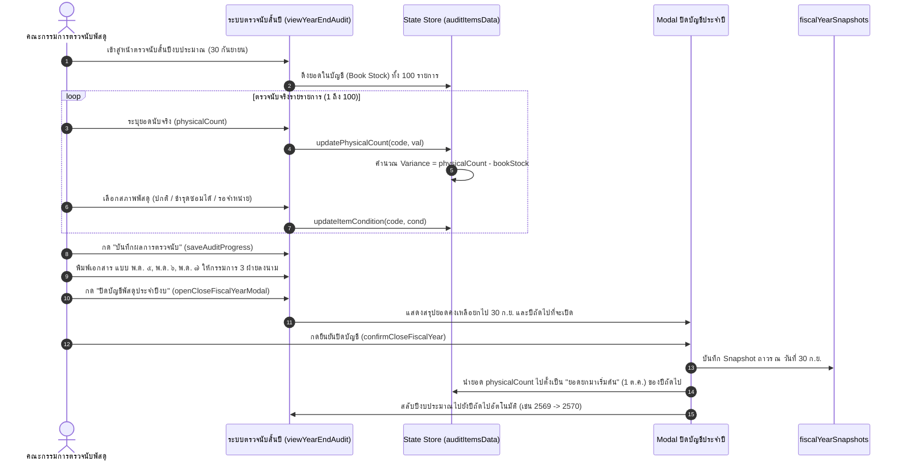

# HRT School Inventory Management System
## CURRENT SYSTEM WORKFLOW & BUSINESS RULES SPECIFICATION
**Document ID:** `DOC-BASELINE-2026-003`  
**Classification:** Baseline Freeze for Pilot Backend Integration  
**Role:** Senior Software Architect & Configuration Manager  
**Date of Freeze:** 2026-09-26  
**Status:** **FROZEN (SYSTEM LOCKED)**  

---

## 1. Overview & Operational Principles

เอกสารฉบับนี้บันทึกกระบวนการทำงานจริง (Actual Workflows) และกฎทางธุรกิจ (Business Rules) ที่สกัดออกมาจากโค้ดของระบบ `index.html` เพื่อใช้เป็นพิมพ์เขียวสำหรับทีมพัฒนา Backend ในการออกแบบ API Endpoints, Database Constraints, และ Background Jobs

---

## 2. End-to-End Operational Workflows

### 2.1 Workflow 1: การขอเบิกและตัดจ่ายพัสดุสถานศึกษา (แบบ พ.ด. ๑)

กระบวนการขอเบิกพัสดุหลายรายการ การตรวจสอบสต็อก และการตัดจ่ายจริงตามระเบียบพัสดุภาครัฐ:

---

### 2.2 Workflow 2: การรับเข้าพัสดุและการสั่งซื้อเพิ่ม (แบบ พ.ด. ๒)

กระบวนการนำเข้าพัสดุจากการจัดซื้อหรือรับบริจาคเข้าสู่คลัง:

---

### 2.3 Workflow 3: การตรวจนับพัสดุสิ้นปีงบประมาณและการปิดบัญชีประจำปี (แบบ พ.ด. ๕, ๖, ๗)

กระบวนการตรวจสอบพัสดุประจำปีตามระเบียบกระทรวงการคลัง พ.ศ. ๒๕๖๐ ข้อ ๒๑๓:

---

### 2.4 Workflow 4: การขึ้นทะเบียนและจับคู่รหัสพัสดุมาตรฐานภาครัฐ (FSN Standard)

1. **การตรวจสอบรหัส 13 หลัก**:
   - ระบบจัดกลุ่มตาม Federal Supply Classification: `[Group 2 หลัก][Class 2 หลัก]-[Country 2 หลัก]-[NIIN 7 หลัก]`
   - รหัสประเทศไทยใช้รหัสประเทศ `00`
2. **การจับคู่กับพัสดุภายใน (Catalog Mapping)**:
   - ผู้ใช้เปิดหน้าต่าง `openAddFsnModal()`
   - เลือกรหัสกลุ่ม (Group เช่น `75 - เครื่องเขียนและอุปกรณ์สำนักงาน`)
   - เลือกรหัสชั้น (Class เช่น `10 - กระดาษพิมพ์และเขียน`)
   - ระบบระบุรหัส FSC 4 หลักอัตโนมัติ (`7510`)
   - ทำการจับคู่กับรหัสพัสดุภายในโรงเรียน (`linked_code` เช่น `OFF-002`)
   - บันทึกเข้าสู่ `fsnData` และเปิดให้ดาวน์โหลดสเปก TOR (Simulation)

---

### 2.5 Workflow 5: การออกเอกสารและสั่งพิมพ์แบบฟอร์มราชการ (แบบ พ.ด. ๑–๗)

1. ผู้ใช้สลับไปยังหน้าจอเอกสาร `switchMainView('docs')` และเลือกแท็บเอกสาร
2. ระบบทำการ Hydrate ข้อมูลจาก In-Memory Store ลงใน DOM ของแบบฟอร์ม:
   - **พ.ด. ๑**: ดึงข้อมูลใบเบิกจาก `mockRequisitionPresets` พร้อมชื่อผู้เบิก วันที่ และรายการ
   - **พ.ด. ๔**: ดึงข้อมูล Stock Card ของพัสดุที่เลือก พร้อมธุรกรรมยกมา รับ จ่าย คงเหลือ
   - **พ.ด. ๕**: ดึงยอดรวมแยกตาม 8 หมวดหมู่วัสดุราชการ ยอดเปิด ยอดรับ ยอดจ่าย ยอดยกไป
   - **พ.ด. ๗**: ดึงรายการตรวจนับทั้ง 100 รายการ แบ่งเป็น 4 หน้า หน้าละ 25 รายการ พร้อม Running Header, Running Footer, และบล็อก 3 ลายเซ็น
3. เมื่อคลิกปุ่มพิมพ์ ระบบเรียก `window.print()` โดยมี CSS `@media print` ควบคุมขนาดกระดาษ A4 ตัดส่วนเมนู แถบข้าง และปุ่มออกทั้งหมด

---

### 2.6 Workflow 6: การสำรองข้อมูลและการนำเข้า (Data Backup & CSV Migration)

1. **การส่งออก (Export CSV)**:
   - ฟังก์ชัน `exportToCSV()` ดึงข้อมูลจาก `allData` 100 รายการ
   - เข้ารหัสด้วย `\uFEFF` (UTF-8 with BOM) ป้องกันภาษาไทยเพี้ยนใน MS Excel
   - ดาวน์โหลดไฟล์ชื่อ `Master_Items_HRT_YYYY-MM-DD.csv`
2. **การนำเข้า (Import CSV)**:
   - ผู้ใช้เปิด Modal `openImportModal()` และวางไฟล์ CSV
   - ฟังก์ชัน `parseCsvLine(line)` แยกคอลัมน์โดยรองรับ Comma ภายในเครื่องหมายคำพูด (Escaped Quotes)
   - แสดงตารางตัวอย่าง 5 แถวแรกเพื่อตรวจสอบความถูกต้อง
   - ผู้ใช้เลือกรูปแบบการนำเข้า:
     - **Overwrite (แทนที่ทั้งหมด)**: ล้าง `allData` เดิมแล้วใส่ชุดข้อมูลใหม่
     - **Merge (อัปเดตและเพิ่ม)**: ค้นหาตาม `item_code` หากซ้ำให้อัปเดตข้อมูล หากไม่ซ้ำให้เพิ่มรายการใหม่
   - กดปุ่ม "ยืนยันนำเข้าข้อมูลสู่ระบบ" -> คำนวณสถานะและรีเฟรชหน้าจอทั้งหมด

---

## 3. Business Rules Extracted from Source Code

| รหัสกฎ | ชื่อกฎธุรกิจ | นิยามและเงื่อนไขตาม Source Code | ผลลัพธ์ในระบบ |
|---|---|---|---|
| **BR-01** | **Stock Health Status Thresholds** | - `stock === 0` -> `out_of_stock` - `stock <= min` -> `critical` - `stock > min && stock <= rop` -> `low` - `stock > rop` -> `normal` | แสดงป้ายกำกับ WCAG AA สีเขียว/เหลือง/แดง และจัดคิว Action Center |
| **BR-02** | **Total Valuation Formula** | `total_val = stock * unit_cost` (ตรวจสอบ `!isNaN` และ `isFinite`) | ป้องกันข้อผิดพลาด `NaN` ใน KPI Cards และรายงานทางบัญชี |
| **BR-03** | **ABC Pareto Classification** | เรียงลำดับพัสดุตาม `total_val` จากมากไปน้อย: - สัดส่วนมูลค่าสะสมถึง 70% -> **กลุ่ม A** (ตรวจนับทุกเดือน) - สัดส่วนมูลค่าสะสม 71%–90% -> **กลุ่ม B** (ตรวจนับทุกไตรมาส) - สัดส่วนมูลค่าสะสม 91%–100% -> **กลุ่ม C** (ตรวจนับประจำปี) | ใช้ในกราฟโดนัท Selective Inventory Control และการวางแผนจัดซื้อ |
| **BR-04** | **FSN Turnover Velocity** | คำนวณจากประวัติการเบิกจ่าย (`type !== 'in'`): - ยอดเบิกสะสม >= 10 หรือจำนวนครั้ง >= 2 -> **Fast-Moving** - ยอดเบิกสะสม > 0 แต่น้อยกว่า 10 -> **Slow-Moving** - ไม่มียอดเบิกเลย -> **Non-Moving (Dead Stock)** | ใช้จัดผังคลังพัสดุ (ของหมุนเร็ววางใกล้ประตู) และระงับสั่งซื้อของค้าง |
| **BR-05** | **Fiscal Year Definition** | ปีงบประมาณราชการไทยเริ่มต้น **1 ตุลาคม** และสิ้นสุด **30 กันยายน** ของปีถัดไป (ปัจจุบันตั้งต้นที่ พ.ศ. 2569: 1 ต.ค. 2568 – 30 ก.ย. 2569) | แกนเวลากราฟและรายงาน พ.ด. ๑–๗ ยึดรอบ 1 ต.ค. – 30 ก.ย. เสมอ |
| **BR-06** | **Role-Based Access Control (RBAC)** | - `officer`: เข้าถึงได้ทุกฟังก์ชัน รวมถึงการปิดบัญชีสิ้นปี, ตรวจรับ, และอนุมัติใบเบิก - `teacher`: ดูแคตตาล็อกพัสดุ, ทำเรื่องขอเบิก, ดูประวัติส่วนตัว (ซ่อนเมนูตรวจนับสิ้นปี) | ซ่อน/แสดงเมนูและปุ่มคำสั่งตามสิทธิ์ผู้ใช้งาน |
| **BR-07** | **Physical Audit Variance Calculation** | `variance = physicalCount - bookStock` - `variance === 0`: ยอดตรงตามบัญชี - `variance < 0`: พัสดุขาดจากบัญชี (Loss) - `variance > 0`: พัสดุเกินจากบัญชี (Surplus) | แสดงในรายงาน พ.ด. ๗ เพื่อให้คณะกรรมการชี้แจงเหตุผล |
| **BR-08** | **Requisition Safety Ceiling** | `reqQty <= stock` (จำนวนขอเบิกต้องไม่เกินยอดคงเหลือในคลังขณะทำรายการ) | ป้องกันปัญหาสต็อกติดลบ และบล็อกปุ่มส่งคำขอทันที |
| **BR-09** | **Official Document 3-Party Signatures** | เอกสารราชการ (พ.ด. ๑, ๕, ๖, ๗) ต้องมีบล็อกลายเซ็น 3 ฝ่าย: 1. ผู้ขอเบิก / ผู้ตรวจนับ 2. หัวหน้าเจ้าหน้าที่พัสดุ 3. หัวหน้ากลุ่มบริหารงานงบประมาณ / ผู้อำนวยการสถานศึกษา | เรนเดอร์ลงในเอกสารสำหรับพิมพ์เพื่อความสมบูรณ์ตามกฎหมาย |

---

**ลงนามรับรองความถูกต้องของ Workflow และ Business Rules:**  
*Senior Software Architect & Configuration Management Team*  
*วันที่ 26 กันยายน 2569*
