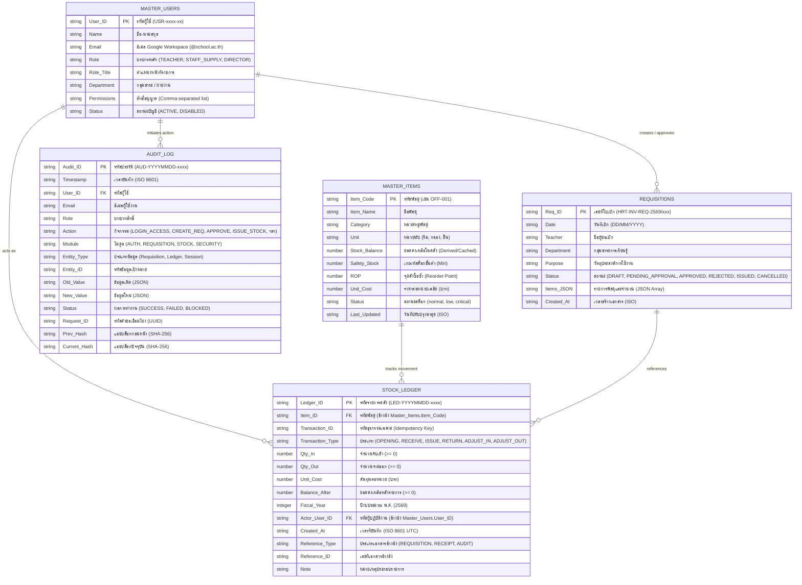

# 🗄️ DATABASE SCHEMA SPECIFICATION
## ข้อกำหนดโครงสร้างฐานข้อมูลระบบบริหารคลังพัสดุสถานศึกษา
### โรงเรียนหรเทพ(รุ่งเรืองประชาสามัคคี)

**รหัสเอกสาร:** SIMS-DBS-2026-001  
**เวอร์ชันสคีมา:** 2.1 (Production Baseline)  
**เอนจินฐานข้อมูล:** Google Sheets Enterprise Engine  
**วันที่ประกาศใช้:** 27 กันยายน 2569  

---

## 1. แผนภาพความสัมพันธ์เชิงข้อมูล (Entity Relationship Diagram - ERD)

---

## 2. รายละเอียดตารางและพจนานุกรมข้อมูล (Data Dictionary)

### 2.1 ตาราง: `Master_Items` (ฐานข้อมูลพัสดุหลัก)
- **Primary Key:** `Item_Code` (ห้ามว่าง, ห้ามซ้ำ, รูปแบบ `[A-Z]{2,4}-\d{3}`)
- **กฎความถูกต้อง:**
  - `Stock_Balance` ต้องเท่ากับผลรวมคณิตศาสตร์ของ `Stock_Ledger`
  - `Safety_Stock` (Min) $\ge 0$
  - `ROP` $\ge$ `Safety_Stock`
  - `Unit_Cost` $\ge 0.00$

### 2.2 ตาราง: `Requisitions` (คำขอเบิกพัสดุ)
- **Primary Key:** `Req_ID` (รูปแบบ `HRT-INV-REQ-2569/xxx`)
- **Foreign Key:** พัสดุใน `Items_JSON` ต้องมีอยู่จริงใน `Master_Items.Item_Code`
- **State Constraint:** สถานะต้องเป็นค่าใดค่าหนึ่งใน: `DRAFT`, `PENDING_APPROVAL`, `APPROVED`, `REJECTED`, `ISSUED`, `CANCELLED`

### 2.3 ตาราง: `Stock_Ledger` (ทะเบียนคุมพัสดุ Append-Only)
- **Primary Key:** `Ledger_ID` (รูปแบบ `LED-YYYYMMDD-xxxx`)
- **Foreign Keys:**
  - `Item_ID` $\rightarrow$ `Master_Items.Item_Code`
  - `Actor_User_ID` $\rightarrow$ `Master_Users.User_ID`
- **Invariant:** $Qty\_In \ge 0$, $Qty\_Out \ge 0$, $Balance\_After \ge 0$ (ห้ามสต็อกติดลบโดยเด็ดขาด)
- **Immutability:** ห้ามแก้ไข (Update) หรือลบ (Delete) แถวข้อมูลเดิมเด็ดขาด

### 2.4 ตาราง: `Audit_Log` (บันทึกประวัติความปลอดภัยและการตรวจสอบ)
- **Primary Key:** `Audit_ID` (รูปแบบ `AUD-YYYYMMDD-xxxx`)
- **Hash Integrity:** คำนวณ SHA-256 Chain จาก $Prev\_Hash + Timestamp + Action + User\_ID + Status$

### 2.5 ตาราง: `Master_Users` (ทะเบียนผู้ใช้งานและสิทธิ์)
- **Primary Key:** `User_ID`
- **Unique Constraint:** `Email` ต้องไม่ซ้ำกัน
- **Account State:** บัญชีสถานะ `DISABLED` จะถูกตัดสิทธิ์การใช้งานทุกฟังก์ชันในระบบ
