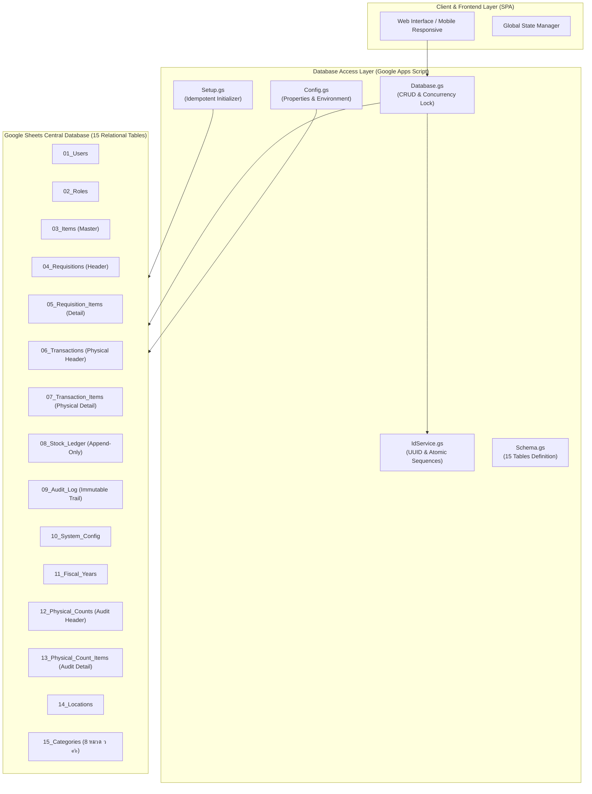

# คู่มือการติดตั้งและบริหารจัดการฐานข้อมูล Google Sheets
## HRT School Inventory Management System (Pilot Phase)
**เอกสารรหัส:** `DOC-DSG-2026-001`  
**สถานะ:** **อนุมัติพร้อมใช้งานสำหรับการติดตั้งระบบนำร่อง (Pilot Implementation)**  
**หน่วยงาน:** โรงเรียนหรเทพ(รุ่งเรืองประชาสามัคคี) สังกัดองค์การบริหารส่วนจังหวัดสระบุรี  
**กลุ่มเป้าหมาย:** ผู้ดูแลระบบเทคโนโลยีสารสนเทศ (System Admin), เจ้าหน้าที่พัสดุ (Inventory Officer)  
**วันที่ประกาศใช้:** 26 กันยายน 2569  

---

## 1. บทนำและสถาปัตยกรรมระบบ (Architecture Overview)

ระบบบริหารคลังพัสดุโรงเรียนหรเทพฯ ในระยะนำร่อง (Pilot Phase) ได้รับการออกแบบให้ใช้ **Google Sheets เป็น Central Relational Database** ร่วมกับ **Google Apps Script (V8 Engine)** ทำหน้าที่เป็น Database Engine / Data Access Layer (DAL) โดยแยกชั้นการทำงานระหว่าง Frontend และ Database ออกจากกันอย่างเด็ดขาด



### หลักการสำคัญของฐานข้อมูล (Core Database Tenets)
1. **No Hardcoding Policy**: ไม่มีการระบุ Spreadsheet ID, Deployment URL, Admin Email หรือปีงบประมาณแบบคงที่ใน Source Code ทุกค่าจะถูกอ่านผ่าน `PropertiesService.getScriptProperties()` อย่างยืดหยุ่น
2. **Non-Row Primary Keys**: ห้ามใช้ Row Number ของ Sheet เป็น Primary Key เด็ดขาด ทุก Entity ต้องมี Stable ID ที่สร้างจาก `IdService` (เช่น `REQ-2569-0001`, `ITM-2569-0001`, `LDG-2569-000001`)
3. **Double-Entry & Append-Only Ledger**: ตาราง `08_Stock_Ledger` จะบันทึกการเคลื่อนไหวแบบเพิ่มต่อท้ายเท่านั้น (Immutable Append-Only) ห้ามแก้ไขหรือลบย้อนหลัง
4. **Idempotent Automation**: ฟังก์ชัน `setupDatabase()` สามารถรันซ้ำได้ไม่จำกัดจำนวนครั้ง โดยไม่ทำลายข้อมูลเดิม ไม่สร้าง Sheet ซ้ำ และไม่สร้างข้อมูล Seed ซ้ำซ้อน

---

## 2. โครงสร้างไฟล์ Apps Script ทั้ง 5 ไฟล์

ไฟล์ Apps Script ทั้งหมดตั้งอยู่ในไดเรกทอรี [`/apps_script`](file:///g:/My%20Drive/School%20Inventory%20Management%20System/apps_script) ประกอบด้วย:

| ชื่อไฟล์ | บทบาทหน้าที่ | ฟังก์ชันเด่น |
| :--- | :--- | :--- |
| [`Config.gs`](file:///g:/My%20Drive/School%20Inventory%20Management%20System/apps_script/Config.gs) | จัดการสภาพแวดล้อม ค่า Config และดึงค่า ScriptProperties | `getSpreadsheet()`, `getActiveFiscalYear()`, `initScriptProperties()` |
| [`Schema.gs`](file:///g:/My%20Drive/School%20Inventory%20Management%20System/apps_script/Schema.gs) | นิยาม Schema ทั้ง 15 ตาราง ชนิดข้อมูล รูปแบบแสดงผล Validation และข้อมูลเริ่มต้น (Seed Data) | `TABLES` (Metadata 15 ตาราง, Enum Validations, Initial Reference Rows) |
| [`IdService.gs`](file:///g:/My%20Drive/School%20Inventory%20Management%20System/apps_script/IdService.gs) | สร้างรหัสข้อมูลที่ไม่ขึ้นกับ Row Number แบบ Thread-safe | `generateUUID()`, `generateItemId()`, `generateRequisitionId()`, `generateLedgerId()` |
| [`Database.gs`](file:///g:/My%20Drive/School%20Inventory%20Management%20System/apps_script/Database.gs) | Data Access Layer (DAL), จัดการ Lock, บันทึก CRUD และ Audit Trail | `withLock()`, `getRecords()`, `getRecordByPk()`, `insertRecord()`, `logAudit()` |
| [`Setup.gs`](file:///g:/My%20Drive/School%20Inventory%20Management%20System/apps_script/Setup.gs) | โปรแกรมติดตั้งและตรวจสอบความสมบูรณ์ของฐานข้อมูลแบบ Idempotent | `setupDatabase()`, `checkDatabaseHealth()` |

---

## 3. ขั้นตอนการติดตั้งฐานข้อมูลทีละขั้นตอน (Step-by-Step Setup Guide)

### ขั้นตอนที่ 1: สร้าง Google Spreadsheet ใหม่
1. ไปที่ Google Drive ของโรงเรียน หรือ Google Workspace บัญชีพัสดุ
2. สร้าง Google Spreadsheet ใหม่ ตั้งชื่อว่า:  
   `HRT_School_Inventory_DB_Pilot_2569`
3. บันทึก Spreadsheet ID จาก URL ของบราวเซอร์ (เช่น `https://docs.google.com/spreadsheets/d/`**`1ABCxyz...123`**`/edit`)

---

### ขั้นตอนที่ 2: เปิด Apps Script Editor
1. ในหน้าต่าง Google Spreadsheet ที่สร้างขึ้น ให้คลิกเมนูด้านบน:  
   **Extensions (ส่วนขยาย)** > **Apps Script**
2. ตั้งชื่อโปรเจกต์ Apps Script ว่า:  
   `HRT_Inventory_DB_Engine`

---

### ขั้นตอนที่ 3: นำเข้าไฟล์ Source Code ทั้ง 5 ไฟล์
ในหน้าต่าง Apps Script Editor ให้สร้างไฟล์ Script (`.gs`) ทั้ง 5 ไฟล์ และ Copy โค้ดจากโฟลเดอร์ `/apps_script` ไปวาง:

1. **`Config.gs`**: นำโค้ดจาก [`apps_script/Config.gs`](file:///g:/My%20Drive/School%20Inventory%20Management%20System/apps_script/Config.gs) มาใส่
2. **`Schema.gs`**: นำโค้ดจาก [`apps_script/Schema.gs`](file:///g:/My%20Drive/School%20Inventory%20Management%20System/apps_script/Schema.gs) มาใส่
3. **`IdService.gs`**: นำโค้ดจาก [`apps_script/IdService.gs`](file:///g:/My%20Drive/School%20Inventory%20Management%20System/apps_script/IdService.gs) มาใส่
4. **`Database.gs`**: นำโค้ดจาก [`apps_script/Database.gs`](file:///g:/My%20Drive/School%20Inventory%20Management%20System/apps_script/Database.gs) มาใส่
5. **`Setup.gs`**: นำโค้ดจาก [`apps_script/Setup.gs`](file:///g:/My%20Drive/School%20Inventory%20Management%20System/apps_script/Setup.gs) มาใส่

> [!TIP]
> ลบไฟล์ค่าเริ่มต้น `Code.gs` ทิ้ง เพื่อป้องกันความสับสน

---

### ขั้นตอนที่ 4: กำหนดค่า Script Properties (Configuration Environment)
คุณสามารถเลือกตั้งค่าได้ **2 วิธี**:

#### วิธีที่ 4.1: ตั้งค่าอัตโนมัติผ่าน Code (แนะนำที่สุด)
ใน Apps Script Editor เลือกฟังก์ชัน `initScriptProperties` ในไฟล์ `Config.gs` แล้วกด **Run** หรือสั่งผ่านคำสั่ง:
```javascript
Config.initScriptProperties({
  adminEmail: "admin@hrt.ac.th",
  activeFiscalYear: "2569"
});
```

#### วิธีที่ 4.2: ตั้งค่าด้วยตนเองผ่านเมนู UI ของ Google Apps Script
1. ไปที่เมนูด้านซ้าย เลือกไอคอนรูปเฟือง ⚙️ **Project Settings (การตั้งค่าโปรเจกต์)**
2. เลื่อนลงมาที่หัวข้อ **Script Properties (คุณสมบัติของสคริปต์)**
3. คลิกปุ่ม **Add script property (เพิ่มคุณสมบัติของสคริปต์)** และกรอกค่าตามตาราง:

| Property Key | Example Value | Description |
| :--- | :--- | :--- |
| `ACTIVE_FISCAL_YEAR` | `2569` | ปีงบประมาณปัจจุบัน (พ.ศ.) |
| `ADMIN_EMAIL` | `admin@hrt.ac.th` | อีเมลของผู้ดูแลระบบพัสดุส่วนกลาง |
| `LOCK_TIMEOUT_MS` | `30000` | เวลาสูงสุดในการรอ Concurrency Script Lock (มิลลิวินาที) |
| `ALLOW_NEGATIVE_STOCK`| `FALSE` | นโยบายห้ามสต็อกติดลบโดยเด็ดขาด |
| `SPREADSHEET_ID` | `(เว้นว่างไว้ได้หากเป็น Container-bound)` | ID ของ Spreadsheet (ระบบจะตรวจจับอัตโนมัติ) |

---

### ขั้นตอนที่ 5: สั่งรันคำสั่ง `setupDatabase()`
1. ในหน้าต่าง Apps Script Editor สลับไปที่ไฟล์ `Setup.gs`
2. บริเวณ Toolbar ด้านบน เลือกฟังก์ชัน:  
   **`setupDatabase`**
3. คลิกปุ่ม **Run (เรียกใช้)** ▶️
4. ในการรันครั้งแรก Google จะแสดงหน้าต่างแจ้งขอสิทธิ์ (Authorization Required):
   - คลิก **Review Permissions**
   - เลือกบัญชี Google ของท่าน
   - หากขึ้นหน้าต่างเตือนความปลอดภัย ให้คลิก **Advanced** > **Go to HRT_Inventory_DB_Engine (unsafe)**
   - คลิก **Allow**
5. รอระบบดำเนินการประมวลผลประมาณ 5–10 วินาที

```
Execution log ตัวอย่าง:
>>> Starting HRT School Inventory Database Setup...
+ Created Sheet: 01_Users
+ Created Sheet: 02_Roles
...
+ Created Sheet: 15_Categories
  -> Seeded 4 records into 02_Roles
  -> Seeded 8 records into 10_System_Config
  -> Seeded 4 records into 11_Fiscal_Years
  -> Seeded 6 records into 14_Locations
  -> Seeded 8 records into 15_Categories
  -> Seeded Default Admin User (USR-001) with email: admin@hrt.ac.th
- Removed empty default sheet: Sheet1
>>> HRT School Inventory Database Setup Completed in 4820 ms.
```

---

## 4. ผลลัพธ์ที่สร้างขึ้นในฐานข้อมูล (Database Entities Verification)

เมื่อคำสั่ง `setupDatabase()` ทำงานเสร็จสมบูรณ์ Google Sheets จะมีตารางครบทั้ง 15 ตาราง พร้อมการจัดรูปแบบระดับมืออาชีพ:

```
[HRT_School_Inventory_DB_Pilot_2569]
 ├── 01_Users                  (ทะเบียนผู้ใช้งาน พร้อม USR-001 Admin)
 ├── 02_Roles                  (4 สิทธิ์หลัก: ROL_ADMIN, ROL_OFFICER, ROL_TEACHER, ROL_AUDITOR)
 ├── 03_Items                  (Master Catalog พัสดุ)
 ├── 04_Requisitions           (ส่วนหัวใบเบิก พ.ด. ๑ พร้อม Dropdown สถานะ 9 สถานะ)
 ├── 05_Requisition_Items      (รายละเอียดใบเบิก พ.ด. ๑)
 ├── 06_Transactions           (ส่วนหัวการเคลื่อนไหวทางกายภาพ: RECEIVE, ISSUE, ฯลฯ)
 ├── 07_Transaction_Items      (รายละเอียดการเคลื่อนไหวทางกายภาพ)
 ├── 08_Stock_Ledger           (บัญชีคุมพัสดุ พ.ด. ๔ แบบ Append-Only พร้อม Sheet Protection)
 ├── 09_Audit_Log              (ประวัติการทำงาน Audit Trail พร้อม Snapshot ข้อมูล)
 ├── 10_System_Config          (พารามิเตอร์ระบบ เช่น ชื่อโรงเรียน, สังกัด อบจ., ปีงบประมาณ)
 ├── 11_Fiscal_Years           (รอบปีงบประมาณ 2567-2570)
 ├── 12_Physical_Counts        (ส่วนหัวการตรวจนับสิ้นปี พ.ด. ๕-๖)
 ├── 13_Physical_Count_Items   (รายละเอียดผลการตรวจนับ พ.ด. ๗ พร้อมสูตรคำนวณผลต่าง)
 ├── 14_Locations              (คลังพัสดุ 6 จุด: LOC-MAIN, LOC-SRV2, LOC-LAB1, LOC-GYM, ฯลฯ)
 └── 15_Categories             (8 หมวดหมู่วัสดุตามหนังสือ ว ๙๖)
```

### รายละเอียดการจัดรูปแบบอัตโนมัติ:
- **Header Row (Row 1)**: สีพื้นหลัง `#1e293b` (Dark Slate), ตัวอักษรสีขาว ตัวหนา, ฟอนต์ Noto Sans Thai, ความสูง 38px
- **Frozen Panes**: ตรึงแถวที่ 1 (Freeze Row 1) และตรึงคอลัมน์ A ซึ่งเป็น Primary Key (Freeze Column 1) ทุกตาราง
- **Data Formats**:
  - Currency: รูปแบบ `#,##0.00`
  - Quantities: รูปแบบ `#,##0`
  - Dates: รูปแบบ `yyyy-mm-dd`
  - Timestamps: รูปแบบ `yyyy-mm-dd hh:mm:ss` (เขตเวลา GMT+7 ประเทศไทย)
- **Data Validation (Dropdown Enums)**: Dropdown แสดงค่าที่อนุญาต ป้องกันการพิมพ์ผิด (เช่น สถานะคำขอ, ชนิดธุรกรรม, หมวดสภาพพัสดุ)
- **Column & Sheet Protection**: คอลัมน์สำคัญ (PK, created_at, updated_at) และตารางบัญชีคุม `08_Stock_Ledger` ถูกตั้งค่า Protection แบบ Warning เพื่อป้องกันการลบหรือพิมพ์ทับโดยไม่ได้ตั้งใจ

---

## 5. การตรวจสอบความสมบูรณ์ของระบบ (Health Check Diagnostic)

ใน Apps Script Editor คุณสามารถรันฟังก์ชันวินิจฉัยสุขภาพฐานข้อมูลได้ตลอดเวลา:
1. เลือกฟังก์ชัน **`checkDatabaseHealth`**
2. คลิก **Run**
3. ระบบจะตรวจสอบความถูกต้องของทั้ง 15 ตาราง คอลัมน์ และจำนวนแถว:

```json
{
  "spreadsheetId": "1aBcD...",
  "activeFiscalYear": "2569",
  "adminEmail": "admin@hrt.ac.th",
  "allSheetsPresent": true,
  "sheetStatuses": {
    "01_Users": { "exists": true, "expectedColumns": 10, "actualColumns": 10, "totalRows": 2, "isSchemaMatch": true },
    "02_Roles": { "exists": true, "expectedColumns": 6, "actualColumns": 6, "totalRows": 5, "isSchemaMatch": true },
    "08_Stock_Ledger": { "exists": true, "expectedColumns": 20, "actualColumns": 20, "totalRows": 1, "isSchemaMatch": true },
    "15_Categories": { "exists": true, "expectedColumns": 8, "actualColumns": 8, "totalRows": 9, "isSchemaMatch": true }
  }
}
```

---

## 6. กฎการบำรุงรักษาและการรันซ้ำ (Idempotency & Maintenance Rules)

> [!IMPORTANT]
> **การรับประกัน Idempotency:**  
> ฟังก์ชัน `setupDatabase()` สามารถรันซ้ำเมื่อใดก็ได้ เช่น หลังการแก้ไขโค้ดเพิ่มคอลัมน์ใหม่ใน `Schema.gs` โดยระบบจะ:
> 1. ไม่สร้างชีตซ้ำหากมีชีตอยู่แล้ว
> 2. ไม่ลบข้อมูลเดิมที่ถูกบันทึกไว้ในชีต
> 3. ตรวจพบเฉพาะคอลัมน์ใหม่ที่เพิ่มเข้ามาใน Schema แล้วต่อท้าย (Append) ไปทางขวาให้โดยอัตโนมัติ
> 4. ไม่แทรกข้อมูล Seed ซ้ำซ้อน หาก Primary Key เดิมมีอยู่ในชีตแล้ว

### ข้อควรระวังในการใช้งาน:
1. **ห้ามเปลี่ยนชื่อชีต (Sheet Tab Name)**: โค้ด Backend อ้างอิงชื่อชีตทั้ง 15 ชื่อตามมาตรฐาน (เช่น `08_Stock_Ledger`) หากเปลี่ยนชื่อชีต ระบบจะมองว่าชีตนั้นหายไปและจะสร้างชีตใหม่
2. **ห้ามลบคอลัมน์ Primary Key (Column A)**: คอลัมน์แรกของทุกตารางถูกใช้ในการผูกความสัมพันธ์ (Relational Integrity) และคำนวณลำดับข้อมูล
3. **การแก้ไขสต็อกย้อนหลัง**: หากพบว่ามียอดสต็อกคลาดเคลื่อน ห้ามแก้ไขแถวใน `08_Stock_Ledger` โดยตรง ให้สร้างธุรกรรมการปรับปรุงยอด (`ADJUSTMENT` Transaction) ผ่านระบบ เพื่อให้มี Audit Trail ครบถ้วนตามระเบียบพัสดุภาครัฐ

---

## 7. ข้อมูลสำหรับการแก้ไขปัญหา (Troubleshooting)

| ปัญหาที่พบ | สาเหตุ | วิธีแก้ไข |
| :--- | :--- | :--- |
| `CONFIGURATION_ERROR: SPREADSHEET_ID is not configured` | ไม่ได้เปิดสคริปต์จาก Spreadsheet และยังไม่ได้ตั้งค่า Script Property | รันคำสั่ง `Config.initScriptProperties({ spreadsheetId: "YOUR_ID" })` หรือผูกสคริปต์แบบ Container-bound |
| `CONCURRENCY_LOCK_TIMEOUT` | มีกระบวนการอื่นกำลังเขียนข้อมูลหรือรัน Setup อยู่พร้อมกัน | ระบบป้องกัน Race Condition ไว้ กรุณารอ 10–30 วินาที แล้วลองใหม่อีกครั้ง |
| `Exception: You do not have permission to call SpreadsheetApp.openById` | สิทธิ์ OAuth ยังไม่ได้รับการอนุมัติ | รันฟังก์ชันใดฟังก์ชันหนึ่งใน Apps Script Editor แล้วกดยินยอมให้สิทธิ์ (Allow Permissions) |
| ตัวเลือก Dropdown ไม่แสดงในชีต | Google Sheets แสดงผลล่าช้า หรือแถวข้อมูลเกินช่วง MaxRows | ฟังก์ชัน `setupDatabase()` ได้ตั้งค่าไว้ที่แถว 2 ถึง 1000 อัตโนมัติ สามารถกดรัน `setupDatabase()` ซ้ำเพื่อขยายช่วงได้ |
