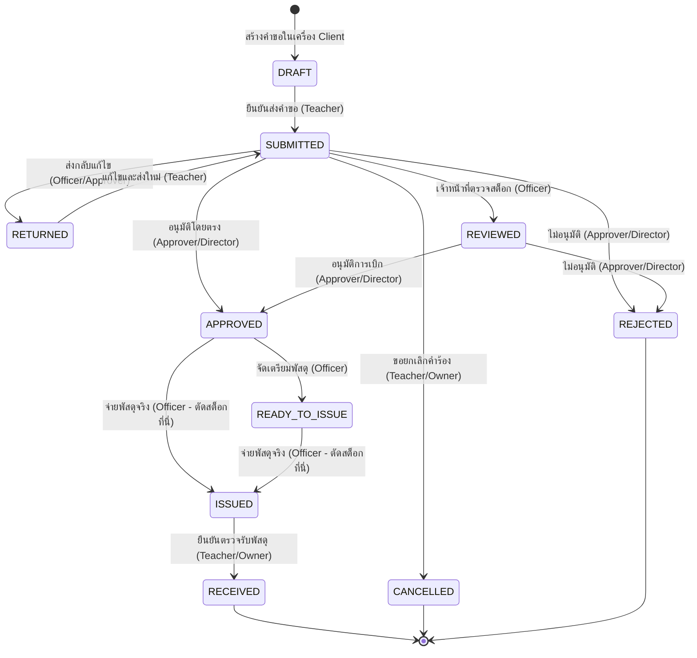

# วงจรชีวิตข้อมูลและผังสถานะระบบ (Data Lifecycle & State Machine Specification)
**ระบบ:** HRT School Inventory Management System v2.6.0  
**สถานศึกษา:** โรงเรียนหรเทพ(รุ่งเรืองประชาสามัคคี) สังกัดองค์การบริหารส่วนจังหวัดสระบุรี  
**มาตรฐานการจัดเก็บ:** 16 Canonical Sheets, Double-Entry Ledger, Decoupled Requisition & Asia/Bangkok Temporal Bounds  

---

## 1. ผังโครงสร้างฐานข้อมูลมาตรฐาน 16 ตาราง (16 Canonical Sheets Schema)

ฐานข้อมูลของระบบทำงานบน Google Sheets โดยมีโครงสร้างคอลัมน์มาตรฐาน (Canonical Schema) ที่คงที่ ห้ามแก้ไข Casing หรือสลับตำแหน่งโดยพลการ:

```
┌─────────────────────────────────────────────────────────────────────────────────┐
│                           CANONICAL SCHEMA (16 SHEETS)                          │
├───────────────────────┬─────────────────────────────────────────────────────────┤
│ 1. 01_Users           │ user_id, username, name, email, role, department, status│
│ 2. 02_Departments     │ dept_id, dept_name, faculty_head, budget_code           │
│ 3. 03_Master_Items    │ code, fsn_code, name, category, unit, warehouse,        │
│                       │ unit_cost, min, rop, stock, supplier, status            │
│ 4. 04_Categories      │ category_id, category_name, code_prefix, icon           │
│ 5. 05_Warehouses      │ warehouse_id, warehouse_name, building, room            │
│ 6. 06_FSN_Catalog     │ fsn_code, group_code, group_name, class_code, fsc,      │
│                       │ name, spec, linked_code                                 │
│ 7. 07_Requisitions    │ req_id, req_no, req_date, user_id, dept, purpose,       │
│                       │ status, approver_id, approved_at, issued_at             │
│ 8. 08_Requisition_Items id, req_id, item_code, qty_requested, qty_approved, unit│
│ 9. 09_Stock_Transactions tx_id, date, doc_ref, type, item_code, qty,           │
│                       │ unit_cost, actor_id, note                               │
│ 10. 10_Stock_Ledger   │ ledger_id, item_code, tx_id, tx_type, qty_in, qty_out,  │
│                       │ balance, unit_cost, fiscal_year, created_at             │
│ 11. 11_Audit_Trail    │ audit_id, timestamp, actor_id, email, action, module,   │
│                       │ prev_hash, record_hash, details                         │
│ 12. 12_Fiscal_Years   │ fiscal_year, start_date, end_date, status, closed_at,    │
│                       │ closed_by                                               │
│ 13. 13_Year_End_Audits count_id, fiscal_year, item_code, book_qty, count_qty,   │
│                       │ variance, condition, auditors                           │
│ 14. 14_Disposal_Records disposal_id, fiscal_year, item_code, qty, method,       │
│                       │ committee, approval_date                                │
│ 15. 15_Settings_Config key, value, description, updated_at                      │
│ 16. 16_Idempotency_Log key, actor_id, action, payload_hash, status,            │
│                       │ result_json, created_at                                 │
└───────────────────────┴─────────────────────────────────────────────────────────┘
```

---

## 2. วงจรสถานะคำขอเบิก–จ่ายพัสดุ (Requisition State Machine)

ระบบบริหารจัดการคำขอเบิกตามแนวปฏิบัติระเบียบพัสดุภาครัฐ โดยแยกการอนุมัติออกจากการตัดจ่ายพัสดุทางกายภาพ (Decoupled Approval & Physical Deduction):



### 2.1 ตารางกติกาการเปลี่ยนสถานะ (State Transition Matrix)

| สถานะปัจจุบัน | สถานะปลายทาง | ผู้มีสิทธิ์ (Actor) | สิทธิ์ที่ต้องมี | เงื่อนไขก่อนหน้า (Pre-conditions) | ผลลัพธ์ต่อสต็อกและระบบ (Side Effects) |
| :--- | :--- | :--- | :--- | :--- | :--- |
| `DRAFT` | `SUBMITTED` | ครูผู้เบิก | `CREATE_REQUISITION` | มีรายการพัสดุอย่างน้อย 1 รายการ | สร้างใบเบิกในชีต 07 และรายการในชีต 08 (ยังไม่ตัดสต็อก) |
| `SUBMITTED` | `CANCELLED` | ครูผู้เบิก (เจ้าของ) | `CANCEL_OWN_REQUISITION` | ต้องเป็นเจ้าของใบเบิก | ยกเลิกใบเบิก ปิดกระบวนการ |
| `SUBMITTED` | `RETURNED` | เจ้าหน้าที่/ผู้อนุมัติ | `REVIEW_REQUISITION` | ระบุเหตุผลที่ส่งกลับ | ส่งกลับเพื่อให้ครูแก้ไขจำนวน/วัตถุประสงค์ |
| `RETURNED` | `SUBMITTED` | ครูผู้เบิก (เจ้าของ) | `CREATE_REQUISITION` | แก้ไขข้อมูลเรียบร้อย | ส่งเข้ากระบวนการตรวจสอบใหม่ |
| `SUBMITTED` | `REVIEWED` | เจ้าหน้าที่พัสดุ | `REVIEW_REQUISITION` | ตรวจสอบยอดคงเหลือทางกายภาพ | ยืนยันว่ามีของพร้อมจ่าย |
| `SUBMITTED`/`REVIEWED` | `APPROVED` | ผู้อนุมัติ/ผอ. | `APPROVE_REQUISITION` | คำขอยังไม่ถูกยกเลิกหรือปฏิเสธ | **บันทึก qty_approved (ยังไม่ตัดสต็อกจริง)** |
| `SUBMITTED`/`REVIEWED` | `REJECTED` | ผู้อนุมัติ/ผอ. | `REJECT_REQUISITION` | ระบุเหตุผลในการไม่อนุมัติ | ปฏิเสธคำขอ สิ้นสุดกระบวนการ |
| `APPROVED` | `READY_TO_ISSUE` | เจ้าหน้าที่พัสดุ | `ISSUE_STOCK` | อยู่ในสถานะ APPROVED | บันทึกว่าจัดเตรียมพัสดุเสร็จแล้ว |
| `APPROVED`/`READY_TO_ISSUE`| `ISSUED` | เจ้าหน้าที่พัสดุ | `ISSUE_STOCK` | สต็อกคงเหลือ $\ge$ จำนวนจ่าย | **ตัดสต็อกจริงใน 03, ลงธุรกรรมใน 09, ลงบัญชีคุม 10** |
| `ISSUED` | `RECEIVED` | ครูผู้เบิก (เจ้าของ) | `CREATE_REQUISITION` | พัสดุถูกจ่ายแล้ว | บันทึกการตรวจรับพัสดุครบถ้วน |

---

## 3. วงจรชีวิตของจำนวนพัสดุ (Quantities Lifecycle)

เพื่อให้เกิดความโปร่งใสและตรวจสอบยอดได้ทุกขั้นตอน ระบบแยกจำนวนพัสดุออกเป็น 4 ระดับอย่างชัดเจน:

$$qty\_requested \longrightarrow qty\_approved \longrightarrow qty\_issued \longrightarrow qty\_received$$

1. **`qty_requested` (จำนวนที่ขอเบิก):**
   - บันทึกเมื่อครูสร้างใบเบิกในชีต `08_Requisition_Items`
   - เป็นตัวเลขความต้องการจริงของผู้ใช้งาน
2. **`qty_approved` (จำนวนที่ได้รับอนุมัติ):**
   - บันทึกเมื่อผู้อนุมัติทำการ `APPROVE_REQUISITION`
   - ค่าเริ่มต้นเท่ากับ `qty_requested` เว้นแต่อนุมัติปรับลด
3. **`qty_issued` (จำนวนที่จ่ายจริง):**
   - บันทึกเมื่อเจ้าหน้าที่พัสดุตัดจ่ายจริง (`ISSUE_STOCK`)
   - **กฎการจ่ายพัสดุเต็มจำนวน (Single Full Issuance Rule):** ในเวอร์ชัน 2.6.0 ระบบกำหนดให้การจ่ายพัสดุจ่ายเต็มจำนวนตามที่อนุมัติ ($qty\_issued = qty\_approved$) ในครั้งเดียว หาก Client ขอจ่ายบางส่วน ระบบจะปฏิเสธด้วย `FEATURE_UNSUPPORTED`
4. **`qty_received` (จำนวนที่ตรวจรับจริง):**
   - บันทึกเมื่อครูผู้เบิกกดตรวจรับพัสดุ ($qty\_received = qty\_issued$)

---

## 4. บัญชีคุมพัสดุสองด้าน (Double-Entry Stock Ledger Model)

พัสดุทุกชิ้นในโรงเรียนมีสถานะทางการเงินและบัญชีควบคุม การเคลื่อนไหวของสต็อกใช้หลักการ Double-Entry Ledger ผ่าน 2 ตารางหลัก:

1. **`09_Stock_Transactions` (Journal Log):** บันทึกประวัติเหตุการณ์ (Transaction Event) วันที่, เลขที่เอกสาร, ผู้ดำเนินการ
2. **`10_Stock_Ledger` (Perpetual Balance Ledger):** บัญชีคุมยอดคงเหลือต่อเนื่อง คำนวณแบบ Running Balance:

$$\text{Balance}_{\text{new}} = \text{Balance}_{\text{previous}} + \text{Qty}_{\text{In}} - \text{Qty}_{\text{Out}}$$

### 4.1 ประเภทธุรกรรมที่กระทบสต็อก (Stock Movement Types)

| รหัสธุรกรรม (`tx_type`) | ทิศทาง | `qty_in` | `qty_out` | เอกสารอ้างอิง | คำอธิบาย |
| :--- | :---: | :---: | :---: | :--- | :--- |
| `INITIAL` | รับเข้า | $>0$ | $0$ | `INIT-{CODE}` | ยอดยกมาเริ่มต้นระบบ |
| `RECEIVE` | รับเข้า | $>0$ | $0$ | `RCV-{YEAR}/{SEQ}` | รับพัสดุใหม่เข้าคลังจากการจัดซื้อ |
| `ISSUE` | ตัดออก | $0$ | $>0$ | `REQ-{YEAR}/{SEQ}` | จ่ายพัสดุตามใบเบิกที่อนุมัติแล้ว |
| `ADJUSTMENT_ADD` | รับเข้า | $>0$ | $0$ | `ADJ-{TIMESTAMP}` | ปรับยอดเพิ่มจากการตรวจนับกายภาพ |
| `ADJUSTMENT_SUB` | ตัดออก | $0$ | $>0$ | `ADJ-{TIMESTAMP}` | ปรับยอดลดจากการตรวจนับกายภาพพบสูญหาย |
| `DISPOSAL` | ตัดออก | $0$ | $>0$ | `DIS-{YEAR}/{SEQ}` | ตัดจำหน่ายพัสดุชำรุดตามระเบียบฯ |

---

## 5. ขอบเขตช่วงเวลาปีงบประมาณไทย (Asia/Bangkok Temporal Bounds)

ระบบไม่ใช้การตัดคำ (String Matching) หรือปีปฏิทิน (Calendar Year) ในการตัดสินปีงบประมาณ แต่ใช้สูตรคณิตศาสตร์บนช่วงเวลาแบบ **Start-Inclusive / End-Exclusive** ตามมาตรฐานเวลาสากลเขตประเทศไทย (`Asia/Bangkok`, UTC+07:00):

### 5.1 สูตรการคำนวณช่วงเวลาปีงบประมาณ

สำหรับปีงบประมาณ พ.ศ. $FY$:
- ปีคริสต์ศักราชสิ้นสุดปีงบประมาณ: $C = FY - 543$
- ปีคริสต์ศักราชเริ่มต้นปีงบประมาณ: $S = C - 1$
- **จุดเริ่มต้น (Start-Inclusive):** $S\text{-10-01T00:00:00.000+07:00}$ ($S\text{-09-30T17:00:00.000Z}$)
- **จุดสิ้นสุด (End-Exclusive):** $C\text{-10-01T00:00:00.000+07:00}$ ($C\text{-09-30T17:00:00.000Z}$)
- **วินาทีสุดท้ายของปี (End-of-Day Inclusive):** $C\text{-09-30T23:59:59.999+07:00}$

### 5.2 ตัวอย่างช่วงเวลาปีงบประมาณ 2569 และ 2570

| ปีงบประมาณ (พ.ศ.) | วันเริ่มต้น (00:00:00 +07:00) | วันสิ้นสุด (23:59:59.999 +07:00) | สถานะปัจจุบัน |
| :---: | :---: | :---: | :---: |
| **2568** | 1 ตุลาคม 2567 (2024-10-01) | 30 กันยายน 2568 (2025-09-30) | `CLOSED` |
| **2569** | 1 ตุลาคม 2568 (2025-10-01) | 30 กันยายน 2569 (2026-09-30) | `ACTIVE` (Active Transaction Year) |
| **2570** | 1 ตุลาคม 2569 (2026-10-01) | 30 กันยายน 2570 (2027-09-30) | `UPCOMING` |

---

## 6. การแยกมุมมองผู้ใช้ (selectedViewingYear) ออกจากปีธุรกรรมองค์กร (activeTransactionYear)

เพื่อป้องกันไม่ให้การดูข้อมูลย้อนหลังของผู้ใช้ไปทำให้การบันทึกตัดสต็อกผิดพลาด ระบบใช้การแยกสองตัวแปรอย่างเด็ดขาด:

1. **`activeTransactionYear` (Authority: Server):**
   - จัดเก็บใน `15_Settings_Config` (`active_fiscal_year`)
   - กำหนดโดย Server เท่านั้น ใช้สำหรับธุรกรรมการเขียน (Write: เบิก, รับเข้า, ปรับยอด, ปิดปี)
   - ผู้ใช้ไม่สามารถเปลี่ยนค่านี้ได้จากการเลือก Dropdown บนหน้าจอ
2. **`selectedViewingYear` (Authority: Client Request):**
   - เป็นพารามิเตอร์ของคำขออ่าน (Read: `items.list`, `getDashboard`, `getHistoryMap`)
   - อนุญาตให้ครูและผู้บริหารเรียกดูข้อมูลประวัติย้อนหลังหรือปีงบประมาณอื่นได้โดยไม่ส่งผลกระทบต่อคอนฟิกส่วนกลาง
