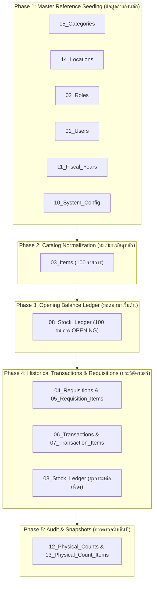

# HRT School Inventory Management System
## DATA MIGRATION MAPPING SPECIFICATION
**Document ID:** `DOC-MIG-2026-001`  
**Classification:** ETL & Data Migration Blueprint  
**Source Baseline:** `Master_Items.csv`, `Transactions.csv`, and In-Memory JS Objects  
**Target Architecture:** Google Sheets Central DB (15 Normalized Tables)  
**Role:** Senior Software Architect & Lead Data Migration Engineer  
**Date:** 2026-09-26  
**Status:** **APPROVED (READY FOR EXECUTION)**  

---

## 1. Migration Strategy & Core Pipeline

กระบวนการย้ายข้อมูล (ETL: Extract-Transform-Load) จากชุดข้อมูลเดิม (Flat CSV & In-Memory State) สู่ฐานข้อมูลกลาง 15 ตาราง มีขั้นตอนตามลำดับการพึ่งพาข้อมูล (Data Dependency Order):

---

## 2. Field-by-Field Migration Mapping

---

### 2.1 Mapping: `Master_Items.csv` / `rawMasterItems` $\rightarrow$ Target Tables

ชุดข้อมูลเดิมประกอบด้วย 100 รายการพัสดุ ต้องถูกกระจายและแปลงเข้าสู่ตาราง `03_Items`, `15_Categories`, `14_Locations`, และ `08_Stock_Ledger`:

| Current Field | New Table | New Field | Transformation Rule | Required | Validation Rule |
|---|---|---|---|:---:|---|
| `item_code` / `code` | `03_Items` | `item_id` | เติม Prefix: `ITM-` + `item_code` (เช่น `ITM-OFF-001`) | **YES** | Primary Key ห้ามว่าง, ห้ามซ้ำ |
| `item_code` / `code` | `03_Items` | `item_code` | ตัดช่องว่างซ้ายขวา `trim()`, แปลงเป็นตัวพิมพ์ใหญ่ | **YES** | Regex: `^[A-Z]{2,4}-[0-9]{3}$`, ห้ามซ้ำ |
| `item_name` / `name` | `03_Items` | `item_name` | `trim()`, ตัดอักขระพิเศษที่ไม่จำเป็น | **YES** | ความยาว 5–200 ตัวอักษร, ไม่เป็นค่าว่าง |
| `category` | `15_Categories` | `category_name` | Lookup หรือสร้างหมวดหมู่อัตโนมัติ (8 หมวด) | **YES** | ต้องตรงกับ 8 หมวดหมู่วัสดุราชการ (ว ๙๖) |
| `category` | `03_Items` | `category_id` | แปลงชื่อหมวดเป็น Foreign Key (เช่น `CAT-OFF`, `CAT-COM`) | **YES** | ต้องมีอยู่จริงใน `15_Categories` |
| `location` / `warehouse` | `14_Locations` | `location_name` | Lookup หรือสร้างสถานที่อัตโนมัติ (เช่น `ห้องเก็บพัสดุ`) | **YES** | ห้ามเป็นค่าว่าง |
| `location` / `warehouse` | `03_Items` | `location_id` | แปลงชื่อคลังเป็น Foreign Key (เช่น `LOC-MAIN`, `LOC-SRV2`) | **YES** | ต้องมีอยู่จริงใน `14_Locations` |
| `unit` | `03_Items` | `unit` | `trim()`, บันทึกเป็นมาตรฐาน (เช่น `รีม`, `ด้าม`) | **YES** | ความยาว 1–30 ตัวอักษร |
| `unit_price` / `unit_cost` | `03_Items` | `unit_cost` | `parseFloat(unit_price).toFixed(2)` | **YES** | Numeric >= 0, ทศนิยมไม่เกิน 2 ตำแหน่ง |
| `min_stock` / `min` | `03_Items` | `min_stock` | `parseInt(min_stock, 10)` | **YES** | Integer >= 0 |
| `rop` (จาก rawMasterItems) | `03_Items` | `reorder_point` | ถ้าไม่มีค่า ให้คำนวณ `min_stock * 1.5` ปัดเศษขึ้น | **YES** | Integer >= min_stock |
| `supplier` | `03_Items` | `supplier_name` | `trim()`, หากไม่มีค่าให้บันทึกเป็น `NULL` | NO | ความยาวไม่เกิน 150 ตัวอักษร |
| `fsnData.fsn_code` | `03_Items` | `fsn_code` | Lookup จาก `fsnData.linked_code === item_code` หากไม่มีให้ใช้ Deterministic Algorithm | NO | Format: `\d{4}-\d{2}-\d{3}-\d{4}` |
| - (Generated) | `03_Items` | `is_active` | กำหนดค่าเริ่มต้นเป็น `TRUE` | **YES** | Boolean |
| - (Generated) | `03_Items` | `created_at` | ใช้เวลาขณะ Migration (`ISO-8601`) | **YES** | Timestamp |
| - (Generated) | `03_Items` | `updated_at` | ใช้เวลาขณะ Migration (`ISO-8601`) | **YES** | Timestamp |

---

### 2.2 Mapping: Initial Stock Balances $\rightarrow$ `08_Stock_Ledger` (ยอดยกมาเริ่มต้น)

> [!IMPORTANT]
> **OPENING BALANCE CONVERSION:**  
> ยอดคงเหลือเดิม `current_qty` / `stock` ใน `Master_Items.csv` ทั้ง 100 รายการ จะ**ไม่ถูกบันทึกเป็นคอลัมน์ในตาราง Item** แต่จะถูกแปลงเป็นธุรกรรม **"ยอดยกมาเริ่มต้น (OPENING)"** จำนวน 100 เรคคอร์ดในตาราง `08_Stock_Ledger` ณ วันที่ 1 ตุลาคม 2568 (วันเปิดปีงบประมาณ 2569)

| Current Field | New Table | New Field | Transformation Rule | Required | Validation Rule |
|---|---|---|---|:---:|---|
| - (Generated) | `08_Stock_Ledger` | `ledger_id` | รันรหัสอัตโนมัติ: `LED-2569-` + `String(idx+1).padStart(6, '0')` | **YES** | Primary Key ห้ามซ้ำ |
| - (Constant) | `08_Stock_Ledger` | `fiscal_year_id` | กำหนดเป็นปีงบประมาณปัจจุบัน: `FY-2569` | **YES** | Ref `11_Fiscal_Years` |
| - (Constant) | `08_Stock_Ledger` | `entry_timestamp` | กำหนดเป็นวันเริ่มต้นปีงบ: `2025-10-01T00:00:00Z` | **YES** | ISO-8601 Timestamp |
| `item_code` / `code` | `08_Stock_Ledger` | `item_id` | `ITM-` + `item_code` | **YES** | Ref `03_Items.item_id` |
| `location` / `warehouse` | `08_Stock_Ledger` | `location_id` | แมปเป็น `location_id` ของพัสดุชิ้นนั้น | **YES** | Ref `14_Locations.location_id` |
| - (Constant) | `08_Stock_Ledger` | `movement_type` | กำหนดค่าเป็น `OPENING` | **YES** | Enum: `OPENING` |
| - (Constant) | `08_Stock_Ledger` | `transaction_id` | กำหนดค่าเป็น `NULL` | NO | ยอดยกมาไม่มีใบธุรกรรม |
| `current_qty` / `stock` | `08_Stock_Ledger` | `qty_in` | `parseInt(current_qty, 10)` | **YES** | Integer >= 0 |
| - (Constant) | `08_Stock_Ledger` | `qty_out` | กำหนดค่าเป็น `0` | **YES** | Integer = 0 |
| `current_qty` / `stock` | `08_Stock_Ledger` | `qty_net` | เท่ากับ `qty_in` | **YES** | Integer >= 0 |
| `unit_price` / `unit_cost` | `08_Stock_Ledger` | `unit_cost` | `parseFloat(unit_price).toFixed(2)` | **YES** | Decimal >= 0 |
| `total_value` / `total_val`| `08_Stock_Ledger` | `val_in` | `qty_in * unit_cost` | **YES** | Decimal >= 0 |
| - (Constant) | `08_Stock_Ledger` | `val_out` | กำหนดค่าเป็น `0.00` | **YES** | Decimal = 0 |
| `total_value` / `total_val`| `08_Stock_Ledger` | `val_net` | เท่ากับ `val_in` | **YES** | Decimal >= 0 |
| `current_qty` / `stock` | `08_Stock_Ledger` | `balance_qty` | ยอดคงเหลือเริ่มต้นเท่ากับ `qty_in` | **YES** | Integer >= 0 |
| `total_value` / `total_val`| `08_Stock_Ledger` | `balance_val` | มูลค่าคงเหลือเริ่มต้นเท่ากับ `val_in` | **YES** | Decimal >= 0 |
| - (Constant) | `08_Stock_Ledger` | `ref_doc_no` | กำหนดเป็น `ยอดยกมาต้นปี 1 ต.ค. 2568` | **YES** | ข้อความอธิบาย |
| - (Constant) | `08_Stock_Ledger` | `created_by` | กำหนดเป็น `USR-SYSTEM` หรือ `USR-001` | **YES** | Ref `01_Users` |
| - (Constant) | `08_Stock_Ledger` | `is_voided` | กำหนดค่าเป็น `FALSE` | **YES** | Boolean |

---

### 2.3 Mapping: `Transactions.csv` $\rightarrow$ Target Tables

แปลงประวัติธุรกรรมเดิม 20 รายการ เข้าสู่ตาราง Header/Detail และบันทึกลงในบัญชีคุม:

| Current Field | New Table | New Field | Transformation Rule | Required | Validation Rule |
|---|---|---|---|:---:|---|
| `transaction_id` | `06_Transactions` | `transaction_id` | แปลง Prefix: `TXN-` + รหัสเดิม (เช่น `TXN-2567-001`) | **YES** | Primary Key ห้ามซ้ำ |
| `transaction_id` | `06_Transactions` | `doc_no` | ใช้ค่าเดิม (เช่น `TX-2567-001`) | **YES** | ข้อความอ้างอิง |
| `date` | `06_Transactions` | `fiscal_year_id` | ตรวจสอบวันที่: ถ้าเดือน 10–12 ให้เป็น `ปี+1`, ถ้าเดือน 1–9 ให้เป็น `ปี` (เช่น `FY-2567`) | **YES** | Ref `11_Fiscal_Years` |
| `transaction_type` | `06_Transactions` | `transaction_type` | แมปคำภาษาไทย: - `เบิกใช้งาน` $\rightarrow$ `ISSUE` - `รับเข้าสต็อก` $\rightarrow$ `RECEIVE` | **YES** | Enum: `ISSUE`, `RECEIVE` |
| `transaction_type` | `06_Transactions` | `ref_doc_type` | ถ้าเบิกใช้ให้เป็น `REQUISITION`, ถ้าเข้าสต็อกให้เป็น `PURCHASE_ORDER` | **YES** | Enum |
| `date` | `06_Transactions` | `transaction_date` | จัดรูปแบบเป็นมาตรฐาน `YYYY-MM-DD` | **YES** | ISO Date |
| `user_name` | `06_Transactions` | `performed_by` | Lookup หา `user_id` จากชื่อใน `01_Users` หากไม่พบให้แมปเข้ากับ `USR-001` (เจ้าหน้าที่พัสดุ) | **YES** | Ref `01_Users` |
| `user_name` | `06_Transactions` | `counterparty` | เก็บชื่อผู้เบิก/ผู้ส่งมอบเต็ม (เช่น `ครูกัญญา (กลุ่มสาระฯ ภาษาไทย)`) | **YES** | ข้อความ |
| - (Constant) | `06_Transactions` | `status` | กำหนดค่าเป็น `POSTED` | **YES** | Enum: `POSTED` |
| - (Generated) | `07_Transaction_Items` | `txn_item_id` | `TXI-` + รหัสธุรกรรม + `-01` | **YES** | Primary Key |
| `transaction_id` | `07_Transaction_Items` | `transaction_id` | แมปเข้ากับ Header `06_Transactions.transaction_id` | **YES** | Foreign Key |
| `item_code` | `07_Transaction_Items` | `item_id` | `ITM-` + `item_code` | **YES** | Ref `03_Items.item_id` |
| `quantity` | `07_Transaction_Items` | `quantity` | `parseInt(quantity, 10)` | **YES** | Integer > 0 |
| `item_code` (Lookup) | `07_Transaction_Items` | `unit_cost` | ดึงราคาจาก `03_Items.unit_cost` | **YES** | Decimal >= 0 |
| `quantity * unit_cost` | `07_Transaction_Items` | `total_cost` | คำนวณยอดเงินรวม | **YES** | Decimal >= 0 |
| - (Generated) | `08_Stock_Ledger` | *Ledger Row* | สร้างบรรทัดบัญชีคุมต่อเนื่อง คำนวณ `balance_qty` และ `balance_val` ตามลำดับเวลา | **YES** | Append-Only Entry |

---

### 2.4 Mapping: `mockRequisitionPresets` $\rightarrow$ Target Tables

แปลงใบเบิกพัสดุจำลอง 5 ใบ เข้าสู่โครงสร้าง Header/Detail:

| Current Field | New Table | New Field | Transformation Rule | Required | Validation Rule |
|---|---|---|---|:---:|---|
| `id` | `04_Requisitions` | `requisition_id` | ใช้รหัสเดิม (เช่น `REQ-2567/018` $\rightarrow$ `REQ-2567-0018`) | **YES** | Primary Key ห้ามซ้ำ |
| `id` | `04_Requisitions` | `doc_no` | จัดรูปแบบเป็นเลขที่ราชการ (เช่น `พ.ด.๑-2567/018`) | **YES** | ห้ามซ้ำ |
| `date` | `04_Requisitions` | `request_date` | แปลงวันที่ภาษาไทย (เช่น `15 พฤษภาคม 2567`) $\rightarrow$ `2024-05-15` | **YES** | ISO Date `YYYY-MM-DD` |
| `teacher` | `04_Requisitions` | `requester_id` | Lookup หาครูใน `01_Users` หากไม่พบให้แมปกับ User ชั่วคราว | **YES** | Ref `01_Users` |
| `teacher` | `04_Requisitions` | `requester_name`| Snapshot ชื่อครูผู้เบิก | **YES** | ข้อความ |
| `dept` | `04_Requisitions` | `department` | Snapshot ฝ่าย/กลุ่มสาระฯ | **YES** | ข้อความ |
| `purpose` | `04_Requisitions` | `purpose` | วัตถุประสงค์การขอเบิก | **YES** | ข้อความ |
| `status` | `04_Requisitions` | `status` | แปลงเป็นตัวพิมพ์ใหญ่: `PENDING_APPROVAL`, `COMPLETED` ฯลฯ | **YES** | Enum |
| `items[]` | `05_Requisition_Items` | *Multiple Rows* | แตก Array ของรายการในใบเบิกออกเป็นหลายเรคคอร์ด | **YES** | Detail Records |
| `item.code` | `05_Requisition_Items` | `item_id` | `ITM-` + `item.code` | **YES** | Ref `03_Items.item_id` |
| `item.reqQty` | `05_Requisition_Items` | `requested_qty` | `parseInt(item.reqQty, 10)` | **YES** | Integer > 0 |
| `item.actualQty` | `05_Requisition_Items` | `issued_qty` | `parseInt(item.actualQty, 10)` หรือ 0 | **YES** | Integer >= 0 |

---

### 2.5 Mapping: `auditItemsData` / Snapshots $\rightarrow$ Target Tables

แปลงข้อมูลการตรวจนับพัสดุสิ้นปี 100 รายการ เข้าสู่ตาราง Audit:

| Current Field | New Table | New Field | Transformation Rule | Required | Validation Rule |
|---|---|---|---|:---:|---|
| - (Generated) | `12_Physical_Counts` | `count_id` | รันรหัส: `PC-2567-ANNUAL` หรือ `PC-2569-ANNUAL` | **YES** | Primary Key |
| `currentFiscalYear` | `12_Physical_Counts` | `fiscal_year_id` | กำหนดตามปีงบประมาณที่ตรวจนับ | **YES** | Ref `11_Fiscal_Years` |
| - (Generated) | `13_Physical_Count_Items`| `count_item_id`| `PCI-` + `count_id` + `-` + `item_code` | **YES** | Primary Key |
| `code` | `13_Physical_Count_Items`| `item_id` | `ITM-` + `code` | **YES** | Ref `03_Items.item_id` |
| `bookStock` | `13_Physical_Count_Items`| `book_qty` | `parseInt(bookStock, 10)` | **YES** | Integer >= 0 |
| `physicalCount` | `13_Physical_Count_Items`| `counted_qty` | `parseInt(physicalCount, 10)` | **YES** | Integer >= 0 |
| `variance` | `13_Physical_Count_Items`| `variance_qty` | `counted_qty - book_qty` | **YES** | Integer (+, -, 0) |
| `unit_cost` | `13_Physical_Count_Items`| `unit_cost` | `parseFloat(unit_cost).toFixed(2)` | **YES** | Decimal >= 0 |
| `endingVal` | `13_Physical_Count_Items`| `variance_val` | `variance_qty * unit_cost` | **YES** | Decimal |
| `condition` | `13_Physical_Count_Items`| `condition` | แมปค่าสถานะ: - `normal` $\rightarrow$ `NORMAL` - `repair` $\rightarrow$ `REPAIRABLE` - `disposed` $\rightarrow$ `DISPOSED` | **YES** | Enum |

---

## 3. Data Cleansing & Normalization Rules

ก่อนนำข้อมูลเข้าสู่ Google Sheets ต้องผ่านกฎ Data Cleansing 5 ข้อ:
1. **Trim Whitespace**: ลบช่องว่างหัว-ท้ายในทุกฟิลด์สตริง
2. **Numeric Sanity Check**: ป้องกันค่า `NaN`, `null`, `undefined` หรือ string ว่าง หากเป็นตัวเลขให้แปลงเป็น `0` หรือ `0.00`
3. **Foreign Key Integrity**: ตรวจสอบว่า `category_id` และ `location_id` ทุกลำดับต้องมีเรคคอร์ดแม่อยู่ในตาราง Reference จริง
4. **Negative Stock Prohibition**: ยอดคงเหลือใน `08_Stock_Ledger.balance_qty` ห้ามติดลบเด็ดขาด หากพบให้บันทึก Error Log และระงับการย้ายรายการนั้น
5. **UTF-8 Thai Encoding**: ข้อมูลทั้งหมดต้องเข้ารหัสแบบ UTF-8 สมบูรณ์ ห้ามมีอักขระเสีย (`` หรือเครื่องหมายคำถาม)

---

## 4. Migration Execution Verification Checklist

| ลำดับ | รายการตรวจสอบความถูกต้องหลังการย้ายข้อมูล (Post-Migration Checklist) | เกณฑ์ความสำเร็จ (Success Criteria) |
|:---:|---|---|
| 1 | จำนวนรายการพัสดุหลักใน `03_Items` | ครบถ้วน **100 รายการ** เท่ากับ `Master_Items.csv` |
| 2 | จำนวนเรคคอร์ดยอดยกมาเริ่มต้นใน `08_Stock_Ledger` (`movement_type = 'OPENING'`) | ครบถ้วน **100 บรรทัด** |
| 3 | ยอดรวมมูลค่าคงคลังเริ่มต้น (`SUM(val_in)`) ของยอดยกมา | ตรงกับยอดเดิมในระบบ: **฿327,150.00** |
| 4 | หมวดหมู่วัสดุราชการใน `15_Categories` | ครบถ้วน **8 หมวดหมู่** |
| 5 | สถานที่จัดเก็บพัสดุใน `14_Locations` | มีครบทุกห้องที่ปรากฏในคลังพัสดุ (อย่างน้อย 6 แห่ง) |
| 6 | ผู้ใช้งานเริ่มต้นใน `01_Users` | มีบัญชีเจ้าหน้าที่พัสดุ, ผู้บริหาร, และครูตัวแทนครบถ้วน |
| 7 | ความสมบูรณ์ของ Foreign Key Reference | **0 Broken FKs** (ไม่มี FK ใดชี้ไปยัง Record ที่ไม่มีอยู่) |

---

**ลงนามรับรองแผนผังการย้ายข้อมูล:**  
*Senior Software Architect & Data Migration Engineering Team*  
*วันที่ 26 กันยายน 2569*
