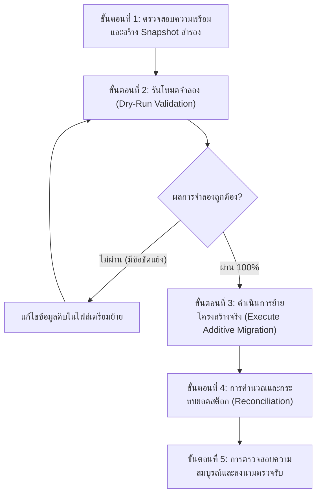

# แผนการย้ายและปรับปรุงโครงสร้างข้อมูล (Data Migration & Schema Evolution Plan)
## HRT Inventory System v2.6.0 (โรงเรียนหรเทพ(รุ่งเรืองประชาสามัคคี))

---

### 1. บทนำและเป้าหมายเชิงสถาปัตยกรรม (Introduction & Objectives)

ในการปรับปรุงระบบ HRT Inventory System สู่เวอร์ชัน 2.6.0 มีการขยายโครงสร้างฐานข้อมูลบน Google Sheets จากรูปแบบเดิมไปสู่ **16 แผ่นงานมาตรฐาน (16 Canonical Sheets)** เพื่อรองรับการจัดการสิทธิ์แบบ Granular RBAC, ระบบ MiniUI ขอเบิกผ่าน QR Code, การกระจายคลังพัสดุหลายแห่ง (Multi-Warehouse), บันทึกการทำรายการแบบแยกอิสระจากยอดคงเหลือ (Decoupled Ledger), และระบบตรวจสอบความสมบูรณ์ (Tamper-Evident Audit Trail)

**หลักการสำคัญสูงสุดในการย้ายข้อมูล (Core Migration Principles)**:
1. **Additive-Only Evolution (เพิ่มคอลัมน์/แผ่นงานเท่านั้น)**:
   - ห้ามลบคอลัมน์เดิม หรือเปลี่ยนชื่อคอลัมน์เดิมที่ยังมีโค้ดอ้างอิงอยู่
   - คอลัมน์ใหม่จะถูกเพิ่มต่อท้าย พร้อมกำหนดค่า Default เพื่อรักษาความเข้ากันได้ย้อนหลัง (Backward Compatibility)
2. **Preserve Historical IDs & Integrity**:
   - รหัสอ้างอิงทั้งหมด (`item_id`, `req_id`, `tx_id`, `user_id`, `audit_id`) และความสัมพันธ์แบบ Foreign Key ต้องได้รับการอนุรักษ์ไว้อย่างครบถ้วน 100%
3. **Dry-Run Validation Mode**:
   - การนำเข้าหรือปรับปรุงโครงสร้างข้อมูลต้องสนับสนุนโหมดจำลอง (`dryRun: true`) เพื่อตรวจจับข้อผิดพลาดก่อนการบันทึกจริง
4. **Zero Production Write Without Staging Sign-Off**:
   - **คำเตือนความปลอดภัยสูงสุด**: ห้ามรันสคริปต์แก้ไขโครงสร้างบนสภาพแวดล้อม Production สดโดยเด็ดขาด จนกว่าจะผ่านการตรวจรับและทดสอบบน Staging Sheet เสร็จสมบูรณ์

---

### 2. ตารางแมปโครงสร้างแผ่นงาน 16 แผ่น (16 Canonical Sheets Mapping)

ระบบรองรับทั้งชื่อชีตมาตรฐานแบบมีหมายเลขนำหน้า (`01_Users` ... `16_Idempotency_Log`) และชื่อชีตแบบดั้งเดิม (Legacy Sheet Aliases) ผ่าน `SHEET_ALIASES` ใน [Config.gs](file:///c:/Users/Art/.gemini/antigravity/scratch/Config.gs):

| # | ชื่อชีตทางการ (Canonical Sheet Name) | ชื่อชีตเดิม (Legacy Aliases) | คีย์หลัก (Primary Key) | ลักษณะการย้ายข้อมูล (Migration Nature) | คอลัมน์ที่เพิ่มใหม่ใน v2.6.0 |
| :-: | :--- | :--- | :--- | :--- | :--- |
| **01** | `01_Users` | `Users`, `users` | `user_id` | Additive | `role`, `department_id`, `status`, `created_at` |
| **02** | `02_Departments` | `Departments` | `department_id` | Additive | `dept_head_id`, `budget_allocated`, `status` |
| **03** | `03_Categories` | `Categories` | `category_id` | Additive | `fsn_prefix`, `default_min_threshold` |
| **04** | `04_Warehouses` | `Warehouses` | `warehouse_id` | New Sheet | เพิ่มชีตใหม่สำหรับจัดการคลังย่อยและห้องพัสดุ |
| **05** | `05_Items` | `Items`, `Inventory`, `Master_Items` | `item_id` | Additive | `warehouse_id`, `fsn_code`, `qty_allocated`, `status` |
| **06** | `06_Requisitions` | `Requisitions`, `Requests` | `req_id` | Additive | `fiscal_year`, `item_count`, `total_amount`, `current_status` |
| **07** | `07_Requisition_Items`| `RequisitionItems`, `RequestItems` | `req_item_id` | Additive | `qty_approved`, `qty_issued`, `qty_received`, `unit_price` |
| **08** | `08_Requisition_Approvals`| `Approvals` | `approval_id` | Additive | `step_order`, `action`, `comments`, `decided_at` |
| **09** | `09_Stock_Transactions`| `StockTransactions`, `Transactions`| `tx_id` | Additive | `fiscal_year`, `warehouse_id`, `ref_type`, `ref_id` |
| **10** | `10_Audit_Log` | `AuditLog`, `Audit` | `audit_id` | Additive | `actor_id`, `action`, `sha256_hash`, `prev_hash` |
| **11** | `11_System_Config` | `Config`, `Settings` | `config_key` | Additive | `active_transaction_year`, `closed_years`, `schema_version` |
| **12** | `12_Fiscal_Years` | `FiscalYears` | `fiscal_year` | Additive | `start_date`, `end_date`, `is_closed`, `closed_at` |
| **13** | `13_Roll_Over_Log` | `RollOverLog` | `rollover_id` | Additive | `from_year`, `to_year`, `carried_forward_qty`, `executed_by` |
| **14** | `14_Stock_Balances` | `StockBalances`, `Balances` | `balance_id` | New Sheet | สรุปยอดคงเหลือรายคลังและรายปีงบเพื่อความเร็ว |
| **15** | `15_Item_Lots` | `ItemLots`, `Lots` | `lot_id` | New Sheet | จัดการ Lot/Batch วันหมดอายุ และราคาต้นทุนตามงวด |
| **16** | `16_Idempotency_Log`| `IdempotencyLog` | `idempotency_key` | New Sheet | ป้องกันการทำรายการสต็อกซ้ำซ้อนจากเครือข่ายหลุด |

---

### 3. กระบวนการย้ายข้อมูลทีละขั้นตอน (Step-by-Step Migration Workflow)

#### ขั้นตอนที่ 1: การสำรองข้อมูล (Pre-Migration Backup & Snapshot)
1. เข้าไปยัง Google Sheets ฐานข้อมูลปัจจุบัน
2. เลือกเมนู **File (ไฟล์)** $\rightarrow$ **Version history (ประวัติเวอร์ชัน)** $\rightarrow$ **Name current version (ตั้งชื่อเวอร์ชันปัจจุบัน)** โดยระบุชื่อ:
   `PRE_V2.6.0_MIGRATION_SNAPSHOT_YYYYMMDD`
3. ดาวน์โหลดสำเนาไฟล์ในรูปแบบ Excel (`.xlsx`) และเก็บไว้ในที่ปลอดภัย
4. ตรวจสอบสำเนาไฟล์แบ็กอัปในไดเรกทอรี [backups/](file:///c:/Users/Art/.gemini/antigravity/scratch/backups/)

#### ขั้นตอนที่ 2: การตรวจสอบในโหมดจำลอง (Dry-Run Mode)
- ใช้งานฟังก์ชัน `initDatabase()` ใน [Code.gs](file:///c:/Users/Art/.gemini/antigravity/scratch/Code.gs)
- ระบบจะตรวจเช็กชื่อชีตทั้ง 16 แผ่น:
  - หากชีตใดยังไม่มี จะสร้างแผ่นงานใหม่พร้อมหัวคอลัมน์มาตรฐาน
  - หากชีตใดมีอยู่แล้ว จะอ่านหัวคอลัมน์ปัจจุบันและทำการ **Append Columns** เฉพาะคอลัมน์ที่ยังขาดอยู่ โดยไม่แตะต้องแถวข้อมูลเดิม

#### ขั้นตอนที่ 3: การประมวลผลข้อมูลเก่าสู่ฟิลด์ใหม่ (Data Transformation & Default Population)
1. **ตารางผู้ใช้ (`01_Users`)**:
   - ผู้ใช้เดิมที่ไม่มีฟิลด์ `status` จะถูกเติมค่าเป็น `ACTIVE`
   - ตรวจสอบอีเมลของแอดมิน เพื่อให้มั่นใจว่ามีอย่างน้อย 1 บัญชีที่มีสิทธิ์ `ADMIN` เพื่อป้องกันข้อผิดพลาด `LAST_ADMIN_PROTECTION`
2. **ตารางพัสดุ (`05_Items`)**:
   - พัสดุเดิมที่ไม่มี `warehouse_id` จะถูกกำหนดค่าเริ่มต้นให้ผูกกับคลังกลาง (`WH-MAIN`)
   - พัสดุเดิมที่ไม่มี `qty_allocated` จะถูกกำหนดค่าเป็น `0`
3. **ตารางคำขอเบิก (`06_Requisitions` และ `07_Requisition_Items`)**:
   - แปลงสถานะเก่า เช่น `PENDING` $\rightarrow$ `SUBMITTED`, `COMPLETE` $\rightarrow$ `RECEIVED`
   - กำหนดค่า `qty_approved = qty_requested` สำหรับคำขอที่ได้รับอนุมัติแล้ว
   - กำหนดค่า `qty_issued = qty_approved` สำหรับคำขอที่จ่ายของแล้ว

#### ขั้นตอนที่ 4: การกระทบยอดสต็อก (Stock Reconciliation)
- รันฟังก์ชัน `apiReconcileStockBalances()` ใน [Write.gs](file:///c:/Users/Art/.gemini/antigravity/scratch/Write.gs)
- ระบบจะคำนวณยอดรวมจาก `09_Stock_Transactions` ย้อนหลังตามสูตร Double-Entry:
  $$\text{Ending Balance} = \sum (\text{Qty IN}) - \sum (\text{Qty OUT})$$
- เปรียบเทียบกับฟิลด์ `qty_on_hand` ใน `05_Items` หากพบผลต่าง ระบบจะบันทึกรายการปรับยอด (Adjustment Transaction) พร้อมระบุเหตุผลเพื่อความถูกต้อง 100%

---

### 4. การจัดการกรณีเกิดข้อผิดพลาดและการย้อนคืน (Rollback Strategy)

หากพบข้อผิดพลาดร้ายแรงระหว่างกระบวนการย้ายข้อมูล ให้ปฏิบัติตามแผนฟื้นฟูฉุกเฉินทันที:

1. **ระงับการทำงานของระบบ (Emergency Lockout)**:
   - สลับค่าคอนฟิก `system.maintenance_mode = true` หรือปลดการเชื่อมต่อ Web App เพื่อป้องกันไม่ให้ผู้ใช้ส่งคำขอใหม่เข้ามาในระหว่างแก้ปัญหา
2. **ย้อนคืนเวอร์ชัน Google Sheets (Version History Revert)**:
   - เปิด Google Sheets $\rightarrow$ เลือกเมนู **Version history**
   - ค้นหาจุดสำรอง `PRE_V2.6.0_MIGRATION_SNAPSHOT_YYYYMMDD` ที่สร้างไว้ในขั้นตอนที่ 1
   - กด **Restore this version (กู้คืนเวอร์ชันนี้)**
3. **ย้อนคืนเวอร์ชันโค้ด Apps Script**:
   - กู้คืนไฟล์โค้ดจากไดเรกทอรี [backups/](file:///c:/Users/Art/.gemini/antigravity/scratch/backups/)
   - ปรับปรุงการปรับใช้ (Deploy) กลับไปที่เวอร์ชันที่มีเสถียรภาพก่อนหน้า
4. **ตรวจสอบความสมบูรณ์หลังการย้อนคืน**:
   - รันชุดทดสอบ [tests/regression_test_suite.js](file:///c:/Users/Art/.gemini/antigravity/scratch/tests/regression_test_suite.js) เพื่อยืนยันว่าการทำงานพื้นฐาน 100% กลับคืนมาเป็นปกติ

---

### 5. รายการตรวจรับความพร้อมก่อนย้ายข้อมูลจริง (Pre-Flight Checklist)

ก่อนเริ่มดำเนินการกับฐานข้อมูลจริง ให้ทำเครื่องหมายตรวจสอบทุกข้อ:

- [x] มีการสำรองข้อมูลชีตและสร้าง Named Version ใน Google Sheets แล้ว
- [x] ชุดทดสอบ [tests/p1_p2_contract_lifecycle_test.js](file:///c:/Users/Art/.gemini/antigravity/scratch/tests/p1_p2_contract_lifecycle_test.js) ผ่าน 10/10 ข้อ
- [x] ชุดทดสอบ [tests/regression_test_suite.js](file:///c:/Users/Art/.gemini/antigravity/scratch/tests/regression_test_suite.js) ผ่าน 11/11 ข้อ
- [x] ตรวจสอบสิทธิ์ผู้ดูแลระบบ (`ADMIN`) มีอย่างน้อย 1 คนที่พร้อมใช้งาน
- [x] การแมปคอลัมน์และชีตรองรับชื่อทั้งแบบ Canonical และ Alias ผ่าน `SHEET_ALIASES`
- [ ] **การลงนามตรวจรับจากผู้รับผิดชอบระบบ (Staging Sign-Off)** *(ยังไม่ดำเนินการ - สถานะ Production ติดบล็อกตามข้อตกลง P0)*

> [!CAUTION]
> **ข้อกำหนดสำคัญ**: สถานะการติดตั้งจริงบน Production ในขณะนี้ยังคงถือเป็น **BLOCKED** จนกว่าจะได้รับข้อมูลบัญชีและสิทธิ์ในการเข้าถึงโดเมนจริงของโรงเรียน ห้ามดำเนินการย้ายข้อมูลบน Production โดยปราศจากการอนุมัติเป็นลายลักษณ์อักษร

---
*เอกสารนี้จัดทำขึ้นสำหรับ HRT Inventory System v2.6.0 เพื่อเป็นมาตรฐานการย้ายข้อมูลอย่างปลอดภัยและตรวจสอบย้อนกลับได้*
