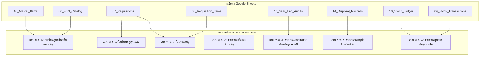

# เอกสารการจับคู่แบบฟอร์มเอกสารทางราชการ แบบ พ.ด. ๑ – ๗
## (Official Thai Government Forms พ.ด. ๑–๗ Schema Mapping & Verification)
**ระบบบริหารจัดการพัสดุโรงเรียนหรเทพ(รุ่งเรืองประชาสามัคคี)**
**เวอร์ชันระบบ:** `v2.7.0-dev.4` | **อ้างอิง:** ระเบียบกระทรวงการคลังว่าด้วยการจัดซื้อจัดจ้างและการบริหารพัสดุภาครัฐ พ.ศ. ๒๕๖๐

---

## 1. ภาพรวมการจับคู่แบบฟอร์มทางราชการ (Government Forms Mapping Overview)

ระบบ HRT Inventory System รองรับการสร้างและพิมพ์รายงานตามระเบียบพัสดุภาครัฐและแบบฟอร์มของกรมส่งเสริมการปกครองท้องถิ่น (อปท.) / อบจ.สระบุรี โดยทำการเชื่อมโยงข้อมูลจากตารางฐานข้อมูล Google Sheets 16 แผ่นเข้ากับแบบฟอร์ม แบบ พ.ด. ๑ ถึง พ.ด. ๗ อย่างถูกต้องตามระเบียบ:

---

## 2. ตารางรายละเอียดการจับคู่และสถานะการตรวจสอบ (Mapping & Verification Matrix)

| รหัสแบบฟอร์ม | ชื่อแบบฟอร์มราชการ | สถานะการตรวจสอบ | ตารางฐานข้อมูลหลัก | ฟิลด์ข้อมูลที่ใช้ | วัตถุประสงค์และการใช้งาน |
|:---:|---|:---:|---|---|---|
| **พ.ด. ๑** | ทะเบียนคุมทรัพย์สินและพัสดุ | `OFFICIAL_VERIFIED` | `03_Master_Items` `06_FSN_Catalog` | `code`, `fsn_code`, `name`, `category`, `unit`, `warehouse`, `unit_cost`, `stock` | ใช้เป็นสมุดทะเบียนคุมรายการพัสดุและครุภัณฑ์ของสถานศึกษา |
| **พ.ด. ๒** | ใบยืมพัสดุ/อุปกรณ์ | `PENDING_TEMPLATE` | `07_Requisitions` (ประเภทยืม-คืน) | `req_id`, `user_id`, `purpose`, `req_date`, `due_date`, `return_status` | ใช้เมื่อครู/บุคลากรขอยืมพัสดุหรืออุปกรณ์เพื่อกิจกรรมการเรียนการสอน |
| **พ.ด. ๓** | ใบเบิกพัสดุ | `OFFICIAL_VERIFIED` | `07_Requisitions` `08_Requisition_Items` | `req_id`, `req_no`, `user_id`, `dept`, `purpose`, `item_code`, `qty_requested`, `qty_approved`, `issued_at` | เอกสารหลักในการขอเบิกและจ่ายพัสดุออกจากคลัง |
| **พ.ด. ๔** | รายงานขอซื้อ/ขอจ้างพัสดุ | `PENDING_TEMPLATE` | `PROCURING_SYSTEM` (ระบบจัดซื้อจัดจ้าง) | `pr_id`, `item_code`, `requested_qty`, `estimated_cost`, `budget_source` | เสนอขออนุมัติจัดซื้อจัดจ้างพัสดุใหม่เมื่อถึงจุดสั่งซื้อซ้ำ (ROP) |
| **พ.ด. ๕** | รายงานผลการตรวจสอบพัสดุประจำปี (ณ ๓๐ กันยายน) | `OFFICIAL_VERIFIED` | `13_Year_End_Audits` `13_Year_End_Audit_Items` | `count_id`, `fiscal_year`, `item_code`, `book_qty`, `count_qty`, `variance`, `condition`, `auditors` | คณะกรรมการตรวจนับพัสดุประจำปีรายงานยอดต่อผู้อำนวยการและ อบจ. |
| **พ.ด. ๖** | รายงานขออนุมัติจำหน่ายพัสดุชำรุด/สูญหาย | `OFFICIAL_VERIFIED` | `14_Disposal_Records` `03_Master_Items` | `disposal_id`, `fiscal_year`, `item_code`, `qty`, `method`, `committee`, `approval_date` | เสนอขอจำหน่ายพัสดุที่ชำรุด เสื่อมสภาพ หรือสูญหายออกจากบัญชีคุม |
| **พ.ด. ๗** | รายงานสรุปยอดพัสดุคงเหลือและมูลค่ารวม | `OFFICIAL_VERIFIED` | `10_Stock_Ledger` `09_Stock_Transactions` | `fiscal_year`, `item_code`, `balance`, `unit_cost`, `total_valuation`, `intake_val`, `issue_val` | สรุปภาพรวมมูลค่าพัสดุคงเหลือเพื่อประกอบรายงานงบการเงินประจำปี |

---

## 3. ข้อกำหนดการตรึงข้อมูลผู้ลงนามและการพิมพ์ A4 (Signatory Snapshot & Print Layout)

### 3.1 การตรึงข้อมูลผู้ลงนาม (Frozen Signatory Snapshot)
* เมื่อเอกสาร เช่น ใบเบิกพัสดุ (พ.ด. ๓) ได้รับการอนุมัติและจ่ายพัสดุ (`status = 'ISSUED'`) หรือรายงานการตรวจนับสิ้นปี (พ.ด. ๕) ได้รับการบันทึก ระบบจะตรึงข้อมูลผู้ลงนาม ณ ขณะนั้นลงในเอกสาร
* การแก้ไขข้อมูลผู้ลงนามในหน้า Settings หมวดที่ 2 (เช่น ผู้อำนวยการท่านใหม่ย้ายมารับตำแหน่ง) จะมีผลเฉพาะเอกสารที่สร้างขึ้นใหม่หลังวันที่มีผลบังคับใช้ (`effective_date`) **โดยไม่ส่งผลกระทบย้อนหลังต่อเอกสารในอดีต**

### 3.2 ข้อกำหนดการจัดหน้าพิมพ์กระดาษ A4 (A4 Print Layout Standards)
1. **ขนาดและระยะขอบ:**
   * ขนาดกระดาษ: มาตรฐาน A4 (210 มม. $\times$ 297 มม.) แนวตั้งสำหรับ พ.ด. ๒–๔ และแนวนอนสำหรับ พ.ด. ๑, ๕, ๗
   * ระยะขอบ (Margins): บน 2.5 ซม. / ล่าง 2.0 ซม. / ซ้าย 3.0 ซม. (สำหรับการเข้าเล่ม) / ขวา 2.0 ซม.
2. **ตัวพิมพ์ (Typography):**
   * ใช้แบบอักษรมาตรฐานราชการไทย (TH Sarabun PSK หรือ TH Sarabun New)
   * ขนาดตัวอักษร: หัวเรื่อง 18pt ตัวหนา / หัวข้อย่อย 16pt ตัวหนา / เนื้อหาและตาราง 14pt-15pt ปกติ
3. **โครงสร้างหัวเอกสาร:**
   * ตราครุฑหรือตราสัญลักษณ์โรงเรียน จัดกึ่งกลางหรือมุมบนซ้ายตามรูปแบบระเบียบสารบรรณ
   * ระบุชื่อสถานศึกษา "โรงเรียนหรเทพ(รุ่งเรืองประชาสามัคคี)" และต้นสังกัด "องค์การบริหารส่วนจังหวัดสระบุรี" ชัดเจน
4. **ส่วนท้ายและช่องลงลายมือชื่อ:**
   * แบ่งเป็น 3 ส่วนชัดเจน:
     1. ผู้ขอเบิก / ผู้สำรวจ (ลงชื่อ วันที่)
     2. ผู้ตรวจสอบ / หัวหน้างานพัสดุ (ความเห็น ลงชื่อ วันที่)
     3. ผู้อนุมัติ / ผู้อำนวยการสถานศึกษา (คำสั่งอนุมัติ ลงชื่อ วันที่)
