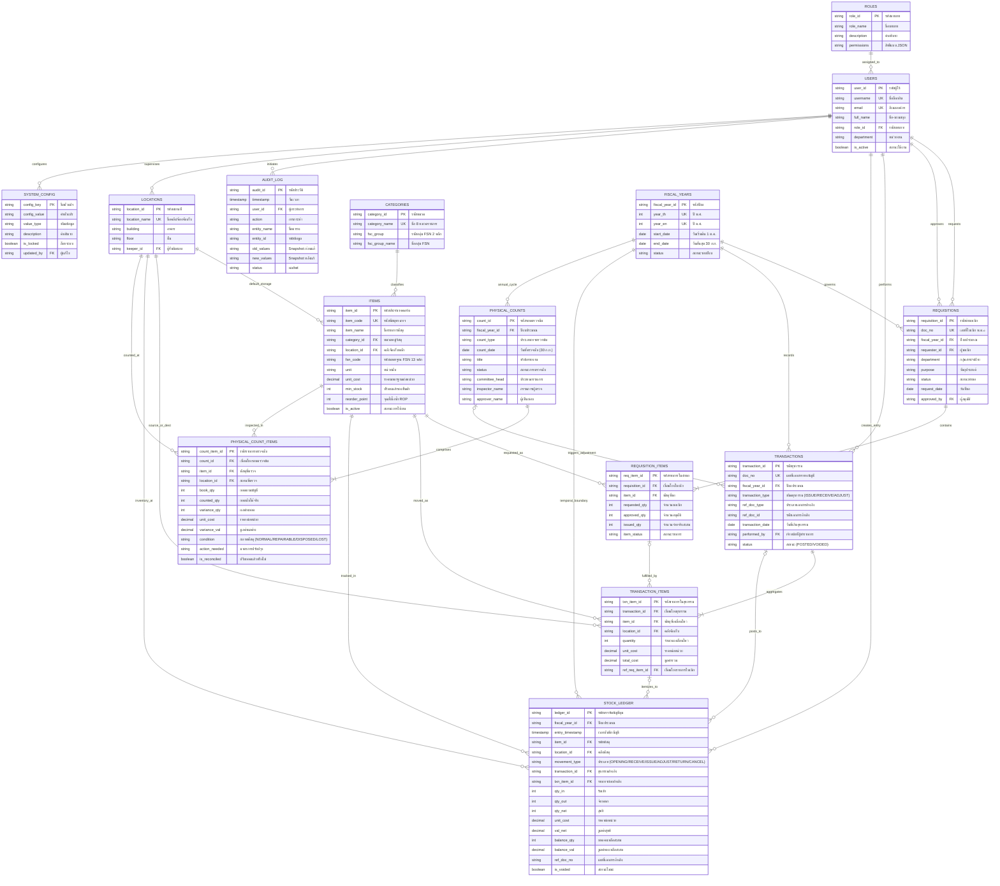

# HRT School Inventory Management System
## ENTITY-RELATIONSHIP DIAGRAM (ERD) & DATA FLOW ARCHITECTURE
**Document ID:** `DOC-ERD-2026-001`  
**Classification:** Database Conceptual & Logical Model  
**Platform Target:** Google Sheets Relational Schema (Pilot Phase)  
**Role:** Senior Software Architect & Database Engineer  
**Date:** 2026-09-26  
**Status:** **APPROVED (VERSION 1.0)**  

---

## 1. Complete Entity-Relationship Diagram (Mermaid)

แผนภาพความสัมพันธ์ของทั้ง 15 เอนทิตี (Entities) ในระบบฐานข้อมูลกลาง Google Sheets แสดง Primary Key (PK), Foreign Key (FK), และ Cardinality ตามมาตรฐานสากล:



---

## 2. Architectural Data Flows

### 2.1 The Requisition-to-Ledger Separation Flow
ความแตกต่างสำคัญระหว่างการขอเบิก (Requisition) และการเคลื่อนไหวทางบัญชี (Ledger):

```
[ผู้ขอเบิก]
    │
    ▼ (1) ยื่นคำขอ
┌────────────────────────┐
│   04_Requisitions      │ (Header: Intent)
│   05_Requisition_Items │ (Detail: Requested Items)
└────────────────────────┘
    │
    ▼ (2) ตรวจสอบ & อนุมัติ (สถานะ: APPROVED)
    │
[เจ้าหน้าที่พัสดุ]
    │
    ▼ (3) ตรวจสอบพัสดุในคลัง & ยืนยันการตัดจ่าย
┌────────────────────────┐
│   06_Transactions      │ (Header: Execution)
│   07_Transaction_Items │ (Detail: Actual Issued Items)
└────────────────────────┘
    │
    ▼ (4) บันทึกบัญชีคุมอัตโนมัติ (Atomic Append)
┌────────────────────────┐
│   08_Stock_Ledger      │ (Immutable Audit Trail)
│   - movement: ISSUE    │
│   - qty_out: X         │
│   - balance_qty: New   │
└────────────────────────┘
```

---

### 2.2 Physical Count Reconciliation Flow
ขั้นตอนเมื่อการตรวจนับสิ้นปีพบผลต่าง (Variance Reconciliation):

```
┌───────────────────────────────┐
│ 12_Physical_Counts (30 ก.ย.)  │
│ 13_Physical_Count_Items       │
└───────────────────────────────┘
                │
                ├─────────────────────────────────────┐
                ▼ (กรณี: Variance > 0 พบพัสดุเกิน)      ▼ (กรณี: Variance < 0 พัสดุขาด/ชำรุด)
       ┌──────────────────┐                  ┌──────────────────┐
       │ 06_Transactions  │                  │ 06_Transactions  │
       │ type: ADJUSTMENT │                  │ type: ADJUSTMENT │
       │ action: ADJUST_IN│                  │ action:ADJUST_OUT│
       └──────────────────┘                  └──────────────────┘
                │                                     │
                ▼                                     ▼
       ┌──────────────────┐                  ┌──────────────────┐
       │ 08_Stock_Ledger  │                  │ 08_Stock_Ledger  │
       │ movement:ADJUST_IN│                 │movement:ADJUST_OUT│
       │ qty_in: +Delta   │                  │ qty_out: -Delta  │
       └──────────────────┘                  └──────────────────┘
```

---

## 3. Structural Integrity & Referential Constraints

1. **Foreign Key Integrity**:
   - `03_Items.category_id` $\rightarrow$ `15_Categories.category_id` (RESTRICT DELETE: ห้ามลบหมวดหมู่ที่มีพัสดุอ้างอิงอยู่)
   - `03_Items.location_id` $\rightarrow$ `14_Locations.location_id` (RESTRICT DELETE: ห้ามลบคลังที่มีพัสดุเก็บอยู่)
   - `05_Requisition_Items.requisition_id` $\rightarrow$ `04_Requisitions.requisition_id` (CASCADE DELETE: ลบใบเบิกต้องลบรายการย่อยด้วย)
   - `07_Transaction_Items.transaction_id` $\rightarrow$ `06_Transactions.transaction_id` (CASCADE DELETE)
   - `08_Stock_Ledger.item_id` $\rightarrow$ `03_Items.item_id` (RESTRICT DELETE: พัสดุที่เคยมีการเคลื่อนไหวห้ามลบเด็ดขาด ให้ใช้ `is_active = FALSE` แทน)
2. **Cardinality Verification**:
   - `04_Requisitions` $\rightarrow$ `05_Requisition_Items`: 1 to Many (1..*)
   - `06_Transactions` $\rightarrow$ `07_Transaction_Items`: 1 to Many (1..*)
   - `12_Physical_Counts` $\rightarrow$ `13_Physical_Count_Items`: 1 to Many (1..100)
   - `03_Items` $\rightarrow$ `08_Stock_Ledger`: 1 to Many (1..*)

---

**ลงนามรับรองแผนผัง ERD และโฟลว์สถาปัตยกรรมข้อมูล:**  
*Senior Software Architect & Database Engineering Team*  
*วันที่ 26 กันยายน 2569*
