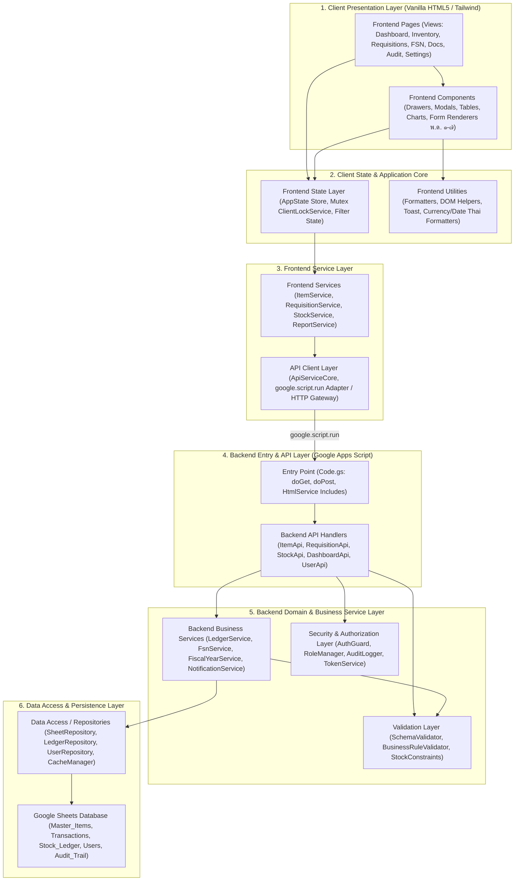

# Target Architecture & Folder Structure Specification
## HRT School Inventory Management System (ระบบบริหารจัดการพัสดุและคลังวัสดุโรงเรียน)

> **Architectural Standard**: Layered Clean Architecture & Separation of Concerns (SoC)  
> **Runtime Environment**: Google Apps Script (V8 Engine) & Modern Vanilla ES6+ Web Client  
> **UI Engine**: Vanilla HTML5 / Tailwind CSS (CDN) / Chart.js (Strictly No React rewrite)  
> **Single Source of Truth**: Immutable Double-Entry Ledger (Google Sheets & Apps Script Backend)

---

## 1. High-Level Target Architecture

The refactored architecture enforces a strict unidirectional dependency hierarchy. Each layer communicates exclusively with its adjacent lower layer through well-defined contracts and interfaces:



---

## 2. Target File Tree

```text
hrt-school-inventory/
├── appsscript.json                     # Google Apps Script manifest configuration
├── Code.gs                             # Apps Script entry point (doGet, doPost, include, routing)
├── Config.gs                           # Central Backend environment configuration & sheet constants
│
├── backend/                            # Server-Side Google Apps Script Domain
│   ├── api/                            # API Gateway & Controller Handlers (Receives client calls)
│   │   ├── ItemApi.gs                  # Item listing, detail, creation, and update controllers
│   │   ├── RequisitionApi.gs           # Requisition lifecycle controllers (submit, approve, issue, reject)
│   │   ├── StockApi.gs                 # Stock adjustment, receive, write-off, and ledger query controllers
│   │   ├── DashboardApi.gs             # Multi-dimensional analytics, KPIs, and aggregation controllers
│   │   ├── UserApi.gs                  # Authentication verification, profile, and role controllers
│   │   └── ReportApi.gs                # Official form data compilation (พ.ด. ๑ through พ.ด. ๗)
│   │
│   ├── services/                       # Pure Business Logic Services (No direct Google Sheets UI binding)
│   │   ├── LedgerService.gs            # Immutable double-entry ledger calculation & balance evaluation
│   │   ├── RequisitionService.gs       # Multi-item requisition workflow state transitions & validations
│   │   ├── StockService.gs             # Safety stock monitoring, reorder alerts, batch stock movements
│   │   ├── FiscalYearService.gs        # Fiscal year closing, balance carryover, inventory freezing
│   │   ├── FsnClassificationService.gs # FSN 8-digit cataloging, group hierarchy, asset valuation logic
│   │   ├── ReportGeneratorService.gs   # Official Ministry format data models (พ.ด. ๑-๗)
│   │   └── NotificationService.gs      # Line Notify, email dispatch, and internal alert service
│   │
│   ├── data/                           # Data Access Layer & Google Sheets Repositories
│   │   ├── SheetRepository.gs          # Generic low-level Google Sheets CRUD, cell batching, formula protection
│   │   ├── ItemRepository.gs           # Master_Items sheet repository (schema mapping & typed queries)
│   │   ├── LedgerRepository.gs         # Stock_Ledger & Transactions sheet repository (append-only)
│   │   ├── RequisitionRepository.gs    # Requisitions & Requisition_Items sheet repository
│   │   ├── UserRepository.gs           # Users & Department directory sheet repository
│   │   ├── AuditTrailRepository.gs     # Immutable Audit_Trail sheet repository
│   │   └── CacheService.gs             # Google Apps Script CacheService wrapper with TTL management
│   │
│   ├── security/                       # Security, Identity & Compliance
│   │   ├── AuthGuard.gs                # Role-Based Access Control (Admin, Officer, Approver, Requester)
│   │   ├── AuditLogger.gs              # Centralized user action recording (IP, Timestamp, Diff, Action)
│   │   ├── InputSanitizer.gs           # XSS mitigation, HTML entity escaping, formula injection protection
│   │   └── LockManager.gs              # Distributed Google Apps Script LockService concurrency control
│   │
│   ├── validation/                     # Server-Side Input & Rule Validation
│   │   ├── SchemaValidator.gs          # Request payload structure & data type validation
│   │   ├── StockRuleValidator.gs       # Quantity limits, negative stock prevention, budget code checks
│   │   └── FsnValidator.gs             # FSN format regex validation (XX-XX-XXXX) & category compliance
│   │
│   └── setup/                          # Initial Setup & Database Provisioning
│       ├── DatabaseSetup.gs            # Auto-provisioning of Google Sheets, tabs, frozen rows, headers
│       ├── DataSeeder.gs               # Seed data generator for Master_Items (100 items) and Transactions
│       └── MigrationScripts.gs         # Schema versioning and migration utilities
│
├── frontend/                           # Client-Side Web Application (HTML5 / Tailwind CSS / Vanilla JS)
│   ├── main/                           # Client Entry Point & Application Shell
│   │   ├── index.html                  # Main WebApp HTML shell (Navigation, layout, view containers)
│   │   ├── app.js                      # Application initialization, routing controller, lifecycle
│   │   └── global-facade.js            # Backward-compatibility facade binding modern modules to window.*
│   │
│   ├── pages/                          # Primary Page Views (Vanilla JS + View HTML templates)
│   │   ├── DashboardPage.js            # Dashboard view controller (8-dimensional analytical engine)
│   │   ├── InventoryPage.js            # Inventory catalog, balance table, stock search controller
│   │   ├── RequisitionPage.js          # Requisition management, approval workflow, status filtering
│   │   ├── FsnCatalogPage.js           # FSN catalog tree, classification explorer, category breakdown
│   │   ├── DocumentsPage.js            # Official forms generator (พ.ด. ๑–๗ view & selector)
│   │   ├── YearEndAuditPage.js         # Annual inventory audit, physical count reconciliation
│   │   └── SettingsPage.js             # System settings, fiscal year config, user role administration
│   │
│   ├── components/                     # Reusable UI Components & Drawers/Modals
│   │   ├── drawers/                    # Slide-out inspection panels
│   │   │   ├── ItemDetailDrawer.js     # Master item 360-degree drawer (specs, ledger, stock cards)
│   │   │   └── ReqDetailDrawer.js      # Requisition review drawer (approval actions, audit logs)
│   │   │
│   │   ├── modals/                     # Modal dialogue dialogs & forms
│   │   │   ├── MultiItemRequisitionModal.js # Multi-item requisition basket & submission dialog
│   │   │   ├── ConfirmIssueModal.js         # Physical stock issuing verification dialog
│   │   │   ├── AddStockModal.js             # Stock receipt / adjustment dialog
│   │   │   ├── CloseFiscalYearModal.js      # Fiscal year rollover & freeze confirmation modal
│   │   │   ├── AddFsnModal.js               # New FSN item registration modal
│   │   │   └── PdfViewerModal.js            # Document preview & print modal dialog
│   │   │
│   │   ├── tables/                     # Data grids & table components
│   │   │   ├── DataTableComponent.js   # Reusable sorting, pagination, and row selection engine
│   │   │   └── StockLedgerTable.js     # Stock movement ledger timeline table
│   │   │
│   │   ├── charts/                     # Chart.js visualization wrappers
│   │   │   ├── InventoryCharts.js      # Inventory distribution, category doughnut, & trend charts
│   │   │   └── AnalyticsCharts.js      # Requisition velocity & stockout risk indicators
│   │   │
│   │   └── forms/                      # Official Ministry of Finance Form Templates (พ.ด. ๑-๗)
│   │       ├── FormPd1DailyReport.js   # พ.ด. ๑: ใบเบิกพัสดุประจำวัน
│   │       ├── FormPd2Requisition.js   # พ.ด. ๒: ใบเบิกพัสดุและอนุมัติจ่าย
│   │       ├── FormPd3StockCard.js     # พ.ด. ๓: บัตรบัญชีคุมพัสดุ (Stock Card)
│   │       ├── FormPd4Monthly.js       # พ.ด. ๔: รายงานการรับจ่ายพัสดุประจำเดือน
│   │       ├── FormPd5AuditSummary.js  # พ.ด. ๕: รายงานการตรวจสอบพัสดุประจำปี
│   │       ├── FormPd6AuditCategory.js # พ.ด. ๖: รายงานการตรวจสอบพัสดุจำแนกตามประเภท
│   │       └── FormPd7AuditAllItems.js # พ.ด. ๗: บัญชีรายละเอียดการตรวจสอบพัสดุสิ้นปี
│   │
│   ├── services/                       # Frontend Service Layer (Abstracts API from UI)
│   │   ├── ApiService.js               # Core transport abstraction (google.script.run & mock fallback)
│   │   ├── ItemService.js              # Client item operations, search caching, catalog retrieval
│   │   ├── RequisitionService.js       # Client requisition handling, basket orchestration, draft persistence
│   │   ├── StockService.js             # Client stock calculations, batch receiving, adjustments
│   │   ├── DashboardService.js         # Client-side 8D analytical metric computation
│   │   ├── ReportService.js            # Client report data aggregation and print formatting
│   │   ├── UserService.js              # Client auth state, user profile, role queries
│   │   └── NotificationClient.js       # Toast notifications, banner alerts, confirmation prompts
│   │
│   ├── state/                          # Frontend Reactive State Management
│   │   ├── AppState.js                 # Central state store (Pub/Sub event bus for state changes)
│   │   ├── ClientLockService.js        # UI Mutex locking to prevent double-click submissions
│   │   ├── FilterState.js              # 8-dimensional dashboard & table filter memory
│   │   └── UserSessionState.js         # Active user session, permissions, department context
│   │
│   ├── utils/                          # Reusable Frontend Utilities
│   │   ├── Formatters.js               # Currency (฿), Numbers, Thai Dates (วัน เดือน พ.ศ.), FSN masking
│   │   ├── DomHelpers.js               # Safe DOM manipulation, element creation, attribute toggling
│   │   ├── PrintManager.js             # Print styling trigger, A4 margin calculation, CSS print injection
│   │   ├── Validator.js                # Form input validation (required fields, positive quantities)
│   │   └── ExportUtils.js              # CSV, Excel, and JSON data export utilities
│   │
│   └── styles/                         # Style Sheets & Design System Tokens
│       ├── main.css                    # Base layout, typography clamps, scrollbars, color variables
│       ├── components.css              # Custom badges, status indicators, drawer animations, modal backdrop
│       └── print-pd.css                # Official Government Print Rules (@media print, A4 portrait/landscape)
│
├── migration/                          # Migration Tools & Safety Verification
│   ├── PhaseValidator.js               # Integrity test checking that no function was lost during modularization
│   └── CompatibilityTest.html          # Browser test harness verifying window.* backwards compatibility
│
├── tests/                              # Unit & Integration Tests
│   ├── backend/                        # Backend GAS unit tests
│   │   ├── LedgerServiceTest.gs        # Double-entry balance calculation verification
│   │   ├── RequisitionServiceTest.gs   # Approval workflow state transition validation
│   │   └── FsnValidatorTest.gs         # FSN pattern matching tests
│   │
│   └── frontend/                       # Frontend unit tests
│       ├── FormattersTest.js           # Thai date and currency formatting tests
│       ├── AppStateTest.js             # State Pub/Sub event broadcast tests
│       └── FilterEngineTest.js         # 8-dimensional filter combination tests
│
└── docs/                               # Architecture, Migration & API Documentation
    ├── FOLDER_STRUCTURE.md             # This structural specification
    ├── REFACTOR_MAPPING.md             # Exhaustive function-by-function mapping (14 categories)
    └── MODULE_DEPENDENCY_MAP.md        # Comprehensive inbound/outbound call & dependency graphs
```

---

## 3. Directory Responsibility Matrix & Separation of Concerns

| Directory | Responsibility Boundary | Prohibited Actions / Anti-Patterns |
| :--- | :--- | :--- |
| `backend/api/` | Accepts incoming client invocations, validates request structure via `validation/`, checks permissions via `security/`, calls `services/`, returns standardized JSON responses. | **Forbidden**: Direct Google Sheets read/write; direct formatting logic; raw exception leaking to client. |
| `backend/services/` | Contains all business rules, inventory ledger mathematics, requisition status state machines, fiscal year calculations, report data assembly. | **Forbidden**: Calling `SpreadsheetApp` directly; accessing client DOM; handling HTTP parameters. |
| `backend/data/` | Manages persistence against Google Sheets (`SpreadsheetApp`), caching via `CacheService`, batch cell operations, row locking. | **Forbidden**: Embedding business rules (e.g. evaluating if an item can be requisitioned); formatting Thai currency strings. |
| `backend/security/` | Enforces authentication, role authorization, audit logging, input sanitization, and distributed locks via `LockService`. | **Forbidden**: Storing business transaction data; returning UI HTML. |
| `backend/validation/`| Enforces data schema integrity, format regex (FSN, budget codes), bounds checking (quantities > 0). | **Forbidden**: Mutating database records; executing side-effects. |
| `frontend/main/` | Orchestrates client boot sequence, sets up global facade wrappers for backwards compatibility, initial routing. | **Forbidden**: Containing business domain logic or long HTML templates. |
| `frontend/pages/` | Coordinates view-specific layout, binds DOM event listeners, invokes `frontend/services/`, reads `frontend/state/`. | **Forbidden**: Direct server communication (`google.script.run`); direct calculation of ledger balances. |
| `frontend/components/`| Self-contained UI components (drawers, modals, tables, charts, พ.ด. forms). Render HTML based on props and trigger callbacks. | **Forbidden**: Mutating global state directly without going through `AppState` or services. |
| `frontend/services/` | Facade over backend APIs, handles network retries, local caching, mock fallback for local browser testing. | **Forbidden**: Modifying DOM elements directly; rendering HTML strings. |
| `frontend/state/` | Single Source of Client Truth for UI state (filters, selected items, active user, pending transactions). Emits change events. | **Forbidden**: Making network calls directly; containing DOM rendering code. |
| `frontend/utils/` | Pure functions for formatting Thai dates, currency, numbers, DOM helpers, CSV export. | **Forbidden**: Maintaining application state; importing domain services. |
| `frontend/styles/` | Pure CSS styles, Tailwind configuration, print media rules for government forms. | **Forbidden**: Inline JavaScript or executable code. |

---

## 4. Google Apps Script Runtime Integration Mechanism

Google Apps Script HTMLService executes in a sandboxed V8 environment where all client scripts and styles must be delivered to the browser within HTML responses. To support a clean modular directory structure without breaking GAS constraints:

1. **Server-Side File Inclusion (`Code.gs`)**:
   `Code.gs` implements a standard recursive pre-processor:
   ```javascript
   function include(filename) {
     return HtmlService.createHtmlOutputFromFile(filename).getContent();
   }
   ```
2. **Template Assembly (`frontend/main/index.html`)**:
   The master HTML file includes modularized scripts using standard GAS scriptlet syntax:
   ```html
   <!-- Styles -->
   <style><?!= include('frontend/styles/main.css'); ?></style>
   <style><?!= include('frontend/styles/components.css'); ?></style>
   <style><?!= include('frontend/styles/print-pd.css'); ?></style>

   <!-- Core Architecture Modules -->
   <script><?!= include('frontend/utils/Formatters.js'); ?></script>
   <script><?!= include('frontend/utils/DomHelpers.js'); ?></script>
   <script><?!= include('frontend/state/AppState.js'); ?></script>
   <script><?!= include('frontend/state/ClientLockService.js'); ?></script>
   <script><?!= include('frontend/services/ApiService.js'); ?></script>
   ...
   <!-- Backwards Compatibility Facade -->
   <script><?!= include('frontend/main/global-facade.js'); ?></script>
   <!-- Application Bootstrap -->
   <script><?!= include('frontend/main/app.js'); ?></script>
   ```
3. **Local Testing Dual-Mode**:
   `frontend/services/ApiService.js` automatically detects if `google.script.run` is defined:
   - If running inside Google Apps Script: delegates to `google.script.run`.
   - If running in a local browser (file:// or localhost): smoothly falls back to mock in-memory data for instant development without requiring deployment.

---

## 5. Architectural Quality Attributes & Compliance

- **No React Rewrite**: All views and components remain in clean, native Vanilla JavaScript (ES6+) with zero build-step overhead.
- **Single Source of Truth**: UI stores only cached projections. All financial and inventory state is derived from the append-only stock ledger.
- **Zero Loss of Functionality**: Every single existing modal, drawer, calculation, and official form (พ.ด. ๑–๗) has an explicit target location in the new structure.
- **100% Backward Compatibility**: `frontend/main/global-facade.js` guarantees that existing inline HTML event handlers (e.g. `onclick="openDrawer('...')"` or `onchange="applyDashFilters()"`) continue executing without error.
