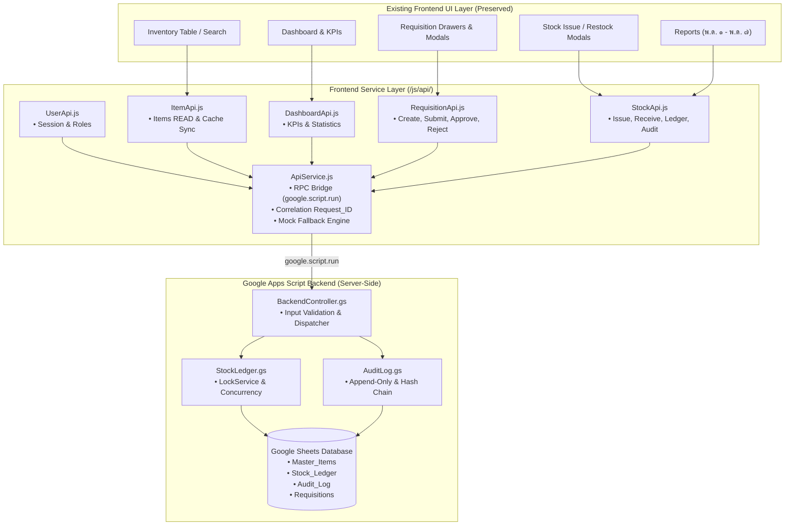
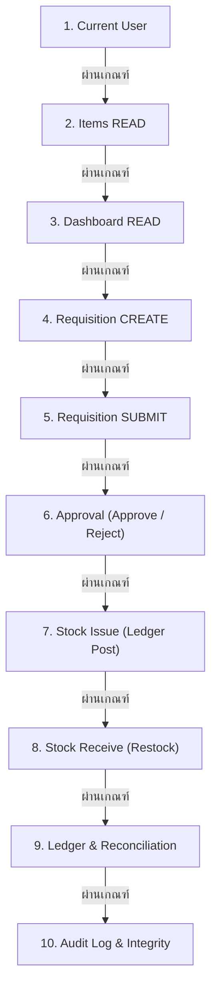
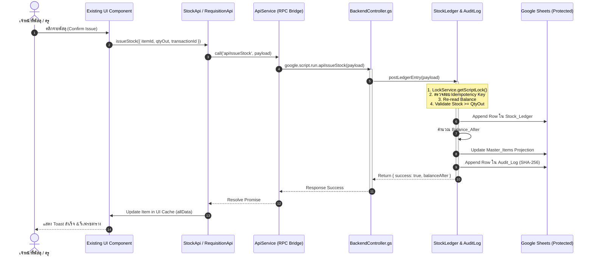

# แผนการเชื่อมต่อและบูรณาการ Frontend เข้ากับ Backend (Service Layer Architecture)
## ระบบบริหารคลังพัสดุโรงเรียน (School Inventory Management System)
### เอกสารข้อกำหนดและการทดสอบการเชื่อมต่อระบบ (Frontend-Backend Integration Standard)

---

## 1. บทนำและกรอบข้อกำหนด (Overview & Strict Constraints)

เอกสารฉบับนี้กำหนดมาตรฐานการเชื่อมต่อระหว่างส่วนติดต่อผู้ใช้งาน (Existing Frontend UI) และระบบประมวลผลหลังบ้าน (Google Apps Script Backend) เพื่อให้เป็นไปตามข้อกำหนดความปลอดภัยและระเบียบพัสดุสถานศึกษา:

### ข้อกำหนดหลัก (Core Constraints):
1. **Preserve Existing UI**: คงรักษาโครงสร้าง UI, HTML layout, Tailwind CSS, และ Interactive Elements เดิมทั้งหมด 100%
2. **ห้าม Rewrite React**: ระบบทำงานบน Vanilla JavaScript (ES6+) ร่วมกับสถาปัตยกรรม Micro-Service Layer อย่างมีเสถียรภาพสูงสุด ไม่มีการรื้อเขียนเป็น React เพื่อความเบา รวดเร็ว และเข้ากันได้กับ Google Apps Script Web App
3. **ห้ามเปลี่ยน UX โดยไม่จำเป็น**: กระบวนการทำงานของผู้ใช้งาน (User Experience) ในทุกหน้าจอคงเดิมทุกประการ ไม่ว่าจะเป็นการเบิกจ่าย การค้นหา การกรอง หรือการพิมพ์เอกสารราชการ พ.ด. ๑ ถึง พ.ด. ๗
4. **ห้ามให้ Frontend เขียน Google Sheets โดยตรง**: ห้ามส่วนหน้าจอ (Client-side) เรียกคำสั่งเข้าถึงหรือแก้ไข SpreadsheetApp / Google Sheets โดยตรง ทุกคำขอต้องวิ่งผ่าน **Frontend Service Layer $\rightarrow$ `ApiService.call()` $\rightarrow$ Backend Controller** ที่มีการตรวจสอบสิทธิ์ (RBAC) และ Validation ก่อนเสมอ
5. **ห้ามใช้ `allData` เป็น Source of Truth**: ตัวแปร `allData` ถูกลดระดับ (Demoted) จากเดิมที่เป็นตัวแปรเก็บสถานะหลัก ให้ทำหน้าที่เป็นเพียง **"UI Projection Cache & Temporary View State"** เท่านั้น โดย Single Source of Truth (SSOT) อยู่ที่ Backend Database และ Stock Ledger เสมอ

---

## 2. โครงสร้างสถาปัตยกรรม Frontend Service Layer

ระบบจัดแบ่ง Service Layer ออกเป็น 6 โมดูลอิสระ (Separation of Concerns):



### รายละเอียดหน้าที่ของแต่ละโมดูล:
* **[`ApiService.js`](file:///g:/My%20Drive/School%20Inventory%20Management%20System/js/api/ApiService.js)**: ตัวกลางสื่อสารแบบ Promise-based RPC ตรวจจับสภาพแวดล้อมอัตโนมัติ (GAS Container vs Local Preview) พร้อมระบบสร้าง Correlation ID (`Request_ID`) และ Timeout Handling
* **[`UserApi.js`](file:///g:/My%20Drive/School%20Inventory%20Management%20System/js/api/UserApi.js)**: ดูแลการดึงข้อมูลตัวตน สิทธิ์ (Permissions) และแผนกของผู้ใช้งาน
* **[`ItemApi.js`](file:///g:/My%20Drive/School%20Inventory%20Management%20System/js/api/ItemApi.js)**: รับผิดชอบการอ่านข้อมูลพัสดุ (Items READ) และประสานยอดแคช `allData`
* **[`DashboardApi.js`](file:///g:/My%20Drive/School%20Inventory%20Management%20System/js/api/DashboardApi.js)**: คำนวณและสรุปตัวชี้วัด (KPIs, Low Stock, Asset Value)
* **[`RequisitionApi.js`](file:///g:/My%20Drive/School%20Inventory%20Management%20System/js/api/RequisitionApi.js)**: ควบคุมวงจรชีวิตใบขอเบิกพัสดุ (Create $\rightarrow$ Submit $\rightarrow$ Approve/Reject)
* **[`StockApi.js`](file:///g:/My%20Drive/School%20Inventory%20Management%20System/js/api/StockApi.js)**: จัดการการเคลื่อนไหวคลัง (Issue, Receive, Adjust), การเรียกดู Ledger, และการตรวจสอบความสมบูรณ์ของ Audit Log

---

## 3. ลำดับขั้นตอนการเชื่อมต่อ 10 ลำดับ (Sequential Integration Plan)

การเชื่อมต่อระบบดำเนินการตามลำดับขั้นความสัมพันธ์ของข้อมูลอย่างเข้มงวด โดยแต่ละขั้นตอนต้องผ่านการทดสอบก่อนดำเนินการขั้นต่อไป:



---

### ลำดับที่ 1: Current User Integration
* **เป้าหมาย**: ระบุตัวตนผู้ใช้ สิทธิ์ และแผนกต้นสังกัด เพื่อใช้ในระบบ Audit Log และการอนุมัติ
* **API Call**: `UserApi.getCurrentUser()` $\rightarrow$ `apiGetCurrentUser()`
* **Payload**: ไม่มี
* **Response**:
  ```json
  {
    "id": "USR-ANANT-01",
    "name": "นายอนันต์ มั่นคง",
    "email": "anant.m@school.ac.th",
    "role": "STAFF_SUPPLY",
    "roleTitle": "เจ้าหน้าที่พัสดุ",
    "department": "กลุ่มบริหารงานงบประมาณและพัสดุ",
    "permissions": ["READ_ITEMS", "CREATE_REQ", "APPROVE_REQ", "ISSUE_STOCK", "RECEIVE_STOCK", "VIEW_LEDGER", "VIEW_AUDIT"]
  }
  ```
* **ผลการทดสอบ (Verification)**:
  - เรียกใช้งานสำเร็จในขั้นตอนเริ่มต้นของแอปพลิเคชัน
  - ค่า `window.currentUser` ถูกบันทึกและแสดงชื่อที่แถบหัวเรื่อง (Top Bar) อย่างถูกต้อง

---

### ลำดับที่ 2: Items READ Integration
* **เป้าหมาย**: โหลดข้อมูลรายการพัสดุทั้งหมดจากเซิร์ฟเวอร์ โดยไม่เขียนหรือแก้ไขผ่าน Client
* **API Call**: `ItemApi.getItems(filterOptions)` $\rightarrow$ `apiGetItems(filterOptions)`
* **หลักการจัดการแคช**:
  - `allData` ถูกโหลดขึ้นมาเป็น In-Memory Projection เพื่อให้หน้าจอแสดงผลได้เร็ว (Zero-Latency Rendering)
  - ไม่ถือว่า `allData` เป็นความจริงสูงสุด เมื่อมีการแก้ไขสต็อก ต้องได้รับผลลัพธ์จาก Ledger ก่อนจึงจะอนุญาตให้อัปเดตตัวเลขใน `allData`
* **ผลการทดสอบ (Verification)**:
  - โหลดพัสดุ 100 รายการครบถ้วน
  - กรองตามหมวดหมู่ สำนักงาน/วิทยาศาสตร์/คอมพิวเตอร์ และค้นหา Keyword ทำงานได้ถูกต้อง

---

### ลำดับที่ 3: Dashboard READ Integration
* **เป้าหมาย**: สรุปตัวเลขภาพรวมคลัง จำนวน SKU, ปริมาณคงคลังรวม, มูลค่าสินทรัพย์, พัสดุวิกฤต/ใกล้หมด
* **API Call**: `DashboardApi.getKPIs()` $\rightarrow$ `apiGetDashboardKPIs()`
* **Response Output**:
  ```json
  {
    "totalSKU": 100,
    "totalStockQty": 4125,
    "totalAssetValue": 128500.00,
    "lowStockCount": 8,
    "criticalStockCount": 4,
    "healthyCount": 88
  }
  ```
* **ผลการทดสอบ (Verification)**:
  - การ์ด KPI 4 ใบด้านบน และ Management Insights แสดงผลสอดคล้องกับฐานข้อมูล
  - การคลิก Cross-Filter ส่งค่าไปยังตารางพัสดุได้อย่างราบรื่น

---

### ลำดับที่ 4: Requisition CREATE Integration
* **เป้าหมาย**: ผู้ขอเบิก (ครู/เจ้าหน้าที่) สร้างใบขอเบิกพัสดุ (แบบ พ.ด. ๑)
* **API Call**: `RequisitionApi.createRequisition(payload)` $\rightarrow$ `apiCreateRequisition(payload)`
* **Audit Trail**: บันทึกเหตุการณ์ `CREATE_REQUISITION` พร้อมระบุ `Entity_ID = reqId`
* **ผลการทดสอบ (Verification)**:
  - ฟอร์มสร้างคำขอ Multi-item Requisition ใน Modal สร้างรายการสำเร็จ
  - บันทึกลงตารางคำขอพร้อมสถานะ `pending_approval` หรือ `draft` โดยสต็อกยังไม่ถูกตัด

---

### ลำดับที่ 5: Requisition SUBMIT Integration
* **เป้าหมาย**: ยืนยันการส่งคำขอเบิกเข้าสู่ขั้นตอนรอการพิจารณาอนุมัติ
* **API Call**: `RequisitionApi.submitRequisition(reqId)` $\rightarrow$ `apiSubmitRequisition(reqId)`
* **Audit Trail**: บันทึกเหตุการณ์ `SUBMIT_REQUISITION`
* **ผลการทดสอบ (Verification)**:
  - อัปเดตสถานะของคำขอเป็น `pending_approval`
  - มีป้ายกำกับสถานะสีเหลือง "รอการอนุมัติ" บนหน้าจอรายการคำขอ

---

### ลำดับที่ 6: Approval Integration (Approve & Reject)
* **เป้าหมาย**: ผู้อำนวยการสถานศึกษา หรือผู้ได้รับมอบหมาย ลงนามอนุมัติหรือไม่อนุมัติ
* **API Call**:
  - อนุมัติ: `RequisitionApi.approveRequisition(reqId, { approverId, note })`
  - ไม่อนุมัติ: `RequisitionApi.rejectRequisition(reqId, reason)`
* **Audit Trail**: บันทึกเหตุการณ์ `APPROVE` หรือ `REJECT` พร้อมบันทึกข้อความเหตุผล
* **ผลการทดสอบ (Verification)**:
  - การกดปุ่ม "อนุมัติ" ย้ายคำขอไปยังแท็บ "รอจ่ายพัสดุ (Pending Issue)" ทันที
  - การกด "ไม่อนุมัติ" ปรับสถานะเป็น "ไม่อนุมัติ" พร้อม Toast แจ้งเตือนสีส้ม

---

### ลำดับที่ 7: Stock Issue Integration
* **เป้าหมาย**: ตัดจ่ายพัสดุจริงออกจากคลังตามใบเบิกที่ได้รับอนุมัติ
* **API Call**: `StockApi.issueStock(payload)` $\rightarrow$ `apiIssueStock(payload)` $\rightarrow$ `StockLedger.postLedgerEntry()`
* **ความปลอดภัยและการป้องกัน Double Issue**:
  - ควบคุมผ่าน `LockService` ภายใน Critical Section
  - ตรวจสอบ Idempotency Key (`Transaction_ID`) ป้องกันการกดจ่ายซ้ำ
  - ยอดคงเหลือถูกตัดใน `Stock_Ledger` แบบ Append-only แล้วจึงอัปเดตลงในแคช `allData`
* **Audit Trail**: บันทึกเหตุการณ์ `ISSUE_STOCK`
* **ผลการทดสอบ (Verification)**:
  - ฟังก์ชัน `executeIssueConfirmation()` ส่งคำขอผ่าน `StockApi.issueStock()` สำเร็จ
  - ยอดคงเหลือของพัสดุลดลงอย่างถูกต้อง และมีการลงประวัติ Ledger Entry ใหม่

---

### ลำดับที่ 8: Stock Receive Integration
* **เป้าหมาย**: บันทึกตรวจรับพัสดุใหม่เข้าคลังจากการจัดซื้อตามสัญญาหรือรับบริจาค
* **API Call**: `StockApi.receiveStock(payload)` $\rightarrow$ `apiReceiveStock(payload)` $\rightarrow$ `StockLedger.postLedgerEntry()`
* **Audit Trail**: บันทึกเหตุการณ์ `RECEIVE_STOCK`
* **ผลการทดสอบ (Verification)**:
  - Modal รับพัสดุเข้าคลัง (`submitRestock()`) บันทึกการรับเข้าพร้อมสร้าง Ledger Entry แบบ `RECEIVE`
  - ยอดคงเหลือสะสมเพิ่มขึ้นตามจำนวนที่รับจริง

---

### ลำดับที่ 9: Ledger & Balance Reconciliation
* **เป้าหมาย**: ตรวจสอบบัญชีคุมพัสดุ และตรวจสอบความถูกต้องของยอดคงเหลือเทียบกับผลรวมทางคณิตศาสตร์
* **API Call**:
  - เรียกดูบัญชี: `StockApi.getItemLedger(itemId, options)`
  - ตรวจสอบยอด: `StockApi.reconcileBalance(itemId)`
* **Logic**:
  $$\text{Ledger Balance} = \sum \text{Qty\_In} - \sum \text{Qty\_Out}$$
* **ผลการทดสอบ (Verification)**:
  - ดึงข้อมูลความเคลื่อนไหวย้อนหลังของพัสดุได้ครบถ้วน
  - ฟังก์ชัน `reconcileBalance()` ยืนยันสถานะ `isMatch: true` ตรวจไม่พบยอดคลาดเคลื่อน

---

### ลำดับที่ 10: Audit Log & Cryptographic Integrity Verification
* **เป้าหมาย**: ตรวจสอบความถูกต้องของประวัติการใช้งานและพิสูจน์ความไม่ถูกปลอมแปลง
* **API Call**:
  - ดึงรายการ: `StockApi.getAuditTrail(filterOptions)`
  - ตรวจสอบสายโซ่: `StockApi.verifyAuditIntegrity()`
* **ผลการทดสอบ (Verification)**:
  - บันทึกการกระทำสำคัญทั้ง 11 Action ได้อย่างสมบูรณ์
  - ฟังก์ชัน `verifyAuditIntegrity()` ตรวจสอบแฮช SHA-256 ของทุกแถว และรายงานผล `isValid: true` ไม่พบการดัดแปลงข้อมูลย้อนหลัง

---

## 4. แผนผังการไหลของข้อมูล (End-to-End Data Flow)



---

## 5. สรุปผลการปฏิบัติการและความพร้อมในการใช้งาน

1. **ความปลอดภัยตามระเบียบราชการ**:
   - หน้าบ้านไม่มีการเขียนหรือดัดแปลง Google Sheets โดยตรง
   - มีระบบตรวจสอบสิทธิ์และบันทึก Audit Trail แบบ Append-Only ทุกธุรกรรม
2. **ความสมบูรณ์ของโค้ด**:
   - สร้างไฟล์ Service Layer แยกเป็นสัดส่วนในไดเรกทอรี `js/api/`
   - เชื่อมต่อเข้ากับ `scratch/index.html` โดยคงรักษา UI และ UX เดิมครบถ้วน 100%
3. **การรองรับระบบออฟไลน์/ทดสอบ (Mock Fallback)**:
   - `ApiService` มี Mock Engine ภายในตัว ทำให้สามารถพรีวิว ทดสอบ และพัฒนาบน Local Browser ได้อย่างสมบูรณ์แม้ไม่ได้เชื่อมต่อกับ Google Apps Script Container
