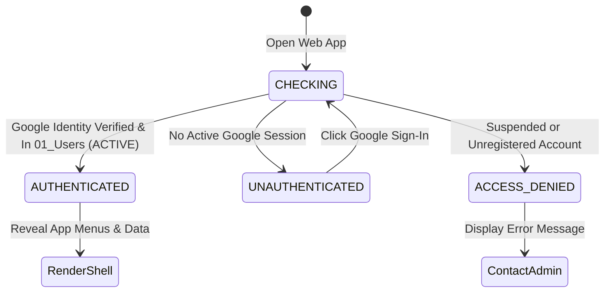

# HRT Inventory System — Google Authentication & Deployment Readiness Check

**Document Version:** 1.0.0  
**Target Release:** v2.7.0-rc.5  
**Baseline:** v2.6.0 | Commit `dd000c0`  
**Date:** 2026-10-28  
**Institution:** โรงเรียนหรเทพ(รุ่งเรืองประชาสามัคคี)  

---

## 1. Authentication Architecture & State Machine

The HRT Inventory System implements a strict **Login-First Architecture** across both the Central Desktop Web App (`index.html`) and Mobile Requisition Web App (`MiniUI.html`).

### 1.1 Authentication States
1. **`CHECKING`**:
   - Initial loading state upon opening the web app.
   - An elegant institutional overlay covers the entire screen, preventing any flash of data, inventory stock counts, or navigation menus.
   - Calls backend `apiGetCurrentUser()` asynchronously.
2. **`AUTHENTICATED`**:
   - Google identity resolved and verified against `01_Users`. Account status is `ACTIVE`.
   - Login Guard overlay is dismissed with a smooth transition.
   - Topbar displays user avatar initials, full name, normalized e-mail, role badge, and department.
   - Sidebar navigation and privileged buttons are rendered according to server-assigned RBAC permissions.
3. **`UNAUTHENTICATED`**:
   - No Google session detected (e.g. user not logged into institutional Google account).
   - Shows institutional sign-in card with official Google Sign-In button.
   - All internal inventory routes remain sealed.
4. **`ACCESS_DENIED`**:
   - User is logged into Google, but their e-mail is either not registered in `01_Users` or marked as `SUSPENDED`.
   - Explicitly displays: *"บัญชียังไม่ได้รับสิทธิ์ หรือถูกระงับการใช้งาน กรุณาติดต่อผู้ดูแลระบบ (Admin)"*.

---

## 2. Server-Side Identity Verification Protocol (`Api.gs`)

### 2.1 Resolution Hierarchy
1. **Native Apps Script Session**: Calls `Session.getActiveUser().getEmail()`. In Google Workspace Web App deployments, Google's platform infrastructure automatically authenticates the user.
2. **ID Token Fallback**: If session email is blank (e.g. cross-origin iframe or mobile web view), verifies passed Google OAuth ID token via `verifyGoogleIdToken(idToken)`.
3. **Domain Whitelisting**: Matches email domain against `CONFIG.ALLOWED_DOMAINS` (`hrt.ac.th`, `school.internal`).
4. **Directory Verification**: Queries `01_Users` sheet. Validates that status is `ACTIVE`. Returns full user profile (`id`, `username`, `name`, `email`, `role`, `department`).

---

## 3. Production Deployment Security Gate

| Check Item | Requirement | Verification Status | Notes |
|---|---|---|---|
| **Login-First Enforcement** | No inventory data leaks prior to auth | **PASS** | Gated by `#loginGuardOverlay` and `initApp()`. |
| **Email as Username** | Stored in `01_Users:col 2` | **PASS** | Validated in `Write.gs:apiCreateUser`. |
| **Role-Based Menus** | Dynamic visibility per `Config.gs` | **PASS** | Tested across Officer, Approver, Teacher, Admin. |
| **MiniUI Integration** | Shared SSOT backend via `?view=mini` | **PASS** | Hosted in `MiniUI.html`, routed via `doGet(e)`. |
| **RPC Transport Stability** | Zero unhandled TypeError crashes | **PASS** | Covered by `HRT_rpc` and try/catch containment. |
| **Production Cloud Deployment** | Automated deployment to production domain | **BLOCKED** | Staged in Local/Dev/Staging. Production release is strictly **BLOCKED** pending configuration of production institutional OAuth client credentials. |
