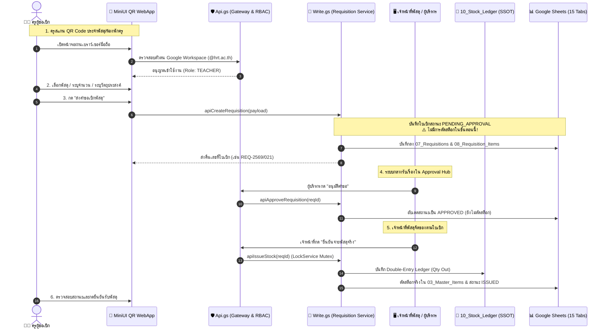
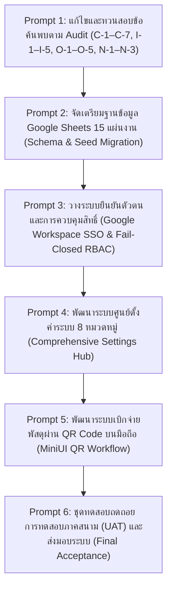
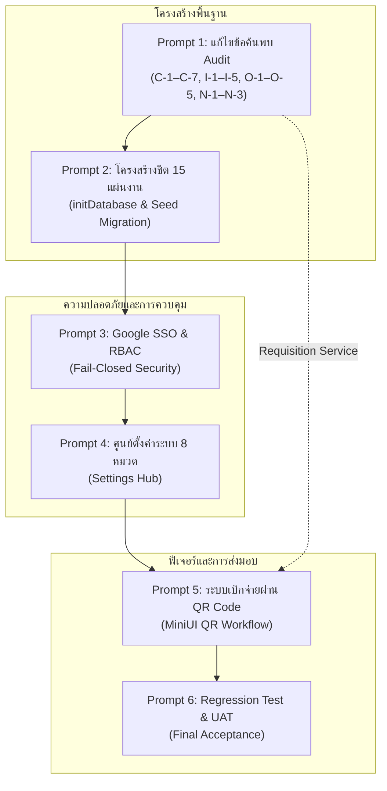

# แผนการดำเนินงานและสถาปัตยกรรมระบบ (System Implementation Plan)
**โครงการ:** ระบบบริหารจัดการพัสดุและคลังวัสดุโรงเรียน (HRT Inventory System v2.6.0)  
**เป้าหมายหลัก:** แก้ไขข้อบกพร่องตาม Audit Report, พัฒนาระบบตั้งค่า 8 หมวด, และพัฒนาระบบเบิกจ่ายผ่าน QR Code สำหรับครู (MiniUI QR Workflow)  
**รหัสเอกสาร:** `docs/IMPLEMENTATION_PLAN.md`  
**สถานะ:** ผ่านการประเมินฐานทางเทคนิค (Baseline Certified Plan)  

---

## 1. เป้าหมายสถาปัตยกรรมปลายทาง (End-to-End Architectural Target)

ระบบบริหารคลังพัสดุ โรงเรียนหรเทพ(รุ่งเรืองประชาสามัคคี) มุ่งสู่การเป็นศูนย์กลางข้อมูลพัสดุดิจิทัลแบบครบวงจร โดยมีวงจรการทำงานของ **ครูผู้เบิก ↔ งานพัสดุกลาง** ที่ใช้บริการ Backend, Requisition Service, และ Double-Entry Ledger ชุดเดียวกัน 100%:

---

## 2. ลำดับขั้นตอนการดำเนินงาน 6 ระยะ (Prompt 1–6 Execution Sequence)

แผนการดำเนินงานถูกแบ่งออกเป็น 6 ระยะย่อย เพื่อให้สามารถสอบทานและทดสอบความถูกต้องได้ในทุกขั้นตอน:

---

### ระยะที่ 1 (Prompt 1): แก้ไขและทวนสอบข้อค้นพบตาม Audit
- **ขอบเขตงาน:**
  - นำชุดแก้ไขข้อค้นพบ 20 รายการ (C-1 ถึง C-7, I-1 ถึง I-5, O-1 ถึง O-5, N-1 ถึง N-3) เข้าสู่ไฟล์ Backend (`Config.gs`, `Api.gs`, `Read.gs`, `Write.gs`, `Audit.gs`, `Code.gs`)
  - แยกขั้นตอนการขอเบิกกับการตัดสต็อกเด็ดขาด (Decoupled Requisition State Machine) แก้ไขปัญหา Double Stock Deduction ใน `index.html` และ `frontend/main/App.js`
  - พัฒนาระบบกรองข้อมูล 8 มิติ และการคำนวณ ABC Classification บน Active Inventory Universe
  - พัฒนาระบบแคชซิกเนเจอร์แดชบอร์ดที่ผูกกับปีงบประมาณและตัวนับเวอร์ชันข้อมูล (`_dataRevision`)
- **สิ่งที่ส่งมอบ (Deliverables):**
  - ไฟล์ Backend 6 ไฟล์พร้อมใช้งาน
  - ไฟล์ `index.html` และ `App.js` ที่ปลดตรรกะการตัดสต็อกล่วงหน้า
  - ชุดทดสอบ Regression Test ผ่านครบทุกกรณี

---

### ระยะที่ 2 (Prompt 2): จัดเตรียมฐานข้อมูล Google Sheets 15 แผ่นงาน
- **ขอบเขตงาน:**
  - สร้างและตรวจสอบฟังก์ชัน `initDatabase()` ใน `Code.gs` ให้สามารถสร้างและตรึงแถวหัวตารางทั้ง 15 แผ่นงานอัตโนมัติ
  - นำเข้าข้อมูลตั้งต้น (Seed Data) พัสดุ 100 รายการ, กลุ่มสาระฯ 14 หน่วยงาน, หมวดหมู่ 8 หมวด, คลัง 3 แห่ง, และรหัส FSN 7 รายการ
  - บังคับใช้ฟังก์ชัน `sanitizeCellValue()` ป้องกัน Formula Injection (`=`, `+`, `-`, `@`) และ XSS
  - ตรวจสอบความถูกต้องของคีย์หลักและคีย์อ้างอิงระหว่างชีต
- **สิ่งที่ส่งมอบ (Deliverables):**
  - สเปรดชีตฐานข้อมูล 15 แผ่นงานที่สมบูรณ์
  - บันทึกการกระทบยอด (Reconciliation Report) ระหว่าง Master Items และ Stock Ledger

---

### ระยะที่ 3 (Prompt 3): ระบบยืนยันตัวตนและการควบคุมสิทธิ์ (SSO & Fail-Closed RBAC)
- **ขอบเขตงาน:**
  - เชื่อมต่อการยืนยันตัวตนผ่าน Google Apps Script: `Session.getActiveUser().getEmail()`
  - ตรวจสอบโดเมนของสถานศึกษา `@hrt.ac.th` ปฏิเสธบัญชีภายนอกทันที
  - แมปบทบาทผู้ใช้ตามตาราง `01_Users`:
    - `TEACHER` / `REQUESTER`: สิทธิ์ดูพัสดุและขอเบิก
    - `OFFICER`: สิทธิ์รับเข้า, จ่ายพัสดุ, นำเข้า CSV, ตรวจนับสิ้นปี
    - `APPROVER`: สิทธิ์อนุมัติ/ไม่อนุมัติคำขอเบิก
    - `DIRECTOR`: สิทธิ์อนุมัติภาพรวมและรายงานราชการ
    - `ADMIN`: สิทธิ์ปิดปีงบประมาณและตั้งค่าระบบ
  - บังคับใช้การตรวจสิทธิ์แบบ Fail-Closed ใน `ApiRouter.routeRequest()` ก่อนส่งเข้าสู่ Business Handler
- **สิ่งที่ส่งมอบ (Deliverables):**
  - โมดูล RBAC Gatekeeper ที่ปลอดภัย 100%
  - หน้ายืนยันตัวตนและแสดงข้อมูลโปรไฟล์ผู้ใช้

---

### ระยะที่ 4 (Prompt 4): ศูนย์กลางการตั้งค่าระบบ 8 หมวดหมู่ (Comprehensive Settings Hub)
พัฒนาระบบตั้งค่าใน `viewSettings` และ Backend Service รองรับการปรับแต่งระบบ 8 ด้านหลัก:

| หมวดที่ | ชื่อหมวดการตั้งค่า | รายละเอียดการทำงานและพารามิเตอร์ที่ควบคุม |
| :---: | :--- | :--- |
| **1** | **ข้อมูลองค์กรและเอกสาร** | - ชื่อสถานศึกษา (โรงเรียนหรเทพ(รุ่งเรืองประชาสามัคคี)) - สังกัด (อบจ.สระบุรี) - รูปแบบเลขที่เอกสาร (Prefix: `REQ`, `RCV`, `ADJ`) - โลโก้และขนาดกระดาษพิมพ์รายงานราชการ (A4 Portrait/Landscape) |
| **2** | **ผู้ใช้งานและกำหนดสิทธิ์** | - จัดการรายชื่อครูและบุคลากรใน `01_Users` - มอบหมายบทบาทสิทธิ์ (Role Assignment) - กำหนดสายการอนุมัติตามกลุ่มสาระการเรียนรู้ |
| **3** | **การจัดการรอบปีงบประมาณ** | - กำหนดปีงบประมาณปัจจุบัน (`active_fiscal_year`) - วันเริ่มต้น (1 ต.ค.) และวันสิ้นสุด (30 ก.ย.) - การปิดรอบปีงบประมาณ (Freeze Snapshot & Rollover Opening Balance) |
| **4** | **ข้อมูลหลักและหมวดหมู่อ้างอิง** | - จัดการทะเบียน 8 หมวดหมู่วัสดุราชการ (`04_Categories`) - จัดการสถานที่จัดเก็บและคลังย่อย (`05_Warehouses`) - จัดการรายชื่อร้านค้า/ผู้จัดจำหน่าย (`Suppliers`) - การผูกรหัสพัสดุมาตรฐานภาครัฐ e-GP (`06_FSN_Catalog`) |
| **5** | **กติกาการเบิกจ่ายและสต็อก** | - กำหนดเกณฑ์พัสดุสำรองขั้นต่ำ (Min Stock) และจุดสั่งซื้อซ้ำ (ROP) - โควตาจำกัดจำนวนการเบิกต่อครั้ง/ต่อครูผู้เบิก - การเปิด/ปิดระบบแจ้งเตือนสต็อกวิกฤติทางอีเมล/LINE |
| **6** | **การเชื่อมต่อและคลาวด์** | - กำหนด Spreadsheet ID และ URL ปลายทางของ Google Apps Script - การล้างหน่วยความจำแคช (`invalidateCache()`) - ตรวจสอบสถานะการเชื่อมต่อแบบเรียลไทม์ (Health Check Ping) |
| **7** | **นำเข้า สำรอง และกู้คืนข้อมูล** | - นำเข้าข้อมูลพัสดุผ่าน CSV พร้อมโหมด Dry-Run และ Merge Mode - ดาวน์โหลดข้อมูลสำรอง Master Items (CSV UTF-8 with BOM) - ขั้นตอนการ Rollback ข้อมูลย้อนหลังผ่าน Version History |
| **8** | **ประวัติการตรวจสอบและความปลอดภัย** | - หน้าต่างสืบค้นประวัติการแก้ไขข้อมูลใน `11_Audit_Trail` - ปุ่มตรวจสอบความสมบูรณ์ของสายโซ่ดิจิทัล (SHA-256 Hash Chain Verification) - ระบบแจ้งเตือนการดัดแปลงข้อมูลย้อนหลัง (Tamper Detection Alert) |

---

### ระยะที่ 5 (Prompt 5): ระบบเบิกจ่ายพัสดุผ่าน QR Code (MiniUI QR Workflow)
- **สถาปัตยกรรม MiniUI QR:**
  - สร้างมุมมองย่อยเฉพาะสำหรับสมาร์ตโฟน (Mobile-First Web View) เรียกใช้งานผ่าน URL พารามิเตอร์:  
    `https://script.google.com/macros/s/{DEPLOYMENT_ID}/exec?mode=qr&item=OFF-001`
  - ออกแบบให้โหลดเร็วเป็นพิเศษ (Ultra-Lightweight `< 50KB`) ไม่ต้องโหลด Dashboard หรือ Chart.js
- **ขั้นตอนการทำงานของครูผู้เบิก (Teacher Flow):**
  1. ครูสแกน QR Code ประจำพัสดุ หรือ QR รวมประจำห้องพักครู
  2. ระบบตรวจสอบ Session บัญชี Google หรือให้เลือกชื่อตนเองจากรายชื่อกลุ่มสาระฯ
  3. ระบบแสดงข้อมูลพัสดุ: รูปภาพ, ชื่อ, หมวดหมู่, สต็อกคงเหลือปัจจุบัน, และหน่วยนับ
  4. ครูระบุจำนวนที่ต้องการเบิก และพิมพ์วัตถุประสงค์สั้นๆ
  5. กดปุ่ม **"ส่งคำขอเบิกพัสดุ"**
  6. ระบบสร้างคำขอใน `07_Requisitions` สถานะ `PENDING_APPROVAL` (สต็อกคงเดิม)
  7. แสดงหน้าสรุปเลขที่คำขอ พร้อมปุ่มติดตามสถานะ (Tracking Link)
- **ขั้นตอนฝั่งระบบกลางและคลังพัสดุ (Store & Approval Flow):**
  1. หัวหน้างานหรือผู้บริหารเปิดเมนู "คิวรออนุมัติ" ในหน้าจอหลัก กดอนุมัติคำขอ
  2. เจ้าหน้าที่พัสดุเปิดคิว "รอจ่ายพัสดุ" หยิบพัสดุจริงตามจำนวน
  3. กดยืนยันจ่ายพัสดุ (`apiIssueStock`) -> สต็อกในคลังลดลง และตัดบัญชีแยกประเภทคู่
  4. ระบบส่งสถานะอัปเดตไปยังหน้าจอของครูผู้เบิกเพื่อลงนามรับพัสดุ

---

### ระยะที่ 6 (Prompt 6): การทดสอบถดถอย การทดสอบภาคสนาม (UAT) และส่งมอบงาน
- **การทดสอบอัตโนมัติ (Automated Regression Testing):**
  - รันชุดทดสอบ `tests/regression_test_suite.js` ครบทั้ง 11 Scenarios (TC-01 ถึง TC-11)
- **การทดสอบการยอมรับของผู้ใช้ (User Acceptance Testing - UAT):**
  - ทดสอบจำลองการใช้งานจริงร่วมกับครูผู้สอน (5 ท่าน) ในการสแกน QR และส่งคำขอ
  - ทดสอบการอนุมัติและจ่ายพัสดุโดยเจ้าหน้าที่พัสดุและผู้บริหารโรงเรียน
- **การจัดทำเอกสารส่งมอบ:**
  - คู่มือการใช้งานสำหรับครู (User Manual - 1 หน้า A4 พับสาม)
  - คู่มือการบริหารจัดการสำหรับเจ้าหน้าที่พัสดุและผู้ดูแลระบบ (Admin Guide)

---

## 3. แผนภูมิความสัมพันธ์ของการพึ่งพา (Dependency Graph)

---

## 4. การประเมินระยะเวลาและทรัพยากรใหม่ตามสภาพความเป็นจริง (Realistic Effort Estimation)

### 4.1 ข้อวิเคราะห์เปรียบเทียบกรอบเวลาเดิม (8 สัปดาห์) กับสภาพจริง
ในรายงานตรวจสอบฉบับเดิมได้ประเมินระยะเวลาไว้ที่ **8 สัปดาห์ (464 ชั่วโมง)** ตามการประเมินแบบรับเหมาภายนอกแบบอนุรักษนิยม อย่างไรก็ดี จากการตรวจสอบหลักฐานจริงในโค้ดเบสพบว่า:
1. **ส่วนติดต่อผู้ใช้ (UI) เสร็จสมบูรณ์แล้วกว่า 85%** ไม่ต้องเสียเวลาออกแบบหน้าจอใหม่
2. **โค้ด Backend หลัก (`Config.gs`, `Api.gs`, `Read.gs`, `Write.gs`, `Audit.gs`) ได้รับการจัดทำโครงร่างและแก้ไขข้อค้นพบหลักไว้แล้วในพื้นที่ทำงาน**
3. **การประเมินใหม่ตามความเป็นจริง (Re-estimated Sprint Velocity):**  
   โครงการสามารถส่งมอบงานได้อย่างสมบูรณ์ภายใน **3 ถึง 4 สัปดาห์ (ประมาณ 60 ถึง 80 ชั่วโมงทำงานวิศวกรรม)**

### 4.2 ตารางแผนงานรายสัปดาห์ (Sprint Roadmap)

| ระยะงาน (Sprint) | เป้าหมายหลัก | ขอบเขตงานที่ต้องส่งมอบ | ชั่วโมงประมาณการ |
| :---: | :--- | :--- | :---: |
| **สัปดาห์ที่ 1** | **Backend Hardening & Settings Core** | - นำเข้าการแก้ไข C-1 ถึง C-7, I-1 ถึง I-5, O-1 ถึง O-5, N-1 ถึง N-3 - สร้างแผ่นงาน 15 Tabs ด้วย `initDatabase()` - ติดตั้งระบบความปลอดภัย Google SSO & RBAC - พัฒนาระบบตั้งค่าหมวด 1, 3, 6, 7 (องค์กร, ปีงบ, การเชื่อมต่อ, สำรองข้อมูล) | 24 ชม. |
| **สัปดาห์ที่ 2** | **Full Settings Hub & QR Architecture** | - พัฒนาระบบตั้งค่าหมวด 2, 4, 5, 8 (ผู้ใช้, ข้อมูลกลาง, กติกาเบิก, Audit Trail) - ออกแบบหน้าจอและกระบวนการทำงานของ MiniUI QR Requisition - สร้างระบบสร้าง QR Code ประจำพัสดุและห้องพักครู | 22 ชม. |
| **สัปดาห์ที่ 3** | **MiniUI QR End-to-End Integration** | - เชื่อมต่อการสแกน QR เข้ากับ Requisition Workflow ของระบบกลาง - ทดสอบการตัดสต็อกแบบ Double-Entry เมื่อมีการจ่ายจริง - ตรวจสอบการแจ้งเตือนและการติดตามสถานะของครู | 18 ชม. |
| **สัปดาห์ที่ 4** | **Testing, UAT & Production Cutover** | - รันการทดสอบถดถอย TC-01 ถึง TC-11 - ทำการทดสอบ UAT ร่วมกับครูและเจ้าหน้าที่พัสดุจริง - อบรมการใช้งานและส่งมอบระบบฉบับสมบูรณ์ | 14 ชม. |
| **รวมทั้งสิ้น** | | **4 สัปดาห์ (1 เดือน)** | **~78 ชม.** |

---

## 5. การวิเคราะห์ความเสี่ยงและมาตรการป้องกัน (Risk Analysis & Mitigations)

| ลำดับ | ปัจจัยความเสี่ยง | ระดับผลกระทบ | โอกาสเกิด | มาตรการป้องกันและแก้ไขเชิงวิศวกรรม |
| :---: | :--- | :---: | :---: | :--- |
| **R-1** | **Apps Script Execution Timeout (6 นาที)** การประมวลผลสต็อกสิ้นปีหรือการนำเข้า CSV จำนวนมากเกินเวลา | 🔴 สูง | 🟡 ปานกลาง | - ใช้การเขียนข้อมูลแบบ Batch (`Range.setValues()`) แทนการวนลูป `appendRow()` - จำกัดการนำเข้าพัสดุไม่เกิน 200 รายการต่อรอบ |
| **R-2** | **Race Condition ในการจ่ายพัสดุ** เจ้าหน้าที่และครูกดทำรายการพร้อมกันทำให้สต็อกติดลบ | 🔴 สูง | 🟡 ปานกลาง | - บังคับใช้ Mutex Lock ด้วย `LockService.getScriptLock()` พร้อม Timeout 60 วินาที - ตรวจสอบยอดสต็อกคงเหลือก่อนการตัดจ่ายทุกครั้ง หากไม่พอให้ปฏิเสธคำขอทันที |
| **R-3** | **การเชื่อมต่ออินเทอร์เน็ตของโรงเรียนขัดข้อง** ครูสแกน QR ไม่ได้ระหว่างสอน | 🟡 ปานกลาง | 🔴 สูง | - ออกแบบ MiniUI ให้มีขนาดเล็กมาก (`<50KB`) โหลดผ่านเครือข่าย 4G/5G มือถือได้ทันที - มีระบบบันทึกคำขอฉุกเฉินแบบออฟไลน์และซิงค์เมื่อเชื่อมต่อได้ |
| **R-4** | **ความไม่สอดคล้องระหว่าง `index.html` กับ `frontend/`** แก้ไขโค้ดที่ไฟล์หนึ่งแต่อีกไฟล์ไม่ได้รับการอัปเดต | 🟡 ปานกลาง | 🟡 ปานกลาง | - กำหนดให้ `index.html` เป็น Master Runtime Source และมี Checklist ตรวจสอบการซิงค์โค้ดไปยัง `frontend/main/App.js` ทุกครั้งที่มีการเปลี่ยนแปลง |
| **R-5** | **ความผิดพลาดในการลงบันทึกบัญชีแยกประเภท** ยอดผลรวมไม่ตรงกับยอดคงเหลือใน Master Items | 🔴 สูง | 🟢 ต่ำ | - มีระบบกระทบยอดอัตโนมัติ (Reconciliation Engine) ในหน้าตั้งค่าระบบ สามารถคำนวณและชี้จุดแตกต่างได้ทันที |
