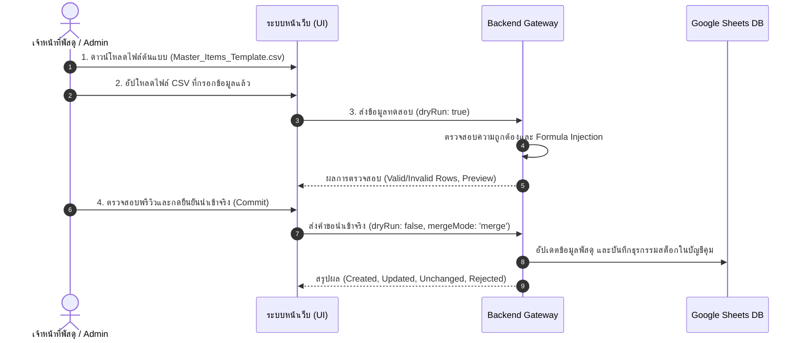

# คู่มือมาตรฐานการนำเข้าข้อมูล การสำรอง และการกู้คืนระบบ
## (CSV Import, Backup Bundle & Staging Restore Guidelines)
**ระบบบริหารจัดการพัสดุโรงเรียนหรเทพ(รุ่งเรืองประชาสามัคคี)**
**เวอร์ชันระบบ:** `v2.7.0-dev.4` | **มาตรฐาน:** ISO/IEC 27001 Data Integrity & OWASP CSV Security

---

## 1. กระบวนการนำเข้าข้อมูลพัสดุผ่านไฟล์ CSV (CSV Import Workflow)

ระบบนำเข้าข้อมูลพัสดุของ HRT Inventory System ถูกปรับปรุงให้เป็นไปตามข้อกำหนดความปลอดภัยและการตรวจสอบสิทธิ์อย่างเข้มงวด (Remediation Finding I-3) โดยแบ่งขั้นตอนการดำเนินงานออกเป็น 4 ขั้นตอน:



---

### 1.1 โครงสร้างคอลัมน์มาตรฐานของไฟล์นำเข้า (CSV Schema)

| ลำดับ | ชื่อคอลัมน์ (Header) | ชนิดข้อมูล | จำเป็น | รายละเอียดและเงื่อนไขการตรวจสอบ |
|:---:|---|---|:---:|---|
| 1 | `code` | ข้อความ | ✅ | รหัสพัสดุ (เช่น `OFF-001`, `COM-010`) ห้ามซ้ำซ้อนในคลังเดียวกัน |
| 2 | `fsn_code` | ข้อความ | ❌ | รหัสมาตรฐานพัสดุภาครัฐ (FSN) ถ้ามีระบบจะผูกความสัมพันธ์อัตโนมัติ |
| 3 | `name` | ข้อความ | ✅ | ชื่อพัสดุ ต้องมีความยาวอย่างน้อย 2 ตัวอักษร |
| 4 | `category` | ข้อความ | ✅ | หมวดหมู่วัสดุ (เช่น `วัสดุสำนักงาน`, `วัสดุคอมพิวเตอร์`) |
| 5 | `unit` | ข้อความ | ✅ | หน่วยนับ (เช่น `ชิ้น`, `กล่อง`, `รีม`, `ลิตร`) |
| 6 | `warehouse` | ข้อความ | ✅ | คลังจัดเก็บ (เช่น `คลังพัสดุกลาง (อาคาร 1)`) |
| 7 | `unit_cost` | ตัวเลข | ✅ | ราคาต่อหน่วย ต้องเป็นตัวเลข $\ge 0$ |
| 8 | `min` | ตัวเลข | ✅ | ปริมาณขั้นต่ำสำรองคลัง (Minimum Stock) |
| 9 | `stock` | ตัวเลข | ✅ | จำนวนคงเหลือเริ่มต้น ต้องเป็นตัวเลข $\ge 0$ |
| 10 | `supplier` | ข้อความ | ❌ | ผู้จัดจำหน่ายหรือแหล่งที่มา |

---

### 1.2 กฎความปลอดภัยและการตรวจสอบข้อมูล (Data Validation Rules)

1. **การป้องกันการแทรกสูตรคำนวณอันตราย (CSV Formula Injection Protection):**
   * ข้อความใดที่ขึ้นต้นด้วยอักขระ `=`, `+`, `-`, `@`, `\t` (Tab), หรือ `\r` (Carriage Return) จะถูกเติมเครื่องหมาย `'` นำหน้าโดยอัตโนมัติ เพื่อป้องกันการสั่งรันคำสั่ง Shell หรือ DDE Attack ผ่านโปรแกรม Microsoft Excel หรือ Google Sheets
2. **การบังคับใช้หน่วยนับจำนวนเต็ม (Integer Unit Constraint):**
   * พัสดุที่มีหน่วยนับเป็นของชิ้นเดี่ยว (`ชิ้น`, `อัน`, `กล่อง`, `เล่ม`, `รีม`, `ด้าม`, `ชุด`, `แพ็ค`) **ไม่อนุญาตให้กรอกจำนวนคงเหลือเป็นทศนิยม** เช่น กรอก `1.5` กล่อง จะถูกปฏิเสธด้วยรหัสข้อผิดพลาด `DECIMAL_NOT_ALLOWED`
   * พัสดุที่สามารถแบ่งย่อยได้ (`กิโลกรัม`, `เมตร`, `ลิตร`) อนุญาตให้มีทศนิยมได้
3. **การจับคู่ข้อมูลตามคีย์ผสม (Composite Key Matching):**
   * ระบบจับคู่รายการเดิมในฐานข้อมูลโดยใช้ `code + warehouse` เพื่อป้องกันการเขียนทับพัสดุที่มีรหัสเดียวกันแต่อยู่คนละคลังจัดเก็บ
4. **ข้อห้ามการลบข้อมูลเดิม (Forbid Delete-First Policy):**
   * ไม่อนุญาตให้ล้างตาราง (Truncate / Wipe) ก่อนการนำเข้าโดยเด็ดขาด เพื่อป้องกันการสูญหายของประวัติข้อมูล
5. **การลงบัญชีคุมสต็อกแบบไม่ทำลายข้อมูล (Non-Destructive Ledger Routing):**
   * กรณีนำเข้ารายการเดิมและมีจำนวนสต็อกเปลี่ยนแปลง ระบบจะไม่แก้ไขยอดในอดีต แต่จะสร้างธุรกรรมการปรับยอด (`ADJUSTMENT_ADD` หรือ `ADJUSTMENT_SUB`) ในชีต `09_Stock_Transactions` และ `10_Stock_Ledger` พร้อมบันทึกประวัติการตรวจสอบเสมอ

---

## 2. การสำรองข้อมูลระบบ (Full Backup Bundle Architecture)

### 2.1 ข้อแตกต่างสำคัญระหว่างการส่งออก CSV กับชุดสำรองข้อมูลระบบ

> [!IMPORTANT]
> **การส่งออก Master Items CSV $\ne$ การสำรองข้อมูลระบบ (Backup Bundle)**
> * **Master Items CSV Export:** เป็นเพียงการส่งออกรายชื่อและยอดคงเหลือปัจจุบันของพัสดุเพื่อใช้ทำรายงานหรือวิเคราะห์ข้อมูล
> * **Full Backup Bundle:** คือชุดข้อมูลโครงสร้างและบันทึกประวัติของทั้ง 16 ตารางฐานข้อมูล ซึ่งจำเป็นต่อการกู้คืนระบบให้กลับมาทำงานได้อย่างสมบูรณ์

---

### 2.2 โครงสร้างของชุดข้อมูลสำรองสมบูรณ์แบบ (16 Canonical Sheets)

ชุดสำรองข้อมูลของ HRT Inventory System ครอบคลุมตารางข้อมูลมาตรฐานทั้ง 16 แผ่น (ไม่รวม Script Properties, รหัสผ่าน, หรือ Google Client Secret):

```
HRT_Backup_Bundle_v2.7.0/
├── 01_Users.csv                 (ข้อมูลผู้ใช้งานและสิทธิ์)
├── 02_Departments.csv           (โครงสร้างกลุ่มสาระและแผนก)
├── 03_Master_Items.csv          (บัญชีรายการพัสดุและสต็อกปัจจุบัน)
├── 04_Categories.csv            (หมวดหมู่พัสดุและรหัสคำนำหน้า)
├── 05_Warehouses.csv            (คลังพัสดุและสถานที่จัดเก็บ)
├── 06_FSN_Catalog.csv           (ทะเบียนรหัสพัสดุภาครัฐ FSN)
├── 07_Requisitions.csv          (ประวัติและสถานะใบเบิกพัสดุ)
├── 08_Requisition_Items.csv     (รายการพัสดุในแต่ละใบเบิก)
├── 09_Stock_Transactions.csv    (ธุรกรรมการรับ-จ่าย-ปรับยอดทั้งหมด)
├── 10_Stock_Ledger.csv          (สมุดบัญชีคุมยอดคงเหลือรายธุรกรรม)
├── 11_Audit_Trail.csv           (บันทึกการตรวจสอบความปลอดภัย SHA-256)
├── 12_Fiscal_Years.csv          (รอบปีงบประมาณและสถานะการปิดบัญชี)
├── 13_Year_End_Audits.csv       (บันทึกผลการตรวจนับพัสดุสิ้นปี)
├── 14_Disposal_Records.csv      (บันทึกการจำหน่ายพัสดุชำรุด/เสื่อมสภาพ)
├── 15_Settings_Config.csv       (ค่ากำหนดระบบและกฎเกณฑ์ทางธุรกิจ)
├── 16_Idempotency_Log.csv       (บันทึกป้องกันธุรกรรมซ้ำซ้อน)
└── manifest.json                (เมทาดาทา วันที่สำรอง และลายมือชื่อดิจิทัล)
```

---

## 3. ขั้นตอนการกู้คืนข้อมูลในสภาพแวดล้อมทดสอบ (Staging-Only Restore Protocol)

เพื่อความปลอดภัยสูงสุดของข้อมูลโรงเรียน การกู้คืนข้อมูลมีข้อกำหนดและขั้นตอนดังนี้:

### ข้อกำหนดความปลอดภัย:
1. **ห้ามกู้คืนทับฐานข้อมูลจริง (Production) โดยตรง:** ต้องกู้คืนเข้าสู่ Google Spreadsheet ที่แยกต่างหากสำหรับทดสอบ (Staging Spreadsheet) เสมอ
2. **การตรวจสอบความครบถ้วนของสคีมา (Schema Integrity Check):** ระบบปลายทางต้องผ่านการทดสอบ `apiCheckHealth` โดยตรวจพบชีตมาตรฐานครบทั้ง 16 แผ่น
3. **การตรวจสอบความถูกต้องของสายแฮช (Hash Chain Verification):** เมื่อกู้คืนแล้ว ต้องรันฟังก์ชัน `apiVerifyAuditIntegrity` เพื่อตรวจสอบว่าไม่มีแถวใดถูกแก้ไขดัดแปลง

### ขั้นตอนการปฏิบัติ:
1. สร้าง Google Spreadsheet ใหม่ และคัดลอก Spreadsheet ID
2. กำหนด `SPREADSHEET_ID` ใน Script Properties ของโปรเจกต์ Staging
3. รันฟังก์ชัน `initDatabase()` เพื่อสร้างหัวตารางมาตรฐานทั้ง 16 แผ่น
4. นำเข้าข้อมูลย้อนหลังตามลำดับ: `Users` $\rightarrow$ `Departments` $\rightarrow$ `Master_Items` $\rightarrow$ `FSN` $\rightarrow$ `Fiscal_Years` $\rightarrow$ `Stock_Ledger`
5. ตรวจสอบความถูกต้องของยอดคงเหลือผ่านฟังก์ชัน `apiReconcileStockBalances`
6. บันทึกประวัติการกู้คืนลงใน `11_Audit_Trail`
