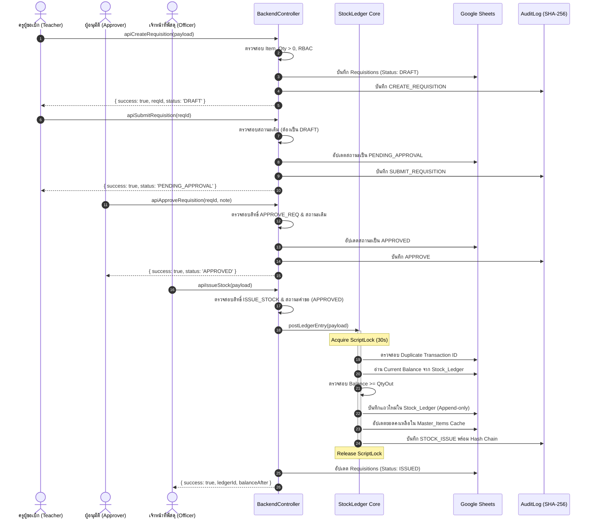
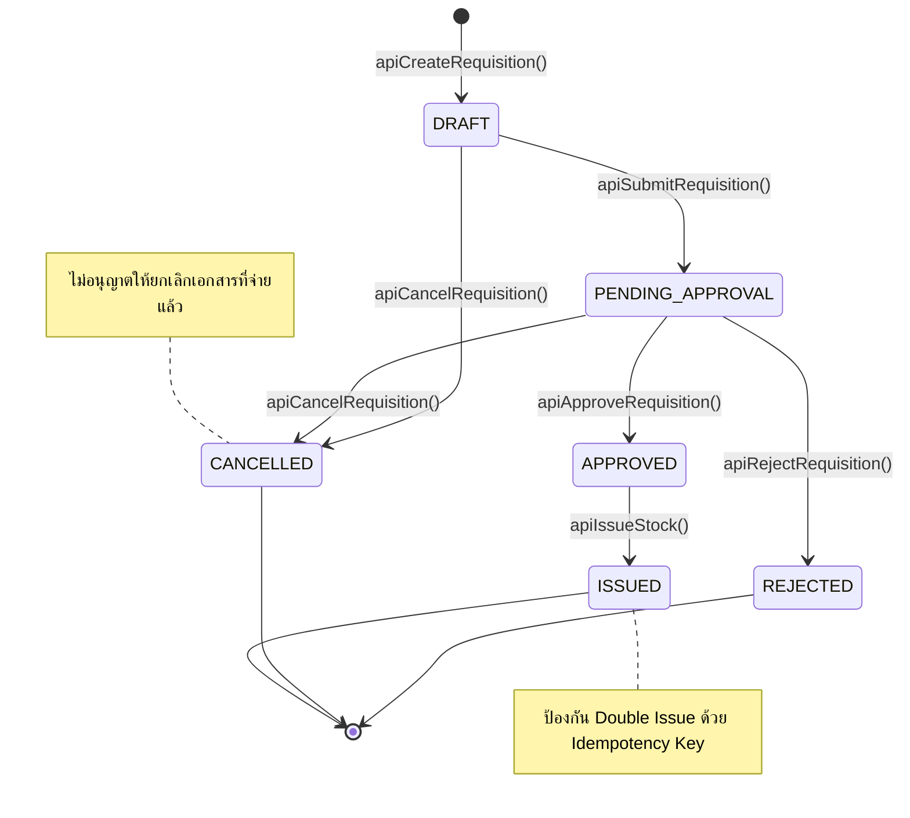

# 📋 INTEGRATION TEST PLAN
## แผนการทดสอบเชิงบูรณาการแบบครอบคลุมรอบด้าน (End-to-End Integration Test Plan)
### ระบบบริหารคลังพัสดุโรงเรียน โรงเรียนหรเทพ(รุ่งเรืองประชาสามัคคี)

**รหัสเอกสาร:** SIMS-ITP-2026-001  
**เวอร์ชัน:** 2.0.0 (Production Core Test Plan)  
**วันที่ประกาศใช้:** 27 กันยายน 2569  
**เกณฑ์คุณภาพ:** Critical Test ต้องผ่าน 100% (Zero Tolerance for Critical Failures)

---

## 1. วัตถุประสงค์และขอบเขต (Objectives & Scope)

แผนการทดสอบเชิงบูรณาการนี้จัดทำขึ้นเพื่อทดสอบการทำงานประสานกันของระบบบริหารคลังพัสดุสถานศึกษาตั้งแต่ต้นจนจบ (End-to-End Lifecycle) ให้เป็นไปตามระเบียบกระทรวงการคลังว่าด้วยการจัดซื้อจัดจ้างและการบริหารพัสดุภาครัฐ พ.ศ. 2560 อย่างเคร่งครัด โดยมุ่งเน้น:

1. **ความถูกต้องของกระบวนการเบิกจ่ายตามลำดับขั้นราชการ (Governance Flow):**
   - ครูผู้ขอเบิก (Teacher) $\rightarrow$ สร้างคำขอ (Create) $\rightarrow$ ยืนยันส่ง (Submit)
   - ผู้มีอำนาจอนุมัติ (Approver) $\rightarrow$ ตรวจสอบ (Review) $\rightarrow$ อนุมัติ (Approve)
   - เจ้าหน้าที่พัสดุ (Supply Officer) $\rightarrow$ ตัดจ่ายพัสดุ (Issue)
   - ระบบหลังบ้าน (System) $\rightarrow$ บันทึกบัญชีคุม (Ledger) $\rightarrow$ ปรับยอดคงคลัง (Balance) $\rightarrow$ บันทึกประวัติความปลอดภัย (Audit)
2. **ความแข็งแกร่งของกฎความปลอดภัยและความถูกต้องของข้อมูล (Invariants & Integrity):**
   - สกัดกั้นการจ่ายพัสดุเกินสต็อกจริงในคลัง (Prevent Negative Stock)
   - ป้องกันการทำรายการซ้ำซ้อน (Prevent Duplicate Submit, Duplicate Approve, Double Issue)
   - ควบคุมสิทธิ์การเข้าถึงตามบทบาทหน้าที่ (Role-Based Access Control - RBAC)
   - สกัดกั้นผู้ใช้งานที่ถูกระงับสิทธิ์ (Disabled User Blocking)
   - จัดการการทำงานพร้อมกัน (Concurrency & Race Condition) ด้วย `LockService`
   - ความทนทานต่อข้อผิดพลาด (Fault Tolerance & Deadlock-Free Guarantee)

---

## 2. สถาปัตยกรรมและแผนภาพลำดับการทำงาน (Architecture & Sequence Flow)

### 2.1 แผนภาพลำดับการทำงานหลัก (Primary Scenario Sequence Diagram)

### 2.2 แผนภาพวงจรสถานะเอกสารคำขอเบิก (Requisition State Machine)

---

## 3. เมทริกซ์สิทธิ์และความรับผิดชอบตามบทบาท (RBAC Matrix)

| บทบาท (Role) | ผู้ใช้งานตัวแทน | สิทธิ์ที่ได้รับ (Permissions) | การกระทำที่ได้รับอนุญาต | การกระทำที่ต้องถูกบล็อก (Prohibited) |
| :--- | :--- | :--- | :--- | :--- |
| **TEACHER** | `USR-TEACHER-01` | `CREATE_REQ`, `SUBMIT_REQ`, `CANCEL_REQ`, `READ_ITEMS` | สร้างคำขอ, ส่งรออนุมัติ, ขอยกเลิก | อนุมัติคำขอ, ตัดจ่ายพัสดุ, รับพัสดุเข้าคลัง |
| **DIRECTOR** | `USR-DIRECTOR-01` | `APPROVE_REQ`, `REJECT_REQ`, `VIEW_LEDGER`, `VIEW_AUDIT` | พิจารณาอนุมัติ/ไม่อนุมัติ, เรียกดูบัญชีคุม | ตัดจ่ายพัสดุออกจากคลังโดยตรง |
| **STAFF_SUPPLY** | `USR-ANANT-01` | `READ_ITEMS`, `ISSUE_STOCK`, `RECEIVE_STOCK`, `VIEW_LEDGER` | ตัดจ่ายพัสดุ, ตรวจรับพัสดุ, ปรับปรุงยอด | อนุมัติคำขอตนเอง (ถ้าไม่มีสิทธิ์มอบหมาย) |
| **DISABLED** | `USR-DISABLED-01` | *(บัญชีถูกระงับสิทธิ์)* | ไม่มี (ถูกบล็อกทุกการกระทำ) | ทุกฟังก์ชันในระบบ |

---

## 4. รายละเอียดกรณีทดสอบทั้ง 13 กรณี (Test Cases Specification)

### หมวดที่ 1: การทำงานตามวงจรปกติ (Happy Path)

#### **TC-01: Scenario หลัก (Teacher $\rightarrow$ Approver $\rightarrow$ Officer $\rightarrow$ System)**
- **ระดับความสำคัญ:** 🔴 Critical
- **วัตถุประสงค์:** ตรวจสอบกระบวนการเบิกจ่ายพัสดุตั้งแต่ต้นจนจบสมบูรณ์ทุกขั้นตอน
- **ขั้นตอนการทดสอบ:**
  1. ครู (`USR-TEACHER-01`) สร้างคำขอเบิกพัสดุ `OFF-001` จำนวน 3 รีม
  2. ครูยืนยันส่งคำขอ (`apiSubmitRequisition`)
  3. ผู้อำนวยการ (`USR-DIRECTOR-01`) อนุมัติคำขอ (`apiApproveRequisition`)
  4. เจ้าหน้าที่พัสดุ (`USR-ANANT-01`) ตัดจ่ายพัสดุออกจากคลัง (`apiIssueStock`)
- **ผลลัพธ์ที่คาดหวัง:**
  - สถานะคำขอเปลี่ยนตามลำดับ: `DRAFT` $\rightarrow$ `PENDING_APPROVAL` $\rightarrow$ `APPROVED` $\rightarrow$ `ISSUED`
  - เกิดแถวใหม่ใน `Stock_Ledger` พร้อม `Ledger_ID`, `Balance_After` ที่ถูกต้อง
  - ยอดใน `Master_Items` ลดลง 3 หน่วย
  - มีประวัติ Audit Log ครบทั้ง 4 กิจกรรมต่อเนื่องกัน

---

### หมวดที่ 2: ความถูกต้องของปริมาณและสต็อก (Quantity & Stock Integrity)

#### **TC-02: ขอเบิก/จ่าย มากกว่า Stock คงเหลือในคลัง (Request > Stock)**
- **ระดับความสำคัญ:** 🔴 Critical
- **วัตถุประสงค์:** ป้องกันไม่ให้เกิดยอดคงเหลือติดลบในคลังพัสดุเด็ดขาด (Invariant: $\text{Stock} \ge 0$)
- **เงื่อนไขนำเข้า:** พัสดุ `IT-011` มียอดคงเหลือในคลัง 2 หน่วย พยายามสั่งตัดจ่าย 50 หน่วย
- **ผลลัพธ์ที่คาดหวัง:**
  - ระบบปฏิเสธการทำรายการและโยนข้อผิดพลาด `InsufficientStockException`
  - ไม่มีการบันทึกแถวใหม่ใน `Stock_Ledger`
  - ยอดคงเหลือในคลังคงเดิมที่ 2 หน่วย

#### **TC-03: จำนวนขอเบิกหรือจ่ายเป็นศูนย์ (Qty = 0)**
- **ระดับความสำคัญ:** 🔴 Critical
- **วัตถุประสงค์:** ดักจับและปฏิเสธข้อมูลที่ไม่มีความเคลื่อนไหวทางพัสดุ
- **เงื่อนไขนำเข้า:** สร้างคำขอหรือสั่งตัดจ่ายด้วย `qty = 0`
- **ผลลัพธ์ที่คาดหวัง:**
  - ปฏิเสธทันทีด้วยข้อผิดพลาด `ValidationException: จำนวนต้องมากกว่า 0`
  - ไม่เกิดธุรกรรมในระบบ

#### **TC-04: จำนวนขอเบิกหรือจ่ายเป็นค่าติดลบ (Negative Qty)**
- **ระดับความสำคัญ:** 🔴 Critical
- **วัตถุประสงค์:** ป้องกันช่องโหว่การเพิ่มยอดสต็อกผ่านฟังก์ชันจ่ายพัสดุ (Negative Issue Exploit)
- **เงื่อนไขนำเข้า:** สั่งตัดจ่ายด้วย `qty = -10` หรือ `qty = -5`
- **ผลลัพธ์ที่คาดหวัง:**
  - ปฏิเสธทันทีด้วยข้อผิดพลาด `ValidationException: จำนวนต้องไม่เป็นค่าติดลบ`

---

### หมวดที่ 3: ป้องกันการทำรายการซ้ำซ้อนและการยกเลิก (Idempotency & State Transitions)

#### **TC-05: ป้องกันการกดยืนยันส่งคำขอซ้ำซ้อน (Duplicate Submit)**
- **ระดับความสำคัญ:** 🔴 Critical
- **วัตถุประสงค์:** ป้องกันคำขอซ้ำหรือการกด Submit รัวจากหน้าเว็บ
- **ขั้นตอนการทดสอบ:** เรียก `apiSubmitRequisition(reqId)` สองครั้งติดต่อกัน
- **ผลลัพธ์ที่คาดหวัง:**
  - ครั้งที่ 1: สำเร็จ สถานะเปลี่ยนเป็น `PENDING_APPROVAL`
  - ครั้งที่ 2: ถูกปฏิเสธด้วย `DuplicateSubmitException: คำขอได้ถูกส่งเพื่อรออนุมัติไปแล้ว`

#### **TC-06: ป้องกันการอนุมัติคำขอซ้ำซ้อน (Duplicate Approve)**
- **ระดับความสำคัญ:** 🔴 Critical
- **วัตถุประสงค์:** ป้องกันการบันทึกอนุมัติซ้ำและการเบิกลอย
- **ขั้นตอนการทดสอบ:** เรียก `apiApproveRequisition(reqId)` บนคำขอที่สถานะเป็น `APPROVED` แล้ว
- **ผลลัพธ์ที่คาดหวัง:**
  - ปฏิเสธด้วยข้อผิดพลาด `DuplicateApproveException`

#### **TC-07: ป้องกันการตัดจ่ายพัสดุซ้ำซ้อน (Double Issue Prevention)**
- **ระดับความสำคัญ:** 🔴 Critical
- **วัตถุประสงค์:** ป้องกันการจ่ายพัสดุซ้ำจากใบเบิกเดิม หรือการใช้ Transaction_ID เดิม
- **ขั้นตอนการทดสอบ:** สั่งจ่ายพัสดุด้วยใบเบิกเดิมหรือ Transaction ID เดิมซ้ำครั้งที่ 2
- **ผลลัพธ์ที่คาดหวัง:**
  - ครั้งที่ 1: ตัดจ่ายสำเร็จ สต็อกลดลง 1 หน่วย
  - ครั้งที่ 2: ถูกปฏิเสธทันทีด้วย `DuplicateIssueException: ปฏิเสธการจ่ายซ้ำ (Double Issue Prevented)`
  - สต็อกไม่ถูกตัดลดลงเป็นครั้งที่สอง

#### **TC-08: ขอยกเลิกคำขอเบิกพัสดุ (Cancel Flow & Block Subsequent Actions)**
- **ระดับความสำคัญ:** 🟡 High
- **วัตถุประสงค์:** รองรับการยกเลิกคำขอก่อนจ่ายพัสดุ และป้องกันการนำคำขอที่ยกเลิกแล้วไปอนุมัติหรือจ่าย
- **ขั้นตอนการทดสอบ:**
  1. ครูยกเลิกคำขอ (`apiCancelRequisition`)
  2. ผู้อำนวยการพยายามอนุมัติคำขอที่ยกเลิกแล้ว
- **ผลลัพธ์ที่คาดหวัง:**
  - สถานะเปลี่ยนเป็น `CANCELLED`
  - การพยายามอนุมัติหรือจ่ายพัสดุหลังจากนั้นต้องถูกปฏิเสธทันที

---

### หมวดที่ 4: ความปลอดภัยและการควบคุมสิทธิ์ (Security & RBAC)

#### **TC-09: ป้องกันการเข้าถึงโดยไม่ได้รับอนุญาต (Unauthorized Access / RBAC)**
- **ระดับความสำคัญ:** 🔴 Critical
- **วัตถุประสงค์:** ป้องกันการยกระดับสิทธิ์ (Privilege Escalation)
- **ขั้นตอนการทดสอบ:**
  - ใช้บัญชีครู (`USR-TEACHER-01`) พยายามอนุมัติคำขอ (`apiApproveRequisition`)
  - ใช้บัญชีครู พยายามตัดจ่ายพัสดุ (`apiIssueStock`)
- **ผลลัพธ์ที่คาดหวัง:**
  - ปฏิเสธทั้ง 2 รายการด้วยข้อผิดพลาด `UnauthorizedAccessException`

#### **TC-10: สกัดกั้นผู้ใช้งานที่ถูกระงับสิทธิ์ (Disabled User Blocking)**
- **ระดับความสำคัญ:** 🔴 Critical
- **วัตถุประสงค์:** ป้องกันอดีตบุคลากรหรือบัญชีที่ถูกสั่งพักงานเข้ามาทำรายการในระบบ
- **ขั้นตอนการทดสอบ:** ใช้บัญชี `USR-DISABLED-01` พยายามสร้างคำขอเบิกพัสดุ
- **ผลลัพธ์ที่คาดหวัง:**
  - ปฏิเสธทันทีด้วยข้อผิดพลาด `DisabledUserException: บัญชีผู้ใช้ถูกระงับการใช้งาน`

#### **TC-11: ดักจับและปฏิเสธรหัสพัสดุที่ไม่มีอยู่ในระบบ (Invalid Item)**
- **ระดับความสำคัญ:** 🔴 Critical
- **วัตถุประสงค์:** รักษาความถูกต้องของ Foreign Key ในคลังพัสดุ
- **เงื่อนไขนำเข้า:** สั่งเบิกพัสดุด้วยรหัส `UNKNOWN-999`
- **ผลลัพธ์ที่คาดหวัง:**
  - ปฏิเสธทันทีด้วยข้อผิดพลาด `ItemNotFoundException`

---

### หมวดที่ 5: การทำงานพร้อมกันและความทนทานต่อข้อผิดพลาด (Concurrency & Fault Tolerance)

#### **TC-12: การจำลองการตัดจ่ายพร้อมกัน (Concurrent Issue & LockService)**
- **ระดับความสำคัญ:** 🔴 Critical
- **วัตถุประสงค์:** ตรวจสอบว่า `LockService` จัดคิวแบบ Atomic ปราศจาก Race Condition
- **ขั้นตอนการทดสอบ:** จำลองการขอ Lock ซ้อนกัน และการตัดจ่ายสต็อกคงเหลือน้อยแบบต่อเนื่อง
- **ผลลัพธ์ที่คาดหวัง:**
  - คำขอเข้าคิวตามลำดับ ยอดสต็อกคำนวณถูกต้องแม่นยำ ไม่มียอดติดลบ

#### **TC-13: ความทนทานต่อข้อผิดพลาดฐานข้อมูลและการคืนสิทธิ์ Lock (Database Error)**
- **ระดับความสำคัญ:** 🔴 Critical
- **วัตถุประสงค์:** ยืนยันว่าหากเกิดข้อผิดพลาดระหว่างทำงาน ระบบต้องปล่อย Lock ในบล็อก `finally` เสมอ และไม่เกิด Deadlock
- **ขั้นตอนการทดสอบ:** ส่ง Payload เสียหายอย่างรุนแรงให้โยน Exception แล้วตรวจสอบว่าคำสั่งถัดไปสามารถขอ Lock ได้ตามปกติหรือไม่
- **ผลลัพธ์ที่คาดหวัง:**
  - ระบบคืนสิทธิ์ Lock สมบูรณ์ คำขอถัดไปทำงานได้ปกติโดยไม่มีอาการค้าง (No Deadlock)

---

## 5. เกณฑ์การประเมินและการผ่านการทดสอบ (Quality Gate & Criteria)

1. **อัตราการผ่านของชุดทดสอบวิกฤต (Critical Tests Pass Rate):** **ต้องผ่าน 100% (13/13 ผ่าน)**
2. **ความสมบูรณ์ของสมการคลังพัสดุ (Inventory Equation Balance):** ผลต่างสุทธิ ($\text{Discrepancy}$) ต้องเท่ากับ 0 เสมอ
3. **การตรวจสอบย้อนกลับ (Audit Traceability):** ทุก Action ต้องมีบันทึก Audit Log พร้อมแฮช SHA-256 เชื่อมโยงกันอย่างถูกต้อง
