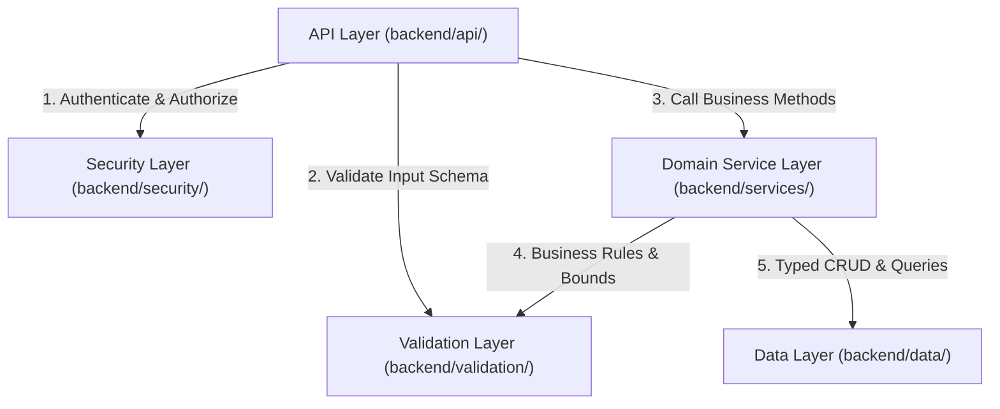

# Layer Dependency Rules & Architectural Invariants
## HRT School Inventory Management System (ระบบบริหารจัดการพัสดุและคลังวัสดุโรงเรียน)

> **Document Status**: Mandatory Architectural Standards & Boundary Invariants  
> **Target Audience**: Core Developers, Contributors & Automated Code Reviewers  

---

## 1. Unidirectional Dependency Rule

All code in the backend follows a strict **downward-only dependency rule**:

$$\text{API Layer} \longrightarrow \text{Security / Validation Layer} \longrightarrow \text{Domain Service Layer} \longrightarrow \text{Data Persistence Layer}$$

---

## 2. Layer-Specific Boundary Rules & Anti-Patterns

### 2.1 API Layer (`backend/api/`)
- **Allowed Outbound Calls**:
  - `Security Layer` (`Auth`, `RBAC`, `PermissionRegistry`)
  - `Validation Layer` (`ValidationService`, `ErrorService`)
  - `Domain Service Layer` (`ItemService`, `RequisitionService`, `StockService`, etc.)
- **Prohibited Calls (Strictly Forbidden)**:
  - ❌ NEVER call `SpreadsheetApp` directly.
  - ❌ NEVER execute direct database CRUD operations via `Database` or `Repository`.
  - ❌ NEVER contain business logic calculations (e.g. balance math, state transition rules).
  - ❌ NEVER leak unhandled raw exceptions or stack traces to the client response.

### 2.2 Domain Service Layer (`backend/services/`)
- **Allowed Outbound Calls**:
  - `Validation Layer` (`ValidationService`, `ErrorService`)
  - `Data Layer` (`Repository`, `Schema`, `IdService`)
  - Internal helper services (e.g. `StockService` calling `LedgerService`)
- **Prohibited Calls (Strictly Forbidden)**:
  - ❌ NEVER access `SpreadsheetApp` directly (all persistence must flow through `Repository`).
  - ❌ NEVER accept raw unvalidated client parameters without sanitization.
  - ❌ NEVER trust client-supplied user roles; identity must always resolve from `Auth.getCurrentUser()`.
  - ❌ NEVER update or delete rows in `Stock_Ledger` or `Audit_Trail`.

### 2.3 Data Layer (`backend/data/`)
- **Allowed Outbound Calls**:
  - `Database.gs` may call `SpreadsheetApp` (or use internal in-memory fallback).
  - `Repository.gs` calls `Database.gs` and `Schema.gs`.
- **Prohibited Calls (Strictly Forbidden)**:
  - ❌ NEVER import or call Domain Services (`ItemService`, `StockService`, etc.).
  - ❌ NEVER embed business logic (e.g. checking whether a requisition is approved).
  - ❌ NEVER format Thai currency or display strings in this layer.

### 2.4 Security Layer (`backend/security/`)
- **Allowed Outbound Calls**:
  - `ErrorService.gs` to throw standardized `FORBIDDEN` or `UNAUTHORIZED` errors.
  - `Repository.gs` (read-only queries to `Users` table).
- **Prohibited Calls (Strictly Forbidden)**:
  - ❌ NEVER modify domain entity tables (`Master_Items`, `Stock_Ledger`, `Requisitions`).
  - ❌ NEVER bypass RBAC checks based on frontend query parameters.

### 2.5 Validation Layer (`backend/validation/`)
- **Characteristics**: Pure functions with zero side effects.
- **Prohibited Calls (Strictly Forbidden)**:
  - ❌ NEVER mutate state or write to database.
  - ❌ NEVER call external APIs or domain services.

---

## 3. Critical Architectural Invariants

### 🔴 Invariant 1: Double-Entry Immutable Ledger
- The `Stock_Ledger` sheet is **strictly append-only**.
- Any attempt to execute `update()` or `deleteRecord()` on `Stock_Ledger` throws a fatal `LEDGER_IMMUTABILITY_VIOLATION`.
- `Master_Items.current_stock` is a cached projection of the ledger. The single source of truth (SSOT) is always the running balance of `Stock_Ledger`.

### 🔴 Invariant 2: Distributed Lock Mutex Protection
- Every operation that mutates physical stock (`receiveStock`, `issueRequisitionStock`, `adjustStock`) MUST be wrapped in a distributed mutex lock via `LockService.getScriptLock()` with a maximum timeout of 10,000ms.
- If the lock cannot be acquired within 10 seconds, the operation aborts with code `LOCK_TIMEOUT` to prevent dirty reads or race conditions.

### 🔴 Invariant 3: Zero Negative Stock
- Stock balances must never drop below zero.
- Requisitions cannot request more than the current available stock.
- Physical issuance validates balances before executing deductions.

### 🔴 Invariant 4: Formula Injection Mitigation
- All user-supplied string inputs written to Google Sheets must be sanitized via `ValidationService.sanitizeString()`.
- Any string starting with formula operators (`=`, `+`, `-`, `@`) is automatically escaped by prepending a single quote (`'`).

### 🔴 Invariant 5: Standard Response Envelope
- Every API endpoint without exception returns the standard envelope:
  - Success: `{ success: true, data: ..., requestId: string, timestamp: string }`
  - Error: `{ success: false, error: { code, message, details }, requestId: string, timestamp: string }`
