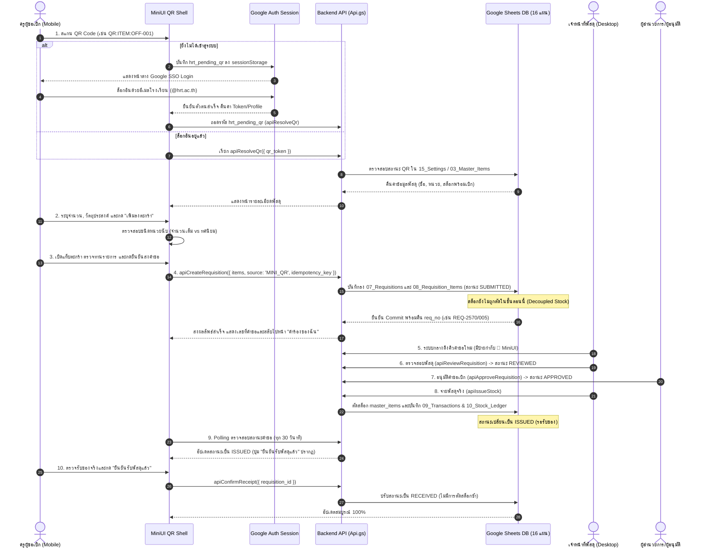

# คู่มือสถาปัตยกรรมและขั้นตอนการทำงานระบบ MiniUI & QR Code (MiniUI QR End-to-End Workflow Specification)
## HRT Inventory System v2.7.0-dev.3 (โรงเรียนหรเทพ(รุ่งเรืองประชาสามัคคี))

---

### 1. บทนำและแนวคิดการออกแบบ (Overview & Architectural Philosophy)

ส่วนติดต่อผู้ใช้ **MiniUI Mobile & QR Shell** ถูกพัฒนาขึ้นเพื่ออำนวยความสะดวกให้แก่ครูและบุคลากรทางการศึกษาในการขอเบิกพัสดุและติดตามสถานะผ่านสมาร์ทโฟนหรืออุปกรณ์พกพาได้อย่างรวดเร็ว โดยยึดหลักการออกแบบเชิงระบบ 5 ประการ:

1. **Shared Unified Backend Services**:
   - MiniUI ไม่สร้างฐานข้อมูล คลังพัสดุ หรือคิวคำร้องแยกต่างหาก แต่เชื่อมต่อกับบริการธุรกิจ (`RequisitionApi`, `ItemApi`, `ApiRouter`) และชีตข้อมูลเดียวกันกับระบบกลาง 100%
2. **Deep-Link Session Continuity**:
   - เมื่อครูสแกน QR Code จากกล้องมือถือในขณะที่ยังไม่ได้เข้าสู่ระบบ ระบบจะบันทึกจุดหมายปลายทางไว้ใน `sessionStorage` (`hrt_pending_qr`) และส่งผู้ใช้กลับมายังรายการพัสดุหรือคำร้องที่สแกนไว้ทันทีหลังล็อกอินสำเร็จ
3. **Strict Zero-Write on QR Resolution**:
   - การสแกนหรือถอดรหัส QR Code เป็นการอ่านข้อมูล (`Read-Only`) เท่านั้น จะไม่มีการเขียนข้อมูล สร้างคำร้อง หรือตัดสต็อกโดยอัตโนมัติจากการเปิดอ่าน
4. **Idempotency & Network Resilience**:
   - การส่งคำขอเบิกผูกกับ `idempotency_key` ฝั่งเซิร์ฟเวอร์ หากเกิดปัญหาเครือข่ายหลุดหรือหมดเวลา (Network Timeout) ผู้ใช้สามารถกดตรวจสอบสถานะด้วยกุญแจเดิมก่อนส่งซ้ำ เพื่อป้องกันการสร้างใบเบิกซ้ำซ้อน
5. **Decoupled Single Issuance Invariant**:
   - การตัดสต็อกทางกายภาพเกิดขึ้นเฉพาะขั้นตอนเจ้าหน้าที่พัสดุจ่ายของจริง (`ISSUED`) เท่านั้น เมื่อครูผู้เบิกกดยืนยันรับพัสดุในภายหลัง (`RECEIVED`) ระบบจะไม่ตัดสต็อกซ้ำอีกเป็นอันขาด

---

### 2. แผนผังกระบวนการทำงานครบวงจร (End-to-End Workflow Diagram)



---

### 3. รูปแบบและการถอดรหัส QR Code 4 ประเภท (The 4 QR Code Types)

ฟังก์ชัน `apiResolveQr(payload, caller)` ใน [Read.gs](file:///c:/Users/Art/.gemini/antigravity/scratch/Read.gs) และ [App.js](file:///c:/Users/Art/.gemini/antigravity/scratch/frontend/main/App.js) รองรับรหัส QR 4 รูปแบบหลัก:

| รูปแบบ Token (Prefix) | ตัวอย่าง Token | พฤติกรรมการทำงานของระบบ | สิทธิ์การเข้าถึงขั้นต่ำ |
| :--- | :--- | :--- | :--- |
| **`QR:CATALOG`** | `QR:CATALOG` | สลับไปที่แท็บ "ขอเบิก" (Catalog) ล้างตัวกรองทั้งหมด แสดงพัสดุที่เปิดให้เบิกได้ทั้งหมด | ทุกคน (REQUESTER) |
| **`QR:ITEM:<item_code>`** | `QR:ITEM:OFF-001` | ตรวจสอบรหัสพัสดุจาก `03_Master_Items` และเปิดฟอร์มระบุจำนวนพร้อมเพิ่มลงตะกร้าทันที | ทุกคน (REQUESTER) |
| **`QR:WH:<warehouse_id>`** | `QR:WH:WH-01` | กรองรายการพัสดุในหน้าแคตตาล็อกให้แสดงเฉพาะรายการที่ประจำอยู่ในคลังนั้นๆ | ทุกคน (REQUESTER) |
| **`QR:TRK:<req_id>`** | `QR:TRK:REQ-2570/001` | ตรวจสอบความเป็นเจ้าของคำขอ (Ownership Verification) แล้วเปิดหน้าไทม์ไลน์ติดตามสถานะ | เฉพาะเจ้าของคำขอ, เจ้าหน้าที่พัสดุ หรือแอดมิน |

> [!WARNING]
> **การตรวจสอบ QR ที่ถูกยกเลิก (Revocation Check)**:
> ก่อนดำเนินการใดๆ ระบบจะตรวจสอบตาราง `qr_registry` หากรหัส QR มีสถานะเป็น `REVOKED` ระบบจะปฏิเสธคำขอทันทีด้วยข้อผิดพลาด `QR_REVOKED`

---

### 4. กฎการตรวจสอบจำนวนตามหน่วยนับ (Unit Type Validation Rules)

เพื่อป้องกันข้อผิดพลาดในการคีย์ข้อมูล ครูไม่สามารถระบุจำนวนพัสดุเป็นทศนิยมสำหรับพัสดุที่มีลักษณะเป็นหน่วยนับเดี่ยวได้:

```javascript
// รายการหน่วยนับที่ต้องเป็นจำนวนเต็มเท่านั้น (Integer Units)
const integerUnits = ['ชิ้น', 'กล่อง', 'เล่ม', 'หลัง', 'ด้าม', 'แผ่น', 'ชุด', 'คัน', 'อัน', 'กระบอก', 'ห่อ', 'รีม', 'ขวด', 'หลอด', 'เครื่อง'];

if (integerUnits.includes(unit) && !Number.isInteger(qty)) {
    throw new Error(`VALIDATION_ERROR: พัสดุหน่วย "${unit}" ต้องระบุเป็นจำนวนเต็ม`);
}
```
สำหรับหน่วยนับประเภทวัดหรือชั่งตวง (เช่น `กก.`, `กิโลกรัม`, `เมตร`, `ลิตร`) ระบบอนุญาตให้ระบุทศนิยมได้สูงสุด 2 ตำแหน่ง

---

### 5. การจัดการหน้าจอและการส่งคำขอ (Mobile UI & Submission Protocol)

#### 5.1 ส่วนติดต่อผู้ใช้ที่เหมาะสมกับมือถือ (Mobile Usability)
- **Sticky Bottom Action Bar**: ปุ่มยืนยันและส่งคำขอเบิก (`btnSubmitMiniReq`) ยึดติดอยู่ด้านล่างสุดของหน้าจอเสมอ โดยคอนเทนเนอร์รายการพัสดุมีการเว้นระยะ Padding ด้านล่าง (`pb-24`) เพื่อไม่ให้ปุ่มบังข้อมูลแถวสุดท้าย
- **Requester & Department Display**: แสดงชื่อครูผู้ขอเบิกและกลุ่มสาระฯ จากเซิร์ฟเวอร์ที่ผ่านการยืนยันตัวตนแล้วโดยอัตโนมัติ

#### 5.2 การฟื้นฟูเมื่อเกิดปัญหาเครือข่าย (Network Timeout Recovery)
- เมื่อกดส่งคำขอ ระบบจะสร้างกุญแจ `idempotency_key` แบบเฉพาะตัว:
  $$\text{Key} = \text{"IDEMP-MINI-" } + \text{Timestamp} + \text{"-" } + \text{Random}$$
- หากเกิด Timeout หรือการเชื่อมต่อขาดหาย ผู้ใช้จะเห็นปุ่ม **"ตรวจสอบสถานะคำขอเดิม"** (`checkMiniSubmitStatus(lastIdempKey)`):
  - หากเซิร์ฟเวอร์บันทึกสำเร็จแล้ว: ระบบจะล้างตะกร้าและนำผู้ใช้ไปหน้า "คำร้องของฉัน" ทันที โดยไม่สร้างคำขอซ้ำ
  - หากเซิร์ฟเวอร์ยังไม่ได้รับข้อมูล: ผู้ใช้สามารถกดยืนยันส่งใหม่ได้อย่างปลอดภัย

---

### 6. การทำงานร่วมกับระบบกลางและระบบ Polling (Central Queue & Polling)

#### 6.1 การแสดงผลในคิวระบบกลาง
ในหน้าต่างศูนย์ควบคุมการเบิกจ่ายระบบกลาง ([index.html:viewRequisition](file:///c:/Users/Art/.gemini/antigravity/scratch/index.html#viewRequisition)):
- คำขอเบิกที่ส่งมาจาก MiniUI จะมีป้ายกำกับชัดเจน: `📱 MiniUI`
- คำขอเบิกที่ส่งมาจากหน้าเว็บกลางจะมีป้ายกำกับ: `💻 เว็บกลาง`
- ใช้ฐานข้อมูลคำขอเบิกชุดเดียวกัน (`07_Requisitions` และ `08_Requisition_Items`) พร้อมข้อมูลสถานะ ปีงบประมาณ และแผนกเดียวกัน

#### 6.2 การแยกตัวนับ "รอรับของ" (Awaiting Receipt Counter)
ระบบแยกตัวนับสถานะออกจากกันอย่างเด็ดขาดในแถบแท็บด้านบน:
- **รออนุมัติ (`SUBMITTED`, `REVIEWED`)**
- **รอจ่าย (`APPROVED`, `READY_TO_ISSUE`)**
- **รอรับของ (`ISSUED`)**: พัสดุถูกตัดสต็อกออกจากคลังแล้ว และสิ่งของรอครูมารับ/ตรวจรับ
- **จ่าย/รับครบแล้ว (`RECEIVED`)**: ครูผู้เบิกกดยืนยันตรวจรับพัสดุเรียบร้อยแล้ว

#### 6.3 ระบบ Polling และการแสดงเวลาอัปเดตล่าสุด
เนื่องจากสภาพแวดล้อม Google Apps Script ไม่รองรับ WebSockets ระบบจึงใช้กลไก Polling ทุก 30 วินาที พร้อมแสดงข้อความอย่างโปร่งใส:
> *สถานะคิวคำขอเบิก • อัปเดตล่าสุด: 16:45:12 (Polling อัตโนมัติทุก 30 วินาที)*
และมีปุ่มกดเพื่อรีเฟรชคิวได้ทันทีโดยไม่ต้องรอรอบ

---

### 7. การบริหารจัดการ QR Code ในหน้า Settings (QR Registry)

ผู้ดูแลระบบและเจ้าหน้าที่พัสดุสามารถจัดการทะเบียน QR Code ได้จากหน้าต่าง Settings:
- **สร้าง QR Code ใหม่ (`apiCreateQrCode`)**: ระบุประเภท (`ITEM`, `WAREHOUSE`, `CATALOG`) และรหัสอ้างอิง ระบบจะบันทึกลงชีต `qr_registry`
- **พิมพ์/ดาวน์โหลดฉลาก QR Code**: นำไปติดที่หน้าห้องคลังหรือบนชั้นวางพัสดุ
- **ยกเลิก QR Code (`apiRevokeQrCode`)**: เปลี่ยนสถานะเป็น `REVOKED` เมื่อยกเลิกรหัสพัสดุหรือย้ายคลัง ซึ่งจะทำให้การสแกนหลังจากนั้นถูกปฏิเสธทันที

---
*เอกสารนี้จัดทำขึ้นสำหรับ HRT Inventory System v2.7.0-dev.3 เพื่อเป็นมาตรฐานการทำงานและการทดสอบส่วน MiniUI และ QR Code ครบวงจร*
