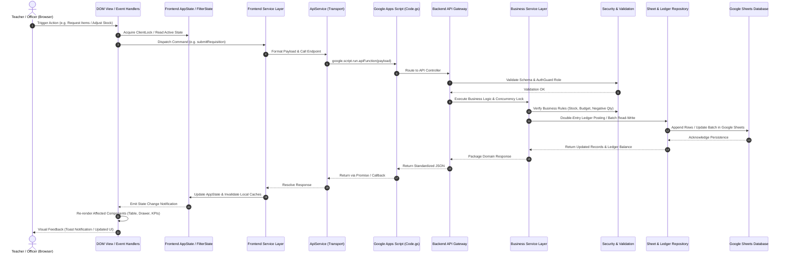
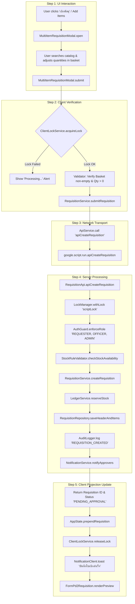
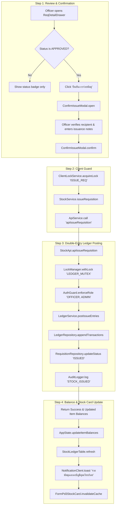
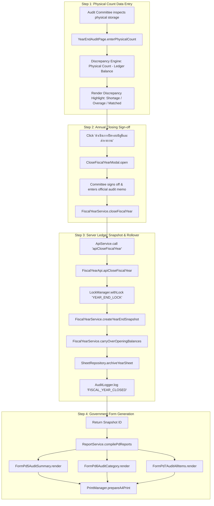
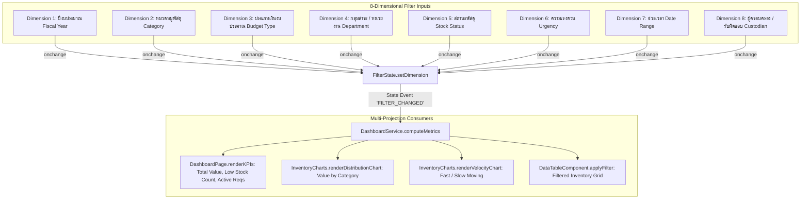

# Comprehensive Module Dependency & Call Map
## HRT School Inventory Management System (ระบบบริหารจัดการพัสดุและคลังวัสดุโรงเรียน)

> **Document Status**: Architectural Blueprint & Dependency Specification  
> **Key Objective**: Uncouple Monolithic Global State, Clarify Inbound/Outbound Call Chains, and Enforce Unidirectional Data Flow.

---

## 1. End-to-End Data Flow Architecture

The refactored system strictly follows a 6-tier unidirectional data flow pipeline. Data flows downward through requests and upward through typed responses or state projections:



---

## 2. Inbound & Outbound Call Chains for Critical Workflows

### 2.1 Multi-Item Requisition Workflow (การเบิกพัสดุหลายรายการ)



- **Inbound Calls**:
  - `onclick="openMultiRequisitionModal()"` on `#btnOpenMultiReq`
  - `oninput="filterReqCatalogItems(this.value)"`
  - `onclick="addToBasket(itemId)"`
  - `onclick="submitMultiRequisition()"`
- **Outbound Calls**:
  - `MultiItemRequisitionModal` → `RequisitionService.submit(basketData)`
  - `RequisitionService` → `ApiService.post('apiCreateRequisition')`
  - Server: `RequisitionApi` → `LockManager` → `StockRuleValidator` → `LedgerService` → `RequisitionRepository` → `NotificationService`
  - Response Callback → `AppState.update()` → `InventoryPage.refresh()` → `FormPd2Requisition.prepare()`

---

### 2.2 Physical Stock Issuance & Ledger Posting (การจ่ายพัสดุและบันทึกบัญชีคุม)



- **Inbound Calls**:
  - `onclick="openConfirmIssueModal(reqId)"` inside `#reqDetailDrawer`
  - `onclick="processIssueConfirmation()"` inside `#confirmIssueModal`
- **Outbound Calls**:
  - `ConfirmIssueModal` → `StockService.issueRequisition(reqId, notes)`
  - `StockService` → `ApiService.call('apiIssueRequisition', ...)`
  - Server: `StockApi` → `LockManager` → `LedgerService.postIssueEntries()` → `LedgerRepository` (atomic write)
  - Callback → `AppState.recordLedgerMovement()` → `StockLedgerTable.render()` → `FormPd3StockCard.render()`

---

### 2.3 Fiscal Year-End Audit & Inventory Freeze (การตรวจสอบพัสดุประจำปีและปิดบัญชี)



- **Inbound Calls**:
  - `onchange="updatePhysicalCount(itemId, this.value)"` in `#viewYearEndAudit`
  - `onclick="openCloseFiscalYearModal()"`
  - `onclick="processFiscalYearClose()"`
- **Outbound Calls**:
  - `YearEndAuditPage` → `FiscalYearService.calculateDiscrepancy()`
  - `CloseFiscalYearModal` → `FiscalYearService.closeYear(summaryData)`
  - Server: `FiscalYearApi` → `FiscalYearService` → `LedgerRepository` → `SheetRepository`
  - Callback → Trigger generation of official forms **พ.ด. ๕, พ.ด. ๖, and พ.ด. ๗**.

---

### 2.4 8-Dimensional Analytics & Dashboard Metric Engine



- **Inbound Calls**:
  - `onchange="applyDashFilters()"` on filter dropdowns (`#dashFilterYear`, `#dashFilterCategory`, etc.)
- **Outbound Calls**:
  - `applyDashFilters()` → `FilterState.updateFromDOM()`
  - `FilterState` → `DashboardService.aggregate(AppState.getItems(), FilterState.get())`
  - `DashboardService` → `renderKPIs()`, `InventoryCharts.update()`, `DataTableComponent.filter()`

---

## 3. Global Variables Inventory & Decoupling Strategy

Currently, the monolithic application stores critical state directly on the global `window` object. Below is the decoupling blueprint mapping every global variable into its encapsulated, reactive state store:

| Current Global Variable | Current Type & Usage | Associated Issues / Risks | Modern Encapsulated Location | Access & Decoupling Mechanism |
| :--- | :--- | :--- | :--- | :--- |
| `window.allData` | `Array<Item>`: Primary inventory item catalog cache. | Mutated directly across multiple functions without event dispatching; prone to out-of-sync bugs. | `frontend/state/AppState.js` (`AppState.items`) | Replaced by `AppState.getItems()` and `AppState.setItems()`. A proxy getter/setter is maintained on `window.allData` for backwards compatibility. |
| `window.filteredData` | `Array<Item>`: Transient table filter results. | Global state pollution; conflicts if multiple views filter items simultaneously. | `frontend/state/AppState.js` (`AppState.filteredItems`) | Managed internally by `InventoryPage` and `DataTableComponent`. |
| `window.stockLedgerEntries` | `Array<LedgerRow>`: In-memory double-entry stock transactions. | Directly mutated in client memory without server synchronization verification. | `frontend/state/AppState.js` (`AppState.ledgerEntries`) | Read via `AppState.getLedger(itemId)`. Immutable append via `AppState.appendLedgerEntry()`. |
| `window.auditTrailEntries` | `Array<AuditRow>`: Log of user actions and state changes. | Directly pushed to from various UI click handlers. | `frontend/state/AppState.js` (`AppState.auditLogs`) | Appended through `AppState.logAudit(action, details)`. |
| `window.fsnData` | `Array<FsnGroup>`: FSN 8-digit catalog tree. | Static global array; cannot easily refresh when new FSNs are registered. | `frontend/state/AppState.js` (`AppState.fsnTree`) | Managed by `ItemService.getFsnCatalog()`. |
| `window.dashFilters` | `Object`: Holds 8-dimensional filter selections. | Read directly by charting and KPI functions; no change-event subscription. | `frontend/state/FilterState.js` (`FilterState.store`) | Accessible via `FilterState.get()` and `FilterState.set()`. Emits `filter:change` event. |
| `window.currentUser` | `Object`: Current user profile, email, and role. | Mutable; could be spoofed in client console to reveal UI elements. | `frontend/state/UserSessionState.js` | Enclosed with private scope; verified on every sensitive backend call via `AuthGuard.gs`. |
| `window.rawMasterItems` | `Array<Item>`: Static seed data constant. | Clutters memory after initial data load. | `backend/setup/DataSeeder.gs` / Mock store | Removed from runtime client memory; loaded on demand only. |

---

## 4. Backward Compatibility Layer (`global-facade.js`)

To guarantee **zero regression and prevent breakage of existing inline HTML attributes** (such as `onclick="..."`, `onchange="..."`, and `onsubmit="..."`), a dedicated compatibility facade is established. This facade guarantees that legacy function names continue resolving to their new modular implementations:

```javascript
/**
 * frontend/main/global-facade.js
 * Backward Compatibility Layer - Bridges Legacy Global Invocations to Modular Services
 */
(function(window) {
  'use strict';

  // 1. Navigation & Views
  window.switchMainView = (viewName) => window.App.switchView(viewName);
  window.switchDocsSubTab = (tabName) => window.DocumentsPage.switchSubTab(tabName);

  // 2. Drawers
  window.openDrawer = (itemId) => window.ItemDetailDrawer.open(itemId);
  window.closeDrawer = () => window.ItemDetailDrawer.close();
  window.switchItemDrawerTab = (tabId) => window.ItemDetailDrawer.switchTab(tabId);
  window.openReqDrawer = (reqId) => window.ReqDetailDrawer.open(reqId);
  window.closeReqDrawer = () => window.ReqDetailDrawer.close();

  // 3. Modals
  window.openMultiRequisitionModal = () => window.MultiItemRequisitionModal.open();
  window.closeMultiRequisitionModal = () => window.MultiItemRequisitionModal.close();
  window.submitMultiRequisition = () => window.MultiItemRequisitionModal.submit();
  window.openConfirmIssueModal = (reqId) => window.ConfirmIssueModal.open(reqId);
  window.closeConfirmIssueModal = () => window.ConfirmIssueModal.close();
  window.processIssueConfirmation = () => window.ConfirmIssueModal.process();
  window.openAddStockModal = (itemId) => window.AddStockModal.open(itemId);
  window.closeAddStockModal = () => window.AddStockModal.close();
  window.submitAddStock = () => window.AddStockModal.submit();
  window.openCloseFiscalYearModal = () => window.CloseFiscalYearModal.open();
  window.closeCloseFiscalYearModal = () => window.CloseFiscalYearModal.close();
  window.processFiscalYearClose = () => window.CloseFiscalYearModal.process();
  window.openAddFsnModal = () => window.AddFsnModal.open();
  window.closeAddFsnModal = () => window.AddFsnModal.close();
  window.submitNewFsn = () => window.AddFsnModal.submit();
  window.openPdfViewerModal = (type, id) => window.PdfViewerModal.open(type, id);
  window.closePdfModal = () => window.PdfViewerModal.close();

  // 4. Tables, Search & Pagination
  window.renderTable = (data, page) => window.DataTableComponent.render(data, page);
  window.changePage = (newPage) => window.DataTableComponent.changePage(newPage);
  window.filterInventory = (query) => window.InventoryPage.handleSearch(query);

  // 5. Dashboard & Analytics
  window.applyDashFilters = () => window.DashboardPage.applyFilters();
  window.resetDashFilters = () => window.DashboardPage.resetFilters();
  window.renderKPIs = (data) => window.DashboardPage.renderKPIs(data);
  window.renderChart = (data) => window.InventoryCharts.render(data);

  // 6. Official Forms (พ.ด. ๑ - ๗)
  window.renderDailyReport = (date) => window.FormPd1DailyReport.render(date);
  window.renderRequisitionForm = (id) => window.FormPd2Requisition.render(id);
  window.renderStockCardReport = (id) => window.FormPd3StockCard.render(id);
  window.renderMonthlyReport = (m, y) => window.FormPd4Monthly.render(m, y);
  window.renderYearEndSummaryReport = () => window.FormPd5AuditSummary.render();
  window.renderYearEndCategoryReport = () => window.FormPd6AuditCategory.render();
  window.renderYearEndAllItemsReport = () => window.FormPd7AuditAllItems.render();

  // 7. Formatters & Utilities
  window.formatCurrency = (amt) => window.Formatters.formatCurrency(amt);
  window.formatThaiDate = (dt) => window.Formatters.formatThaiDate(dt);
  window.formatNumber = (n) => window.Formatters.formatNumber(n);
  window.formatFsnCode = (c) => window.Formatters.formatFsnCode(c);
  window.showToast = (msg, type) => window.NotificationClient.toast(msg, type);

  // 8. Global State Proxies (Backward Compatibility)
  Object.defineProperty(window, 'allData', {
    get: () => window.AppState.getItems(),
    set: (val) => window.AppState.setItems(val)
  });
  Object.defineProperty(window, 'stockLedgerEntries', {
    get: () => window.AppState.getLedgerEntries(),
    set: (val) => window.AppState.setLedgerEntries(val)
  });
  Object.defineProperty(window, 'dashFilters', {
    get: () => window.FilterState.get(),
    set: (val) => window.FilterState.set(val)
  });

  console.log('[HRT Compatibility Facade] 100% legacy window bindings successfully initialized.');
})(window);
```

---

## 5. Architectural Invariant Checks & Verification Criteria

To ensure that future refactoring phases never introduce regressions, each module boundary must pass the following invariant assertions:

1. **Unidirectional Invocation**: A lower layer (e.g. `SheetRepository`) must **NEVER** call an upper layer (e.g. `RequisitionApi` or `DashboardPage`).
2. **Double-Entry Invariant**: Every stock subtraction (issue) must have a corresponding requisition or write-off reference, and must be strictly appended to the ledger.
3. **No Direct DOM Manipulation in Services**: Services (`ItemService`, `StockService`, `LedgerService`) must return pure data structures or Promises, and must never contain `document.getElementById` or `innerHTML`.
4. **Idempotent UI Locks**: All form submissions must acquire a token via `ClientLockService` before invocation and release it in a `finally` block to eliminate race conditions and double-submits.
5. **Print Isolation**: Government forms (พ.ด. ๑–๗) must render into dedicated print containers with `@media print` CSS rules, ensuring clean A4 output without navigation headers or buttons.
