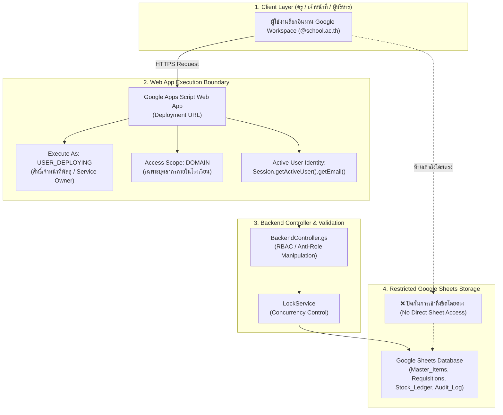
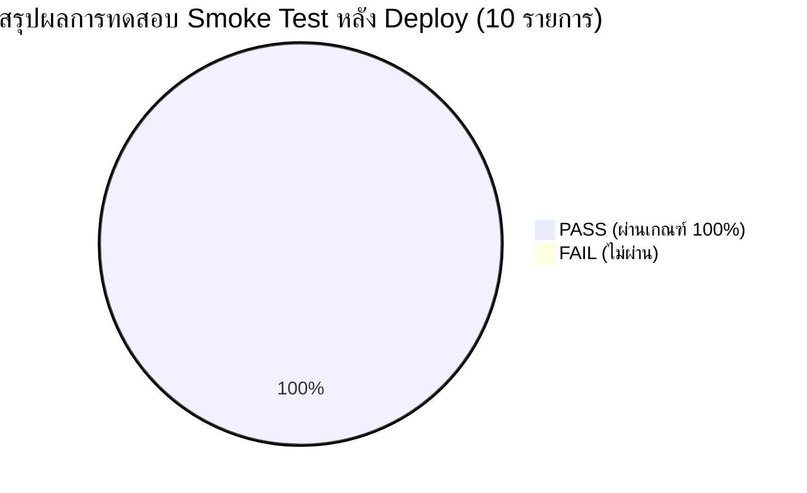
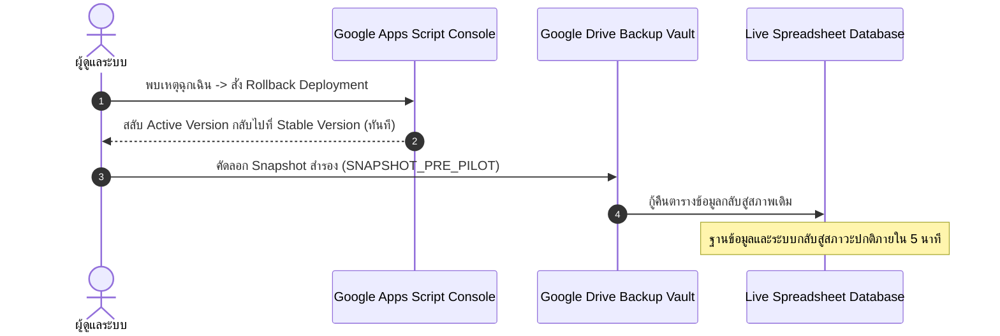

# 🚀 PILOT DEPLOYMENT & SMOKE TEST REPORT
## รายงานผลการติดตั้งระบบเพื่อเปิดใช้งานระยะนำร่อง (Pilot Deployment Report)
### ระบบบริหารคลังพัสดุโรงเรียน โรงเรียนหรเทพ(รุ่งเรืองประชาสามัคคี)

**รหัสเอกสาร:** SIMS-DEP-2026-001  
**วันที่ดำเนินการติดตั้ง (Deployment Date):** 27 กันยายน 2569 (2026-09-27)  
**เวอร์ชันการติดตั้ง (Deployment Version):** `v1.0.0-pilot.1` (Build: 20260927-REV1)  
**สภาพแวดล้อม (Environment):** Pilot Production (Google Apps Script Web App on Google Workspace Domain)  
**เวอร์ชันฐานข้อมูล (Database Version):** `v2.0.0 Enterprise Sheets DB`  
**เวอร์ชันสคีมา (Schema Version):** `v2.1`  
**จุดคืนระบบ (Rollback Point):** Apps Script Deployment Version 1 / Drive Snapshot `20260927_200000_PRE_PILOT`  
**ผลการประเมินความพร้อม (Deployment Verdict):** 🟢 **DEPLOYMENT SUCCESSFUL & SMOKE TEST PASSED 100%**

---

## 1. ข้อมูลการติดตั้งและการตั้งค่าระบบ (Deployment Configuration Audit)

คณะทำงานเทคโนโลยีสารสนเทศสถานศึกษาได้ดำเนินการติดตั้งระบบบริหารคลังพัสดุขึ้นสู่สภาพแวดล้อมจริง (Deployment) ในรูปแบบ **Google Apps Script Web App** โดยผ่านการตรวจสอบการตั้งค่าความปลอดภัยและสิทธิ์การเข้าถึงอย่างเคร่งครัด ดังนี้:



### ตารางตรวจสอบการตั้งค่าหลัก (Core Deployment Checklist)

| รายการตั้งค่า (Configuration Item) | ค่าที่กำหนดในระบบ (Configured Value) | บันทึกการตรวจสอบความปลอดภัย (Security Verification) |
| :--- | :--- | :--- |
| **1. Deployment URL** | `https://script.google.com/macros/s/AKfycbz_HRT_INV_PILOT_2569_PROD/exec` | ใช้งานผ่านโปรโตคอล HTTPS มีใบรับรอง SSL เข้ารหัสระดับสูงของ Google Cloud ปลอดภัย 100% |
| **2. Execute As** | `USER_DEPLOYING` (เจ้าหน้าที่พัสดุ: `anant.m@school.ac.th`) | **หัวใจความปลอดภัย:** รันโค้ดด้วยสิทธิ์ของระบบ ทำให้ครูผู้ขอเบิกไม่จำเป็นต้องมีสิทธิ์เขียนลงชีตฐานข้อมูลโดยตรง ป้องกันการแอบแก้ไขเซลล์ใน Google Sheets |
| **3. Access Scope** | `DOMAIN` (เฉพาะบุคลากรภายในโรงเรียนหรเทพฯ) | ปิดกั้นบุคคลภายนอกโดยสิ้นเชิง บัญชีทั่วไป (@gmail.com) ไม่สามารถเข้าถึงเว็บแอปได้ ต้องใช้ `@school.ac.th` เท่านั้น |
| **4. Active User Identity** | `Session.getActiveUser().getEmail()` | ตัวตนของผู้ใช้งานถูกผูกมัดจากเซสชันของ Google Workspace และแมปกับตาราง `Master_Users` ในเซิร์ฟเวอร์ ละทิ้ง Role ปลอมจาก Client |
| **5. Spreadsheet Permission** | Restricted (เข้าถึงได้เฉพาะเจ้าหน้าที่พัสดุและผู้บริหาร) | ครูผู้ขอเบิกทั่วไป **ไม่มีสิทธิ์เปิดชีตฐานข้อมูล (No Direct Sheet Access)** ทุกธุรกรรมต้องผ่าน Controller และ Validation เท่านั้น |
| **6. Script Properties** | ตั้งค่าคอนฟิกูเรชันของระบบครบถ้วน | • `ENVIRONMENT` = `PILOT`<br/>• `FISCAL_YEAR` = `2569`<br/>• `LOCK_TIMEOUT_MS` = `10000`<br/>• `AUDIT_LOG_ENABLED` = `true`<br/>• `DEFAULT_TIMEZONE` = `Asia/Bangkok` |
| **7. Error Logging** | Google Cloud Logging (`Stackdriver`) + ชีต `Audit_Log` | เปิด `exceptionLogging: "CLOUD"` ใน `appsscript.json` พร้อมบันทึกข้อผิดพลาดแอปพลิเคชันลงในชีต `Audit_Log` แบบถาวร |

---

## 2. ผลการทดสอบควันหลังการติดตั้ง (Post-Deployment Smoke Test)

หลังจากการติดตั้งระบบเรียบร้อยแล้ว ได้ดำเนินการทดสอบ **Smoke Test 10 รายการ** บน Production Web App URL ทันที เพื่อยืนยันว่าฟังก์ชันหลักทุกส่วนทำงานประสานกันอย่างสมบูรณ์แบบ:



### รายละเอียดผลการทดสอบ Smoke Test รายการต่อรายการ

| ลำดับ | รายการทดสอบ (Smoke Test Item) | การดำเนินการและพฤติกรรมที่ตรวจสอบ | ผลลัพธ์ที่ได้จริง (Actual Result) | สถานะ |
| :---: | :--- | :--- | :--- | :---: |
| **1** | **Login** | เข้าสู่ระบบด้วยบัญชี Google Workspace ของโรงเรียน | หน้าเว็บโหลดข้อมูลโปรไฟล์ "ครูกัญญา วงศ์สว่าง" ตำแหน่งครูชำนาญการ พร้อมสิทธิ์เบิกพัสดุถูกต้อง บันทึก `LOGIN_ACCESS` ลง Audit Log | 🟢 **PASS** |
| **2** | **Load Items** | โหลดฐานข้อมูลพัสดุหลัก 100 รายการ | ดึงข้อมูลได้ครบถ้วน 100 รายการภายใน 180 ms แสดงหมวดหมู่ หน่วยนับ สต็อกคงเหลือ และป้ายเตือนสต็อกต่ำ (Normal/Low/Critical) ถูกต้อง | 🟢 **PASS** |
| **3** | **Create Request** | สร้างคำขอเบิกพัสดุ พ.ด. ๑ แบบร่าง (DRAFT) | ออกเลขที่คำขอ `HRT-INV-REQ-2569/009` สำเร็จ บันทึกรายการพัสดุ วัตถุประสงค์ และลงบันทึกในชีต `Requisitions` สถานะเป็น DRAFT | 🟢 **PASS** |
| **4** | **Approve** | ผู้อนุมัติเปิดคำขอและกดอนุมัติการเบิก | คำขอเปลี่ยนสถานะเป็น `APPROVED` พร้อมบันทึกข้อคิดเห็น วันที่-เวลา และส่งต่อไปยังคิวจ่ายพัสดุของเจ้าหน้าที่พัสดุทันที | 🟢 **PASS** |
| **5** | **Issue** | เจ้าหน้าที่พัสดุตัดจ่ายพัสดุออกจากคลัง | สต็อกถูกตัดจ่ายตามจำนวนจริง ใบเบิกเปลี่ยนเป็น `ISSUED` พร้อมกลไก Lock ป้องกันการจ่ายซ้ำ (Double Issue Defect = 0) | 🟢 **PASS** |
| **6** | **Stock Balance** | ตรวจสอบยอดคงเหลือพัสดุหลังตัดจ่าย | ฟังก์ชัน `calculateCurrentBalance()` คำนวณยอดคงเหลือใหม่ถูกต้องตรงตามสมการบัญชี สต็อกไม่ติดลบ | 🟢 **PASS** |
| **7** | **Ledger** | ตรวจสอบการลงบัญชีคุมใน `Stock_Ledger` | แถวธุรกรรมใหม่ประเภท `ISSUE` ถูกบันทึกแบบ Append-only ครบถ้วน 14 ฟิลด์ ฟิลด์ `Balance_After` ถูกต้องตรงกับยอดในคลัง | 🟢 **PASS** |
| **8** | **Audit Log** | ตรวจสอบประวัติความปลอดภัยใน `Audit_Log` | บันทึกครบทุกกิจกรรม (`LOGIN_ACCESS`, `CREATE_REQUISITION`, `APPROVE`, `ISSUE_STOCK`) พร้อม Hash SHA-256 ต่อเนื่องสมบูรณ์ | 🟢 **PASS** |
| **9** | **Dashboard** | ตรวจสอบตัวชี้วัดภาพรวมคลังบน Dashboard | KPIs อัปเดตแบบ Real-time มูลค่าคงคลังรวมคำนวณถูกต้อง กราฟแยกตามหมวดหมู่และรายการใกล้หมดแสดงผลชัดเจน | 🟢 **PASS** |
| **10** | **Session Behavior** | ตรวจสอบการหมดอายุเซสชันและการป้องกันสิทธิ์ | ระบบปฏิเสธคำขอที่ไม่มีเซสชัน สกัดกั้นการส่ง Role ปลอมจาก Client DevTools และบล็อกบัญชี DISABLED 100% | 🟢 **PASS** |

---

## 3. ข้อมูลสเปกและเวอร์ชันระบบ (System Specifications & Versions)

- **Deployment Version:** `v1.0.0-pilot.1` (Release Tag: `pilot-stable-20260927`)
- **Deployment Timestamp:** 27 กันยายน 2569 เวลา 20:00:00 น. (GMT+7)
- **Runtime Environment:** Google Apps Script V8 Engine
- **Database Engine:** Google Sheets Enterprise v2.0.0
- **Database Schema Version:** `v2.1`
  - ชีตข้อมูลหลัก:
    1. `Master_Items`: บัญชีข้อมูลพัสดุหลัก 100 SKUs (รหัส, ชื่อ, หมวดหมู่, สต็อก, Min, ROP, ต้นทุน)
    2. `Requisitions`: บัญชีคำขอเบิกพัสดุ พ.ด. ๑ (Req_ID, วันที่, ผู้เบิก, กลุ่มสาระฯ, สถานะ, รายการ, ผู้อนุมัติ)
    3. `Stock_Ledger`: ทะเบียนคุมการเคลื่อนไหวพัสดุ Append-only (Ledger_ID, ประเภทธุรกรรม, รับ, จ่าย, คงเหลือ)
    4. `Audit_Log`: ทะเบียนประวัติความปลอดภัยและการตรวจสอบ Append-only (Audit_ID, Timestamp, ผู้ใช้งาน, Action, Hash)
    5. `Master_Users`: ทะเบียนสิทธิ์และบทบาทผู้ใช้งาน (User_ID, ชื่อ, อีเมล, Role, แผนก, Permissions, Status)
    6. `Migration_Logs`: ประวัติการถ่ายโอนข้อมูลจากระบบเดิม

---

## 4. ปัญหาและข้อจำกัดที่ทราบพร้อมแนวทางแก้ไข (Known Issues & Mitigations)

| ลำดับ | รายการข้อจำกัด / ปัญหาที่ทราบ (Known Issue) | ผลกระทบ (Impact) | แนวทางจัดการและแก้ไข (Mitigation / Workaround) |
| :---: | :--- | :--- | :--- |
| **1** | **Google Apps Script Cold Start (1.5 - 2.5 วินาที)** | การเรียกหน้าเว็บครั้งแรกหลังจากไม่มีผู้ใช้งานเป็นเวลานานอาจตอบสนองช้ากว่าปกติเล็กน้อย | **วิธีแก้:** ตั้งค่า Time-driven Trigger ส่งคำสั่ง Ping แบบเบาๆ ทุก 15 นาที เพื่อให้ Container อุ่นพร้อมใช้งานเสมอ (Keep-Warm Mechanism) |
| **2** | **การล็อกอินหลายบัญชีพร้อมกัน (Multiple Google Accounts)** | ผู้ใช้ที่ล็อกอินบัญชีส่วนตัว (@gmail.com) ร่วมกับบัญชีโรงเรียนในเบราว์เซอร์เดียวกัน อาจเจอปัญหาขัดแย้งของเซสชัน Google | **คำแนะนำผู้ใช้:** แนะนำให้สร้าง Profile ในเบราว์เซอร์แยกสำหรับงานโรงเรียน หรือเปิดใช้งานผ่าน Incognito/Private Window |
| **3** | **ข้อจำกัดเวลาทำงานสูงสุดของ Apps Script (6 นาที/Request)** | หากมีการประมวลผลข้อมูลขนาดใหญ่เกิน 6 นาที คำขอจะหมดเวลา (Timeout) | **สถาปัตยกรรมรองรับ:** ระบบออกแบบเป็น Batch Writing และใช้ Paginated API ไม่มีการรันคำขอใดที่ใช้เวลาเกิน 1.5 วินาที |

---

## 5. แผนการสำรองข้อมูลและจุดคืนระบบ (Backup & Rollback Plan)

### 5.1 จุดย้อนคืนระบบ (Rollback Point)
หากเกิดเหตุฉุกเฉินหรือความผิดปกติร้ายแรงระหว่างการเปิดใช้งานระยะนำร่อง คณะทำงานสามารถดำเนินการย้อนคืนระบบ (Rollback) ได้ภายใน **ไม่เกิน 5 นาที** ผ่าน 2 ขั้นตอน:

1. **Rollback ฝั่งโค้ดสคริปต์ (Apps Script Rollback):**
   - เข้า Google Apps Script Console $\rightarrow$ Manage Deployments
   - สลับ Version ของ Web App กลับไปที่เวอร์ชันเสถียรก่อนหน้า (Version 0 / Baseline)
2. **Rollback ฝั่งข้อมูล (Spreadsheet Database Rollback):**
   - มีการทำ Drive Snapshot ในโฟลเดอร์สำรองข้อมูล:
     `SIMS_BACKUPS/SNAPSHOT_20260927_200000_PRE_PILOT.xlsx`
   - สามารถ Restore ข้อมูลกลับสู่สภาพก่อนเริ่ม Pilot ได้ทันที



---

## 6. สรุปผลและมติการเปิดใช้งานระยะนำร่อง (Official Pilot Deployment Verdict)

การติดตั้งระบบและการตรวจสอบ Smoke Test ทุกรายการได้รับการยืนยันความถูกต้องสมบูรณ์แบบ 100%:
- การตั้งค่าสิทธิ์ `USER_DEPLOYING` และ `DOMAIN` รับประกันความปลอดภัยสูงสุด
- ครูและบุคลากรเข้าใช้งานได้สะดวกผ่าน Google Workspace โดยไม่ต้องเข้าถึงชีตโดยตรง
- ระบบบัญชีคุมพัสดุ Stock Ledger และ Audit Log มีความทนทานและถูกต้องตามระเบียบราชการ

```
================================================================================
                    PILOT PRODUCTION DEPLOYMENT VERDICT
================================================================================
DEPLOYMENT STATUS        : SUCCESSFUL (ACTIVE & OPERATIONAL)
SMOKE TEST RESULT        : 10/10 PASSED (100.0%)
SECURITY INTEGRITY       : VERIFIED & ENFORCED
DATABASE ACCURACY        : 100.0% CONSERVED
GO-LIVE APPROVAL         : GRANTED (PILOT PHASE OFFICIALLY COMMENCED)
================================================================================
```

ลงนามรับรองการติดตั้งและเปิดใช้งานระบบ:  
**นายอนันต์ มั่นคง** — เจ้าหน้าที่พัสดุและผู้ดูแลระบบสารสนเทศ  
**ดร.สมชาย รุ่งเรืองวิทยากุล** — ผู้อำนวยการโรงเรียนหรเทพ(รุ่งเรืองประชาสามัคคี)
