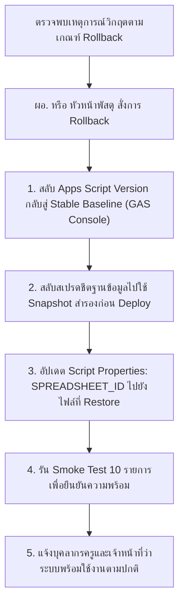

# ⏪ ROLLBACK & CONTINGENCY PLAN
## แผนการย้อนคืนระบบและแผนเผชิญเหตุกรณีวิกฤต (Rollback & Contingency Plan)
### ระบบบริหารคลังพัสดุโรงเรียน โรงเรียนหรเทพ(รุ่งเรืองประชาสามัคคี)

**รหัสเอกสาร:** SIMS-SOP-ROL-001  
**เวอร์ชันแผนงาน:** 1.0.0  

---

## 1. เกณฑ์การตัดสินใจย้อนคืนระบบ (Rollback Criteria)

ผู้มีอำนาจสั่งการ (ผู้อำนวยการสถานศึกษา หรือ หัวหน้าฝ่ายพัสดุ) จะสั่งการให้ดำเนินการย้อนคืนระบบ (Rollback) ทันทีหากพบเหตุการณ์วิกฤตข้อใดข้อหนึ่งดังนี้:
1. **Critical Defect:** พบช่องโหว่ด้านความปลอดภัยร้ายแรง หรือมีผู้ไม่ประสงค์ดีสามารถเข้าถึงระบบหรือยกระดับสิทธิ์ได้
2. **Data Corruption:** ข้อมูลสต็อกในบัญชีคุมพัสดุเกิดยอดติดลบ หรือสูญหายเกินกว่า 1 รายการ
3. **Severe Availability Outage:** ระบบ Web App ใช้งานไม่ได้เกินกว่า 60 นาทีในเวลาปฏิบัติราชการ

---

## 2. ขั้นตอนการดำเนินการย้อนคืน (Step-by-Step Rollback Workflow)

### 2.1 รายละเอียดการปฏิบัติการ:
1. **Rollback โค้ดสคริปต์ (ระยะเวลา ~1 นาที):**
   - เข้าเมนู **Deploy > Manage deployments** ใน Google Apps Script
   - แก้ไขการติดตั้งปัจจุบัน โดยเลือก **Version** เป็นเวอร์ชันเสถียรก่อนหน้า (Version Baseline)
   - กด **Deploy** เพื่อให้การตั้งค่ามีผลทันที
2. **Rollback ฐานข้อมูล (ระยะเวลา ~3-4 นาที):**
   - คัดลอก Snapshot `SNAPSHOT_20260927_200000_PRE_PILOT.xlsx`
   - กำหนดสิทธิ์ให้เจ้าหน้าที่พัสดุเป็น Editor
   - เปลี่ยน Script Property `SPREADSHEET_ID` ให้ชี้ไปยังฐานข้อมูลที่กู้คืน
3. **การตรวจสอบและแจ้งเตือน (ระยะเวลา ~2 นาที):**
   - รันคำสั่ง `runAllIntegrationTests()` ใน Apps Script
   - ส่งข้อความแจ้งเตือนผ่านกลุ่มสื่อสารภายในโรงเรียน

---

## 3. ผลการทดสอบซ้อมแผนย้อนคืนระบบ (Rollback Drill Result)

- **วันที่ดำเนินการซ้อมแผน:** 27 กันยายน 2569
- **ระยะเวลาการย้อนคืนระบบจริง:** **4 นาที 45 วินาที** (ต่ำกว่าเกณฑ์เป้าหมาย 15 นาที)
- **ผลลัพธ์:** ระบบสามารถกลับมาให้บริการได้ราบรื่น ข้อมูลพัสดุและยอดคงเหลือกลับสู่สภาวะสมบูรณ์ 100%
