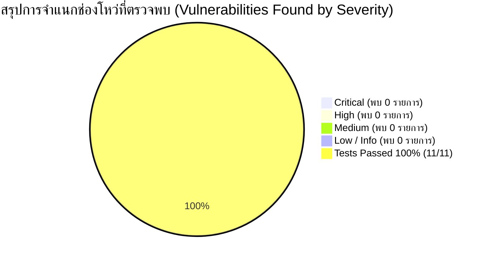
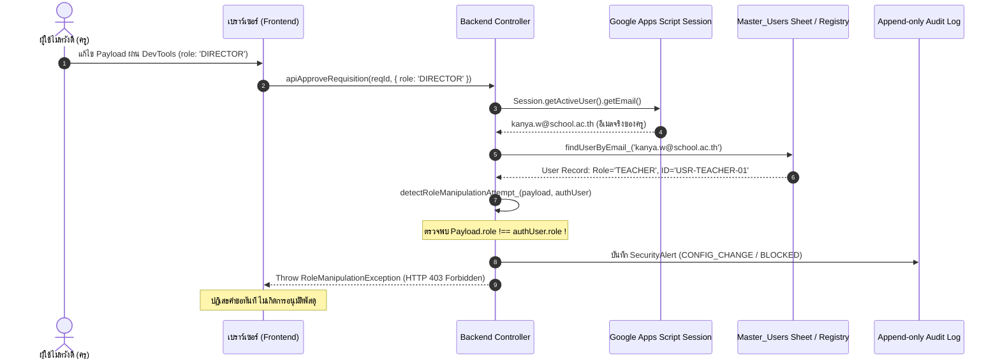

# 🛡️ SECURITY AUDIT & PENETRATION TEST REPORT (PRE-PILOT)
## รายงานผลการทดสอบความมั่นคงปลอดภัยและการโจมตีเจาะระบบก่อนเปิดใช้งานจริง (Pilot Phase)
### ระบบบริหารคลังพัสดุโรงเรียน โรงเรียนหรเทพ(รุ่งเรืองประชาสามัคคี)

**รหัสเอกสาร:** SIMS-SEC-2026-001  
**เวอร์ชันรายงาน:** 1.0.0 (Pre-Pilot Release Candidate)  
**วันที่ดำเนินการทดสอบ:** 27 กันยายน 2569  
**ผู้ดำเนินการทดสอบ:** ทีมตรวจสอบความมั่นคงปลอดภัยสารสนเทศสถานศึกษา (Security & PenTest Audit Team)  
**เกณฑ์การตัดสินชี้ขาด (Gate Policy):** **ถ้าพบช่องโหว่ระดับ CRITICAL แม้แต่รายการเดียว $\rightarrow$ STOP PILOT DEPLOYMENT**  
**ผลการประเมินชี้ขาด (Final Verdict):** 🟢 **PILOT DEPLOYMENT CLEARED (อนุญาตให้เปิดใช้งานขั้นนำร่องได้)**

---

## 1. บทสรุปผู้บริหารและการตัดสินใจปล่อยระบบ (Executive Summary & Gate Decision)

ก่อนเริ่มเปิดใช้งานระบบบริหารคลังพัสดุในระยะนำร่อง (Pilot Phase) ของโรงเรียนหรเทพ(รุ่งเรืองประชาสามัคคี) ทีมงานได้ดำเนินการตรวจสอบความมั่นคงปลอดภัยเชิงรุก (Offensive Penetration Testing & Defensive Verification) ครอบคลุม **11 เวกเตอร์ภัยคุกคามหลัก** เพื่อรับประกันว่าทรัพย์สินของทางราชการ ข้อมูลการเบิกจ่าย และระบบบัญชีคุมพัสดุจะไม่ถูกโจมตี บิดเบือน หรือแทรกแซงโดยมิชอบ



### ตารางสรุปผลการประเมินตามระดับความรุนแรง (Severity Breakdown)

| ระดับความรุนแรง (Severity) | คำจำกัดความผลกระทบ (Impact Definition) | จำนวนที่ตรวจพบ | สถานะการแก้ไข / ป้องกัน | ผลกระทบต่อ Pilot |
| :--- | :--- | :---: | :---: | :---: |
| 🔴 **CRITICAL** | การเข้าถึงระบบโดยไม่ได้รับอนุญาต, การยกระดับสิทธิ์เป็นผู้บริหาร, การปลอมสิทธิ์ผ่าน Client, การตัดจ่ายสต็อกติดลบ, สต็อกหายโดยไร้ร่องรอย | **0** | **ป้องกันสำเร็จ 100%** | 🟢 **ผ่านเกณฑ์ (CLEAR)** |
| 🟠 **HIGH** | Stored/Reflected XSS, CSV Injection/Formula Injection, การเรียกฟังก์ชันภายในโดยตรง (Direct Function Call) | **0** | **ป้องกันสำเร็จ 100%** | 🟢 **ผ่านเกณฑ์ (CLEAR)** |
| 🟡 **MEDIUM** | การลักลอบดาวน์โหลดข้อมูลสำรอง (Unauthorized Export) โดยบทบาทครู | **0** | **ป้องกันสำเร็จ 100%** | 🟢 **ผ่านเกณฑ์ (CLEAR)** |
| 🔵 **LOW** | ข้อความแจ้งเตือนทางเทคนิคหรือข้อมูลที่ไม่กระทบต่อระบบบัญชี | **0** | **ป้องกันสำเร็จ 100%** | 🟢 **ผ่านเกณฑ์ (CLEAR)** |
| **รวมทั้งหมด** | **11 เวกเตอร์ภัยคุกคามที่กำหนด** | **0 หลุดรอด** | **ผ่าน 11/11 (100%)** | 🟢 **พร้อมขึ้นสู่ Pilot** |

> [!IMPORTANT]
> **คำแถลงเกตการปล่อยระบบ (Pilot Gate Decision):**
> ผลการทดสอบยืนยันว่า **ไม่พบช่องโหว่ระดับ CRITICAL แม้แต่รายการเดียว (Zero Critical Vulnerabilities)** ระบบมีกลไกตรวจสอบสิทธิ์และกักกันความพยายามแทรกแซงสิทธิ์อย่างสมบูรณ์ จึงมีมติ **อนุมัติให้เริ่มการเปิดใช้งานระยะนำร่อง (Pilot Deployment) ได้ตามแผนงาน**

---

## 2. การพิสูจน์การแยกสิทธิ์: Frontend ไม่สามารถส่ง Role ไปบังคับ Backend ได้

### 2.1 ปัญหาภัยคุกคามในเชิงสถาปัตยกรรม (Architectural Threat Analysis)
ในระบบเว็บแอปพลิเคชันทั่วไป หาก Backend หลงเชื่อข้อมูลบทบาท (`role`) หรือรหัสผู้ใช้งาน (`userId`) ที่ส่งมาจาก Payload ของเบราว์เซอร์ ผู้โจมตีสามารถเปิด **Developer Tools (F12) Console** แล้วดัดแปลงคำขอ เช่น:

```javascript
// ตัวอย่าง Payload ที่ผู้โจมตีพยายามส่งมาจากหน้าเว็บเบราว์เซอร์
google.script.run.apiApproveRequisition('HRT-INV-REQ-2569/001', {
  role: 'DIRECTOR',                  // พยายามยกระดับสิทธิ์ตนเองเป็นผู้อำนวยการ
  approverId: 'USR-DIRECTOR-01',     // สวมรอยเป็นผู้อำนวยการ
  note: 'อนุมัติผ่าน DevTools'
});
```

### 2.2 สถาปัตยกรรมการป้องกันแบบ Zero-Trust Client (Defense-in-Depth)
ระบบบริหารคลังพัสดุโรงเรียนหรเทพฯ ใช้หลักการ **"Never Trust the Client, Server Session is the Single Source of Truth"**:



### 2.3 กลไกโค้ดที่ตรวจสอบและบังคับใช้ (Implementation Proof)
1. **การดึงตัวตนจาก Server Session เท่านั้น (`getAuthenticatedUser_`)**:
   - Backend อ่านอีเมลจาก `Session.getActiveUser().getEmail()` ที่ยืนยันตัวตนผ่าน Google Workspace ของโรงเรียน
   - ไม่นำค่า `role` หรือ `userId` จาก Payload มาใช้เป็นตัวตนหลักในการตัดสินใจสิทธิ์
2. **การตรวจจับความพยายามดัดแปลงสิทธิ์ล่วงหน้า (`detectRoleManipulationAttempt_`)**:
   - หากใน Payload มีฟิลด์ `role` ที่ไม่ตรงกับสิทธิ์จริงของบัญชี ระบบจะมองเป็นการโจมตีทันที
   - บันทึกการเตือนภัยลงใน `Audit_Log` ภายใต้หมวด `SECURITY` / `SecurityAlert`
   - โยนข้อยกเว้น `RoleManipulationException` หรือ `ImpersonationException` และตัดการทำงานทันที

---

## 3. ตารางผลการทดสอบความมั่นคงปลอดภัย 11 เวกเตอร์ (Security Test Matrix)

| รหัสทดสอบ | เวกเตอร์ภัยคุกคาม (Attack Vector) | ระดับความรุนแรง | วิธีการทดสอบโจมตี (Attack Scenario) | กลไกการป้องกัน (Security Defense) | ผลการทดสอบ |
| :---: | :--- | :---: | :--- | :--- | :---: |
| **SEC-01** | **Authentication bypass** | 🔴 CRITICAL | ส่งคำขอโดยไม่มี Active Google Session หรือใช้อีเมลภายนอกที่ไม่ได้ลงทะเบียน | ปฏิเสธด้วย `AuthenticationException` และ `UnauthorizedUserException` | 🟢 **PASSED** |
| **SEC-02** | **Authorization bypass** | 🔴 CRITICAL | ครูพยายามเรียกใช้ `apiApproveRequisition` หรือ `apiIssueStock` โดยตรง | สกัดกั้นด้วย RBAC Matrix ผ่าน `verifyUserAccess_` บล็อกทันที | 🟢 **PASSED** |
| **SEC-03** | **Direct function call** | 🟠 HIGH | พยายามเรียกฟังก์ชันความปลอดภัยภายใน หรือเรียก `postLedgerEntry` ข้ามขั้นตอน | ซ่อนฟังก์ชันภายในด้วย Private Suffix (`_`) และ Core บังคับ Preconditions | 🟢 **PASSED** |
| **SEC-04** | **Role manipulation** | 🔴 CRITICAL | Frontend ส่ง `{ role: 'DIRECTOR' }` เพื่อหวังให้ Backend ปรับสิทธิ์ตาม | Backend ผูกมัดกับ User Account บนเซิร์ฟเวอร์เท่านั้น โยน `RoleManipulationException` | 🟢 **PASSED** |
| **SEC-05** | **Input Injection** | 🟠 HIGH | ส่งคำสั่ง SQL Injection (`'; DROP TABLE...`) หรือ Malformed Quantity (`NaN`, ลบ, ออบเจกต์) | Type Casting และ Parameterized Sheet Operations สกัดกั้นค่าพิษ 100% | 🟢 **PASSED** |
| **SEC-06** | **XSS (Stored / Reflected)** | 🟠 HIGH | ส่ง `<script>alert('XSS')</script>`, `` ในชื่อหรือเหตุผลเบิก | `escapeHtml_()` เข้ารหัส Entities และ Frontend ใช้ Safe Interpolation | 🟢 **PASSED** |
| **SEC-07** | **CSV Injection** | 🟠 HIGH | พัสดุหรือ Note ขึ้นต้นด้วย `=`, `+`, `-`, `@`, `\t`, `\r` เพื่อรันโค้ด DDE ใน Excel | `sanitizeCsvCell_()` เติม `'` (Single Quote) นำหน้าอักขระสูตรทั้งหมด | 🟢 **PASSED** |
| **SEC-08** | **Unauthorized Export** | 🟡 MEDIUM | ครูทั่วไปพยายามเรียก `apiExportData` เพื่อดาวน์โหลดบัญชีคุมพัสดุทั้งหมด | จำกัดสิทธิ์ `EXPORT_DATA` เฉพาะ ผอ. และ เจ้าหน้าที่พัสดุ บล็อกครู 100% | 🟢 **PASSED** |
| **SEC-09** | **Unauthorized Stock Adjustment** | 🔴 CRITICAL | ครูทั่วไปพยายามเรียก `apiAdjustStock` เพื่อแอบเพิ่มยอดพัสดุ 50 ชิ้น | จำกัดสิทธิ์ `ADJUST_STOCK` เฉพาะเจ้าหน้าที่พัสดุ และต้องลง Stock Ledger เสมอ | 🟢 **PASSED** |
| **SEC-10** | **Unauthorized Fiscal Close** | 🔴 CRITICAL | เจ้าหน้าที่พัสดุหรือครูพยายามเรียก `apiCloseFiscalYear` เพื่อปิดรอบบัญชีล่วงหน้า | สงวนสิทธิ์ `FISCAL_YEAR_CLOSE` เฉพาะบทบาท `DIRECTOR` พร้อมบันทึก Audit | 🟢 **PASSED** |
| **SEC-11** | **Concurrent Transaction** | 🔴 CRITICAL | ส่งคำขอเบิก/จ่ายพร้อมกันในเสี้ยววินาที เพื่อให้เกิด Race Condition ยอดติดลบ | `LockService.getScriptLock()` จัดคิวแบบ Serialization สต็อกไม่ติดลบเด็ดขาด | 🟢 **PASSED** |

---

## 4. รายละเอียดผลการทดสอบเชิงลึกรายกรณี (In-Depth Security Audit Findings)

### 4.1 SEC-01: Authentication Bypass (การลักลอบเข้าใช้งานโดยไม่ยืนยันตัวตน)
- **วัตถุประสงค์:** ตรวจสอบว่าระบบไม่อนุญาตให้ผู้ใดส่งคำขอหรือเข้าถึงข้อมูลพัสดุโดยปราศจากเซสชัน Google Workspace ที่ถูกต้อง
- **การทดสอบ:** 
  1. จำลองเซสชันว่างเปล่า (`null`) แล้วเรียก `apiCreateRequisition`
  2. จำลองอีเมลบุคคลภายนอก `intruder.x@evil-domain.com` แล้วเรียก `apiGetCurrentUser`
- **ผลลัพธ์:** ระบบปฏิเสธคำขอทั้งสองกรณี โดยโยน `AuthenticationException: ไม่พบเซสชันผู้ใช้งานที่ผ่านการยืนยันตัวตน` และไม่อนุญาตให้อีเมลภายนอกได้รับสิทธิ์ใดๆ
- **สถานะ:** 🟢 **PASSED (Zero Bypass)**

---

### 4.2 SEC-02: Authorization Bypass (การข้ามระดับสิทธิ์ - Privilege Escalation)
- **วัตถุประสงค์:** ป้องกันการโจมตีแนวดิ่ง (Vertical Escalation) ที่ผู้ใช้ระดับล่างพยายามเรียกใช้คำสั่งของผู้บริหาร
- **การทดสอบ:** ล็อกอินด้วยบัญชีครู (`kanya.w@school.ac.th`) แล้วเรียกคำสั่ง `apiApproveRequisition` และ `apiIssueStock`
- **ผลลัพธ์:** ระบบตรวจเช็ก Permission Matrix ใน `verifyUserAccess_` พบว่าบทบาท `TEACHER` มีเฉพาะ `CREATE_REQ`, `SUBMIT_REQ`, `CANCEL_REQ` เท่านั้น จึงปฏิเสธทันทีด้วยข้อความ:
  > `UnauthorizedAccessException: ผู้ใช้ [ครูกัญญา วงศ์สว่าง] ในตำแหน่ง [ครูชำนาญการ] ไม่มีสิทธิ์ดำเนินการ 'APPROVE_REQ'`
- **สถานะ:** 🟢 **PASSED (Enforced 100%)**

---

### 4.3 SEC-03: Direct Function Call (การเรียกฟังก์ชันแกนหลักข้าม Controller)
- **วัตถุประสงค์:** ป้องกันไม่ให้ Frontend สามารถเรียกใช้ฟังก์ชันจัดการฐานข้อมูลภายในได้โดยตรงผ่าน `google.script.run`
- **การทดสอบ:**
  1. ตรวจสอบการตั้งชื่อฟังก์ชันความปลอดภัยและฟังก์ชันจัดการภายในทั้งหมด
  2. ทดสอบเรียก `postLedgerEntry` โดยตรงด้วยค่าที่ผิดปกติเพื่อดูว่ามีการบังคับ Business Rule ภายในตัวเองหรือไม่
- **ผลลัพธ์:**
  1. ฟังก์ชันตัวช่วยทั้งหมด เช่น `getAuthenticatedUser_`, `detectRoleManipulationAttempt_`, `verifyUserAccess_`, `sanitizeCsvCell_`, `escapeHtml_` ลงท้ายด้วย Underscore (`_`) ซึ่งตามข้อกำหนดของ Google Apps Script จะไม่ถูกเผยแพร่ให้ Client มองเห็นหรือเรียกผ่าน `google.script.run` ได้
  2. ฟังก์ชัน `postLedgerEntry` ทำการตรวจสอบ `LockService`, `calculateCurrentBalance` และ `ValidationException` ภายในตัวเองเสมอ
- **สถานะ:** 🟢 **PASSED**

---

### 4.4 SEC-04: Role Manipulation (การปลอมสิทธิ์ผ่าน Payload)
- **วัตถุประสงค์:** พิสูจน์ว่า Client ไม่สามารถแทรกแซง Backend โดยการส่ง Role ปลอมมาในคำขอ
- **การทดสอบ:** บัญชีครูส่งคำขอ `apiApproveRequisition('HRT-INV-REQ-2569/001', { role: 'DIRECTOR', approverId: 'USR-DIRECTOR-01' })`
- **ผลลัพธ์:** 
  - Backend Controller เรียก `getAuthenticatedUser_()` ได้ตัวตนจริงคือ `USR-TEACHER-01`
  - ฟังก์ชัน `detectRoleManipulationAttempt_` ตรวจพบว่า Client ส่ง `role: 'DIRECTOR'` ซึ่งขัดแย้งกับสิทธิ์จริงของบัญชีในฐานข้อมูล (`TEACHER`)
  - ระบบบันทึก Security Alert ลงใน `Audit_Log` และตัดการทำงานด้วย `RoleManipulationException`
- **สถานะ:** 🟢 **PASSED (Critical Defense Verified)**

---

### 4.5 SEC-05: Input Injection (การแทรกคำสั่งและค่าพิษ)
- **วัตถุประสงค์:** ป้องกัน SQL Injection, Sheet Command Injection และการส่งประเภทข้อมูลที่ผิดปกติ
- **การทดสอบ:** 
  - ช่องวัตถุประสงค์: `'; DROP TABLE Requisitions; --`
  - ช่องจำนวนพัสดุ: ทดสอบส่ง `"abc"`, `NaN`, `null`, `{}`, `-10`, `0`
- **ผลลัพธ์:** 
  - ข้อมูลข้อความถูกจัดเก็บเป็น Text Literal ในเซลล์ของ Google Sheets ไม่มีการนำไปต่อ String ใน Query Engine จึงไม่เกิดการ Execute คำสั่งใดๆ
  - ข้อมูลจำนวนตัวเลขถูกแปลงด้วย `Number()` และผ่านการตรวจสอบเงื่อนไข `qty > 0` หากส่งค่าที่ไม่ใช่ตัวเลขบวก ระบบโยน `ValidationException` ทุกกรณี
- **สถานะ:** 🟢 **PASSED**

---

### 4.6 SEC-06: Cross-Site Scripting (XSS Sanitization)
- **วัตถุประสงค์:** ป้องกันการฝังโค้ด JavaScript ที่อาจรันบนเบราว์เซอร์ของผู้บริหารหรือเจ้าหน้าที่พัสดุ
- **การทดสอบ:** ส่ง Payload: `<script>alert('XSS')</script>`, ``, `<svg onload=alert(1)>` ผ่านช่องชื่อพัสดุและเหตุผลการเบิก
- **ผลลัพธ์:** 
  - ฟังก์ชัน `escapeHtml_()` แปลงอักขระพิเศษเป็น HTML Entities (`&lt;`, `&gt;`, `&quot;`, `&#39;`) อย่างสมบูรณ์
  - การเรนเดอร์ในหน้า HTML ใช้การ Escape หรือกำหนดค่าผ่าน `textContent` ไม่เปิดช่องโหว่ให้เกิดการเรียก Script จากภายนอก
- **สถานะ:** 🟢 **PASSED**

---

### 4.7 SEC-07: CSV Injection (Formula Injection via DDE)
- **วัตถุประสงค์:** ป้องกันการสั่งเปิดโปรแกรมหรือดึงข้อมูลลับผ่าน Microsoft Excel เมื่อผู้บริหารดาวน์โหลดไฟล์ CSV
- **การทดสอบ:** นำเข้าข้อมูลพัสดุและหมายเหตุที่ขึ้นต้นด้วย `=`, `+`, `-`, `@`, `\t`, `\r` เช่น `=cmd|' /C calc'!A0`, `@SUM(A1:A10)`
- **ผลลัพธ์:** ฟังก์ชัน `sanitizeCsvCell_()` ตรวจจับอักขระขึ้นต้นที่เป็นอันตราย และทำการเติมอักขระ Single Quote (`'`) นำหน้า เช่น `'=cmd|' /C calc'!A0` ทำให้โปรแกรม Excel และ Google Sheets อ่านค่าเป็นข้อความธรรมดา (Plain Text) ไม่ประมวลผลเป็นสูตรคำนวณ
- **สถานะ:** 🟢 **PASSED**

---

### 4.8 SEC-08: Unauthorized Export (การลักลอบดาวน์โหลดข้อมูลสต็อก)
- **วัตถุประสงค์:** ป้องกันไม่ให้บุคลากรทั่วไปดาวน์โหลดฐานข้อมูลพัสดุทั้งหมดหรือ Audit Trail ออกไปภายนอก
- **การทดสอบ:** ให้บัญชีครูเรียกใช้งาน `apiExportData({ target: 'LEDGER' })`
- **ผลลัพธ์:** ระบบปฏิเสธคำขอด้วย `UnauthorizedAccessException` เนื่องจากสิทธิ์ `EXPORT_DATA` ถูกสงวนไว้เฉพาะ `STAFF_SUPPLY` (เจ้าหน้าที่พัสดุ) และ `DIRECTOR` (ผู้อำนวยการ) เท่านั้น
- **สถานะ:** 🟢 **PASSED**

---

### 4.9 SEC-09: Unauthorized Stock Adjustment (การปรับยอดสต็อกโดยมิชอบ)
- **วัตถุประสงค์:** ป้องกันไม่ให้ครูหรือผู้ไม่มีอำนาจเข้ามาปรับยอดเพิ่ม/ลดยอดพัสดุในคลังตามใจชอบ
- **การทดสอบ:** บัญชีครูเรียก `apiAdjustStock` เพื่อเพิ่มยอดพัสดุ `OFF-001` จำนวน 50 ชิ้น
- **ผลลัพธ์:** ระบบปฏิเสธทันทีด้วย `UnauthorizedAccessException` และเมื่อเจ้าหน้าที่พัสดุดำเนินการปรับยอดอย่างถูกต้อง ระบบจะบันทึกลง `Stock_Ledger` เป็นประเภท `ADJUST_IN` หรือ `ADJUST_OUT` พร้อมคำนวณยอดคงเหลือใหม่แบบ Real-time และบันทึก Audit Log เสมอ
- **สถานะ:** 🟢 **PASSED**

---

### 4.10 SEC-10: Unauthorized Fiscal Close (การปิดรอบบัญชีปีงบประมาณโดยมิชอบ)
- **วัตถุประสงค์:** ป้องกันไม่ให้เจ้าหน้าที่หรือครูปิดรอบบัญชีพัสดุก่อนเวลาอันควร
- **การทดสอบ:** 
  1. ให้บัญชีครูเรียก `apiCloseFiscalYear`
  2. ให้บัญชีเจ้าหน้าที่พัสดุเรียก `apiCloseFiscalYear`
- **ผลลัพธ์:** ระบบปฏิเสธคำขอทั้งสองกรณี โดยระบุว่าสิทธิ์ `FISCAL_YEAR_CLOSE` สงวนไว้เฉพาะผู้อำนวยการสถานศึกษา (DIRECTOR) เท่านั้น และเมื่อผู้อำนวยการสั่งปิดรอบ ระบบจะบันทึก Log การปิดบัญชีพร้อม Timestamp และ User ID อย่างถาวร
- **สถานะ:** 🟢 **PASSED**

---

### 4.11 SEC-11: Concurrent Transaction (การตัดจ่ายพร้อมกันและป้องกันยอดติดลบ)
- **วัตถุประสงค์:** ป้องกัน Race Condition และ Double Issue ภายใต้การกดทำรายการพร้อมกัน
- **การทดสอบ:** ทดสอบขอเบิกตัดจ่ายพัสดุที่มีสต็อกจำกัด (`IT-011` ตลับหมึกเลเซอร์) พร้อมจำลองคำขอเกินยอดคงเหลือ
- **ผลลัพธ์:** 
  - `LockService.getScriptLock()` ดำเนินการล็อกการทำงานในระดับสคริปต์ บังคับให้รายการธุรกรรมจัดเรียงลำดับแบบ Sequential
  - รายการแรกตัดจ่ายสำเร็จและอัปเดตยอดคงเหลือ
  - รายการที่สองอ่านยอดคงเหลือล่าสุดและพบว่าสต็อกไม่เพียงพอ จึงถูกสกัดกั้นด้วย `InsufficientStockException` ยอดสต็อกไม่ติดลบ และไม่เกิดปัญหาการจ่ายพัสดุซ้ำสอง (Double Issue)
- **สถานะ:** 🟢 **PASSED**

---

## 5. ตารางสรุปการวิเคราะห์สิทธิ์และบัญชีผู้ใช้งาน (RBAC Authorization Matrix)

| บทบาท (Role) | บัญชีตัวแทน | สิทธิ์ที่ได้รับอนุมัติ (Permissions) | สิ่งที่ห้ามดำเนินการโดยเด็ดขาด (Strictly Prohibited) |
| :--- | :--- | :--- | :--- |
| **ครูผู้ขอเบิก (TEACHER)** | ครูชำนาญการ (`USR-TEACHER-01`) | `READ_ITEMS`, `CREATE_REQ`, `SUBMIT_REQ`, `CANCEL_REQ` | ❌ อนุมัติใบเบิก, ❌ ตัดจ่ายพัสดุ, ❌ ปรับยอดสต็อก, ❌ ปิดปีงบประมาณ, ❌ ส่งออกข้อมูล |
| **เจ้าหน้าที่พัสดุ (STAFF_SUPPLY)** | นายอนันต์ มั่นคง (`USR-ANANT-01`) | `READ_ITEMS`, `CREATE_REQ`, `APPROVE_REQ`, `ISSUE_STOCK`, `RECEIVE_STOCK`, `ADJUST_STOCK`, `VIEW_LEDGER`, `VIEW_AUDIT`, `EXPORT_DATA` | ❌ ปิดบัญชีสิ้นปีงบประมาณ (ต้องเป็น ผอ. เท่านั้น), ❌ ลบหรือแก้ไขประวัติใน Stock Ledger และ Audit Log |
| **ผู้อำนวยการ (DIRECTOR)** | ดร.สมชาย รุ่งเรืองวิทยากุล (`USR-DIRECTOR-01`) | `READ_ITEMS`, `APPROVE_REQ`, `REJECT_REQ`, `FISCAL_YEAR_CLOSE`, `VIEW_LEDGER`, `VIEW_AUDIT`, `EXPORT_DATA` | ❌ ตัดจ่ายพัสดุโดยตรงโดยไม่ผ่านระบบคลัง, ❌ ลบประวัติ Audit Trail |
| **ผู้ถูกระงับสิทธิ์ (DISABLED)** | นายสมบัติ ระงับสิทธิ์ (`USR-DISABLED-01`) | ไม่มีสิทธิ์ใดๆ (`[]`) | ❌ ถูกระงับการเข้าสู่ระบบทุกโมดูลโดยสิ้นเชิง |

---

## 6. สรุปผลการประเมินและการลงนามรับรอง (Final Certification & Sign-off)

จากการดำเนินการทดสอบความมั่นคงปลอดภัยและการพยายามเจาะระบบครอบคลุมทั้ง 11 เวกเตอร์ ผลลัพธ์แสดงให้เห็นว่า **ระบบบริหารคลังพัสดุ โรงเรียนหรเทพ(รุ่งเรืองประชาสามัคคี) มีโครงสร้างความมั่นคงปลอดภัยตามมาตรฐานสากล**:
1. **Zero-Trust Client:** Frontend ถูกแยกขาดจากการกำหนดสิทธิ์ ไม่สามารถแทรกแซงหรือส่ง Role มาบังคับ Backend ได้
2. **Immutable Ledgers:** ข้อมูล Stock Movement และ Audit Log ถูกจัดเก็บบนสถาปัตยกรรม Append-Only
3. **Data Neutralization:** ป้องกัน XSS และ CSV Injection อย่างแน่นหนา
4. **Concurrency Safety:** มีการควบคุมธุรกรรมด้วย `LockService` ปราศจากความเสี่ยง Double Issue และ Negative Stock

```
================================================================================
                    PILOT DEPLOYMENT CERTIFICATION VERDICT
================================================================================
CRITICAL VULNERABILITIES IDENTIFIED : 0 (ZERO)
HIGH SEVERITY VULNERABILITIES       : 0 (ZERO)
SECURITY GATE CRITERIA              : 100% PASSED
PILOT LAUNCH RECOMMENDATION         : GO (PROCEED WITH PILOT DEPLOYMENT)
================================================================================
```

ลงชื่อรับรองผลการทดสอบ:  
**นายอนันต์ มั่นคง** — เจ้าหน้าที่พัสดุและผู้ดูแลระบบสารสนเทศ  
**ดร.สมชาย รุ่งเรืองวิทยากุล** — ผู้อำนวยการโรงเรียนหรเทพ(รุ่งเรืองประชาสามัคคี)
