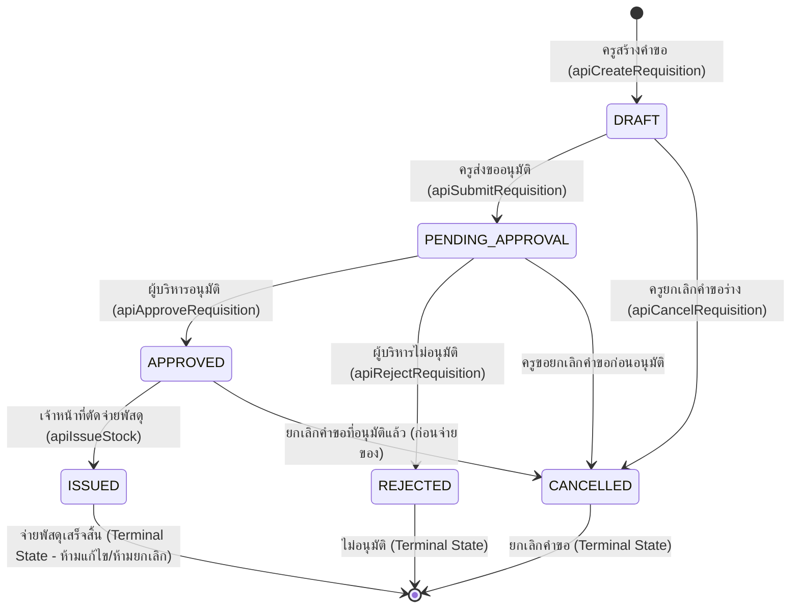

# 🔄 STATE MACHINE & LIFECYCLE SPECIFICATION
## แผนผังสถานะและวงจรชีวิตคำขอเบิกพัสดุ (Requisition Finite State Machine)
### ระบบบริหารคลังพัสดุโรงเรียน โรงเรียนหรเทพ(รุ่งเรืองประชาสามัคคี)

**รหัสเอกสาร:** SIMS-FSM-2026-001  
**เวอร์ชันสถานะ:** 1.0.0  

---

## 1. แผนภาพการเปลี่ยนผ่านสถานะ (Finite State Diagram)

---

## 2. ตารางการเปลี่ยนผ่านสถานะที่ถูกต้อง (Valid State Transition Table)

| สถานะปัจจุบัน (From State) | เหตุการณ์ / การกระทำ (Event / Action) | บทบาทผู้มีสิทธิ์ (Authorized Role) | สถานะถัดไป (To State) | ผลกระทบต่อระบบ (Side Effects) |
| :--- | :--- | :--- | :--- | :--- |
| *ไม่มี (None)* | `CREATE_REQUISITION` | `TEACHER`, `STAFF_SUPPLY` | `DRAFT` | ออกเลขที่คำขอ, บันทึกรายการพัสดุ |
| `DRAFT` | `SUBMIT_REQUISITION` | `TEACHER` (เจ้าของคำขอ) | `PENDING_APPROVAL` | ล็อกเอกสาร, ส่งแจ้งเตือนในระบบ |
| `DRAFT` | `CANCEL_REQUISITION` | `TEACHER` (เจ้าของคำขอ) | `CANCELLED` | ยุติคำขอ, ปิดเอกสาร |
| `PENDING_APPROVAL` | `APPROVE` | `DIRECTOR`, หัวหน้าฝ่าย | `APPROVED` | บันทึกความเห็นผู้อนุมัติ, ส่งเข้าคิวจ่าย |
| `PENDING_APPROVAL` | `REJECT` | `DIRECTOR`, หัวหน้าฝ่าย | `REJECTED` | บันทึกเหตุผลการไม่อนุมัติ, ยุติคำขอ |
| `PENDING_APPROVAL` | `CANCEL_REQUISITION` | `TEACHER` (เจ้าของคำขอ) | `CANCELLED` | ยุติคำขอ |
| `APPROVED` | `ISSUE_STOCK` | `STAFF_SUPPLY` | `ISSUED` | ตัดสต็อก, สร้าง Stock Ledger, บันทึก Audit Log |
| `APPROVED` | `CANCEL_REQUISITION` | `DIRECTOR`, `TEACHER` | `CANCELLED` | ยุติคำขอก่อนที่จะจ่ายของ |
| `ISSUED` | *ไม่อนุญาตการกระทำใดๆ* | - | - | **TERMINAL STATE:** ห้ามเปลี่ยนสถานะหรือยกเลิก |
| `REJECTED` | *ไม่อนุญาตการกระทำใดๆ* | - | - | **TERMINAL STATE:** สิ้นสุดกระบวนการ |
| `CANCELLED` | *ไม่อนุญาตการกระทำใดๆ* | - | - | **TERMINAL STATE:** สิ้นสุดกระบวนการ |

---

## 3. การสกัดกั้นการเปลี่ยนสถานะที่ผิดกฎ (Invalid Transition Enforcement)

หาก Client หรือ API พยายามส่งคำสั่งที่ขัดแย้งกับ State Machine ระบบจะโยนข้อยกเว้นทันที:
1. **พยายามอนุมัติซ้ำ (Double Approve):** `APPROVED` $\rightarrow$ `APPROVED` $\Rightarrow$ `DuplicateApproveException`
2. **พยายามจ่ายพัสดุซ้ำ (Double Issue):** `ISSUED` $\rightarrow$ `ISSUED` $\Rightarrow$ `DuplicateIssueException`
3. **พยายามจ่ายพัสดุที่ยังไม่อนุมัติ:** `PENDING_APPROVAL` $\rightarrow$ `ISSUED` $\Rightarrow$ `InvalidStateTransitionException`
4. **พยายามยกเลิกพัสดุที่จ่ายไปแล้ว:** `ISSUED` $\rightarrow$ `CANCELLED` $\Rightarrow$ `InvalidStateTransitionException`
