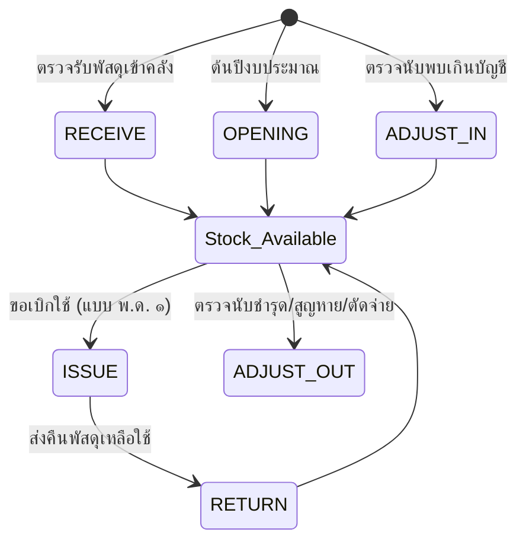
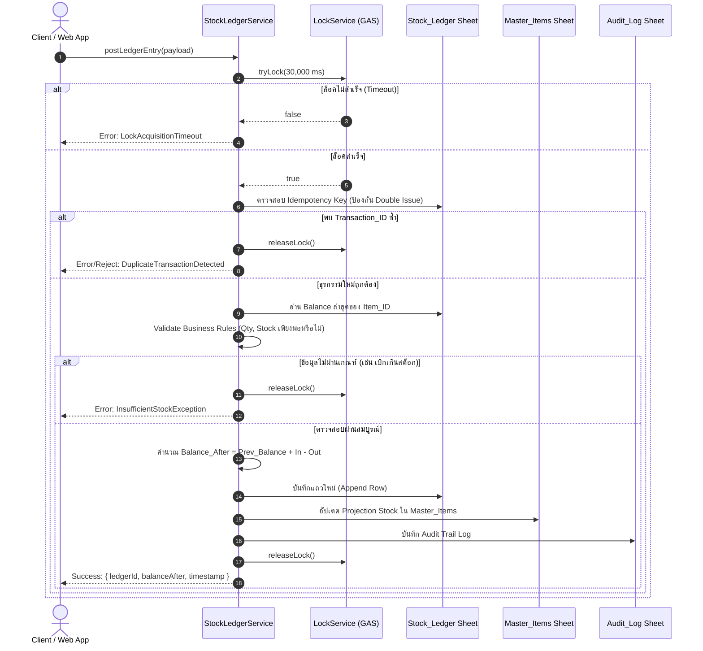

# สถาปัตยกรรมและข้อกำหนดการออกแบบ Stock Ledger Core Module
## ระบบบริหารคลังพัสดุโรงเรียน (School Inventory Management System)

---

## 1. บทนำและปรัชญาการออกแบบ (Design Philosophy)

ในระบบบริหารจัดการพัสดุสถานศึกษาตามระเบียบกระทรวงการคลังว่าด้วยการจัดซื้อจัดจ้างและการบริหารพัสดุภาครัฐ พ.ศ. ๒๕๖๐ **ความถูกต้อง โปร่งใส และตรวจสอบย้อนกลับได้ (Auditability & Traceability)** ถือเป็นหัวใจสำคัญสูงสุด

### ปัญหาของสถาปัตยกรรมแบบดั้งเดิม (Direct Stock Mutation Pitfall)
ระบบคลังสินค้าทั่วไปมักจัดเก็บยอดคงเหลือเป็นตัวเลขเดี่ยว (Field: `stock`) ในตาราง Master แล้วใช้คำสั่ง `UPDATE items SET stock = stock - qty` ซึ่งก่อให้เกิดปัญหาขั้นวิกฤต:
1. **ยอดสต็อกคลาดเคลื่อนไม่ทราบสาเหตุ**: ไม่สามารถพิสูจน์ย้อนหลังได้ว่าตัวเลขหายไปจากรายการใด เมื่อใด และใครเป็นผู้ทำรายการ
2. **ปัญหา Race Condition & Concurrency**: เมื่อมีผู้ขอเบิกพร้อมกัน ยอดจะถูกเขียนทับ (Lost Update)
3. **ปัญหาการเบิกจ่ายซ้ำ (Double Issue)**: การกดปุ่มซ้ำ (Double Click) หรือเครือข่ายกระตุกทำให้เกิดการตัดสต็อกเกินจริง ยอดติดลบ

### ปรัชญา Event Sourcing & Append-Only Ledger
Stock Ledger Core Module ถูกออกแบบภายใต้หลักการ **Immutable Append-Only Ledger**:
* **Ledger คือ Single Source of Truth (SSOT)**: ตาราง `Stock_Ledger` ไม่มีการ `UPDATE` หรือ `DELETE` ข้อมูลแถวเดิมโดยเด็ดขาด ทุกการเปลี่ยนแปลงทางกายภาพจะถูกบันทึกเป็น "รายการเคลื่อนไหวใหม่ (New Entry)" เสมอ
* **Balance คือ Derived State**: ยอดคงเหลือของพัสดุ ณ เวลาใดๆ คือผลรวมสะสมทางคณิตศาสตร์:
  $$\text{Current Balance} = \sum (\text{Qty\_In}) - \sum (\text{Qty\_Out})$$
* **Master Stock เป็นเพียง Projection/Cache**: ยอดในตาราง `Master_Items` มีหน้าที่เพียงอำนวยความสะดวกในการแสดงผล (Read Model) และต้องผ่านการตรวจสอบความถูกต้อง (Reconciliation) เทียบกับ Ledger เสมอ

---

## 2. โครงสร้างข้อมูล Stock Ledger Schema

โครงสร้างตาราง `Stock_Ledger` ถูกออกแบบให้รองรับข้อกำหนดราชการครบถ้วนตามแบบ พ.ด. ๑ ถึง พ.ด. ๗:

| Field Name | Data Type | Constraints | Description & Example |
|---|---|---|---|
| `Ledger_ID` | String | PK, Unique | รหัสรายการบัญชีคุม เช่น `LED-25690927-0001` |
| `Item_ID` | String | Indexed | รหัสพัสดุภายในสถานศึกษา เช่น `OFF-001`, `IT-010` |
| `Transaction_ID` | String | Indexed | รหัสธุรกรรมต้นทาง (Idempotency Key) เช่น `TXN-REQ-2569/012-01` |
| `Transaction_Type` | Enum | Not Null | ประเภทความเคลื่อนไหว (ดูหัวข้อที่ 3) |
| `Qty_In` | Number (Dec) | $\ge 0$ | จำนวนรับเข้าคลัง (กรณีจ่ายออกจะเป็น 0) |
| `Qty_Out` | Number (Dec) | $\ge 0$ | จำนวนจ่ายออกจากคลัง (กรณีรับเข้าจะเป็น 0) |
| `Unit_Cost` | Number (Dec) | $\ge 0$ | ราคาต่อหน่วย ณ ขณะเกิดรายการ (บาท) |
| `Balance_After` | Number (Dec) | $\ge 0$ | ยอดคงเหลือในบัญชีทันทีหลังทำรายการเสร็จสิ้น |
| `Fiscal_Year` | Integer | Not Null | ปีงบประมาณ พ.ศ. เช่น `2569` |
| `Actor_User_ID` | String | Not Null | รหัสผู้ใช้/ผู้ปฏิบัติงาน เช่น `USR-WICHAI-01` |
| `Created_At` | String (ISO) | UTC Format | วันที่และเวลาเกิดรายการ `YYYY-MM-DDTHH:mm:ss.sssZ` |
| `Reference_Type` | String | Not Null | ประเภทเอกสารอ้างอิง เช่น `REQUISITION`, `RECEIPT`, `AUDIT` |
| `Reference_ID` | String | Not Null | เลขที่เอกสารอ้างอิง เช่น `HRT-INV-REQ-2569/012` |
| `Note` | String | Optional | บันทึกช่วยจำ เช่น "เบิกสอนกิจกรรมภาษาไทย ภาคเรียนที่ 1" |

---

## 3. ประเภทธุรกรรมที่รองรับ (Supported Transaction Types)

โมดูลรองรับ 6 ประเภทความเคลื่อนไหวตามระเบียบงานพัสดุ:



1. **`OPENING` (ยอดยกมาต้นงวด)**:
   - บันทึกยอดคงเหลือยกมาจากสิ้นปีงบประมาณก่อนหน้า
   - เงื่อนไข: `Qty_In > 0`, `Qty_Out = 0`
2. **`RECEIVE` (รับพัสดุเข้าคลัง)**:
   - บันทึกจากการจัดซื้อจัดจ้าง หรือรับบริจาค
   - อ้างอิง: ใบตรวจรับพัสดุ / PO
   - เงื่อนไข: `Qty_In > 0`, `Qty_Out = 0`
3. **`ISSUE` (จ่ายพัสดุ)**:
   - บันทึกการจ่ายพัสดุตามใบขอเบิกที่ได้รับอนุมัติ (แบบ พ.ด. ๑)
   - เงื่อนไข: `Qty_In = 0`, `Qty_Out > 0`, `Qty_Out <= Current_Balance`
4. **`RETURN` (ส่งคืนคลัง)**:
   - บันทึกกรณีครู/ฝ่ายงานนำพัสดุที่เบิกเกินมาส่งคืนเข้าคลัง
   - เงื่อนไข: `Qty_In > 0`, `Qty_Out = 0`, ต้องอ้างอิง `Reference_ID` ของใบเบิกเดิม
5. **`ADJUST_IN` (ปรับปรุงสต็อกเพิ่ม)**:
   - บันทึกผลต่างจากการตรวจนับสิ้นปีงบประมาณ (แบบ พ.ด. ๗) กรณีพัสดุจริงมีมากกว่ายอดบัญชี
   - เงื่อนไข: `Qty_In > 0`, `Qty_Out = 0`
6. **`ADJUST_OUT` (ปรับปรุงสต็อกลด / จำหน่าย)**:
   - บันทึกผลต่างตรวจนับขาด หรือพัสดุชำรุด เสื่อมสภาพ สูญหาย หรือจำหน่ายออกจากบัญชี
   - เงื่อนไข: `Qty_In = 0`, `Qty_Out > 0`, `Qty_Out <= Current_Balance`

---

## 4. โครงสร้าง Concurrency Control ด้วย `LockService`

ในสภาพแวดล้อม Google Apps Script และ Web Application การที่ครูหรือเจ้าหน้าที่หลายท่านกดทำรายการพร้อมกัน อาจส่งผลให้เกิด Race Condition ได้ ระบบจึงบังคับใช้ `LockService.getScriptLock()` เพื่อควบคุมให้การทำรายการเป็น Atomic Operation:



### รายละเอียดขั้นตอนใน Flow (The Critical Execution Path)
1. **Acquire Lock**: ขอถือครองสิทธิ์เอ็กซ์คลูซีฟผ่าน `LockService.getScriptLock().tryLock(30000)` ป้องกันเธรดอื่นแทรก
2. **Read Balance**: อ่านยอดคงเหลือสะสมล่าสุดจากบรรทัดล่าสุดของ `Item_ID` ใน Ledger
3. **Validate**: ตรวจสอบความถูกต้องของอินพุต ค่าตัวเลข และเงื่อนไขห้ามติดลบ ($Balance\_After \ge 0$)
4. **Create Transaction**: กำหนดหมายเลขกำกับ `Ledger_ID` และตรวจสอบความไม่ซ้ำซ้อน
5. **Write Ledger**: บันทึกแถวรายการใหม่ลงในแผ่นงาน `Stock_Ledger` ทันที
6. **Calculate Balance**: ประมวลผลและอัปเดตแคชยอดพัสดุใน `Master_Items`
7. **Audit Log**: บันทึกประวัติการกระทำลงใน `Audit_Log` เพื่อความโปร่งใส
8. **Release Lock**: คืนสิทธิ์การล็อคในบล็อก `finally` เสมอ แม้จะเกิด Exception ระหว่างทาง

---

## 5. ยุทธวิธีป้องกันการเบิกจ่ายซ้ำ (Double Issue Prevention)

การเบิกจ่ายซ้ำมักเกิดจาก 3 สาเหตุหลัก ซึ่งระบบมีกลไกป้องกันครบทั้ง 3 ระดับ:

### ระดับที่ 1: Distributed Idempotency Key
* กำหนดให้ทุกคำขอเบิกจ่ายพัสดุ ต้องมีรหัสธุรกรรมเฉพาะตัว (`Transaction_ID`) เช่น `REQ-2569/012-IT004`
* ภายใน Critical Section (ขณะถือ Lock) ฟังก์ชัน `postLedgerEntry()` จะสแกนตาราง Ledger ย้อนหลังเพื่อค้นหา `Transaction_ID` ดังกล่าว
* หากพบว่ามี `Transaction_ID` นี้ถูกโพสต์สำเร็จไปแล้ว ระบบจะปฏิเสธการทำรายการทันที พร้อมส่งคืนข้อมูล Ledger เดิมโดยไม่หักสต็อกซ้ำ

### ระดับที่ 2: Pessimistic Balance Re-evaluation
* แม้ฝั่ง Client จะตรวจสอบมาแล้วว่ามีสต็อกเหลือ แต่ในจังหวะที่มีคำขอมาพร้อมกัน ข้อมูลฝั่ง Client อาจล้าสมัย (Stale Data)
* ระบบจะทำการ Re-read ค่า `Balance_After` ล่าสุดจาก Ledger ภายใน Lock เสมอ หากคำนวณแล้ว $Current\_Balance < Qty\_Out$ ระบบจะ Abort ทันที

### ระดับที่ 3: Client-side UI Debounce & State Locking
* ปุ่ม "ยืนยันการขอเบิก" บนหน้าเว็บจะถูก Disable ทันทีเมื่อคลิก พร้อมแสดง Spinner ป้องกันผู้ใช้ Double Click ซ้ำขณะเครือข่ายหน่วง

---

## 6. ข้อกำหนด API และฟังก์ชันหลัก 4 ฟังก์ชัน

### 6.1 `postLedgerEntry(entryPayload)`
บันทึกความเคลื่อนไหวพัสดุลงในบัญชีคุมแบบ Atomic
* **Input Parameters**:
  ```json
  {
    "itemId": "OFF-001",
    "transactionId": "TXN-REQ-2569/012-OFF001",
    "transactionType": "ISSUE",
    "qtyIn": 0,
    "qtyOut": 5,
    "unitCost": 125.00,
    "fiscalYear": 2569,
    "actorUserId": "USR-WICHAI-01",
    "referenceType": "REQUISITION_SLIP",
    "referenceId": "HRT-INV-REQ-2569/012",
    "note": "ขอเบิกเอกสารสำหรับงานธุรการ"
  }
  ```
* **Output Success**:
  ```json
  {
    "success": true,
    "ledgerId": "LED-25690927-0042",
    "itemId": "OFF-001",
    "previousBalance": 35,
    "qtyIn": 0,
    "qtyOut": 5,
    "balanceAfter": 30,
    "createdAt": "2026-09-27T00:45:00.000Z"
  }
  ```
* **Error Thrown**:
  - `LockAcquisitionTimeout`: เมื่อไม่สามารถครอบครอง Lock ได้ภายใน 30 วินาที
  - `DuplicateTransactionException`: เมื่อตรวจพบ `transactionId` ซ้ำ
  - `InsufficientStockException`: เมื่อยอดคงเหลือไม่เพียงพอต่อการจ่ายออก
  - `InvalidPayloadException`: เมื่อฟิลด์ข้อมูลสำคัญไม่ครบถ้วนหรือไม่ถูกต้อง

---

### 6.2 `getItemLedger(itemId, options)`
ดึงประวัติบัญชีคุมพัสดุรายการที่กำหนด พร้อมตัวกรองและการตรวจสอบความต่อเนื่องทางบัญชี
* **Input Parameters**:
  - `itemId` (String, Required)
  - `options` (Object, Optional):
    - `fiscalYear`: กรองตามปีงบประมาณ
    - `startDate`: วันที่เริ่มต้น (ISO)
    - `endDate`: วันที่สิ้นสุด (ISO)
    - `transactionType`: กรองเฉพาะประเภทรายการ
    - `limit`: จำนวนแถวสูงสุด (Default: 100)
    - `offset`: ลำดับแถวเริ่มต้น
* **Output**:
  ```json
  {
    "itemId": "OFF-001",
    "totalEntries": 14,
    "currentBalance": 30,
    "entries": [
      {
        "ledgerId": "LED-25690515-0001",
        "createdAt": "2026-05-15T08:30:00.000Z",
        "transactionType": "OPENING",
        "qtyIn": 50,
        "qtyOut": 0,
        "unitCost": 125.00,
        "balanceAfter": 50,
        "referenceId": "YE-2568-BALANCE",
        "actorUserId": "USR-ANAN-01"
      },
      {
        "ledgerId": "LED-25690515-0012",
        "createdAt": "2026-05-15T10:15:00.000Z",
        "transactionType": "ISSUE",
        "qtyIn": 0,
        "qtyOut": 5,
        "unitCost": 125.00,
        "balanceAfter": 45,
        "referenceId": "HRT-INV-REQ-2569/001",
        "actorUserId": "USR-KANYA-02"
      }
    ]
  }
  ```

---

### 6.3 `calculateCurrentBalance(itemId)`
คำนวณหายอดคงเหลือที่แท้จริงจากผลรวมประวัติศาสตร์ของ Ledger ทั้งหมดโดยตรง (Mathematical Audit)
* **Logic**:
  $$\text{Balance} = \sum_{e \in \text{Ledger}(itemId)} (e.\text{Qty\_In} - e.\text{Qty\_Out})$$
* **Output**: Number (จำนวนเต็มหรือทศนิยมยอดคงเหลือแท้จริง)

---

### 6.4 `reconcileBalance(itemId)`
ตรวจสอบความสอดคล้องระหว่างยอดแคชใน `Master_Items` กับยอดคำนวณจริงใน `Stock_Ledger`
* **Workflow**:
  1. ดึงค่า `projectedStock` จาก `Master_Items`
  2. ดึงค่า `calculatedStock = calculateCurrentBalance(itemId)`
  3. ตรวจสอบความถูกต้อง:
     - หาก $projectedStock == calculatedStock$: ผลการตรวจสอบเป็น `IN_SYNC` สมบูรณ์
     - หาก $projectedStock \ne calculatedStock$: ผลการตรวจสอบเป็น `DISCREPANCY_DETECTED`
  4. ทำการ Auto-Heal: อัปเดต `Master_Items` ให้ตรงกับ Ledger ทันที พร้อมเขียนบันทึกเตือนใน `Audit_Log`
* **Output**:
  ```json
  {
    "itemId": "OFF-001",
    "status": "IN_SYNC", // หรือ "DISCREPANCY_FIXED"
    "projectedStock": 30,
    "calculatedStock": 30,
    "discrepancy": 0,
    "reconciledAt": "2026-09-27T00:50:00.000Z"
  }
  ```

---

## 7. โค้ดต้นแบบสำหรับการติดตั้งใช้งาน (Production-Ready GAS Implementation)

```javascript
/**
 * ============================================================================
 * STOCK LEDGER CORE MODULE FOR GOOGLE APPS SCRIPT
 * ระบบบัญชีคุมพัสดุสถานศึกษา (โรงเรียนหรเทพ(รุ่งเรืองประชาสามัคคี))
 * ============================================================================
 */

const CONFIG = {
  SHEET_LEDGER: 'Stock_Ledger',
  SHEET_ITEMS: 'Master_Items',
  SHEET_AUDIT: 'Audit_Log',
  LOCK_TIMEOUT_MS: 30000,
  CURRENT_FISCAL_YEAR: 2569
};

const TRANSACTION_TYPES = {
  OPENING: 'OPENING',
  RECEIVE: 'RECEIVE',
  ISSUE: 'ISSUE',
  RETURN: 'RETURN',
  ADJUST_IN: 'ADJUST_IN',
  ADJUST_OUT: 'ADJUST_OUT'
};

/**
 * โพสต์บันทึกความเคลื่อนไหวพัสดุลงใน Stock Ledger (Atomic & Concurrency Protected)
 * @param {Object} payload 
 * @return {Object} ผลลัพธ์การบันทึก
 */
function postLedgerEntry(payload) {
  if (!payload || !payload.itemId || !payload.transactionType) {
    throw new Error("InvalidPayloadException: itemId and transactionType are mandatory.");
  }

  const qtyIn = Number(payload.qtyIn) || 0;
  const qtyOut = Number(payload.qtyOut) || 0;

  if (qtyIn < 0 || qtyOut < 0) {
    throw new Error("ValidationException: Qty_In and Qty_Out cannot be negative.");
  }
  if (qtyIn === 0 && qtyOut === 0) {
    throw new Error("ValidationException: Either Qty_In or Qty_Out must be greater than zero.");
  }

  const lock = LockService.getScriptLock();
  const hasLock = lock.tryLock(CONFIG.LOCK_TIMEOUT_MS);
  if (!hasLock) {
    throw new Error("LockAcquisitionTimeout: ไม่สามารถขอสิทธิ์เข้าถึงคลังได้ในขณะนี้ กรุณาลองใหม่อีกครั้ง");
  }

  try {
    const ss = SpreadsheetApp.getActiveSpreadsheet();
    let ledgerSheet = ss.getSheetByName(CONFIG.SHEET_LEDGER);
    if (!ledgerSheet) {
      ledgerSheet = initLedgerSheet_(ss);
    }

    // 1. ตรวจสอบ Idempotency Key ป้องกัน Double Issue
    if (payload.transactionId) {
      const isDuplicate = checkDuplicateTransaction_(ledgerSheet, payload.transactionId, payload.itemId);
      if (isDuplicate) {
        throw new Error(`DuplicateTransactionException: ธุรกรรมรหัส ${payload.transactionId} ถูกดำเนินการไปแล้ว`);
      }
    }

    // 2. อ่านยอดยกมาล่าสุดของ Item_ID
    const currentBalance = calculateCurrentBalanceInternal_(ledgerSheet, payload.itemId);

    // 3. ตรวจสอบเงื่อนไขยอดคงเหลือสำหรับการจ่ายออก
    if (payload.transactionType === TRANSACTION_TYPES.ISSUE || payload.transactionType === TRANSACTION_TYPES.ADJUST_OUT) {
      if (currentBalance < qtyOut) {
        throw new Error(`InsufficientStockException: พัสดุรหัส ${payload.itemId} มียอดคงเหลือ ${currentBalance} ไม่เพียงพอสำหรับการจ่ายออก ${qtyOut}`);
      }
    }

    // 4. คำนวณยอดคงเหลือใหม่
    const balanceAfter = currentBalance + qtyIn - qtyOut;

    // 5. สร้างหมายเลข Ledger_ID
    const now = new Date();
    const dateStamp = Utilities.formatDate(now, "GMT+7", "yyyyMMdd");
    const ledgerId = `LED-${dateStamp}-${Utilities.getUuid().substring(0, 8).toUpperCase()}`;
    const createdAtIso = now.toISOString();

    // 6. บันทึกลงใน Stock_Ledger Sheet
    const newRow = [
      ledgerId,
      payload.itemId,
      payload.transactionId || `TXN-${ledgerId}`,
      payload.transactionType,
      qtyIn,
      qtyOut,
      Number(payload.unitCost) || 0,
      balanceAfter,
      payload.fiscalYear || CONFIG.CURRENT_FISCAL_YEAR,
      payload.actorUserId || 'SYSTEM',
      createdAtIso,
      payload.referenceType || 'DIRECT',
      payload.referenceId || '-',
      payload.note || ''
    ];
    ledgerSheet.appendRow(newRow);

    // 7. อัปเดต Projection ใน Master_Items
    updateMasterStockCache_(ss, payload.itemId, balanceAfter);

    // 8. บันทึกประวัติใน Audit_Log
    logAuditTrail_(ss, {
      action: `STOCK_${payload.transactionType}`,
      actor: payload.actorUserId || 'SYSTEM',
      details: `Item: ${payload.itemId}, In: ${qtyIn}, Out: ${qtyOut}, BalanceAfter: ${balanceAfter}, Ref: ${payload.referenceId}`
    });

    return {
      success: true,
      ledgerId: ledgerId,
      itemId: payload.itemId,
      previousBalance: currentBalance,
      qtyIn: qtyIn,
      qtyOut: qtyOut,
      balanceAfter: balanceAfter,
      createdAt: createdAtIso
    };

  } finally {
    lock.releaseLock();
  }
}

/**
 * ดึงรายการบัญชีคุมพัสดุเฉพาะรายการ
 */
function getItemLedger(itemId, options) {
  options = options || {};
  const ss = SpreadsheetApp.getActiveSpreadsheet();
  const ledgerSheet = ss.getSheetByName(CONFIG.SHEET_LEDGER);
  if (!ledgerSheet) return { itemId: itemId, totalEntries: 0, entries: [] };

  const data = ledgerSheet.getDataRange().getValues();
  if (data.length <= 1) return { itemId: itemId, totalEntries: 0, entries: [] };

  const headers = data[0];
  const colIndex = {
    ledgerId: headers.indexOf('Ledger_ID'),
    itemId: headers.indexOf('Item_ID'),
    txnId: headers.indexOf('Transaction_ID'),
    txnType: headers.indexOf('Transaction_Type'),
    qtyIn: headers.indexOf('Qty_In'),
    qtyOut: headers.indexOf('Qty_Out'),
    unitCost: headers.indexOf('Unit_Cost'),
    balanceAfter: headers.indexOf('Balance_After'),
    fiscalYear: headers.indexOf('Fiscal_Year'),
    actor: headers.indexOf('Actor_User_ID'),
    createdAt: headers.indexOf('Created_At'),
    refType: headers.indexOf('Reference_Type'),
    refId: headers.indexOf('Reference_ID'),
    note: headers.indexOf('Note')
  };

  const filtered = [];
  for (let i = 1; i < data.length; i++) {
    const row = data[i];
    if (String(row[colIndex.itemId]).trim() === String(itemId).trim()) {
      if (options.fiscalYear && Number(row[colIndex.fiscalYear]) !== Number(options.fiscalYear)) continue;
      if (options.transactionType && String(row[colIndex.txnType]) !== String(options.transactionType)) continue;

      filtered.push({
        ledgerId: row[colIndex.ledgerId],
        transactionId: row[colIndex.txnId],
        transactionType: row[colIndex.txnType],
        qtyIn: Number(row[colIndex.qtyIn]) || 0,
        qtyOut: Number(row[colIndex.qtyOut]) || 0,
        unitCost: Number(row[colIndex.unitCost]) || 0,
        balanceAfter: Number(row[colIndex.balanceAfter]) || 0,
        fiscalYear: row[colIndex.fiscalYear],
        actorUserId: row[colIndex.actor],
        createdAt: row[colIndex.createdAt],
        referenceType: row[colIndex.refType],
        referenceId: row[colIndex.refId],
        note: row[colIndex.note]
      });
    }
  }

  const currentBalance = filtered.length > 0 ? filtered[filtered.length - 1].balanceAfter : 0;

  return {
    itemId: itemId,
    totalEntries: filtered.length,
    currentBalance: currentBalance,
    entries: filtered
  };
}

/**
 * คำนวณหายอดคงเหลือที่แท้จริงจากผลรวมทางคณิตศาสตร์ใน Ledger
 */
function calculateCurrentBalance(itemId) {
  const ss = SpreadsheetApp.getActiveSpreadsheet();
  const ledgerSheet = ss.getSheetByName(CONFIG.SHEET_LEDGER);
  if (!ledgerSheet) return 0;
  return calculateCurrentBalanceInternal_(ledgerSheet, itemId);
}

/**
 * ฟังก์ชันภายในสำหรับการคำนวณ Balance โดยตรง
 */
function calculateCurrentBalanceInternal_(ledgerSheet, itemId) {
  const data = ledgerSheet.getDataRange().getValues();
  if (data.length <= 1) return 0;

  let balance = 0;
  const colItemId = 1;  // Item_ID
  const colQtyIn = 4;   // Qty_In
  const colQtyOut = 5;  // Qty_Out

  for (let i = 1; i < data.length; i++) {
    if (String(data[i][colItemId]).trim() === String(itemId).trim()) {
      const inVal = Number(data[i][colQtyIn]) || 0;
      const outVal = Number(data[i][colQtyOut]) || 0;
      balance += (inVal - outVal);
    }
  }
  return balance;
}

/**
 * ตรวจสอบความถูกต้องและปรับปรุงยอดแคชให้ตรงกับ Ledger เสมอ
 */
function reconcileBalance(itemId) {
  const ss = SpreadsheetApp.getActiveSpreadsheet();
  const calculatedStock = calculateCurrentBalance(itemId);
  
  const itemsSheet = ss.getSheetByName(CONFIG.SHEET_ITEMS);
  let projectedStock = 0;
  let rowFound = -1;

  if (itemsSheet) {
    const data = itemsSheet.getDataRange().getValues();
    for (let i = 1; i < data.length; i++) {
      if (String(data[i][0]).trim() === String(itemId).trim()) { // สมมติ Column 0 คือ Code/ID
        projectedStock = Number(data[i][8]) || 0; // สมมติ Column 8 คือ Stock
        rowFound = i + 1;
        break;
      }
    }
  }

  const discrepancy = projectedStock - calculatedStock;
  let status = "IN_SYNC";

  if (discrepancy !== 0) {
    status = "DISCREPANCY_DETECTED";
    if (itemsSheet && rowFound > 0) {
      itemsSheet.getRange(rowFound, 9).setValue(calculatedStock); // Sync update
      status = "DISCREPANCY_FIXED";
    }
    logAuditTrail_(ss, {
      action: 'RECONCILE_DISCREPANCY',
      actor: 'SYSTEM',
      details: `Reconciled Item: ${itemId}. Cached was: ${projectedStock}, Ledger actual: ${calculatedStock}. Fixed.`
    });
  }

  return {
    itemId: itemId,
    status: status,
    projectedStock: projectedStock,
    calculatedStock: calculatedStock,
    discrepancy: discrepancy,
    reconciledAt: new Date().toISOString()
  };
}

// ----------------------------------------------------------------------------
// HELPER FUNCTIONS
// ----------------------------------------------------------------------------

function checkDuplicateTransaction_(ledgerSheet, transactionId, itemId) {
  const data = ledgerSheet.getDataRange().getValues();
  if (data.length <= 1) return false;
  
  const colTxnId = 2; // Transaction_ID
  const colItemId = 1; // Item_ID

  for (let i = data.length - 1; i >= 1; i--) {
    if (String(data[i][colTxnId]).trim() === String(transactionId).trim() &&
        String(data[i][colItemId]).trim() === String(itemId).trim()) {
      return true;
    }
  }
  return false;
}

function updateMasterStockCache_(ss, itemId, newBalance) {
  const itemsSheet = ss.getSheetByName(CONFIG.SHEET_ITEMS);
  if (!itemsSheet) return;
  const data = itemsSheet.getDataRange().getValues();
  for (let i = 1; i < data.length; i++) {
    if (String(data[i][0]).trim() === String(itemId).trim()) {
      itemsSheet.getRange(i + 1, 9).setValue(newBalance);
      break;
    }
  }
}

function logAuditTrail_(ss, logData) {
  let auditSheet = ss.getSheetByName(CONFIG.SHEET_AUDIT);
  if (!auditSheet) {
    auditSheet = ss.insertSheet(CONFIG.SHEET_AUDIT);
    auditSheet.appendRow(['Log_ID', 'Timestamp', 'Action', 'Actor', 'Details']);
  }
  auditSheet.appendRow([
    `LOG-${Utilities.getUuid().substring(0, 8)}`,
    new Date().toISOString(),
    logData.action,
    logData.actor,
    logData.details
  ]);
}

function initLedgerSheet_(ss) {
  const sheet = ss.insertSheet(CONFIG.SHEET_LEDGER);
  sheet.appendRow([
    'Ledger_ID',
    'Item_ID',
    'Transaction_ID',
    'Transaction_Type',
    'Qty_In',
    'Qty_Out',
    'Unit_Cost',
    'Balance_After',
    'Fiscal_Year',
    'Actor_User_ID',
    'Created_At',
    'Reference_Type',
    'Reference_ID',
    'Note'
  ]);
  sheet.setFrozenRows(1);
  return sheet;
}
```

---

## 8. สรุปความพร้อมในการใช้งาน (Readiness & Compliance)

สถาปัตยกรรม Stock Ledger นี้รับประกัน:
1. **Zero Data Loss**: ข้อมูลประวัติการเคลื่อนไหวไม่สูญหายและไม่ถูกแก้ไขย้อนหลัง
2. **Mathematical Integrity**: ยอดคงเหลือถูกรับรองด้วยหลักการบัญชีแยกประเภท
3. **Double Issue Immunity**: ป้องกันการเบิกจ่ายซ้ำด้วย Idempotency และ Mutual Exclusion Lock
4. **Full Thai Government Standard Compatibility**: สอดรับกับการสร้างเอกสาร พ.ด. ๑ ถึง พ.ด. ๗ ได้แบบเรียลไทม์ 100%
