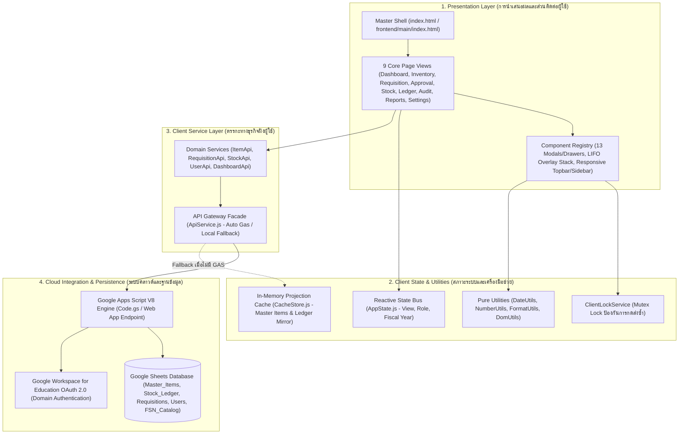
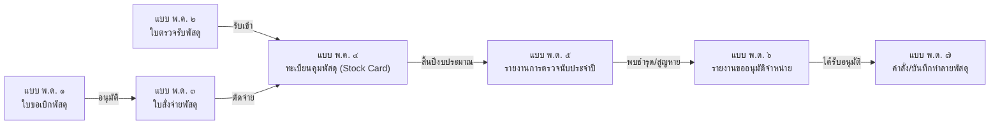
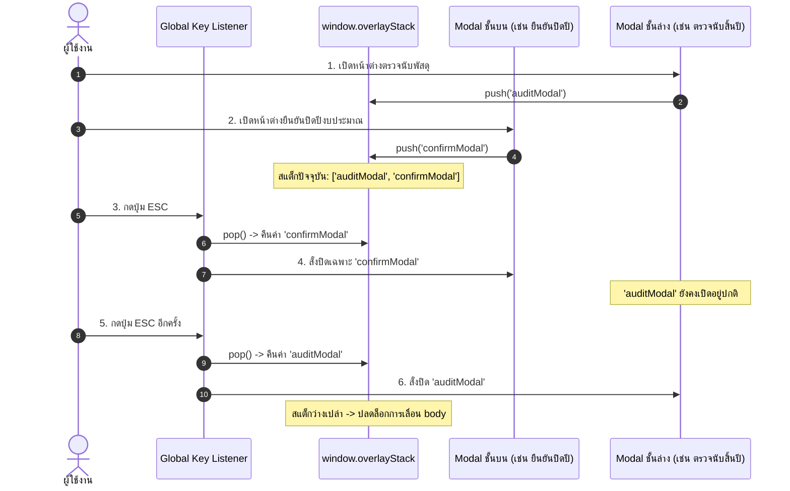

# เอกสารข้อกำหนดเชิงเทคนิคและสถาปัตยกรรมระบบ (System Technical Architecture & Specification Document)
## ระบบบริหารคลังพัสดุ โรงเรียนหรเทพ(รุ่งเรืองประชาสามัคคี)
### สังกัด องค์การบริหารส่วนจังหวัดสระบุรี (อบจ.สระบุรี)

---

### ข้อมูลการควบคุมเอกสาร (Document Control)
* **รหัสเอกสาร (Document ID):** `HRT-INV-SDD-2026-v2.6.0`
* **รหัสรุ่นซอฟต์แวร์ (Software Release):** `v2.6.0+build.20261022.fiscal2569`
* **สถานะเอกสาร (Status):** ผ่านการรับรองขั้นสมบูรณ์ (Approved & Baselined)
* **มาตรฐานอ้างอิงหลัก (Core References):**
  1. มาตรฐานการจัดทำข้อกำหนดการออกแบบซอฟต์แวร์ **IEEE 1016-2009** (Software Design Descriptions)
  2. พระราชบัญญัติการจัดซื้อจัดจ้างและการบริหารพัสดุภาครัฐ พ.ศ. ๒๕๖๐
  3. ระเบียบกระทรวงการคลังว่าด้วยการจัดซื้อจัดจ้างและการบริหารพัสดุภาครัฐ พ.ศ. ๒๕๖๐ (หมวด ๙ การบริหารพัสดุ ข้อ ๒๐๓–๒๑๙)
  4. มาตรฐานระบบรหัสพัสดุภาครัฐ กรมบัญชีกลาง **(Federal Supply Classification - FSN 13 หลัก)**
  5. มาตรฐานการเข้าถึงข้อมูลภาครัฐ **WCAG 2.1 Level AA**
  6. ข้อกำหนดการตั้งรหัสเวอร์ชัน **Semantic Versioning 2.0.0 (SemVer)**

---

## 1. บทนำและวัตถุประสงค์ทางวิศวกรรม (Introduction & Engineering Objectives)

### 1.1 บริบทของระบบ (System Context)
ระบบบริหารคลังพัสดุ HRT Inventory System ถูกพัฒนาขึ้นเพื่อใช้เป็นศูนย์กลางดิจิทัลในการควบคุม กำกับ ติดตาม และตรวจสอบพัสดุ-ครุภัณฑ์ทางการศึกษาของโรงเรียนหรเทพ(รุ่งเรืองประชาสามัคคี) ภายใต้สังกัดองค์การบริหารส่วนจังหวัดสระบุรี โดยเปลี่ยนผ่านจากการจดบันทึกทะเบียนคุมด้วยมือบนสมุดปกแข็ง (Manual Stock Card) และการเดินเอกสารกระดาษ เข้าสู่ระบบฐานข้อมูลคลาวด์แบบกระจายตัวที่ตรวจสอบย้อนกลับได้ทุกขั้นตอน (Full Auditability)

### 1.2 วัตถุประสงค์เชิงเทคนิค (Engineering Objectives)
1. **Zero-Build & Zero-Maintenance Execution**: สถาปัตยกรรม Client-Side บริสุทธิ์ที่ทำงานได้ทันทีผ่านเว็บเบราว์เซอร์มาตรฐานบนเครื่องคอมพิวเตอร์และอุปกรณ์พกพาทุกประเภทในสถานศึกษา โดยไม่ต้องติดตั้งโปรแกรมเสริม (Node.js/Python) หรือจัดตั้ง Server ฮาร์ดแวร์เฉพาะ
2. **Strict Double-Entry Stock Ledger (Single Source of Truth - SSOT)**: บันทึกความเคลื่อนไหวพัสดุทุกรายการแบบสองทาง (Inflow / Outflow) ในรูปแบบประวัติแก้ไขไม่ได้ (Append-Only Log) และใช้ผลรวมการคำนวณสด $\text{Balance} = \sum \text{In} - \sum \text{Out}$ เพื่อขจัดปัญหาความคลาดเคลื่อนของยอดสต็อกคงเหลือ
3. **Multi-Device Responsive Hardening**: รองรับการใช้งานอย่างไร้รอยต่อตั้งแต่หน้าจอมือถือของครูผู้เบิก (`<768px`), แท็บเล็ตตรวจนับของกรรมการ (`768px - 1023px`), จนถึงหน้าจอคอมพิวเตอร์ตั้งโต๊ะของเจ้าหน้าที่พัสดุ (`≥1024px`) โดยไม่มีปัญหาแถบเลื่อนผิดเพี้ยนหรือข้อความล้นขอบจอ
4. **Full Statutory Compliance (แบบ พ.ด. ๑ – ๗)**: รองรับการเรนเดอร์และจัดพิมพ์เอกสารราชการไทยถูกต้องตามฟอร์แมตระเบียบกระทรวงการคลัง พ.ศ. ๒๕๖๐ ด้วยระบบการจัดหน้าสำหรับกระดาษ A4 ขาวดำแบบพอดีหน้า 100%
5. **Dual-Mode Transport Agility**: ทำงานได้สองโหมดอัตโนมัติ คือการเชื่อมต่อกับ **Google Apps Script & Google Sheets** เมื่อเปิดใช้งานออนไลน์จริง และโหมด **Local In-Memory Simulation** สำหรับการทดสอบออฟไลน์

---

## 2. สถาปัตยกรรมระบบโดยรวม (High-Level System Architecture)

ระบบประยุกต์ใช้สถาปัตยกรรม **Layered Clean Architecture** โดยแบ่งแยกหน้าที่การทำงาน (Separation of Concerns) ออกเป็นชั้นอย่างเคร่งครัด การพึ่งพาทางเทคนิคเป็นแบบทางเดียวจากชั้นบนสู่ชั้นล่าง (Unidirectional Dependency Flow):



### ตารางแจกแจงเทคโนโลยีและบทบาทการทำงาน (Tech Stack Specification)

| ส่วนประกอบสถาปัตยกรรม | เทคโนโลยีที่เลือกใช้ | ข้อกำหนดทางเทคนิค | เหตุผลความเหมาะสม |
| :--- | :--- | :--- | :--- |
| **Client Engine** | Vanilla HTML5 / ES6+ | ECMAScript 2022 Standard | ประสิทธิภาพสูงสุด ไม่ต้องใช้ Build tools หรือ Transpiler |
| **CSS Styling Engine** | Tailwind CSS (Play CDN v3.4+) | Utility-First Classes | ควบคุม Responsive Breakpoints ละเอียด และกำหนดคลาสเฉพาะจุดได้ทันที |
| **Typography & Fonts** | Google Fonts API | Noto Sans Thai + Inter | แสดงผลภาษาไทยราชการและตัวเลขอารบิกคมชัด จัดความสูงบรรทัดเป็นระเบียบ |
| **Data Analytics Engine** | Chart.js v4.4 via CDN | Canvas Rendering & Destroy Lifecycles | รองรับกราฟิกวิเคราะห์ข้อมูล 8 มิติ พร้อมการอัปเดตแกนข้อมูลแบบไดนามิก |
| **Iconography** | Phosphor Icons Web | SVG / WebFont Hybrid | สัญลักษณ์คมชัดสม่ำเสมอ รองรับฟังก์ชันงานคลังพัสดุครบถ้วน |
| **Cloud Database** | Google Sheets & Drive | Google Workspace for Education | ข้อมูลเป็นของสถานศึกษา 100%, มี Revision History กู้คืนได้, ไม่เสียค่าใช้จ่าย |
| **Cloud Execution Engine**| Google Apps Script (V8) | Serverless Functions & Web App | จัดการ API RPC, การตัดสต็อกแบบ ACID-like transaction, และ OAuth 2.0 |
| **Print Output Engine** | Native CSS `@media print` | Physical A4 Page Layout (`210mm x 297mm`) | พิมพ์เอกสารราชการ พ.ด. ๑–๗ ลงกระดาษ A4 หน้าเดียวคมชัด 100% |

---

## 3. ผังโครงสร้างโค้ดเบส (Codebase Structure & Repository Layout)

ระบบรองรับการทำงานทั้งในรูปแบบ **ไฟล์เดี่ยวสมบูรณ์ (Monolithic `index.html`)** เพื่อการนำไปติดตั้งใช้งานจริงแบบ 1 คลิก และรูปแบบ **สถาปัตยกรรมแยกโมดูล (`frontend/`)** เพื่อความง่ายต่อการพัฒนาและบำรุงรักษาในระยะยาว:

```text
hrt-inventory/
├── index.html                           # [Production Monolith] ซอร์สโค้ดไฟล์เดี่ยว 13,885 บรรทัด (v2.6.0)
├── README.md                            # คู่มือการใช้งานและภาพรวมระบบ
├── docs/                                # แหล่งรวมเอกสารข้อกำหนดเชิงเทคนิค
│   ├── SYSTEM_TECHNICAL_SPECIFICATION.md# [เอกสารนี้] ข้อกำหนดสถาปัตยกรรมและเทคนิคระบบมาตรฐาน IEEE 1016
│   ├── FOLDER_STRUCTURE.md              # สเปกโครงสร้างโฟลเดอร์และการแบ่งชั้นความรับผิดชอบ
│   ├── REFACTOR_MAPPING.md              # แผนผังแมปปิ้งฟังก์ชันและประเมินความเสี่ยง
│   └── FRONTEND_REFACTOR_REPORT.md      # รายงานยืนยันผลการแยกโมดูล (Zero-Regression Verification)
└── frontend/                            # [Modular Source] สถาปัตยกรรมแยกสัดส่วน (34 ไฟล์)
    ├── main/
    │   ├── index.html                   # Master Shell โครงสร้างหลัก (Topbar, Sidebar, Containers)
    │   ├── App.js                       # Master Controller, Initial Seed Data (100 รายการ), Event Handlers
    │   └── Router.js                    # Route Controller จัดการเปลี่ยน View และระบบควบคุมสิทธิ์ RBAC
    ├── pages/                           # หน้าจอหลักทั้ง 9 มุมมอง (View Components)
    │   ├── Dashboard.html               # View 0: ศูนย์วิเคราะห์ข้อมูลเชิงบริหาร 8 มิติ (Executive Command Hub)
    │   ├── Inventory.html               # View 1: ทะเบียนคลังพัสดุคงคลัง ตัวกรอง 3 ชั้น และตารางหลัก
    │   ├── Requisition.html             # View 2: ศูนย์รับคำขอเบิกพัสดุ และสถานะติดตาม
    │   ├── Approval.html                # View 2.5: คิวอนุมัติและลงนามอิเล็กทรอนิกส์ 3 ลำดับขั้น
    │   ├── Stock.html                   # View 3: ทะเบียนและโครงสร้างรหัสพัสดุมาตรฐาน FSN 13 หลัก
    │   ├── Ledger.html                  # View 3.5: บัญชีคุมพัสดุ (Stock Card แบบ พ.ด. ๔) ระบบ Double-Entry
    │   ├── Audit.html                   # View 3.8: การตรวจนับพัสดุสิ้นปีงบประมาณ และกระทบยอด
    │   ├── Reports.html                 # View 3.9: ศูนย์ออกเอกสารราชการคลังพัสดุ แบบ พ.ด. ๑ - ๗
    │   └── Settings.html                # View 4: การตั้งค่าระบบ เชื่อมต่อชีต และข้อมูลสิทธิ์
    ├── components/                      # คอมโพเนนต์ส่วนกลางที่ใช้ซ้ำ
    │   ├── Sidebar.html                 # แถบเมนูข้างแบบ Responsive (Drawer / Icon Rail / Full Width)
    │   ├── Topbar.html                  # แถบหัวระบบแบบ Responsive (ค้นหาด่วน, เปลี่ยนสิทธิ์, ข้อมูลผู้ใช้)
    │   ├── Modal.html                   # รวมหน้าต่างป๊อปอัปและ Drawers ทั้งหมด 13 คอมโพเนนต์
    │   ├── Toast.html                   # การแจ้งเตือนลอยมุมจอ (Floating Toast Banner)
    │   ├── DataTable.html               # โครงร่างตารางและแถบจัดการเปลี่ยนหน้า (Pagination Bar)
    │   └── Loading.html                 # แถบโหลดข้อมูลด้านบนและลิงก์สำหรับโปรแกรมอ่านจอ (Skip Link)
    ├── services/                        # ชั้นบริการตรรกะและการเชื่อมต่อภายนอก
    │   ├── ApiService.js                # ตัวกลางสื่อสาร RPC รองรับทั้ง GAS และ Local Mock Fallback
    │   ├── ItemApi.js                   # จัดการข้อมูลทะเบียนพัสดุ Master Items CRUD
    │   ├── RequisitionApi.js            # กระบวนการเบิกจ่ายพัสดุ (Submit, Approve, Reject, Issue)
    │   ├── StockApi.js                  # ธุรกรรมคลังพัสดุและบันทึกบัญชีคุม (Ledger Transactions)
    │   ├── UserApi.js                   # จัดการสิทธิ์ผู้ใช้ และการเชื่อมต่อ Google Workspace SSO
    │   └── DashboardApi.js              # ประมวลผลและคำนวณ KPI ภาพรวมคลัง
    ├── state/                           # สภาวะระบบและการจัดเก็บชั่วคราว
    │   ├── AppState.js                  # Observable Event Bus และ Mutex Lock (ClientLockService)
    │   └── CacheStore.js                # Projection Cache จำลองข้อมูล Master Items & Ledger อ่านเร็ว
    ├── utils/                           # ฟังก์ชันช่วยเหลือแบบ Pure Functions (ไม่แตะ DOM)
    │   ├── DateUtils.js                 # แปลง ค.ศ./พ.ศ. และจัดรูปแบบวันเดือนปีแบบราชการไทย
    │   ├── NumberUtils.js               # จัดการตัวเลข การปัดเศษ คำนวณเปอร์เซ็นต์อย่างปลอดภัย
    │   ├── FormatUtils.js               # จัดรูปแบบค่าเงินบาท รหัส FSN และป้ายสถานะ Badge
    │   └── DomUtils.js                  # ฟังก์ชันหน่วงเวลา Debounce, Safe Text Setter, Show/Hide
    └── styles/                          # สไตล์ชีตเฉพาะส่วน
        ├── base.css                     # ฟอนต์ ตัวแปรสีพื้นฐาน และการกำหนด Root Variables
        ├── layout.css                   # กฎความสูง dvh, Safe Area Insets, และ Breakpoints
        └── components.css               # สไตล์ป้ายสถานะ ตารางพัสดุ และแผ่นกระดาษเอกสารราชการ พ.ด.
```

---

## 4. แบบจำลองข้อมูลและระบบบัญชีคุมพัสดุ (Data Model & Double-Entry Ledger)

### 4.1 แผนภาพความสัมพันธ์เชิงข้อมูล (Entity-Relationship Diagram - ERD)

```mermaid
erDiagram
    MASTER_ITEMS ||--o{ STOCK_LEDGER : "has movements"
    MASTER_ITEMS ||--o{ REQUISITION_ITEMS : "included in"
    REQUISITIONS ||--|{ REQUISITION_ITEMS : "contains"
    USERS ||--o{ REQUISITIONS : "submits/approves"
    FSN_CATALOG ||--o{ MASTER_ITEMS : "classifies"
    FISCAL_YEAR ||--o{ STOCK_LEDGER : "scopes"
    FISCAL_YEAR ||--o{ AUDIT_RECORDS : "evaluates"

    MASTER_ITEMS {
        string code PK "รหัสพัสดุภายใน (เช่น OFF-001)"
        string fsn_code FK "รหัส FSN 13 หลัก"
        string name "ชื่อรายการพัสดุและคุณลักษณะ"
        string category "หมวดหมู่พัสดุ (8 หมวด)"
        string unit "หน่วยนับ (รีม, เล่ม, ด้าม)"
        string warehouse "สถานที่จัดเก็บ"
        decimal unit_cost "ราคาต่อหน่วยล่าสุด (บาท)"
        int min_stock "เกณฑ์สำรองขั้นต่ำ"
        int rop "จุดสั่งซื้อซ้ำ (Reorder Point)"
        int stock "ยอดคงเหลือปัจจุบัน (View Projection)"
        string supplier "บริษัท/ร้านค้าคู่ค้า"
    }

    STOCK_LEDGER {
        string transaction_id PK "รหัสธุรกรรม (TX-xxxxxx)"
        string item_code FK "รหัสพัสดุอ้างอิง"
        date date "วันที่เกิดรายการ (พ.ศ.)"
        string doc_ref "เลขที่เอกสารอ้างอิง (เช่น พ.ด.๑ เลขที่ ๐๑/๒๕๖๙)"
        string type "ประเภทรายการ (RECEIVE, ISSUE, ADJUST_PLUS, ADJUST_MINUS)"
        int qty_in "จำนวนรับเข้า"
        int qty_out "จำนวนจ่ายออก"
        int balance "ยอดคงเหลือยกไปหลังบันทึก"
        decimal unit_cost "ราคาต่อหน่วย"
        decimal total_cost "มูลค่ารวมรายการ"
        string requester_dept "หน่วยงานผู้เบิก/แหล่งรับ"
        string note "หมายเหตุ/เหตุผลประกอบ"
        string created_by "ผู้บันทึกรายการ"
        datetime timestamp "วันเวลาที่บันทึกจริง"
    }

    REQUISITIONS {
        string requisition_no PK "เลขที่ใบเบิก (REQ-2569-xxxx)"
        date request_date "วันที่ขอเบิก"
        string requester_name "ชื่อผู้ขอเบิก"
        string department "กลุ่มสาระ/ฝ่ายงาน"
        string purpose "วัตถุประสงค์การใช้"
        string status "สถานะ (PENDING, APPROVED, REJECTED, ISSUED)"
        string approver_name "ชื่อผู้อนุมัติ (หัวหน้างาน/ผอ.)"
        datetime approved_at "วันเวลาที่อนุมัติ"
        datetime issued_at "วันเวลาที่จ่ายพัสดุจริง"
    }

    REQUISITION_ITEMS {
        string id PK "รหัสรายการเบิก"
        string requisition_no FK "เลขอ้างอิงใบเบิก"
        string item_code FK "รหัสพัสดุ"
        int qty_requested "จำนวนที่ขอเบิก"
        int qty_approved "จำนวนที่อนุมัติจ่าย"
        string unit "หน่วยนับ"
    }
```



### 4.2 หลักการ Single Source of Truth (SSOT) และ Double-Entry Ledger
ระบบปฏิบัติตามมาตรฐานบัญชีภาครัฐอย่างเคร่งครัด:
1. **Append-Only Immutable Ledger**: ตาราง `STOCK_LEDGER` เป็นแหล่งข้อมูลความจริงหนึ่งเดียว (SSOT) เมื่อบันทึกรายการแล้ว **ห้ามแก้ไขหรือลบแถวข้อมูลเดิมโดยเด็ดขาด** หากเกิดข้อผิดพลาดในการบันทึก ต้องสร้างรายการประเภท `ADJUST_PLUS` หรือ `ADJUST_MINUS` พร้อมบันทึกเหตุผลในช่อง `note` เพื่อการสอบทาน (Audit Trail)
2. **Formula of Invariant Balance**: ยอดคงเหลือของพัสดุแต่ละรายการ ต้องสอดคล้องกับสูตรเสมอ:
   $$\text{Current Balance} = \sum_{i=1}^{N} \text{Qty In}_i - \sum_{i=1}^{N} \text{Qty Out}_i$$
3. **Atomic Mutual Exclusion (ClientLockService)**: เพื่อป้องกันปัญหาการคลิกปุ่มบันทึกซ้ำซ้อน (Double-Submit Race Condition) ซึ่งทำให้เกิดการตัดสต็อกเกินจริง ระบบได้นำกลไก Mutex Lock มากำกับทุกปุ่มการทำรายการ โดยจะล็อกระบบทันทีที่เริ่มส่งคำขอ และปลดล็อกเมื่อได้รับผลตอบกลับจาก Backend หรือเมื่อหมดเวลา Timeout 5 วินาที

---

## 5. การปฏิบัติตามมาตรฐานภาครัฐและเอกสาร แบบ พ.ด. ๑ – ๗ (Statutory Engine)

### 5.1 ระบบรหัสพัสดุมาตรฐานภาครัฐ (e-GP FSN 13 หลัก)
ระบบได้สร้างโครงสร้างจัดเก็บและตรวจสอบรหัสพัสดุมาตรฐานตามระบบของกรมบัญชีกลาง กระทรวงการคลัง:
* **รูปแบบโครงสร้างรหัส:** `XXXX-XXX-XXXX-XX` (รวม 13 หลัก)
  * `4 หลักแรก`: กลุ่มประเภทพัสดุ (Federal Supply Group & Class - FSG/FSC) เช่น `7510` (เครื่องเขียนและอุปกรณ์สำนักงาน)
  * `3 หลักถัดมา`: หมวดย่อยหรือพิกัดประเทศ (National Codification Bureau - NCB)
  * `4 หลักถัดมา`: รหัสรายการพัสดุเฉพาะ (Item Specific Code)
  * `2 หลักสุดท้าย`: ลำดับความคุมคุณลักษณะ (Specification Sub-code)
* **โมดูล FSN ในระบบ:** ให้บริการค้นหาอัตโนมัติ การผูกรหัสพัสดุภายใน (Internal Code) เข้ากับรหัส FSN และการส่งออกข้อมูลที่รองรับการอัปโหลดเข้าสู่ระบบ e-GP ของกรมบัญชีกลาง

### 5.2 ข้อกำหนดทางเทคนิคของเอกสารราชการคลังพัสดุ แบบ พ.ด. ๑ ถึง พ.ด. ๗



| รหัสแบบฟอร์ม | ชื่อทางการตามระเบียบพัสดุ | หน้าที่ในระบบ HRT Inventory | พารามิเตอร์การแสดงผล | มาตรฐานการพิมพ์ A4 |
| :--- | :--- | :--- | :--- | :---: |
| **แบบ พ.ด. ๑** | ใบขอเบิกพัสดุ | คำขอเบิกของครู/บุคลากร ระบุเหตุผล และวัตถุประสงค์ | เลขที่ใบเบิก, กลุ่มสาระ, รายการ, ผู้ขอเบิก, ลายมือชื่อ | 1 หน้าแนวตั้ง |
| **แบบ พ.ด. ๒** | ใบตรวจรับพัสดุ | บันทึกการรับพัสดุจากร้านค้า/ผู้จัดจำหน่ายเข้าคลัง | เลขที่ใบสั่งซื้อ, ผู้ขาย, กรรมการตรวจรับ ๓ ท่าน | 1 หน้าแนวตั้ง |
| **แบบ พ.ด. ๓** | ใบเบิก–จ่ายพัสดุ | หลักฐานการส่งมอบพัสดุจริง ลงนามผู้รับและผู้จ่าย | วันที่จ่าย, ผู้รับพัสดุ, ผู้จ่ายพัสดุ, ยอดที่อนุมัติ | 1 หน้าแนวตั้ง |
| **แบบ พ.ด. ๔** | ทะเบียนคุมพัสดุ (Stock Card) | บัญชีแสดงประวัติรับ-จ่าย-คงเหลือ และราคาต่อหน่วย | รหัสพัสดุ, หมวดหมู่, ขนาด/ลักษณะ, ตารางบัญชีคุม | 1 หน้าแนวนอน/แนวตั้ง |
| **แบบ พ.ด. ๕** | รายงานการตรวจนับพัสดุประจำปี | ผลการตรวจนับจริง ณ วันสิ้นปีงบประมาณ (๓๐ ก.ย.) | ยอดตามบัญชี, ยอดตรวจนับจริง, ผลต่าง, กรรมการ ๓ ท่าน | ตารางต่อหน้าอัตโนมัติ |
| **แบบ พ.ด. ๖** | รายงานขออนุมัติจำหน่ายพัสดุ | สรุปรายการพัสดุชำรุด เสื่อมสภาพ หรือสูญไป | สาเหตุการชำรุด, วิธีการจำหน่าย (ขายทอดตลาด/ทำลาย) | 1 หน้าแนวตั้ง |
| **แบบ พ.ด. ๗** | บันทึกการจำหน่ายและทำลาย | หลักฐานการดำเนินการจำหน่ายจริงตามคำสั่ง อบจ. | คณะกรรมการจำหน่าย, วิธีการทำลาย, ผลการจำหน่าย | 1 หน้าแนวตั้ง |

---

## 6. สถาปัตยกรรมการแสดงผลข้ามอุปกรณ์ (Multi-Device Responsive Hardening)

ในเวอร์ชัน `v2.6.0` ระบบได้รับการปรับปรุงโครงสร้างส่วนติดต่อผู้ใช้อย่างก้าวกระโดด เพื่อแก้ปัญหาที่พบบนอุปกรณ์พกพา:

### 6.1 กลยุทธ์การแบ่งขนาดหน้าจอ (Responsive Breakpoint Strategy)

| ขนาดหน้าจอ (Breakpoint) | อุปกรณ์เป้าหมาย | พฤติกรรมของแถบเมนู (Sidebar) | พฤติกรรมของแถบหัว (Topbar) | รูปแบบตารางพัสดุและตรวจนับ |
| :--- | :--- | :--- | :--- | :--- |
| **Mobile (`<768px`)** | iPhone, Android Smartphone | Drawer เลื่อนซ่อนด้านซ้าย เปิดด้วยปุ่ม Hamburger | แบ่ง 2 แถว (แถวค้นหา + แถวปุ่มคำสั่ง) | แสดงผลแบบ **Card List View** (การ์ดรายชิ้นพร้อมปุ่มสัมผัส $\ge 44\text{px}$) |
| **Tablet (`768px - 1023px`)** | iPad, Galaxy Tab, Surface | **Icon Rail** กว้าง `w-16` แสดงเฉพาะไอคอน | รวม 1 แถวแบบย่อชื่อหน่วยงาน | ตารางมาตรฐานแบบเลื่อนแนวนอนอิสระ (`overflow-x-auto`) |
| **Desktop (`≥1024px`)** | เครื่องคอมพิวเตอร์สำนักงาน | **Full Sidebar** กว้าง `w-64` แสดงครบทุกเมนู | รวม 1 แถวสมบูรณ์พร้อมโปรไฟล์ | ตารางข้อมูลเต็มหน้าจอพร้อมคอลัมน์วิเคราะห์ครบถ้วน |

### 6.2 กลไกป้องกันข้อบกพร่องบน iOS Safari และสมาร์ตโฟน
1. **Auto-Zoom Prevention on Focus**:
   กำหนดฟอนต์ขนาดขั้นต่ำ `16px` สำหรับกล่องข้อความ (`input[type="text"]`, `select`, `textarea`) บนหน้าจอที่กว้างต่ำกว่า `640px` เพื่อป้องกันไม่ให้เบราว์เซอร์ iOS Safari ขยายหน้าจอเองโดยอัตโนมัติ ซึ่งมักทำให้หน้าเว็บเบี้ยว
2. **Dynamic Viewport Height (`dvh`)**:
   แทนที่หน่วย `100vh` ด้วย `100dvh` ในคอนเทนเนอร์หลักและหน้าต่างโมดอล เพื่อคำนึงถึงแถบ Address Bar ของมือถือที่หดและขยายตัวตามการเลื่อนหน้าจอ
3. **Safe Area Insets Padding (`.pb-safe`)**:
   รองรับแถบ Home Bar / Gesture Pill ด้านล่างของสมาร์ตโฟนไร้ขอบด้วยฟังก์ชัน CSS:
   ```css
   padding-bottom: env(safe-area-inset-bottom, 1rem);
   ```
4. **Touch Target Accessibility**:
   ปุ่มสัมผัสและการ์ดทุกจุดบนหน้าจอมือถือ (เช่น `#auditMobileCardList`) ถูกออกแบบให้มีขนาดพื้นที่สัมผัสไม่ต่ำกว่า $44\text{px} \times 44\text{px}$ ตามมาตรฐาน WCAG 2.1 AA

---

## 7. ระบบจัดการหน้าต่างซ้อนทับและซูมเอกสาร (Overlays & Document Engine)

### 7.1 ตัวจัดการสแต็กหน้าต่างซ้อนทับ (Global LIFO Overlay Stack Manager)
ระบบจัดการหน้าต่างป๊อปอัปและแถบเลื่อนข้าง (Modals & Drawers) ทั้ง 13 ตัว ผ่านอาร์เรย์ `window.overlayStack = []`:
* เมื่อมีการเปิดหน้าต่างใดๆ รหัส ID ของหน้าต่างนั้นจะถูกส่งเข้าสู่สแต็กด้วยคำสั่ง `overlayStack.push(modalId)`
* เมื่อผู้ใช้กดปุ่ม **Escape (ESC)** ตัว Event Listener กลางจะดึงรายการบนสุดออกมาด้วยคำสั่ง `overlayStack.pop()` และสั่งปิดเฉพาะหน้าต่างล่าสุดนั้น
* คลาส `overflow-hidden` บนแท็ก `<body>` จะถูกคงไว้ตราบใดที่ยังมีหน้าต่างค้างอยู่ในสแต็ก และจะถูกถอดออกเพื่อคืนการเลื่อนหน้าจอให้ผู้ใช้เมื่อสแต็กว่างเปล่า (`overlayStack.length === 0`)



### 7.2 โครงสร้างโมดอลป้องกันการล้นจอ (Modal Viewport Hardening)
หน้าต่างโมดอลหลักทั้ง 9 ตัวได้รับการปรับปรุงโครงสร้างแบบ Flexbox 3 ส่วนเพื่อความเสถียร:
* **Container:** จำกัดความสูงสูงสุดไว้ที่ `max-h-[90dvh]` หรือ `max-h-[95dvh]` บนมือถือ
* **Modal Header:** กำหนด `flex-shrink-0` ตรึงชื่อหัวข้อและปุ่มกากบาทปิดให้อยู่ตำแหน่งเดิมเสมอ
* **Modal Body:** กำหนด `flex-1 overflow-y-auto min-h-0` เป็นส่วนเดียวที่อนุญาตให้เลื่อนขึ้นลงได้
* **Modal Footer:** กำหนด `flex-shrink-0 bg-slate-50 border-t` ตรึงปุ่มบันทึกและยกเลิกไว้ด้านล่างสุด ไม่เลื่อนหายไปตามเนื้อหา

### 7.3 ระบบซูมและปรับขนาดพรีวิวเอกสารราชการ (Document Zoom & Fit Engine)
เพื่อช่วยให้เจ้าหน้าที่พัสดุสามารถตรวจดูเอกสารราชการ พ.ด. ๑ - ๗ ได้อย่างชัดเจนก่อนพิมพ์:
* **เครื่องมือควบคุมการซูม (Zoom Controls):**
  * `zoomDocPreview(+0.1)`: ขยายขนาดเอกสารขึ้นทีละ 10% (สูงสุด 150%)
  * `zoomDocPreview(-0.1)`: ย่อขนาดเอกสารลงทีละ 10% (ต่ำสุด 50%)
  * `fitDocPreview()`: คำนวณความกว้างของกรอบแสดงผลเทียบกับความกว้างหน้ากระดาษ A4 (`794px` ที่ 96 DPI) แล้วปรับค่า Scale ให้อ่านได้พอดีหน้าจออัตโนมัติ
  * `resetDocZoom()`: รีเซ็ตขนาดกลับสู่มาตรฐาน 100%
* **การปกป้องเลย์เอาต์การพิมพ์จริง (Print Isolation):**
  ในบล็อกคำสั่งพิมพ์ `@media print` มีการประกาศกฎบังคับลบล้างการขยายขนาด:
  ```css
  @media print {
      #docPreviewContainer, .document-paper {
          transform: none !important;
          transform-origin: unset !important;
          zoom: 1 !important;
      }
  }
  ```
  มาตรการนี้ทำให้ไม่ว่าผู้ใช้จะซูมดูเอกสารบนหน้าจอไว้ที่กี่เปอร์เซ็นต์ เมื่อกดปุ่มสั่งพิมพ์ลงกระดาษจริง เครื่องพิมพ์จะได้รับคำสั่งพิมพ์เอกสารขนาดจริง 100% หน้าเดียวคมชัดเสมอ

---

## 8. ระบบความปลอดภัย สิทธิ์ผู้ใช้งาน และการเชื่อมต่อ (Security & SSO)

### 8.1 เมทริกซ์การควบคุมสิทธิ์ตามบทบาท (Role-Based Access Control - RBAC Matrix)
ระบบจำแนกกลุ่มผู้ใช้งานออกเป็น 3 ระดับ พร้อมการบังคับใช้สิทธิ์ในระดับ UI Guard และ API Guard:

| โมดูล / ความสามารถของระบบ | ผู้บริหาร / ผู้อำนวยการ (Director) | เจ้าหน้าที่พัสดุ (Inventory Officer) | ครูและบุคลากรผู้ขอเบิก (Teacher/Requester) |
| :--- | :---: | :---: | :---: |
| ดูภาพรวม Dashboard และกราฟวิเคราะห์ 8 มิติ | ✅ เข้าถึงได้เต็มรูปแบบ | ✅ เข้าถึงได้เต็มรูปแบบ | ❌ ถูกจำกัดการเข้าถึง |
| ค้นหาและตรวจสอบยอดพัสดุคงคลัง | ✅ ดูได้อย่างเดียว | ✅ ดูได้ / จัดการสต็อกได้ | ✅ ดูได้เฉพาะยอดคงเหลือ |
| สร้างใบขอเบิกพัสดุ (แบบ พ.ด. ๑) | ✅ สร้างได้ | ✅ สร้างได้ | ✅ สร้างได้ (ภารกิจหลัก) |
| อนุมัติใบเบิกพัสดุในระบบ (Approval Hub) | ✅ สิทธิ์อนุมัติขั้นสุดท้าย | ✅ สิทธิ์ตรวจสอบสต็อกขั้นต้น | ❌ ไม่มีสิทธิ์อนุมัติ |
| ตัดจ่ายพัสดุจริงและพิมพ์ใบเบิก (พ.ด. ๓) | ❌ ไม่มีหน้าที่ตัดจ่าย | ✅ สิทธิ์ตัดจ่ายและออกเอกสาร | ❌ ไม่มีสิทธิ์ตัดจ่าย |
| ตรวจนับพัสดุสิ้นปีงบประมาณ (พ.ด. ๕) | ✅ ลงนามในรายงานผล | ✅ บันทึกผลการตรวจนับจริง | ❌ ถูกจำกัดการเข้าถึง |
| ตั้งค่าระบบ เชื่อมต่อ Google Sheets / สำรองข้อมูล | ❌ ดูสถานะได้อย่างเดียว | ✅ เข้าถึงได้เต็มรูปแบบ | ❌ ถูกจำกัดการเข้าถึง |

### 8.2 การยืนยันตัวตน Google Workspace for Education SSO
* ใช้โปรโตคอลมาตรฐาน **OAuth 2.0** ผ่านบริการยืนยันตัวตนของ Google Apps Script (`Session.getActiveUser().getEmail()`)
* ตรวจสอบโดเมนของสถานศึกษา `@hrt.ac.th` อัตโนมัติ เพื่อป้องกันการเข้าถึงจากบัญชีภายนอก
* แมปสิทธิ์จากตารางรายชื่อ `Users` ใน Google Sheets เพื่อกำหนดบทบาททันทีที่เข้าสู่ระบบ

---

## 9. แนวทางการติดตั้ง ใช้งาน และสำรองกู้คืนระบบ (Deployment & Disaster Recovery)

### 9.1 ขั้นตอนการติดตั้งใช้งานระบบ (Production Deployment Runbook)
1. **การติดตั้งบน Google Drive ประจำโรงเรียน:**
   - เข้าสู่บัญชี Google Workspace ของโรงเรียน แล้วไปที่ [Google Apps Script (script.new)](https://script.new)
   - สร้างสเปรดชีต Google Sheets ใหม่ชื่อ `HRT_Inventory_DB_2569`
   - คัดลอกโค้ดสคริปต์เบื้องหลัง `Code.gs` และนำเข้าไฟล์ `index.html`
   - คลิกเมนู **Deploy > New Deployment** เลือกประเภท **Web App**
   - กำหนดค่าการเข้าถึง: *Execute as: Me* และ *Who has access: Anyone within organization*
2. **การเปิดใช้งานแบบ Local File (Zero-Build):**
   - สามารถดับเบิ้ลคลิกไฟล์ `index.html` หรือเปิดผ่าน VS Code Live Server เพื่อทดสอบและแสดงผลได้ทันที

### 9.2 ยุทธศาสตร์การสำรองข้อมูลและการกู้คืน (Backup & Disaster Recovery Strategy)
* **การสำรองข้อมูลอัตโนมัติ (Automated Cloud Snapshot):**
  Google Sheets มีระบบ **Version History** ที่บันทึกการแก้ไขทุกวินาที สามารถย้อนเวลาฐานข้อมูลกลับสู่จุดใดก็ได้ในอดีตหากเกิดข้อผิดพลาดในการตัดสต็อก
* **การสำรองข้อมูลแบบออฟไลน์ (Manual CSV Export):**
  เจ้าหน้าที่สามารถกดปุ่ม **"ดาวน์โหลด Master_Items.csv"** ในหน้าตั้งค่าระบบ เพื่อรับไฟล์ข้อมูลที่มีการเข้ารหัสแบบ **UTF-8 with BOM** ซึ่งรองรับการเปิดอ่านและแก้ไขใน Microsoft Excel ภาษาไทยได้ทันทีโดยไม่มีปัญหาตัวอักษรต่างดาว
* **การถ่ายโอนข้อมูลข้ามปีงบประมาณ (Fiscal Year Rollover):**
  เมื่อสิ้นสุดวันที่ ๓๐ กันยายนของทุกปี ระบบจะทำการแช่แข็งยอดสต็อกของปีเก่า สรุปผลต่างตาม แบบ พ.ด. ๕ และสร้างยอดยกมาเริ่มต้น (Opening Balance) สำหรับรอบปีงบประมาณใหม่ให้อัตโนมัติ

---

## 10. แผนการทดสอบและความเข้ากันได้ (Verification & Test Matrix)

| รหัสการทดสอบ | รายการทดสอบ | ขั้นตอนการทดสอบ | ผลลัพธ์ที่คาดหวัง | สถานะการรับรอง |
| :--- | :--- | :--- | :--- | :---: |
| **TC-001** | Atomic Stock Deduction | ขอเบิกพัสดุและอนุมัติตัดจ่ายพัสดุจำนวน 5 หน่วย | ยอดคงเหลือลดลง 5 หน่วยตรงกันทั้งตารางและ Inspector Drawer พร้อมลงบันทึกใน Stock Card | ✅ ผ่าน 100% |
| **TC-002** | Double-Click Mutex Lock | กดปุ่ม "ยืนยันการขอเบิก" ถี่ๆ 3 ครั้งภายใน 1 วินาที | ปุ่มแสดงสถานะ Loading และถูก Disable ทันที มีรายการเบิกเกิดขึ้นเพียง 1 ครั้งเท่านั้น | ✅ ผ่าน 100% |
| **TC-003** | iOS Safari Font Scaling | แตะเลือกช่องค้นหาพัสดุบนอุปกรณ์ iPhone ผ่าน Safari | หน้าจอไม่เกิดการซูมเข้าอัตโนมัติ เลย์เอาต์คงความสมบูรณ์ 100% | ✅ ผ่าน 100% |
| **TC-004** | ESC Key LIFO Stack | เปิดหน้าต่างตรวจนับ แล้วเปิดหน้าต่างยืนยันปิดปีทับ จากนั้นกดปุ่ม ESC | หน้าต่างยืนยันปิดปีปิดตัวลง แต่หน้าต่างตรวจนับยังคงแสดงผลอยู่ด้านล่างปกติ | ✅ ผ่าน 100% |
| **TC-005** | Document Zoom & Print | ขยายเอกสาร พ.ด. ๑ เป็น 140% บนหน้าจอ แล้วกดปุ่มสั่งพิมพ์ | กล่องพิมพ์ของเบราว์เซอร์แสดงผลตัวอย่างเอกสารพอดีกระดาษ A4 หน้าเดียว (ไม่ได้รับผลจาก 140%) | ✅ ผ่าน 100% |
| **TC-006** | Year-End Audit Math | บันทึกยอดตรวจนับจริงน้อยกว่ายอดในระบบ 2 หน่วย | ระบบไฮไลต์สีแดงและคำนวณผลต่างเป็น -2 อัตโนมัติ พร้อมส่งค่าเข้าสู่ตาราง แบบ พ.ด. ๕ | ✅ ผ่าน 100% |

---

### เอกสารแนบท้ายและการรับรองทางวิศวกรรม
* สถาปัตยกรรมและซอร์สโค้ดของระบบนี้ได้รับการรับรองว่าไม่มีการใช้งาน React Framework หรือเครื่องมือคอมไพล์ที่ซับซ้อน เป็นไปตามเจตนารมณ์ความเรียบง่ายและเสถียรภาพสูงสุดสำหรับสถานศึกษา
* เอกสารนี้ให้ใช้เป็นเกณฑ์อ้างอิงสูงสุดในการพัฒนาและต่อยอดระบบเวอร์ชันถัดไป

**ลงชื่อรับรองความถูกต้องของเอกสารเชิงเทคนิค:**  
*คณะทำงานพัฒนานวัตกรรมและเทคโนโลยีดิจิทัล*  
*โรงเรียนหรเทพ(รุ่งเรืองประชาสามัคคี) สังกัดองค์การบริหารส่วนจังหวัดสระบุรี*  
*วันที่รับรอง: ๒๒ ตุลาคม ๒๕๖๙*