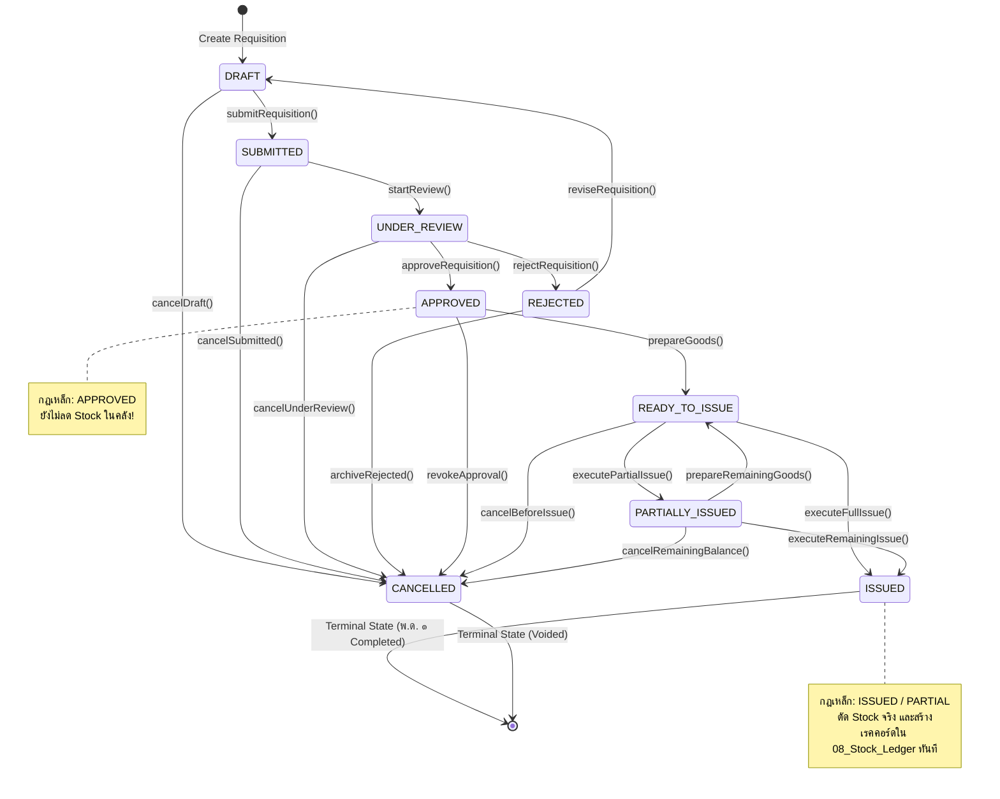
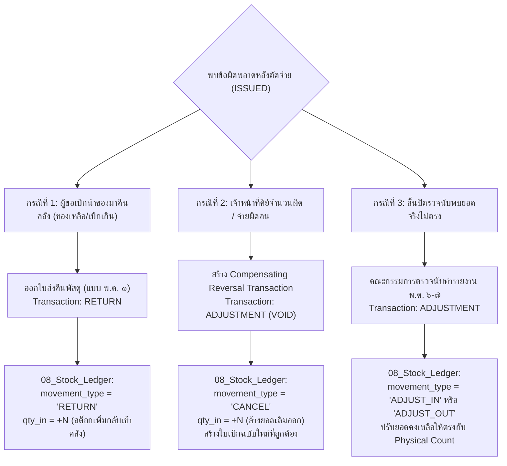

# HRT School Inventory Management System
## TRANSACTION STATE MACHINE SPECIFICATION
**Document ID:** `DOC-TSM-2026-001`  
**Classification:** Core System Architecture & Workflow State Machine  
**Module Target:** Requisition, Stock Movement & Ledger Engine  
**Role:** Senior Software Architect & Lead Systems Engineer  
**Date:** 2026-09-26  
**Status:** **APPROVED & LOCKED FOR PILOT IMPLEMENTATION**  

---

## 1. Architectural Principles & State Machine Model

ระบบบริหารคลังพัสดุ โรงเรียนหรเทพ(รุ่งเรืองประชาสามัคคี) ใช้สถาปัตยกรรม **Deterministic Finite State Machine (FSM)** ในการควบคุมวงจรชีวิต (Lifecycle) ของเอกสารคำขอเบิกพัสดุ (Requisitions) และธุรกรรมการเคลื่อนไหวด้านสต็อก (Stock Transactions) โดยยึดหลักเกณฑ์ความมั่นคงปลอดภัยและความถูกต้องทางบัญชีภาครัฐ:

### 1.1 Non-Negotiable Core Tenets
1. **Separation of Intent and Physical Movement**:
   - การอนุมัติคำขอ (`APPROVED`) เป็นเพียง **"การอนุมัติสิทธิ์/เจตนา"** ในเชิงบริหาร **ห้ามตัดลดสต็อกโดยเด็ดขาด**
   - สต็อกจะลดลงจริงก็ต่อเมื่อเกิด **"การจ่ายพัสดุทางกายภาพ (Physical Stock Movement)"** โดยเจ้าหน้าที่คลังพัสดุ และเปลี่ยนสถานะสู่ `PARTIALLY_ISSUED` หรือ `ISSUED` เท่านั้น
2. **Immutable Append-Only Ledger**:
   - เมื่อสถานะเปลี่ยนเป็น `ISSUED` หรือ `PARTIALLY_ISSUED` ระบบ **ต้องสร้างเรคคอร์ดใน `08_Stock_Ledger` โดยอัตโนมัติ**
   - **ห้ามแก้ไข (UPDATE) หรือลบ (DELETE)** ข้อมูลใน `08_Stock_Ledger` ย้อนหลังโดยเด็ดขาด
   - หากพบข้อผิดพลาดหลังการจ่ายพัสดุ (เช่น จ่ายผิดรายการ, ครูนำมาส่งคืน, ตรวจนับคลาดเคลื่อน) ต้องใช้ **Compensating Adjustment Transaction** (`ADJUST_IN`, `RETURN`, `CANCEL`) เพื่อบันทึกบัญชีหักล้างแบบ Double-Entry
3. **Atomic State Transitions**:
   - การเปลี่ยนสถานะทุกครั้งต้องเกิดขึ้นภายใต้ Atomic Transaction ผ่าน `LockService` หากขั้นตอนใดล้มเหลว (เช่น สต็อกคงเหลือไม่พอ) ระบบจะ Rollback ทั้งหมด

---

## 2. State Machine Diagram

---

## 3. Requisition State Definitions

| State Name | State Type | Business Meaning & Description | Physical Stock Impact | Ledger Record Created |
|---|:---:|---|:---:|:---:|
| `DRAFT` | Initial | ผู้ขอเบิก (ครู/บุคลากร) กำลังจัดทำรายการในตะกร้า สามารถเพิ่ม/ลด/แก้ไขได้อิสระ | ❌ ไม่มีผล | ❌ ไม่มี |
| `SUBMITTED` | Intermediate | ยื่นคำขอเบิกเข้าสู่ระบบอย่างเป็นทางการ ล็อกไม่ให้ผู้ขอแก้ไขรายการ | ❌ ไม่มีผล | ❌ ไม่มี |
| `UNDER_REVIEW` | Intermediate | เจ้าหน้าที่พัสดุหรือผู้บริหารเปิดดูเอกสารเพื่อตรวจสอบความสมบูรณ์และงบประมาณ | ❌ ไม่มีผล | ❌ ไม่มี |
| `APPROVED` | Milestone | ผู้มีอำนาจ (ผอ./หัวหน้ากลุ่มงบประมาณ) ลงนามอนุมัติให้เบิกได้ (ระบุ `approved_qty`) | ❌ **ห้ามลดสต็อก** | ❌ **ไม่มี** |
| `REJECTED` | Intermediate | คำขอไม่ผ่านการอนุมัติ พร้อมระบุเหตุผลประกอบ ผู้ขอสามารถแก้ไขแล้วส่งใหม่ได้ | ❌ ไม่มีผล | ❌ ไม่มี |
| `READY_TO_ISSUE` | Operational | เจ้าหน้าที่พัสดุจัดเตรียมสิ่งของในคลังเรียบร้อย พร้อมให้ผู้ขอมาลงนามรับพัสดุ | ❌ ไม่มีผล | ❌ ไม่มี |
| `PARTIALLY_ISSUED`| Operational | เจ้าหน้าที่ส่งมอบและตัดจ่ายพัสดุบางส่วน (เนื่องจากของไม่พอหรือผู้ขอรับบางส่วน) | ⚠️ **ลดเฉพาะยอดจ่ายจริง** | 🟢 **สร้างทันที (ISSUE)** |
| `ISSUED` | Terminal | พัสดุทุกรายการถูกตัดจ่ายและส่งมอบครบถ้วน 100% เอกสาร พ.ด. ๑ ปิดสมบูรณ์ | 🟢 **ลดตามยอดจ่ายครบถ้วน** | 🟢 **สร้างทันที (ISSUE)** |
| `CANCELLED` | Terminal | คำขอถูกยกเลิก ไม่สามารถนำกลับมาดำเนินการได้อีก | ❌ ไม่มีผล | ❌ ไม่มี |

---

## 4. Comprehensive State Transition Specifications

---

### Transition 01: `DRAFT` $\rightarrow$ `SUBMITTED`
*การยื่นคำขอเบิกพัสดุอย่างเป็นทางการ*

- **Transition ID**: `TR-REQ-01`
- **Trigger Function**: `submitRequisition(requisition_id)`
- **Required Role**: `ROL_TEACHER`, `ROL_OFFICER`, `ROL_ADMIN` (ต้องเป็นเจ้าของเอกสาร `requester_id === current_user_id`)
- **Allowed Source State**: `DRAFT`
- **Forbidden Transitions**: ห้ามยื่นคำขอจากสถานะอื่นที่ไม่ใช่ `DRAFT` หรือ `REJECTED`
- **Validation Rules**:
  1. `05_Requisition_Items` ต้องมีรายการอย่างน้อย 1 รายการ (`items.length >= 1`)
  2. ทุกรายการต้องระบุ `requested_qty > 0`
  3. ฟิลด์ `purpose`, `department`, `requester_name` ต้องไม่ว่างเปล่า
  4. ทุกพัสดุในรายการต้องมี `is_active === TRUE` ใน `03_Items`
- **Database Effect**:
  - `04_Requisitions.status` $\leftarrow$ `SUBMITTED`
  - `04_Requisitions.request_date` $\leftarrow$ วันที่ปัจจุบัน (`YYYY-MM-DD`)
  - `04_Requisitions.updated_at` $\leftarrow$ `CURRENT_TIMESTAMP`
  - `05_Requisition_Items.item_status` $\leftarrow$ `PENDING`
- **Ledger Effect**: **ไม่มีผลต่อ `08_Stock_Ledger`** (ยังไม่มีการเคลื่อนย้ายพัสดุ)
- **Audit Log Effect**:
  - `action` $\leftarrow$ `UPDATE`
  - `entity_name` $\leftarrow$ `04_Requisitions`
  - `new_values` $\leftarrow$ `{"status": "SUBMITTED", "item_count": X}`
- **Error Codes**:
  - `ERR_REQ_EMPTY_ITEMS`: ไม่พบรายการพัสดุในคำขอเบิก
  - `ERR_REQ_INVALID_QTY`: จำนวนพัสดุที่ขอเบิกต้องมากกว่าศูนย์
  - `ERR_REQ_UNAUTHORIZED_OWNER`: ผู้ใช้ไม่มีสิทธิ์ยื่นคำขอของบุคคลอื่น

---

### Transition 02: `SUBMITTED` $\rightarrow$ `UNDER_REVIEW`
*เจ้าหน้าที่หรือผู้บริหารรับเรื่องเพื่อตรวจสอบความถูกต้อง*

- **Transition ID**: `TR-REQ-02`
- **Trigger Function**: `startReview(requisition_id)`
- **Required Role**: `ROL_OFFICER`, `ROL_ADMIN`
- **Allowed Source State**: `SUBMITTED`
- **Forbidden Transitions**: ห้ามเปิด Review ซ้ำหากเอกสารถูกอนุมัติหรือยกเลิกไปแล้ว
- **Validation Rules**:
  1. เอกสารต้องอยู่ในสถานะ `SUBMITTED` เท่านั้น
  2. ตรวจสอบว่าปีงบประมาณของคำขอ (`fiscal_year_id`) มีสถานะเป็น `ACTIVE` ใน `11_Fiscal_Years`
- **Database Effect**:
  - `04_Requisitions.status` $\leftarrow$ `UNDER_REVIEW`
  - `04_Requisitions.updated_at` $\leftarrow$ `CURRENT_TIMESTAMP`
- **Ledger Effect**: **ไม่มีผลต่อ `08_Stock_Ledger`**
- **Audit Log Effect**:
  - `action` $\leftarrow$ `UPDATE`
  - `entity_name` $\leftarrow$ `04_Requisitions`
  - `new_values` $\leftarrow$ `{"status": "UNDER_REVIEW", "reviewer_id": current_user_id}`
- **Error Codes**:
  - `ERR_REQ_NOT_SUBMITTED`: คำขอนี้ยังไม่ได้ยื่น หรือไม่ได้อยู่ในสถานะ SUBMITTED
  - `ERR_FY_INACTIVE`: รอบปีงบประมาณของคำขอนี้ถูกปิดบัญชีไปแล้ว

---

### Transition 03: `UNDER_REVIEW` $\rightarrow$ `APPROVED`
*ผู้บริหารลงนามอนุมัติคำขอเบิก (พิจารณาสิทธิ์และงบประมาณ)*

> [!CAUTION]
> **CRITICAL RULE: APPROVED DOES NOT REDUCE STOCK**  
> การอนุมัติขั้นตอนนี้เป็นการรับรองสิทธิ์ของครูผู้ขอในทางบริหารเท่านั้น **ห้ามทำการหักลดสต็อก หรือสร้างรายการใน `08_Stock_Ledger` โดยเด็ดขาด** เพราะยังไม่มีการหยิบจ่ายของจริงออกจากคลังพัสดุ

- **Transition ID**: `TR-REQ-03`
- **Trigger Function**: `approveRequisition(requisition_id, approval_payload)`
- **Required Role**: `ROL_OFFICER`, `ROL_ADMIN` (หัวหน้ากลุ่มบริหารงานงบประมาณ หรือผู้อำนวยการ)
- **Allowed Source State**: `UNDER_REVIEW`
- **Forbidden Transitions**: ห้ามอนุมัติข้ามขั้นตอนจาก `DRAFT`, ห้ามอนุมัติเอกสารที่ `REJECTED` หรือ `CANCELLED`
- **Validation Rules**:
  1. ผู้มีสิทธิ์อนุมัติต้องไม่ใช่บุคคลเดียวกับผู้ขอเบิก (`approver_id !== requester_id` - หลักการ Four-Eyes Principle)
  2. แต่ละรายการใน `05_Requisition_Items` ต้องมีการระบุ `approved_qty` โดยเงื่อนไข: `0 <= approved_qty <= requested_qty`
  3. หากมีรายการใดที่ `approved_qty === 0` รายการนั้นจะถูกปรับสถานะเป็น `REJECTED` รายชิ้น
- **Database Effect**:
  - `04_Requisitions.status` $\leftarrow$ `APPROVED`
  - `04_Requisitions.approved_by` $\leftarrow$ `current_user_id`
  - `04_Requisitions.approved_at` $\leftarrow$ `CURRENT_TIMESTAMP`
  - `04_Requisitions.updated_at` $\leftarrow$ `CURRENT_TIMESTAMP`
  - `05_Requisition_Items.approved_qty` $\leftarrow$ ค่าที่อนุมัติรายชิ้น
  - `05_Requisition_Items.item_status` $\leftarrow$ `APPROVED` (หรือ `REJECTED` ถ้ายอดเป็น 0)
- **Ledger Effect**: **ZERO EFFECT (ห้ามแตะต้อง `08_Stock_Ledger`)**
- **Audit Log Effect**:
  - `action` $\leftarrow$ `APPROVE`
  - `entity_name` $\leftarrow$ `04_Requisitions`
  - `new_values` $\leftarrow$ `{"status": "APPROVED", "approved_by": current_user_id, "items": [...]}`
- **Error Codes**:
  - `ERR_AUTH_SELF_APPROVAL`: ผู้อนุมัติต้องไม่เป็นบุคคลเดียวกับผู้ยื่นคำขอเบิก
  - `ERR_REQ_APPROVED_QTY_EXCEEDED`: ยอดอนุมัติต้องไม่เกินยอดที่ผู้ขอระบุ

---

### Transition 04: `UNDER_REVIEW` $\rightarrow$ `REJECTED`
*คำขอไม่ผ่านการพิจารณาอนุมัติ*

- **Transition ID**: `TR-REQ-04`
- **Trigger Function**: `rejectRequisition(requisition_id, rejection_note)`
- **Required Role**: `ROL_OFFICER`, `ROL_ADMIN`
- **Allowed Source State**: `UNDER_REVIEW`
- **Forbidden Transitions**: ห้ามปฏิเสธเอกสารที่ผ่านการจ่ายพัสดุไปแล้ว (`PARTIALLY_ISSUED`, `ISSUED`)
- **Validation Rules**:
  1. ต้องระบุเหตุผลการไม่อนุมัติ (`rejection_note`) ความยาวไม่ต่ำกว่า 5 ตัวอักษร
- **Database Effect**:
  - `04_Requisitions.status` $\leftarrow$ `REJECTED`
  - `04_Requisitions.rejection_note` $\leftarrow$ `rejection_note`
  - `04_Requisitions.updated_at` $\leftarrow$ `CURRENT_TIMESTAMP`
  - `05_Requisition_Items.item_status` $\leftarrow$ `REJECTED` (ทุกรายการ)
- **Ledger Effect**: **ไม่มีผลต่อ `08_Stock_Ledger`**
- **Audit Log Effect**:
  - `action` $\leftarrow$ `REJECT`
  - `entity_name` $\leftarrow$ `04_Requisitions`
  - `new_values` $\leftarrow$ `{"status": "REJECTED", "reason": rejection_note}`
- **Error Codes**:
  - `ERR_REQ_MISSING_REJECTION_REASON`: ต้องระบุเหตุผลในการไม่อนุมัติคำขอ

---

### Transition 05: `APPROVED` $\rightarrow$ `READY_TO_ISSUE`
*เจ้าหน้าที่พัสดุตรวจนับของในคลังและจัดเตรียมพร้อมส่งมอบ*

- **Transition ID**: `TR-REQ-05`
- **Trigger Function**: `prepareGoods(requisition_id)`
- **Required Role**: `ROL_OFFICER`, `ROL_ADMIN` (เจ้าหน้าที่ผู้คุมคลัง)
- **Allowed Source State**: `APPROVED`, `PARTIALLY_ISSUED`
- **Forbidden Transitions**: ห้ามเตรียมของหากคำขอยังไม่ผ่านการอนุมัติ (`DRAFT`, `SUBMITTED`, `REJECTED`)
- **Validation Rules**:
  1. ต้องตรวจสอบยอดคงเหลือจริงในบัญชีคุม (`balance_qty` ใน `08_Stock_Ledger`) ณ ปัจจุบัน
  2. หากพบว่าสต็อกในคลังมีไม่เพียงพอกับยอด `approved_qty` ระบบต้องแจ้งเตือนเตือนเจ้าหน้าที่ แต่ยังอนุญาตให้เข้าสู่สถานะนี้เพื่อเตรียมจ่ายบางส่วน (Partial) ได้
- **Database Effect**:
  - `04_Requisitions.status` $\leftarrow$ `READY_TO_ISSUE`
  - `04_Requisitions.updated_at` $\leftarrow$ `CURRENT_TIMESTAMP`
- **Ledger Effect**: **ไม่มีผลต่อ `08_Stock_Ledger`** (ของยังอยู่บนชั้นวางในคลัง)
- **Audit Log Effect**:
  - `action` $\leftarrow$ `UPDATE`
  - `entity_name` $\leftarrow$ `04_Requisitions`
  - `new_values` $\leftarrow$ `{"status": "READY_TO_ISSUE"}`
- **Error Codes**:
  - `ERR_REQ_NOT_APPROVED`: เอกสารต้องได้รับการอนุมัติอย่างเป็นทางการก่อนจัดเตรียมพัสดุ

---

### Transition 06: `READY_TO_ISSUE` $\rightarrow$ `PARTIALLY_ISSUED`
*เจ้าหน้าที่ส่งมอบพัสดุบางส่วนและตัดสต็อกจริง*

> [!IMPORTANT]
> **PHYSICAL MOVEMENT TRIGGER:**  
> ทันทีที่มีการจ่ายพัสดุจริง ระบบต้องสร้างเอกสารใน `06_Transactions`, บันทึกรายการใน `07_Transaction_Items`, และ **บันทึกแถวใหม่แบบ Append-Only ลงใน `08_Stock_Ledger` (movement_type = 'ISSUE') ทันที**

- **Transition ID**: `TR-REQ-06`
- **Trigger Function**: `executePartialIssue(requisition_id, issue_items_payload)`
- **Required Role**: `ROL_OFFICER`, `ROL_ADMIN`
- **Allowed Source State**: `READY_TO_ISSUE`, `PARTIALLY_ISSUED`
- **Forbidden Transitions**: ห้ามตัดจ่ายจากคำขอที่ยังไม่อนุมัติ หรือคำขอที่ยกเลิกไปแล้ว
- **Validation Rules**:
  1. ยอดจ่ายครั้งนี้ (`current_issue_qty`) ต้องมากกว่า 0
  2. ยอดจ่ายสะสมใหม่ (`issued_qty + current_issue_qty`) ต้องไม่เกินยอดอนุมัติ (`approved_qty`)
  3. ยอดจ่ายครั้งนี้ต้อง **ไม่เกินสต็อกคงเหลือจริงในคลัง** (`current_issue_qty <= balance_qty` ของพัสดุนั้นใน `08_Stock_Ledger`)
  4. ต้องระบุชื่อผู้รับพัสดุจริง (`counterparty`) และคลังต้นทาง (`location_id`)
- **Database Effect**:
  - **1. Update Requisition**:
    - `04_Requisitions.status` $\leftarrow$ `PARTIALLY_ISSUED`
    - `04_Requisitions.updated_at` $\leftarrow$ `CURRENT_TIMESTAMP`
    - อัปเดต `05_Requisition_Items.issued_qty` $\leftarrow$ `issued_qty + current_issue_qty`
    - ปรับ `05_Requisition_Items.item_status` $\leftarrow$ (`issued_qty === approved_qty` ? `FULFILLED` : `PARTIAL`)
  - **2. Create Transaction Header (`06_Transactions`)**:
    - `transaction_id` $\leftarrow$ `TXN-YYYY-XXXX`
    - `doc_no` $\leftarrow$ `TX-YYYY-XXXX` (รันเลขอัตโนมัติ)
    - `transaction_type` $\leftarrow$ `ISSUE`
    - `ref_doc_type` $\leftarrow$ `REQUISITION`
    - `ref_doc_id` $\leftarrow$ `requisition_id`
    - `status` $\leftarrow$ `POSTED`
  - **3. Create Transaction Items (`07_Transaction_Items`)**:
    - บันทึกพัสดุแต่ละรายการที่จ่ายจริง พร้อมคำนวณ `total_cost`
- **Ledger Effect (`08_Stock_Ledger`)**:
  - **สร้างเรคคอร์ดใหม่ (Append-Only) สำหรับทุกพัสดุที่จ่ายจริง:**
    - `movement_type` $\leftarrow$ `ISSUE`
    - `qty_in` $\leftarrow$ `0`
    - `qty_out` $\leftarrow$ `current_issue_qty`
    - `qty_net` $\leftarrow$ `-current_issue_qty`
    - `val_out` $\leftarrow$ `current_issue_qty * unit_cost`
    - `val_net` $\leftarrow$ `-(current_issue_qty * unit_cost)`
    - `balance_qty` $\leftarrow$ `previous_balance_qty - current_issue_qty`
    - `balance_val` $\leftarrow$ `previous_balance_val - val_out`
    - `ref_doc_no` $\leftarrow$ `doc_no` ของใบเบิก (เช่น `พ.ด.๑-2569/018`)
    - `is_voided` $\leftarrow$ `FALSE`
- **Audit Log Effect**:
  - `action` $\leftarrow$ `POST`
  - `entity_name` $\leftarrow$ `06_Transactions`
  - `new_values` $\leftarrow$ Snapshot ของธุรกรรมและรายการตัดสต็อกทั้งหมด
- **Error Codes**:
  - `ERR_STOCK_INSUFFICIENT`: สต็อกในคลังไม่เพียงพอสำหรับการตัดจ่าย
  - `ERR_ISSUE_EXCEEDS_APPROVED`: ยอดตัดจ่ายสะสมเกินจำนวนที่ได้รับอนุมัติ
  - `ERR_LOCK_CONFLICT`: ไม่สามารถตัดสต็อกได้เนื่องจากมีธุรกรรมอื่นกำลังทำงานอยู่

---

### Transition 07: `READY_TO_ISSUE` (หรือ `PARTIALLY_ISSUED`) $\rightarrow$ `ISSUED`
*เจ้าหน้าที่ส่งมอบพัสดุครบถ้วน 100% ปิดใบเบิกสมบูรณ์*

- **Transition ID**: `TR-REQ-07`
- **Trigger Function**: `executeFullIssue(requisition_id, issue_items_payload)`
- **Required Role**: `ROL_OFFICER`, `ROL_ADMIN`
- **Allowed Source State**: `READY_TO_ISSUE`, `PARTIALLY_ISSUED`
- **Forbidden Transitions**: ห้ามเปลี่ยนเป็น `ISSUED` หากยอดจ่ายจริงยังไม่ครบตามยอดอนุมัติทุกรายการ
- **Validation Rules**:
  1. ยอดจ่ายสะสมหลังการจ่ายครั้งนี้ ต้องเท่ากับยอดอนุมัติครบทุกรายการ (`issued_qty === approved_qty` สำหรับทุก active item)
  2. สต็อกคงเหลือในคลังต้องเพียงพอ (`current_issue_qty <= balance_qty`)
- **Database Effect**:
  - `04_Requisitions.status` $\leftarrow$ `ISSUED` (Terminal State)
  - `04_Requisitions.updated_at` $\leftarrow$ `CURRENT_TIMESTAMP`
  - ทุกรายการใน `05_Requisition_Items.item_status` $\leftarrow$ `FULFILLED`
  - สร้าง `06_Transactions` (type: `ISSUE`, status: `POSTED`)
  - สร้าง `07_Transaction_Items`
- **Ledger Effect (`08_Stock_Ledger`)**:
  - **สร้างเรคคอร์ดใหม่ (Append-Only) สำหรับทุกพัสดุที่ตัดจ่ายในงวดสุดท้าย:**
    - `movement_type` $\leftarrow$ `ISSUE`
    - หักลดยอดสต็อกคงเหลือ (`balance_qty`) และมูลค่าสะสม (`balance_val`) อย่างถูกต้อง
- **Audit Log Effect**:
  - `action` $\leftarrow$ `POST`
  - `entity_name` $\leftarrow$ `04_Requisitions`
  - `new_values` $\leftarrow$ `{"status": "ISSUED", "fulfillment": "100%"}`
- **Error Codes**:
  - `ERR_STOCK_INSUFFICIENT`: สต็อกในคลังไม่พอสำหรับปิดยอดจ่าย
  - `ERR_FULFILLMENT_INCOMPLETE`: ไม่สามารถปรับเป็น ISSUED ได้เนื่องจากยังมีรายการที่จ่ายไม่ครบ

---

### Transition 08: `DRAFT` / `SUBMITTED` / `APPROVED` $\rightarrow$ `CANCELLED`
*การยกเลิกคำขอเบิกพัสดุ*

- **Transition ID**: `TR-REQ-08`
- **Trigger Function**: `cancelRequisition(requisition_id, cancellation_reason)`
- **Required Role**:
  - ถ้าสถานะเป็น `DRAFT` หรือ `SUBMITTED`: ผู้ขอเบิก (`requester_id === current_user_id`) หรือ `ROL_OFFICER`
  - ถ้าสถานะเป็น `APPROVED` หรือ `READY_TO_ISSUE`: ต้องเป็น `ROL_OFFICER` หรือ `ROL_ADMIN` เท่านั้น
- **Allowed Source State**: `DRAFT`, `SUBMITTED`, `UNDER_REVIEW`, `APPROVED`, `READY_TO_ISSUE`
- **Forbidden Transitions**:
  - **ห้ามยกเลิกเอกสารที่อยู่ในสถานะ `ISSUED` โดยเด็ดขาด!**
  - **ห้ามยกเลิกเอกสารที่อยู่ในสถานะ `PARTIALLY_ISSUED` ผ่าน Transition นี้โดยตรง** (ต้องใช้ Transition ปิดยอดส่วนที่เหลือ TR-REQ-09)
- **Validation Rules**:
  1. ต้องระบุเหตุผลในการยกเลิกคำขอ (`cancellation_reason`)
  2. ต้องไม่มีการจ่ายพัสดุทางกายภาพเกิดขึ้นแล้วแม้แต่ชิ้นเดียว (`issued_qty === 0` ทุกรายการ)
- **Database Effect**:
  - `04_Requisitions.status` $\leftarrow$ `CANCELLED` (Terminal State)
  - `04_Requisitions.rejection_note` $\leftarrow$ `cancellation_reason`
  - `04_Requisitions.updated_at` $\leftarrow$ `CURRENT_TIMESTAMP`
  - `05_Requisition_Items.item_status` $\leftarrow$ `REJECTED`
- **Ledger Effect**: **ไม่มีผลต่อ `08_Stock_Ledger`** (เนื่องจากยังไม่มีการตัดจ่ายใดๆ เกิดขึ้น)
- **Audit Log Effect**:
  - `action` $\leftarrow$ `VOID`
  - `entity_name` $\leftarrow$ `04_Requisitions`
  - `new_values` $\leftarrow$ `{"status": "CANCELLED", "reason": cancellation_reason}`
- **Error Codes**:
  - `ERR_REQ_CANNOT_CANCEL_ISSUED`: ห้ามยกเลิกคำขอที่ได้ทำการตัดจ่ายพัสดุไปแล้ว
  - `ERR_REQ_MISSING_CANCEL_REASON`: ต้องระบุเหตุผลในการยกเลิกคำขอ

---

### Transition 09: `PARTIALLY_ISSUED` $\rightarrow$ `CANCELLED` (Close Remaining Balance)
*การปิดคำขอเบิกที่จ่ายไปแล้วบางส่วน และขอยกเลิกยอดคงเหลือที่ค้างจ่าย*

- **Transition ID**: `TR-REQ-09`
- **Trigger Function**: `cancelRemainingBalance(requisition_id, reason)`
- **Required Role**: `ROL_OFFICER`, `ROL_ADMIN`
- **Allowed Source State**: `PARTIALLY_ISSUED`
- **Forbidden Transitions**: ห้ามย้อนกลับยอดพัสดุที่จ่ายไปแล้ว
- **Validation Rules**:
  1. ต้องระบุเหตุผลในการไม่ขอรับของที่เหลือ (เช่น ผู้ขอยกเลิกโครงการ, ของขาดตลาดนาน)
- **Database Effect**:
  - `04_Requisitions.status` $\leftarrow$ `CANCELLED` (หรือ `CLOSED_SHORT`)
  - รายการที่จ่ายครบแล้วให้คงสถานะ `FULFILLED`
  - รายการที่ค้างจ่ายให้ปรับ `item_status` $\leftarrow$ `REJECTED`
  - `04_Requisitions.updated_at` $\leftarrow$ `CURRENT_TIMESTAMP`
- **Ledger Effect**: **ไม่มีผลย้อนกลับใน `08_Stock_Ledger`** (ยอดที่เคยตัดจ่ายไปแล้วยังคงมีผลตามกฎหมาย ส่วนยอดที่เหลือไม่มีการตัดสต็อก)
- **Audit Log Effect**:
  - `action` $\leftarrow$ `UPDATE`
  - `entity_name` $\leftarrow$ `04_Requisitions`
  - `new_values` $\leftarrow$ `{"status": "CLOSED_SHORT", "reason": reason}`
- **Error Codes**:
  - `ERR_REQ_INVALID_STATE`: คำขอไม่ได้อยู่ในสถานะ PARTIALLY_ISSUED

---

## 5. Post-Issuance Exception Handling: The Compensating Transaction Protocol

> [!CAUTION]
> **NO RETROSPECTIVE EDITING LAW:**  
> เมื่อเอกสารอยู่ในสถานะ `ISSUED` แล้ว **ห้ามเปลี่ยนสถานะกลับเป็น DRAFT, ห้ามแก้ไขจำนวนในใบเบิกเดิม, และห้ามลบแถวใน `08_Stock_Ledger` โดยเด็ดขาด** (การกระทำดังกล่าวถือเป็นการปลอมแปลงเอกสารทางบัญชีราชการ มีโทษตาม พรบ.วินัยการเงินการคลัง พ.ศ. ๒๕๖๑)

หากเกิดข้อผิดพลาดขึ้นหลังการจ่ายพัสดุ ระบบกำหนดให้แก้ไขผ่าน **3 มาตรการชดเชย (Compensating Protocols)** เท่านั้น:

### รายละเอียดการทำงานของ Compensating Transaction:
1. **การส่งคืนพัสดุ (Return Protocol - แบบ พ.ด. ๓)**:
   - บันทึกใน `06_Transactions` (type: `RETURN`, ref_doc_id: `REQ-xxxx`)
   - บันทึกใน `08_Stock_Ledger`: `movement_type = 'RETURN'`, `qty_in = จำนวนที่คืน`, คำนวณ `balance_qty` เพิ่มขึ้น
2. **การยกเลิกธุรกรรมที่คีย์ผิด (Reversal Cancellation Protocol)**:
   - ตาราง `06_Transactions` เดิมถูกเปลี่ยนสถานะเป็น `status = 'VOIDED'`
   - สร้างแถวชดเชยใหม่ใน `08_Stock_Ledger`: `movement_type = 'CANCEL'`, ระบุ `ref_doc_no = 'ยกเลิก TX-xxxx'`, ทำการเพิ่มสต็อกกลับคืน (`qty_in = ยอดที่เคยตัดผิด`)
   - นำเรคคอร์ดเดิมใน Ledger มาติด Flag `is_voided = TRUE`
3. **การปรับยอดผลต่างตรวจนับ (Physical Audit Reconciliation Protocol)**:
   - เมื่อปิดบัญชี 30 กันยายน หาก `variance_qty > 0` $\rightarrow$ บันทึก `movement_type = 'ADJUST_IN'`
   - หาก `variance_qty < 0` $\rightarrow$ บันทึก `movement_type = 'ADJUST_OUT'`

---

## 6. Complete Transition Matrix & Invariants

ตารางสรุปการเปลี่ยนสถานะที่เป็นไปได้ (Allowed: 🟢) และที่เป็นไปไม่ได้ (Forbidden: 🔴):

| From \ To | DRAFT | SUBMITTED | UNDER_REVIEW | APPROVED | REJECTED | READY_TO_ISSUE | PARTIALLY_ISSUED | ISSUED | CANCELLED |
|---|:---:|:---:|:---:|:---:|:---:|:---:|:---:|:---:|:---:|
| **DRAFT** | - | 🟢 (TR-01) | 🔴 | 🔴 | 🔴 | 🔴 | 🔴 | 🔴 | 🟢 (TR-08) |
| **SUBMITTED** | 🔴 | - | 🟢 (TR-02) | 🔴 | 🔴 | 🔴 | 🔴 | 🔴 | 🟢 (TR-08) |
| **UNDER_REVIEW** | 🔴 | 🔴 | - | 🟢 (TR-03) | 🟢 (TR-04) | 🔴 | 🔴 | 🔴 | 🟢 (TR-08) |
| **APPROVED** | 🔴 | 🔴 | 🔴 | - | 🔴 | 🟢 (TR-05) | 🔴 | 🔴 | 🟢 (TR-08) |
| **REJECTED** | 🟢 (Revise) | 🔴 | 🔴 | 🔴 | - | 🔴 | 🔴 | 🔴 | 🟢 (TR-08) |
| **READY_TO_ISSUE** | 🔴 | 🔴 | 🔴 | 🔴 | 🔴 | - | 🟢 (TR-06) | 🟢 (TR-07) | 🟢 (TR-08) |
| **PARTIALLY_ISSUED**| 🔴 | 🔴 | 🔴 | 🔴 | 🔴 | 🟢 (TR-05) | - | 🟢 (TR-07) | 🟢 (TR-09) |
| **ISSUED** | 🔴 | 🔴 | 🔴 | 🔴 | 🔴 | 🔴 | 🔴 | - | 🔴 **(FORBIDDEN)** |
| **CANCELLED** | 🔴 | 🔴 | 🔴 | 🔴 | 🔴 | 🔴 | 🔴 | 🔴 | - |

---

**ลงนามรับรองข้อกำหนด State Machine:**  
*Senior Software Architect & Systems Architecture Committee*  
*วันที่ 26 กันยายน 2569*
