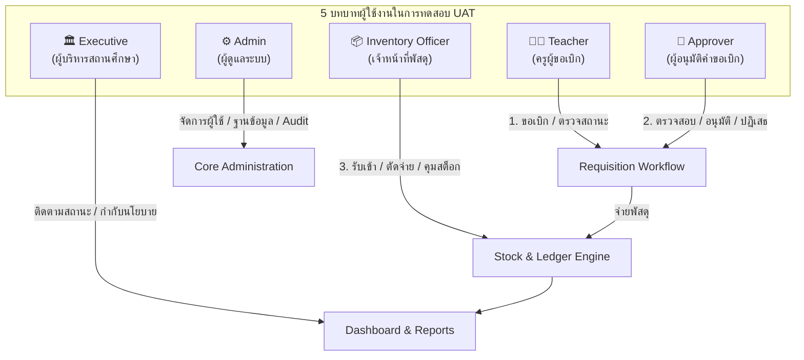

# 📋 USER ACCEPTANCE TEST (UAT) PLAN — PILOT PHASE
## แผนการทดสอบการยอมรับของผู้ใช้งานสำหรับการเปิดใช้งานระยะนำร่อง (Pilot UAT Plan)
### ระบบบริหารคลังพัสดุโรงเรียน โรงเรียนหรเทพ(รุ่งเรืองประชาสามัคคี)

**รหัสเอกสาร:** SIMS-UAT-PLAN-2026-001  
**เวอร์ชันแผนงาน:** 1.0.0 (Pilot Readiness Baseline)  
**วันที่ประกาศใช้:** 27 กันยายน 2569  
**หน่วยงานรับผิดชอบ:** กลุ่มบริหารงานงบประมาณและพัสดุ ร่วมกับ ทีมพัฒนาระบบเทคโนโลยีสารสนเทศ  
**เป้าหมายการทดสอบ:** ทดสอบการทำงานจริงตามบทบาทผู้ใช้งาน (Role-Based Acceptance) ก่อนเปิดใช้งานระบบเต็มรูปแบบในภาคเรียนนำร่อง

---

## 1. บทนำและวัตถุประสงค์ (Introduction & Objectives)

### 1.1 วัตถุประสงค์ของแผน UAT (Test Purpose)
1. **ยืนยันความพร้อมในการใช้งานจริง (Operational Readiness):** เพื่อให้มั่นใจว่าระบบบริหารคลังพัสดุสามารถสนับสนุนการปฏิบัติงานของครู เจ้าหน้าที่พัสดุ ผู้อนุมัติ ผู้ดูแลระบบ และผู้บริหารได้อย่างราบรื่น ถูกต้องตามระเบียบพัสดุภาครัฐ พ.ศ. 2560
2. **ประเมินประสบการณ์ผู้ใช้งาน (User Experience & Usability):** ยืนยันว่าหน้าจอ ส่วนต่อประสาน (UI) และขั้นตอนการทำงาน (UX) เข้าใจง่าย ไม่ซับซ้อน และไม่เพิ่มภาระงานเอกสารให้แก่ครูผู้สอน
3. **ตรวจสอบความสมบูรณ์ของการเชื่อมโยงระบบ (End-to-End Validation):** ตรวจสอบการส่งต่อข้อมูลตั้งแต่ครูสร้างคำขอเบิก $\rightarrow$ หัวหน้าฝ่าย/ผู้บริหารอนุมัติ $\rightarrow$ เจ้าหน้าที่จ่ายพัสดุ $\rightarrow$ ระบบลงบัญชีคุมและบันทึกประวัติความปลอดภัยแบบอัตโนมัติ

### 1.2 เกณฑ์การตัดสินการยอมรับ (Acceptance Criteria & Thresholds)
- **อัตราความสำเร็จของกรณีทดสอบ (Pass Rate):** กรณีทดสอบระดับวิกฤต (Critical) และงานหลักของแต่ละบทบาทต้องได้ผลลัพธ์ **PASS 100%**
- **ข้อบกพร่องที่ขัดขวางการทำงาน (Blockers):** ต้องเป็น **0 รายการ (Zero Blockers)**
- **โครงสร้างตารางตรวจสอบ (Checklist Format):** ทุกกรณีทดสอบต้องระบุผลลัพธ์ชัดเจนด้วย:
  - `PASS` : การทดสอบผ่านเกณฑ์ พฤติกรรมระบบเป็นไปตามข้อกำหนด
  - `FAIL` : ระบบทำงานผิดพลาดหรือไม่เป็นไปตามผลที่คาดหวัง
  - `BLOCKED` : ไม่สามารถทดสอบได้เนื่องจากมีข้อบกพร่องอื่นขัดขวาง
  - `COMMENT` : ข้อคิดเห็น คำแนะนำ หรือข้อสังเกตเพิ่มเติมจากผู้ทดสอบจริง

---

## 2. ขอบเขตการทดสอบและบทบาทผู้ใช้งาน (Test Scope & Roles Matrix)

การทดสอบ UAT ครอบคลุม **5 บทบาทหลัก (5 Roles)** ดังตารางโครงสร้างสิทธิ์และความรับผิดชอบ:

### รายละเอียดหน้าที่ที่ต้องทดสอบแยกตามบทบาท

| บทบาท (Role) | ผู้ทดสอบตัวแทน | ฟังก์ชันที่ต้องทดสอบ (Assigned Test Actions) |
| :--- | :--- | :--- |
| **1. Teacher** (ครูผู้ขอเบิก) | ครูกัญญา วงศ์สว่าง (`USR-TEACHER-01`) | • Login • Search Item • Create Request • Submit • View Status • Print (พ.ด. ๑) |
| **2. Inventory Officer** (เจ้าหน้าที่พัสดุ) | นายอนันต์ มั่นคง (`USR-ANANT-01`) | • View Pending • Receive Stock • Issue Stock • View Ledger |
| **3. Approver** (ผู้อนุมัติ) | หัวหน้ากลุ่มงาน / รอง ผอ. / ผอ. (`USR-DIRECTOR-01`) | • Approve • Reject |
| **4. Admin** (ผู้ดูแลระบบ) | ผู้ดูแลระบบสารสนเทศ (`USR-ANANT-01`) | • User & Role Management • Master Items Management • System Audit & Security Monitoring |
| **5. Executive** (ผู้บริหาร) | ดร.สมชาย รุ่งเรืองวิทยากุล (`USR-DIRECTOR-01`) | • Dashboard (Real-time KPIs) • Reports (สรุปยอดและวิเคราะห์คลัง) |

---

## 3. แผนรายละเอียดกรณีทดสอบรายบทบาท (Detailed UAT Test Cases)

### 3.1 กลุ่มการทดสอบ: บทบาทครูผู้ขอเบิก (Teacher Test Cases)

| รหัสทดสอบ | ฟังก์ชันงาน (Action) | วัตถุประสงค์และขั้นตอนการทดสอบ (Test Steps) | ผลลัพธ์ที่คาดหวัง (Expected Result) |
| :---: | :--- | :--- | :--- |
| **UAT-T-01** | **Login** | 1. เข้าสู่ URL ของเว็บแอปพลิเคชันระบบคลังพัสดุ 2. ยืนยันตัวตนด้วยบัญชี Google Workspace ของโรงเรียน (`kanya.w@school.ac.th`) | เข้าสู่ระบบสำเร็จ แสดงชื่อ "ครูกัญญา วงศ์สว่าง" ตำแหน่ง "ครูชำนาญการ" สิทธิ์ตรงตามบทบาท ครูผู้ขอเบิก |
| **UAT-T-02** | **Search Item** | 1. ไปที่เมนู "รายการพัสดุ" 2. พิมพ์คำค้นหา เช่น "กระดาษ", "หมึก" 3. กรองตามหมวดหมู่วัสดุสำนักงาน/คอมพิวเตอร์ | ระบบแสดงผลการค้นหาทันที แสดงรหัส ชื่อ หน่วยนับ ยอดคงเหลือ และป้ายสถานะสต็อก (ปกติ/ใกล้หมด) ชัดเจน |
| **UAT-T-03** | **Create Request** | 1. คลิกปุ่ม "+ สร้างใบเบิกพัสดุ (พ.ด. ๑)" 2. เลือกรายการพัสดุ ระบุจำนวนที่ต้องการเบิก 3. ระบุวัตถุประสงค์การใช้งานและกลุ่มสาระฯ 4. บันทึกคำขอเป็นแบบร่าง (Save Draft) | ระบบสร้างเอกสารใบเบิกใหม่ รหัสขึ้นต้นด้วย `HRT-INV-REQ-2569/xxx` สถานะตั้งต้นเป็น `DRAFT` รายการพัสดุครบถ้วน |
| **UAT-T-04** | **Submit** | 1. ตรวจสอบความถูกต้องของใบเบิกสถานะ DRAFT 2. กดปุ่ม "ยืนยันส่งคำขอเบิกพัสดุ" | ระบบเปลี่ยนสถานะใบเบิกเป็น `PENDING_APPROVAL` (รออนุมัติ) ล็อกไม่ให้แก้ไขรายการ และส่งต่อให้ผู้อนุมัติทันที |
| **UAT-T-05** | **View Status** | 1. ไปที่เมนู "ติดตามสถานะการเบิก" 2. ตรวจสอบรายการใบเบิกของตนเอง 3. ดูประวัติสถานะ (Timeline): ร่าง $\rightarrow$ รออนุมัติ $\rightarrow$ อนุมัติ $\rightarrow$ จ่ายแล้ว | แสดงรายการใบเบิกทั้งหมดของผู้ใช้งาน พร้อม Badge สีบอกสถานะชัดเจน (เหลือง=รอ, เขียว=อนุมัติ, น้ำเงิน=จ่ายแล้ว) |
| **UAT-T-06** | **Print** | 1. เปิดดูรายละเอียดใบเบิกที่ต้องการพิมพ์ 2. คลิกปุ่ม "พิมพ์ใบเบิกพัสดุ (แบบ พ.ด. ๑)" 3. ตรวจสอบรูปแบบการพิมพ์บนกระดาษ A4 | แสดงแบบฟอร์มใบเบิกพัสดุราชการ (พ.ด. ๑) สวยงาม ฟอนต์ Sarabun ครบถ้วนทั้งช่องลงนามผู้เบิก ผู้เห็นชอบ และผู้อนุมัติ พร้อมพิมพ์/PDF |

---

### 3.2 กลุ่มการทดสอบ: บทบาทเจ้าหน้าที่พัสดุ (Inventory Officer Test Cases)

| รหัสทดสอบ | ฟังก์ชันงาน (Action) | วัตถุประสงค์และขั้นตอนการทดสอบ (Test Steps) | ผลลัพธ์ที่คาดหวัง (Expected Result) |
| :---: | :--- | :--- | :--- |
| **UAT-O-01** | **View Pending** | 1. ล็อกอินด้วยบัญชีเจ้าหน้าที่พัสดุ (`anant.m@school.ac.th`) 2. เข้าเมนู "รายการรอตัดจ่าย (Pending Issues)" | แสดงรายการใบเบิกที่ผ่านการอนุมัติแล้ว (`APPROVED`) จัดเรียงตามลำดับเวลา เพื่อเตรียมจัดพัสดุให้ผู้เบิก |
| **UAT-O-02** | **Receive Stock** | 1. เข้าเมนู "รับเข้าพัสดุ (Receive Stock)" 2. เลือกพัสดุ ระบุจำนวนรับเข้า ราคาต่อหน่วย เลขที่ใบส่งของ/ผู้จำหน่าย 3. กดยืนยันบันทึกรับเข้าคลัง | ยอดคงเหลือในคลังเพิ่มขึ้นทันที สร้าง Ledger Entry ประเภท `RECEIVE` คำนวณยอด Balance_After ใหม่ถูกต้อง และบันทึก Audit Log |
| **UAT-O-03** | **Issue Stock** | 1. เลือกใบเบิกที่อนุมัติแล้วในรายการรอจ่าย 2. ตรวจสอบความพร้อมของพัสดุในคลัง 3. กดปุ่ม "ยืนยันตัดจ่ายพัสดุ" | สต็อกถูกหักตามจำนวนที่จ่ายจริง สร้าง Ledger Entry ประเภท `ISSUE` เปลี่ยนสถานะใบเบิกเป็น `ISSUED` พร้อมป้องกัน Double Issue |
| **UAT-O-04** | **View Ledger** | 1. เข้าเมนู "บัญชีคุมพัสดุ (Stock Ledger)" 2. เลือกรหัสพัสดุที่ต้องการดูประวัติ 3. ตรวจสอบรายการเคลื่อนไหวรับ-จ่าย-ปรับยอด | แสดงตารางบัญชีคุมพัสดุเรียงตามเวลา ยอดคงเหลือ Balance_After ถูกต้องตรงกับความเป็นจริงทุกบรรทัด |

---

### 3.3 กลุ่มการทดสอบ: บทบาทผู้อนุมัติ (Approver Test Cases)

| รหัสทดสอบ | ฟังก์ชันงาน (Action) | วัตถุประสงค์และขั้นตอนการทดสอบ (Test Steps) | ผลลัพธ์ที่คาดหวัง (Expected Result) |
| :---: | :--- | :--- | :--- |
| **UAT-A-01** | **Approve** | 1. ล็อกอินด้วยบัญชีผู้อนุมัติ/ผู้บริหาร (`somchai.r@school.ac.th`) 2. เข้าเมนู "รอการอนุมัติ (Approval Inbox)" 3. เปิดดูรายการใบเบิก ตรวจสอบเหตุผลความจำเป็น 4. กรอกความเห็น "อนุมัติจ่ายตามระเบียบ" แล้วกดยืนยัน | สถานะใบเบิกเปลี่ยนเป็น `APPROVED` บันทึกชื่อผู้อนุมัติ วันที่-เวลา และส่งต่อไปยังคิวจ่ายพัสดุของเจ้าหน้าที่พัสดุ |
| **UAT-A-02** | **Reject** | 1. เลือกใบเบิกที่มีจำนวนขอเบิกเกินความจำเป็น 2. กรอกเหตุผลการไม่อนุมัติ เช่น "สต็อกสำรองมีจำกัด ให้เบิกได้เฉพาะส่วนเร่งด่วน" 3. กดปุ่ม "ไม่อนุมัติ (Reject)" | สถานะใบเบิกเปลี่ยนเป็น `REJECTED` ไม่มีการตัดยอดสต็อก และแสดงเหตุผลให้ครูผู้ขอเบิกทราบในหน้าติดตามสถานะ |

---

### 3.4 กลุ่มการทดสอบ: บทบาทผู้ดูแลระบบ (Admin Test Cases)

| รหัสทดสอบ | ฟังก์ชันงาน (Action) | วัตถุประสงค์และขั้นตอนการทดสอบ (Test Steps) | ผลลัพธ์ที่คาดหวัง (Expected Result) |
| :---: | :--- | :--- | :--- |
| **UAT-AD-01** | **User Management** | 1. เข้าเมนู "จัดการผู้ใช้งาน" 2. ตรวจสอบรายชื่อผู้ใช้ บทบาท และสถานะบัญชี (ACTIVE / DISABLED) 3. ทดสอบการปรับปรุงสิทธิ์ | แสดงรายชื่อผู้ใช้ถูกต้อง มีการควบคุมสิทธิ์ตาม RBAC และผู้ใช้สถานะ DISABLED จะถูกบล็อกการเข้าสู่ระบบ 100% |
| **UAT-AD-02** | **Master Items** | 1. เข้าเมนู "จัดการข้อมูลพัสดุหลัก" 2. ตรวจสอบรหัสพัสดุ เกณฑ์เตือนสต็อกต่ำ (Safety Stock / ROP) | ข้อมูลพัสดุแสดงถูกต้อง สามารถระบุเกณฑ์ Minimum และ Reorder Point เพื่อแจ้งเตือนอัตโนมัติได้อย่างแม่นยำ |
| **UAT-AD-03** | **Audit Trail** | 1. เข้าเมนู "บันทึกประวัติความปลอดภัย (Audit Log)" 2. ตรวจสอบการบันทึกประวัติทุกกิจกรรมสำคัญ | บันทึกครบถ้วนทั้ง Action, User, Timestamp, ค่าเดิม, ค่าใหม่ และระบบแฮชป้องกันการดัดแปลง (Append-Only) |

---

### 3.5 กลุ่มการทดสอบ: บทบาทผู้บริหารสถานศึกษา (Executive Test Cases)

| รหัสทดสอบ | ฟังก์ชันงาน (Action) | วัตถุประสงค์และขั้นตอนการทดสอบ (Test Steps) | ผลลัพธ์ที่คาดหวัง (Expected Result) |
| :---: | :--- | :--- | :--- |
| **UAT-E-01** | **Dashboard** | 1. ล็อกอินด้วยบัญชีผู้บริหาร (`somchai.r@school.ac.th`) 2. เปิดหน้าแรก Dashboard 3. ตรวจสอบตัวชี้วัด KPIs (จำนวนรายการพัสดุ, มูลค่าคงคลังรวม, รายการใกล้หมด, คำขอเบิกประจำวัน) | KPIs อัปเดตแบบ Real-time กราฟแสดงสัดส่วนพัสดุแยกตามหมวดหมู่ และรายการพัสดุวิกฤต (Critical Items) แสดงเด่นชัด |
| **UAT-E-02** | **Reports** | 1. เข้าเมนู "รายงานและสถิติ" 2. เรียกดูรายงานสรุปการใช้วัสดุประจำเดือน/ไตรมาส 3. ทดสอบการวิเคราะห์แนวโน้มการใช้วัสดุแยกตามกลุ่มสาระฯ | แสดงรายงานสรุปเข้าใจง่าย ตัวเลขทางบัญชีถูกต้องตรงกับ Ledger และสามารถส่งออกข้อมูลเป็นรายงานผู้บริหารได้ |

---

## 4. สภาพแวดล้อมและข้อมูลทดสอบ (Test Environment & Data Setup)

1. **URL ระบบทดสอบ:** เว็บแอปพลิเคชัน Google Apps Script (Deployment ID: Pilot-Test-v1.0)
2. **เบราว์เซอร์เป้าหมาย:** Google Chrome, Microsoft Edge, Safari และการทดสอบผ่านแท็บเล็ต/สมาร์ตโฟน
3. **บัญชีทดสอบที่กำหนด:**
   - ครู: `kanya.w@school.ac.th` (ครูกัญญา วงศ์สว่าง)
   - เจ้าหน้าที่พัสดุ: `anant.m@school.ac.th` (นายอนันต์ มั่นคง)
   - ผู้บริหาร/ผู้อนุมัติ: `somchai.r@school.ac.th` (ดร.สมชาย รุ่งเรืองวิทยากุล)
4. **ชุดข้อมูลพัสดุทดสอบ:** ฐานข้อมูล Master Items 100 รายการจริง ครอบคลุมพัสดุปกติ พัสดุสต็อกต่ำ และพัสดุควบคุม

---

## 5. กำหนดการและการลงนามรับรองแผน (Schedule & Sign-off)

- **ช่วงเวลาดำเนินการทดสอบ:** 27 - 28 กันยายน 2569
- **การรวบรวมและสรุปผล:** จัดทำเอกสาร [UAT_RESULT.md](file:///g:/My%20Drive/School%20Inventory%20Management%20System/docs/UAT_RESULT.md) ส่งมอบคณะกรรมการบริหารโรงเรียน

จัดทำแผนโดย:  
**นายอนันต์ มั่นคง** — เจ้าหน้าที่พัสดุและหัวหน้าทีมทดสอบ  
อนุมัติแผนการทดสอบโดย:  
**ดร.สมชาย รุ่งเรืองวิทยากุล** — ผู้อำนวยการโรงเรียนหรเทพ(รุ่งเรืองประชาสามัคคี)
