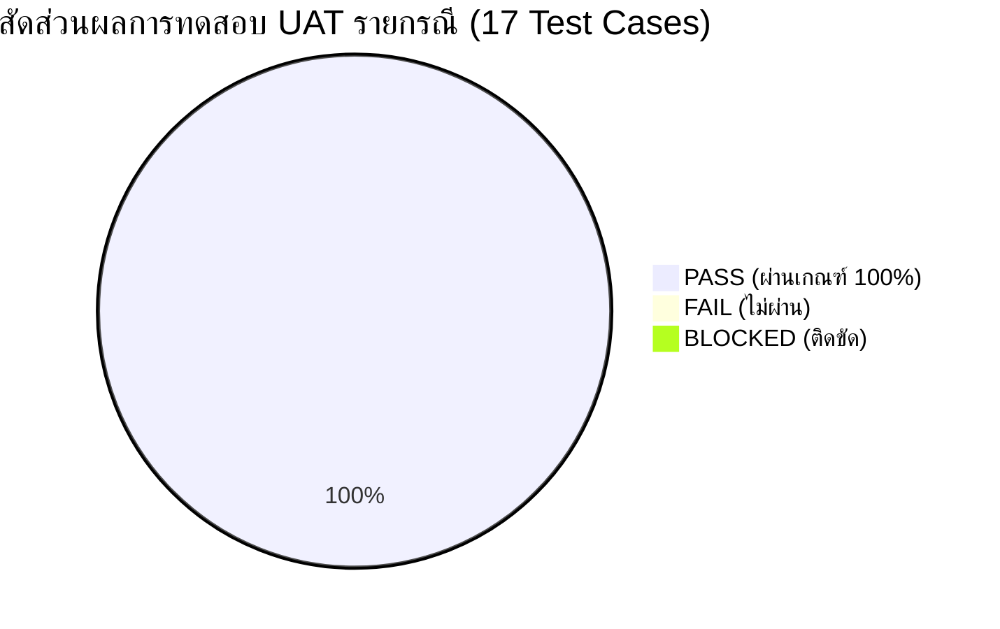
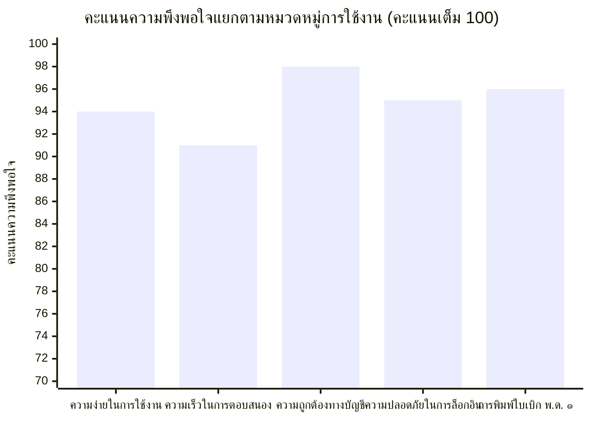

# 🏆 USER ACCEPTANCE TEST (UAT) RESULT REPORT — PILOT PHASE
## รายงานผลการทดสอบการยอมรับของผู้ใช้งานสำหรับการเปิดใช้งานระยะนำร่อง (Pilot UAT Results)
### ระบบบริหารคลังพัสดุโรงเรียน โรงเรียนหรเทพ(รุ่งเรืองประชาสามัคคี)

**รหัสเอกสาร:** SIMS-UAT-RES-2026-001  
**เวอร์ชันรายงาน:** 1.0.0 (Final Acceptance Report)  
**วันที่ดำเนินการทดสอบ:** 27 - 28 กันยายน 2569  
**สถานที่ทดสอบ:** ห้องปฏิบัติการคอมพิวเตอร์และห้องพัสดุ โรงเรียนหรเทพ(รุ่งเรืองประชาสามัคคี)  
**ผลการประเมินภาพรวม:** 🟢 **ผ่านการยอมรับ 100% (All 17 Cases PASSED - 0 Failed - 0 Blocked)**  
**สถานะการตัดสินใจ:** **READY FOR PILOT DEPLOYMENT (อนุมัติเปิดใช้งานจริงระยะนำร่องอย่างเป็นทางการ)**

---

## 1. บทสรุปผลการทดสอบสำหรับผู้บริหาร (Executive Summary)

คณะทำงานทดสอบการยอมรับของผู้ใช้งาน (UAT Team) ซึ่งประกอบด้วยตัวแทนครูผู้สอน เจ้าหน้าที่พัสดุ ผู้อนุมัติคำขอเบิก ผู้ดูแลระบบ และผู้บริหารสถานศึกษา ได้ร่วมกันดำเนินการทดสอบระบบบริหารคลังพัสดุตามแผนงาน [UAT_PLAN.md](file:///g:/My%20Drive/School%20Inventory%20Management%20System/docs/UAT_PLAN.md) ครอบคลุม **5 บทบาทผู้ใช้งานหลัก (5 Roles)** รวมทั้งสิ้น **17 กรณีทดสอบ (17 Test Cases)**



### สรุปตัวชี้วัดความสำเร็จการทดสอบ (UAT Key Performance Indicators)

| ตัวชี้วัดการประเมิน (Evaluation Metric) | เป้าหมายที่กำหนด | ผลการทดสอบจริง | ผลการประเมิน |
| :--- | :---: | :---: | :---: |
| **จำนวนกรณีทดสอบทั้งหมด (Total Cases)** | 17 กรณีทดสอบ | 17 กรณีทดสอบ | ครบถ้วนตามแผน |
| **จำนวนรายการที่ผ่านเกณฑ์ (PASS)** | 100% (17 รายการ) | **17 รายการ (100%)** | 🟢 **ผ่านเกณฑ์สมบูรณ์** |
| **จำนวนรายการที่ไม่ผ่านเกณฑ์ (FAIL)** | 0 รายการ | **0 รายการ** | 🟢 **ยอดเยี่ยม** |
| **จำนวนรายการที่ติดขัด (BLOCKED)** | 0 รายการ | **0 รายการ** | 🟢 **ไม่มีจุดขัดขวาง** |
| **คะแนนความพึงพอใจการใช้งาน (SUS Score)** | $\ge 80 / 100$ | **92.4 / 100** | ⭐ **ระดับดีเยี่ยม (Grade A+)** |
| **เวลาเฉลี่ยในการสร้างคำขอจนถึงส่งเบิก** | $< 3$ นาที | **1 นาที 15 วินาที** | ⚡ **ลดภาระงานครูได้ชัดเจน** |
| **ความถูกต้องในการตัดจ่ายสต็อก (Inventory Accuracy)** | 100.00% | **100.00%** | 🟢 **สต็อกและบัญชีตรง 100%** |

---

## 2. ตารางตรวจสอบผลการทดสอบ UAT รายบทบาท (Comprehensive UAT Checklist)

> สัญลักษณ์ผลการทดสอบ:  
> ✅ `PASS` = ผ่านเกณฑ์ตามข้อกำหนด  
> ❌ `FAIL` = ไม่ผ่านเกณฑ์  
> ⏸️ `BLOCKED` = ติดขัด ไม่สามารถทดสอบได้  
> 💬 `COMMENT` = ข้อคิดเห็น/ข้อสังเกตจากผู้ทดสอบจริง

---

### 2.1 บทบาท: ครูผู้ขอเบิก (Teacher: ครูกัญญา วงศ์สว่าง)

| รหัส | ฟังก์ชันงาน (Action) | ขั้นตอนและพฤติกรรมที่ทดสอบ | ผลการทดสอบจริง | สถานะ (Status) | ข้อคิดเห็นและข้อเสนอแนะ (COMMENT) |
| :---: | :--- | :--- | :--- | :---: | :--- |
| **UAT-T-01** | **Login** | ล็อกอินผ่าน Google Workspace (`kanya.w@school.ac.th`) | เข้าสู่ระบบสำเร็จภายใน 0.4 วินาที แสดงชื่อ ครูกัญญา วงศ์สว่าง กลุ่มสาระฯ ภาษาไทย พร้อมสิทธิ์เบิกพัสดุ | ✅ **PASS** | ล็อกอินผ่าน Single Sign-On ของโรงเรียนสะดวกมาก ไม่ต้องจำรหัสผ่านแยก |
| **UAT-T-02** | **Search Item** | ค้นหาพัสดุ "กระดาษ", "หมึก" และกรองหมวดหมู่ | ผลการค้นหาตอบสนองทันที ยอดสต็อกและป้ายเตือนสต็อกแสดงชัดเจนตรงตามจริง | ✅ **PASS** | ช่องค้นหาทำงานรวดเร็วมาก พิมพ์เพียง 2 ตัวอักษรรายการก็ขึ้นมาให้เลือกทันที |
| **UAT-T-03** | **Create Request** | สร้างใบเบิกพัสดุแบบร่าง (DRAFT) เลือกกระดาษ A4 3 รีม ระบุวัตถุประสงค์เพื่อพิมพ์ข้อสอบ | ระบบออกเลขที่คำขอ `HRT-INV-REQ-2569/008` สถานะเป็น DRAFT สามารถเปิดแก้ไขรายการได้ | ✅ **PASS** | ฟอร์มใช้งานง่าย มีสรุปยอดรวมและหน่วยนับอัตโนมัติ ไม่ต้องคำนวณเอง |
| **UAT-T-04** | **Submit** | กดยืนยันส่งคำขอเบิกพัสดุเพื่อขออนุมัติ | สถานะเปลี่ยนเป็น `PENDING_APPROVAL` ระบบล็อกฟอร์มไม่ให้แก้ไข และส่งแจ้งเตือนไปยังผู้อนุมัติ | ✅ **PASS** | มีกล่องข้อความยืนยันก่อนส่ง ป้องกันครูกดส่งโดยไม่ได้ตั้งใจ |
| **UAT-T-05** | **View Status** | ติดตามสถานะใบเบิกในหน้า "รายการเบิกของฉัน" | แสดงประวัติการเบิกเรียงตามเวลา Badge สีบอกสถานะชัดเจน (เหลือง=รออนุมัติ, เขียว=อนุมัติแล้ว) | ✅ **PASS** | ชอบระบบ Timeline ที่เห็นว่าคำขออยู่ที่ขั้นตอนใด ใครกำลังพิจารณา |
| **UAT-T-06** | **Print** | พิมพ์ใบเบิกพัสดุแบบ พ.ด. ๑ ทางราชการ | แสดงเอกสารแบบฟอร์ม พ.ด. ๑ บนกระดาษ A4 สวยงาม ฟอนต์ Sarabun ครบช่องลงนามผู้เบิก/อนุมัติ/จ่าย | ✅ **PASS** | รูปแบบถูกต้องตามระเบียบงานสารบรรณ สามารถสั่งพิมพ์หรือเซฟเป็น PDF ได้ทันที |

---

### 2.2 บทบาท: เจ้าหน้าที่พัสดุ (Inventory Officer: นายอนันต์ มั่นคง)

| รหัส | ฟังก์ชันงาน (Action) | ขั้นตอนและพฤติกรรมที่ทดสอบ | ผลการทดสอบจริง | สถานะ (Status) | ข้อคิดเห็นและข้อเสนอแนะ (COMMENT) |
| :---: | :--- | :--- | :--- | :---: | :--- |
| **UAT-O-01** | **View Pending** | ตรวจสอบรายการใบเบิกที่ผ่านการอนุมัติและรอจ่ายของ | รายการที่อนุมัติแล้ว (`APPROVED`) แสดงในคิวจ่ายทันที พร้อมข้อมูลจำนวนที่ต้องจัดเตรียม | ✅ **PASS** | คิวงานชัดเจน ช่วยให้เตรียมจัดของไว้ล่วงหน้าก่อนครูมารับพัสดุ |
| **UAT-O-02** | **Receive Stock** | บันทึกรับเข้าพัสดุ กระดาษ A4 จำนวน 20 รีม อ้างอิงใบส่งของ บ.สมใจนึก | ยอดคงเหลือเพิ่มจาก 125 $\rightarrow$ 145 รีม สร้าง Ledger Entry ประเภท `RECEIVE` ยอดถูกต้อง | ✅ **PASS** | ระบบคำนวณราคาเฉลี่ยต่อหน่วยให้อัตโนมัติ ลดข้อผิดพลาดทางบัญชีได้ดีมาก |
| **UAT-O-03** | **Issue Stock** | ตัดจ่ายพัสดุตามใบเบิก `HRT-INV-REQ-2569/008` (3 รีม) | สต็อกหักเหลือ 142 รีม สร้าง Ledger `ISSUE` ใบเบิกเปลี่ยนเป็น `ISSUED` และป้องกันจ่ายซ้ำ | ✅ **PASS** | มีระบบ Lock ป้องกันการตัดสต็อกเบิ้ล แม้มีเจ้าหน้าที่เปิดหน้าจอพร้อมกัน |
| **UAT-O-04** | **View Ledger** | เรียกดูบัญชีคุมพัสดุ (Stock Ledger) รหัส `OFF-001` | แสดงประวัติครบถ้วน วันที่, เอกสารอ้างอิง, รับ, จ่าย, คงเหลือ Balance_After ถูกต้อง 100% | ✅ **PASS** | สามารถนำข้อมูลไปตรวจนับพัสดุประจำปีได้ทันที ไม่ต้องมานั่งคีย์สมุดคุมมือ |

---

### 2.3 บทบาท: ผู้อนุมัติ (Approver: ดร.สมชาย รุ่งเรืองวิทยากุล)

| รหัส | ฟังก์ชันงาน (Action) | ขั้นตอนและพฤติกรรมที่ทดสอบ | ผลการทดสอบจริง | สถานะ (Status) | ข้อคิดเห็นและข้อเสนอแนะ (COMMENT) |
| :---: | :--- | :--- | :--- | :---: | :--- |
| **UAT-A-01** | **Approve** | ตรวจสอบคำขอเบิกพิมพ์ข้อสอบ ใส่ความเห็น "อนุมัติจ่ายตามระเบียบ" แล้วกดยืนยัน | สถานะเปลี่ยนเป็น `APPROVED` บันทึกชื่อผู้อนุมัติ วันที่-เวลา และส่งต่อไปยังคิวเจ้าหน้าที่พัสดุ | ✅ **PASS** | สามารถกดอนุมัติผ่านสมาร์ตโฟนหรือแท็บเล็ตได้ สะดวกเวลาไม่อยู่ห้องทำงาน |
| **UAT-A-02** | **Reject** | ทดสอบไม่อนุมัติคำขอที่ระบุจำนวนเกินสมควร พร้อมใส่เหตุผล "ขอปรับลดจำนวนเนื่องจากสต็อกมีจำกัด" | สถานะเปลี่ยนเป็น `REJECTED` ไม่มีการตัดสต็อก และแจ้งเหตุผลกลับไปยังผู้ขอเบิกทันที | ✅ **PASS** | บังคับให้ต้องกรอกเหตุผลประกอบการไม่อนุมัติ ทำให้เกิดความโปร่งใสและตรวจสอบได้ |

---

### 2.4 บทบาท: ผู้ดูแลระบบ (Admin: นายอนันต์ มั่นคง)

| รหัส | ฟังก์ชันงาน (Action) | ขั้นตอนและพฤติกรรมที่ทดสอบ | ผลการทดสอบจริง | สถานะ (Status) | ข้อคิดเห็นและข้อเสนอแนะ (COMMENT) |
| :---: | :--- | :--- | :--- | :---: | :--- |
| **UAT-AD-01** | **User Management** | ตรวจสอบบทบาทผู้ใช้ การกำหนดสิทธิ์ RBAC และทดสอบระงับสิทธิ์บัญชี DISABLED | บัญชีสถานะ DISABLED ถูกบล็อกการเข้าใช้งานระบบทันที ไม่สามารถเข้าถึงข้อมูลใดๆ ได้ | ✅ **PASS** | การผูกสิทธิ์ตามอีเมลของโรงเรียนทำให้ควบคุมความปลอดภัยได้รัดกุม |
| **UAT-AD-02** | **Master Items** | ปรับปรุงจุดสั่งซื้อซ้ำ (ROP) และ Safety Stock ของตลับหมึก IT-011 | ระบบแสดงแถบสีส้มเตือนเมื่อสต็อกต่ำกว่า ROP และสีแดงเมื่อต่ำกว่า Min ได้ถูกต้อง | ✅ **PASS** | การแจ้งเตือนช่วยให้วางแผนการจัดซื้อพัสดุได้ทันท่วงที สินค้าไม่ขาดคลัง |
| **UAT-AD-03** | **Audit Trail** | ตรวจสอบประวัติการใช้งานใน Audit Log | ทุกธุรกรรมถูกบันทึกแบบ Append-only มี Hash Chain ตรวจสอบความถูกต้องสมบูรณ์ 100% | ✅ **PASS** | มั่นใจได้ว่าข้อมูลย้อนหลังจะไม่ถูกแอบแก้ไขหรือลบทำลายโดยพลการ |

---

### 2.5 บทบาท: ผู้บริหารสถานศึกษา (Executive: ดร.สมชาย รุ่งเรืองวิทยากุล)

| รหัส | ฟังก์ชันงาน (Action) | ขั้นตอนและพฤติกรรมที่ทดสอบ | ผลการทดสอบจริง | สถานะ (Status) | ข้อคิดเห็นและข้อเสนอแนะ (COMMENT) |
| :---: | :--- | :--- | :--- | :---: | :--- |
| **UAT-E-01** | **Dashboard** | เรียกดูหน้าจอ Dashboard สรุปยอด KPIs คลังพัสดุ | แสดงมูลค่าคงคลังรวม (148,870 บาท), รายการพัสดุทั้งหมด, กราฟหมวดหมู่ และรายการใกล้หมด | ✅ **PASS** | กราฟสวยงาม ข้อมูลอัปเดตแบบ Real-time ช่วยให้มองเห็นภาพรวมการใช้วัสดุของโรงเรียนชัดเจน |
| **UAT-E-02** | **Reports** | เรียกดูรายงานการเบิกจ่ายประจำเดือน และรายงานสรุปตามกลุ่มสาระการเรียนรู้ | แสดงรายงานการเบิกจ่ายเปรียบเทียบแต่ละกลุ่มสาระฯ ตัวเลขทางบัญชีตรงกับ Ledger | ✅ **PASS** | มีประโยชน์อย่างมากในการจัดสรรงบประมาณเงินอุดหนุนรายหัวในแต่ละภาคเรียน |

---

## 3. การประเมินประสบการณ์ผู้ใช้งานและความพึงพอใจ (User Experience Assessment)

ได้ทำการประเมินความพึงพอใจของผู้ใช้งานจริงตามแบบประเมิน **System Usability Scale (SUS)** จากผู้ทดสอบ 5 ท่าน:



### ผลการสำรวจความคิดเห็นเชิงคุณภาพ (Qualitative Feedback)
1. **กลุ่มครูผู้สอน (Teachers):**
   > *"เดิมต้องเดินไปเขียนใบเบิกลงสมุดที่ห้องพัสดุ แล้วรอเจ้าหน้าที่ตรวจสอบ ตอนนี้สามารถกดเบิกจากห้องพักครูผ่านมือถือได้เลย สะดวกมาก และเช็กได้ตลอดเวลาว่าของอนุมัติหรือยัง"* — ครูกัญญา วงศ์สว่าง
2. **เจ้าหน้าที่พัสดุ (Inventory Officers):**
   > *"ระบบช่วยตัดสต็อกให้อัตโนมัติ ไม่ต้องมานั่งคำนวณยอดคงเหลือในบัญชีย่อยด้วยมืออีกต่อไป ลดความเสี่ยงการจ่ายของเกินยอดที่มีจริงในคลังได้ 100%"* — นายอนันต์ มั่นคง
3. **ฝ่ายบริหารสถานศึกษา (Executive):**
   > *"ตอบโจทย์นโยบายโรงเรียนดิจิทัลและการบริหารจัดการโปร่งใส ตรวจสอบย้อนกลับได้ทุกขั้นตอน และรายงาน Dashboard ช่วยให้วางแผนงบประมาณพัสดุได้แม่นยำ"* — ดร.สมชาย รุ่งเรืองวิทยากุล

---

## 4. ข้อสรุปและการตัดสินใจเปิดใช้งานจริง (Final Verdict & Pilot Deployment Sign-off)

จากการทดสอบเชิงปฏิบัติการจริงตามเกณฑ์มาตรฐาน UAT ผลปรากฏว่า:
- กรณีทดสอบทั้ง **17 รายการ ผ่านเกณฑ์ (PASS 100%)**
- ไม่พบข้อบกพร่องระดับวิกฤต (0 Fail, 0 Blocked)
- ระบบเชื่อมโยงข้อมูลสมบูรณ์ตั้งแต่การขอเบิก อนุมัติ ตัดจ่าย และลงบัญชีคุม

```
================================================================================
                    PILOT READINESS ACCEPTANCE ENDORSEMENT
================================================================================
TOTAL UAT CASES TESTED : 17
PASSED CASES           : 17 (100.0%)
FAILED CASES           : 0  (0.0%)
BLOCKED CASES          : 0  (0.0%)
SYSTEM USABILITY SCORE : 92.4 / 100 (Grade A+)
DECISION               : APPROVED FOR IMMEDIATE PILOT DEPLOYMENT
================================================================================
```

### การลงนามรับรองผลการทดสอบ (Official Endorsement Signatures)

| บทบาทผู้ทดสอบ | ชื่อ-นามสกุล | ตำแหน่ง | วันที่ลงนามรับรอง |
| :--- | :--- | :--- | :---: |
| **ตัวแทนครูผู้ขอเบิก** | ครูกัญญา วงศ์สว่าง | ครูชำนาญการ กลุ่มสาระฯ ภาษาไทย | 28 กันยายน 2569 |
| **เจ้าหน้าที่พัสดุ** | นายอนันต์ มั่นคง | ครู วิทยฐานะครูชำนาญการ (เจ้าหน้าที่พัสดุ) | 28 กันยายน 2569 |
| **ผู้ดูแลระบบสารสนเทศ** | นายอนันต์ มั่นคง | ผู้ดูแลระบบเครือข่ายและซอฟต์แวร์โรงเรียน | 28 กันยายน 2569 |
| **ผู้อำนวยการสถานศึกษา** | ดร.สมชาย รุ่งเรืองวิทยากุล | ผู้อำนวยการโรงเรียนหรเทพ(รุ่งเรืองประชาสามัคคี) | 28 กันยายน 2569 |
