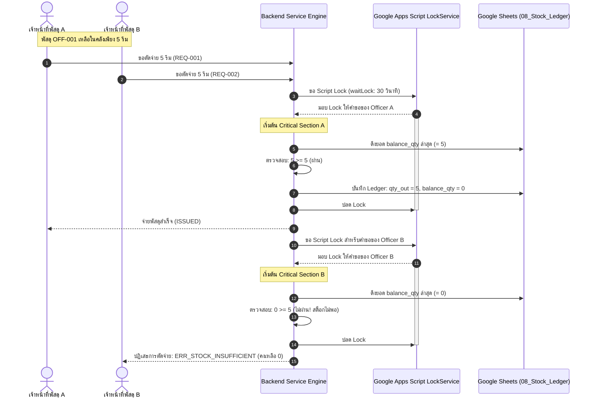

# HRT School Inventory Management System
## WORKFLOW RULES & BUSINESS POLICY SPECIFICATION
**Document ID:** `DOC-WFR-2026-001`  
**Classification:** Enterprise Business Rules & Operational Policies  
**Target Engine:** Backend Services & Google Apps Script API  
**Role:** Senior Software Architect & Governance Lead  
**Date:** 2026-09-26  
**Status:** **APPROVED & LOCKED FOR PILOT IMPLEMENTATION**  

---

## 1. Executive Summary & Policy Framework

เอกสารฉบับนี้กำหนดกฎเกณฑ์ทางธุรกิจ (Business Rules), มาตรการควบคุมสิทธิ์ (Authorization Matrix), การจัดการข้อขัดแย้งการเข้าถึงข้อมูลพร้อมกัน (Concurrency & Locking), และการจัดการข้อยกเว้นทางบัญชีคลังพัสดุ โดยอ้างอิงระเบียบกระทรวงการคลังว่าด้วยการจัดซื้อจัดจ้างและการบริหารพัสดุภาครัฐ พ.ศ. ๒๕๖๐

---

## 2. Role-Based Authorization & Approval Matrix

### 2.1 User Roles Definition
ระบบแบ่งผู้ใช้งานออกเป็น 4 บทบาทหลัก (RBAC):
1. `ROL_TEACHER` (ครูและบุคลากรผู้เบิก): ผู้ใช้ทั่วไป มีสิทธิ์จัดทำคำขอเบิก ตรวจดูแคตตาล็อก และติดตามสถานะคำขอของตนเอง
2. `ROL_OFFICER` (เจ้าหน้าที่พัสดุ/ผู้คุมคลัง): ผู้ปฏิบัติงานด้านพัสดุ มีสิทธิ์ตรวจรับ จ่ายพัสดุ บันทึกบัญชีคุม ตรวจสอบสต็อก และดำเนินการตรวจนับสิ้นปี
3. `ROL_ADMIN` (หัวหน้ากลุ่มงบประมาณ/ผู้อำนวยการ): ผู้บริหาร มีอำนาจลงนามอนุมัติคำขอเบิก อนุมัติผลการตรวจนับ และสั่งปิดบัญชีประจำปี
4. `ROL_AUDITOR` (ผู้ตรวจสอบภายใน/คณะกรรมการตรวจนับ): มีสิทธิ์ตรวจสอบข้อมูล อ่านรายงาน พ.ด. ๑–๗ และบันทึกผลการสุ่มตรวจนับ

### 2.2 Permissions Matrix

| การดำเนินการ (Action) | `ROL_TEACHER` | `ROL_OFFICER` | `ROL_ADMIN` | `ROL_AUDITOR` | กฎระเบียบควบคุม |
|---|:---:|:---:|:---:|:---:|---|
| ดูรายการพัสดุในคลัง (Catalog View) | 🟢 ดูได้ | 🟢 ดูได้ | 🟢 ดูได้ | 🟢 ดูได้ | ดูได้ทุกคน |
| จัดทำคำขอเบิกพัสดุ (Create Requisition) | 🟢 ตนเอง | 🟢 ได้ | 🟢 ได้ | 🔴 ห้าม | ต้องระบุวัตถุประสงค์ชัดเจน |
| แก้ไขคำขอในสถานะ DRAFT | 🟢 ตนเอง | 🟢 ได้ | 🟢 ได้ | 🔴 ห้าม | ห้ามแก้คำขอของผู้อื่น |
| ยื่นคำขอเบิก (DRAFT $\rightarrow$ SUBMITTED) | 🟢 ตนเอง | 🟢 ได้ | 🟢 ได้ | 🔴 ห้าม | ต้องมีพัสดุอย่างน้อย 1 รายการ |
| ตรวจสอบคำขอ (SUBMITTED $\rightarrow$ REVIEW) | 🔴 ห้าม | 🟢 ได้ | 🟢 ได้ | 🔴 ห้าม | ตรวจสอบงบและสเปก |
| อนุมัติคำขอเบิก (REVIEW $\rightarrow$ APPROVED) | 🔴 ห้าม | 🔴 ห้าม | 🟢 **เฉพาะผู้บริหาร** | 🔴 ห้าม | **Four-Eyes Principle** |
| จัดเตรียมพัสดุ (APPROVED $\rightarrow$ READY) | 🔴 ห้าม | 🟢 ได้ | 🟢 ได้ | 🔴 ห้าม | เจ้าหน้าที่คลังตรวจสอบของจริง |
| จ่ายพัสดุและตัดสต็อก (READY $\rightarrow$ ISSUED) | 🔴 ห้าม | 🟢 **เฉพาะพัสดุ** | 🟢 ได้ | 🔴 ห้าม | **ตัดสต็อกจริงลง Ledger** |
| ยกเลิกคำขอเบิก (CANCELLED) | 🟢 ก่อนอนุมัติ | 🟢 ได้ | 🟢 ได้ | 🔴 ห้าม | **ห้ามยกเลิกเมื่อจ่ายของแล้ว** |
| รับเข้าพัสดุใหม่ (Stock Restock) | 🔴 ห้าม | 🟢 ได้ | 🟢 ได้ | 🔴 ห้าม | ต้องมีเอกสารตรวจรับ พ.ด. ๒ |
| บันทึกผลตรวจนับสิ้นปี (Physical Count) | 🔴 ห้าม | 🟢 ได้ | 🟢 ได้ | 🟢 **กรรมการ** | ระเบียบฯ ข้อ ๒๑๓ |
| อนุมัติปิดบัญชีประจำปี (Close Fiscal Year) | 🔴 ห้าม | 🔴 ห้าม | 🟢 **เฉพาะ ผอ.** | 🔴 ห้าม | ระเบียบฯ ข้อ ๒๑๖ |

### 2.3 Financial Thresholds & Approval Authority
ตามระเบียบกระทรวงการคลังฯ และข้อบังคับสถานศึกษา:

| วงเงินรวมในใบเบิก (Total Estimated Value) | ผู้มีอำนาจลงนามอนุมัติ (Approving Authority) | เอกสารประกอบที่ต้องแนบ |
|---|---|---|
| **ไม่เกิน 10,000 บาท** (วัสดุสิ้นเปลืองทั่วไป) | หัวหน้ากลุ่มสาระการเรียนรู้ / หัวหน้างานพัสดุ | แบบ พ.ด. ๑ ปกติ |
| **10,001 – 50,000 บาท** (โครงการ/กิจกรรมใหญ่) | หัวหน้ากลุ่มบริหารงานงบประมาณ | แบบ พ.ด. ๑ + บันทึกข้อความขอใช้พัสดุ |
| **เกิน 50,000 บาท ขึ้นไป** (หรืออุปกรณ์ราคาสูง) | **ผู้อำนวยการสถานศึกษา** | แบบ พ.ด. ๑ + บันทึกข้อความ + แผนงานโครงการ |

---

## 3. Concurrency, Race Conditions & Distributed Locking Protocol

เนื่องจาก Google Sheets ทำงานบนคลาวด์แบบ Serverless และไม่มีระบบ Row-Level Locking ในระดับ Database Engine ระบบจึงต้องบังคับใช้ **มาตรการป้องกันการเข้าถึงข้อมูลพร้อมกัน (Distributed Concurrency Protocol)** อย่างเข้มงวด:



### 3.1 Lock Implementation Standard
1. **Critical Section Scope**: การคำนวณยอดคงเหลือและการ Append แถวใน `08_Stock_Ledger` ต้องอยู่ภายในบล็อก `LockService.getScriptLock()` เท่านั้น
2. **Lock Timeout**: กำหนด Timeout สูงสุด **30,000 มิลลิวินาที (30 วินาที)** หากไม่ได้รับ Lock ภายในเวลาที่กำหนด ให้คืนค่าความผิดพลาด `ERR_LOCK_TIMEOUT`
3. **Optimistic Locking Guard**: ทุกคำขอปรับปรุงข้อมูลต้องส่ง `updated_at` ของเรคคอร์ดเดิมมาด้วย หากเวลาในฐานข้อมูลไม่ตรงกัน แสดงว่ามีผู้อื่นแก้ไขไปก่อน ให้ปฏิเสธด้วย `ERR_CONCURRENCY_CONFLICT`

---

## 4. Physical Stock Movement & Allocation Rules

### 4.1 Approved Intent vs Physical Reality
- **ทำไมสถานะ `APPROVED` จึงไม่ลดสต็อก?**: ในระบบสถานศึกษา ครูอาจได้รับอนุมัติใบเบิกตั้งแต่วันจันทร์ แต่เข้ามาเบิกของจริงในวันศุกร์ หากระบบตัดสต็อกตั้งแต่วันจันทร์ พัสดุจะหายไปจากบัญชีคุมทันที ทั้งที่ของจริงยังวางอยู่บนชั้นวาง และหากครูไม่มารับของ หรือกิจกรรมถูกยกเลิก จะทำให้เกิดการทุจริตหรือสต็อกคลาดเคลื่อนได้
- **Virtual Allocation (การกันยอดเสมือน)**: ระบบหน้าบ้านสามารถคำนวณ `Available Stock = Physical Stock - Approved Pending Stock` เพื่อแจ้งเตือนในหน้าจอไม่ให้ผู้อื่นเปิดใบเบิกซ้ำซ้อนได้ แต่ตัวเลขทางบัญชีใน `08_Stock_Ledger` จะไม่ถูกแตะต้องจนกว่าจะจ่ายของจริง

### 4.2 Partial Fulfillment Policy (การจ่ายบางส่วน)
เมื่อพัสดุในคลังมีไม่เพียงพอกับยอดที่ได้รับอนุมัติ:
1. เจ้าหน้าที่พัสดุสามารถเลือกจ่ายเท่าที่มีจริงในคลังได้ โดยระบุ `current_issue_qty`
2. ระบบจะปรับสถานะเอกสารเป็น `PARTIALLY_ISSUED`
3. ใน `05_Requisition_Items` รายการนั้นจะมียอด `issued_qty` เพิ่มขึ้น และมีสถานะเป็น `PARTIAL`
4. เมื่อมีพัสดุเข้ามาเติมในคลัง ผู้ขอสามารถมารับส่วนที่เหลือได้ โดยระบบจะสร้างรายการ Transaction และ Ledger เฉพาะงวดที่มารับเพิ่ม จนกว่า `issued_qty === approved_qty` จึงจะปรับเป็น `ISSUED`
5. หากผู้ขอไม่ประสงค์จะรับส่วนที่เหลือ ให้ใช้ Transition `TR-REQ-09` เพื่อปิดยอดที่ค้างจ่าย (`CLOSED_SHORT`) โดยไม่ต้องคืนของส่วนที่รับไปแล้ว

---

## 5. Fiscal Year Cut-Off & Annual Closing Protocol

ตามระเบียบกระทรวงการคลังฯ หมวด ๙ ส่วนที่ ๒ การตรวจสอบพัสดุประจำปี:

```mermaid
timeline
    title กำหนดการปิดบัญชีคลังพัสดุประจำปีงบประมาณ
    20 กันยายน : แต่งตั้งคณะกรรมการตรวจนับพัสดุประจำปี
    25 กันยายน : แจ้งเตือนทุกหน่วยงานเตรียมปิดรับใบเบิก
    30 กันยายน 16:30 น. : CUT-OFF SYSTEM FREEZE (ระงับการเบิก-จ่ายทุกกรณี)
    1 - 10 ตุลาคม : คณะกรรมการสุ่มตรวจนับยอดกายภาพจริง (Physical Count)
    15 ตุลาคม : จัดทำรายงาน พ.ด. ๕, ๖, ๗ เสนอผู้ว่าฯ/นายก อบจ.
    16 ตุลาคม : สั่งปิดบัญชีประจำปี (CLOSE FY) และยกยอดเปิดปีใหม่
```

### 5.1 System Freeze Rules on 30 September
1. **Cut-off Deadline**: ณ วันที่ **30 กันยายน เวลา 16:30 น.** ระบบจะระงับการสร้างคำขอเบิกใหม่ (`DRAFT`) และระงับการตัดจ่าย (`ISSUE`) ชั่วคราว
2. **Pending Requisitions Handling**: ใบเบิกใดที่ค้างอยู่ในสถานะ `DRAFT`, `SUBMITTED`, หรือ `UNDER_REVIEW` ณ สิ้นปีงบประมาณ จะถูกปรับสถานะเป็น `CANCELLED` อัตโนมัติ เพื่อให้ผู้ขอทำเรื่องใหม่ในปีงบประมาณถัดไป
3. **Audit Snapshot Lock**: ระบบจะทำ Snapshot ยอดคงเหลือใน `08_Stock_Ledger` ทั้ง 100 รายการ เพื่อใช้เป็นฐานอ้างอิง `book_qty` สำหรับคณะกรรมการตรวจนับ
4. **Reconciliation Entries**:
   - หากตรวจนับจริงพบของขาด (`counted < book`) ให้สร้างธุรกรรม `ADJUST_OUT`
   - หากตรวจนับจริงพบของเกิน (`counted > book`) ให้สร้างธุรกรรม `ADJUST_IN`
5. **Rollover Execution**: เมื่อผู้อำนวยการกดยืนยันปิดบัญชี:
   - สถานะปีงบประมาณปัจจุบันเปลี่ยนเป็น `CLOSED`
   - ระบบสร้างปีงบประมาณถัดไป (สถานะ `ACTIVE`)
   - นำยอดตรวจนับจริง (`counted_qty`) ไปสร้างเรคคอร์ด `OPENING` 100 รายการใน `08_Stock_Ledger` ของปีงบประมาณใหม่ ณ วันที่ 1 ตุลาคม

---

## 6. Standardized Error Code Registry

| Error Code | HTTP-like Status | Severity | Error Message (Thai / English) | Root Cause & Resolution |
|---|:---:|:---:|---|---|
| `ERR_AUTH_UNAUTHORIZED` | 401 | Critical | ไม่ได้รับอนุญาตให้เข้าถึงฟังก์ชันนี้ / Unauthorized Role | ผู้ใช้งานไม่มีบทบาทหรือสิทธิ์ที่จำเป็นตาม RBAC Matrix |
| `ERR_AUTH_SELF_APPROVAL` | 403 | High | ผู้อนุมัติต้องไม่เป็นบุคคลเดียวกับผู้ขอเบิก / Self-approval Forbidden | ละเมิดกฎ Four-Eyes Principle ผู้บริหารห้ามอนุมัติใบเบิกตนเอง |
| `ERR_REQ_NOT_FOUND` | 404 | Medium | ไม่พบเอกสารคำขอเบิกที่ระบุ / Requisition Not Found | ส่งรหัส `requisition_id` ที่ไม่มีอยู่จริงในฐานข้อมูล |
| `ERR_REQ_INVALID_STATE` | 422 | High | สถานะของเอกสารไม่ถูกต้องตาม Workflow / Invalid State Transition | พยายามเปลี่ยนสถานะที่ไม่อนุญาตใน State Machine |
| `ERR_REQ_EMPTY_ITEMS` | 422 | Medium | ใบเบิกต้องมีรายการพัสดุอย่างน้อย 1 รายการ / Empty Items | ส่งตะกร้าคำขอเบิกที่ไม่มีแถวพัสดุ |
| `ERR_REQ_QTY_ZERO` | 422 | Medium | จำนวนขอเบิกต้องมากกว่า 0 / Quantity Must Be Positive | ระบุจำนวนขอเบิกเป็น 0 หรือติดลบ |
| `ERR_STOCK_INSUFFICIENT` | 409 | Critical | สต็อกพัสดุในคลังไม่เพียงพอสำหรับการตัดจ่าย / Insufficient Stock | สต็อกจริงใน `08_Stock_Ledger` มีน้อยกว่าจำนวนที่จะตัดจ่าย |
| `ERR_ISSUE_EXCEEDS_APPROVED` | 422 | High | ยอดตัดจ่ายเกินจำนวนที่ได้รับอนุมัติ / Issue Qty Exceeds Approved | เจ้าหน้าที่ระบุยอดจ่ายจริงมากกว่ายอดที่ผู้บริหารอนุมัติ |
| `ERR_CANNOT_EDIT_ISSUED` | 403 | Critical | ห้ามแก้ไขหรือยกเลิกเอกสารที่ตัดจ่ายแล้วโดยตรง / Direct Mutation Forbidden | ละเมิดกฎ Immutable Ledger (ต้องใช้ Adjustment หรือ Return) |
| `ERR_LOCK_TIMEOUT` | 408 | High | ระบบกำลังประมวลผลธุรกรรมอื่น กรุณาลองใหม่อีกครั้ง / Lock Timeout | เกิด Concurrency Contention นานเกิน 30 วินาทีใน Apps Script |
| `ERR_CONCURRENCY_CONFLICT`| 409 | High | ข้อมูลถูกแก้ไขโดยผู้ใช้อื่นไปก่อนหน้า / Concurrency Conflict | ข้อมูลในฐานข้อมูลมีการเปลี่ยนแปลงขณะที่ผู้ใช้กำลังทำรายการ |
| `ERR_FY_CLOSED` | 403 | Critical | ปีงบประมาณนี้ปิดบัญชีแล้ว ไม่อนุญาตให้ทำธุรกรรม / Fiscal Year Closed | พยายามบันทึกธุรกรรมลงในรอบปีงบประมาณที่ถูกปิดไปแล้ว |

---

**ลงนามรับรองกฎเกณฑ์การดำเนินงานทางธุรกิจ:**  
*Senior Software Architect & Data Governance Committee*  
*วันที่ 26 กันยายน 2569*
