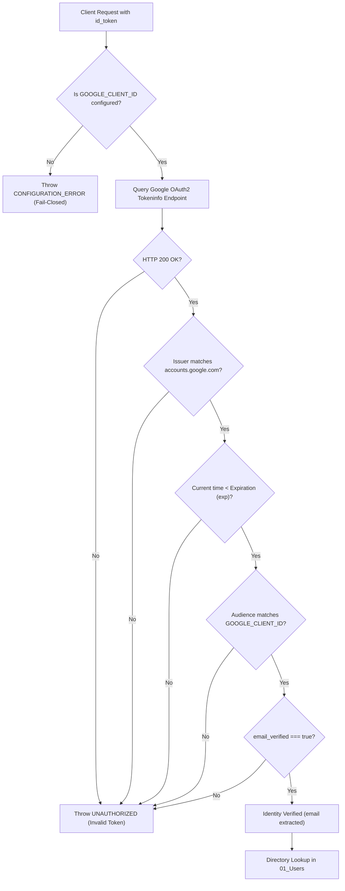
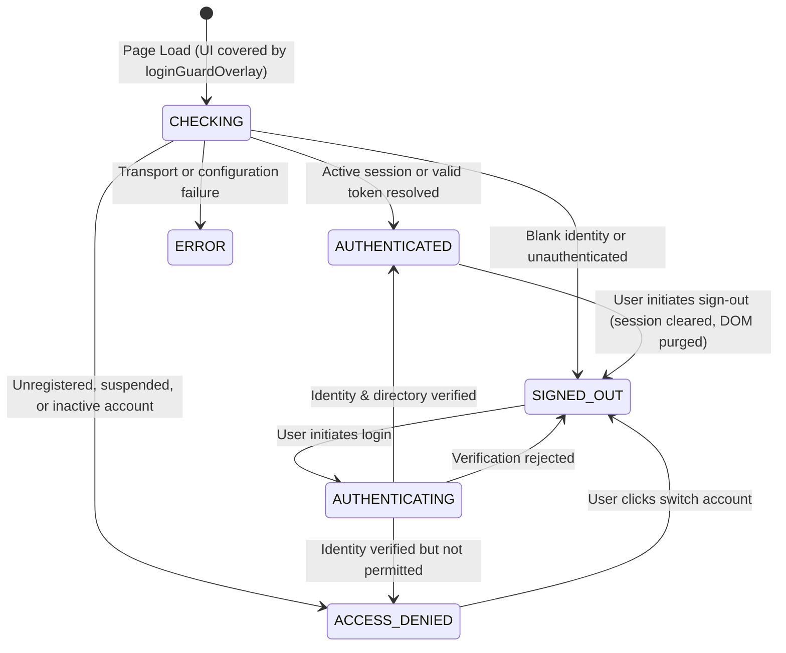

# HRT Inventory Management System — Authentication & Deployment Architecture Matrix
**Document Version:** v1.1  
**Target Release Pipeline:** `v2.7.0-rc.5` (Working Tree) $\rightarrow$ Candidate `v2.7.0-rc.6` (Post Repair Prompts 13–20)  
**Historical Baseline:** `v2.6.0` (Last Verified Pre-Clean File Baseline)  
**Organization:** โรงเรียนหรเทพ(รุ่งเรืองประชาสามัคคี)  
**Date:** 28 ตุลาคม 2569

---

## 1. Executive Summary & Identity Architecture Overview

The HRT Inventory System is designed as an institutional resource planning application deployed within the Google Workspace environment of โรงเรียนหรเทพ(รุ่งเรืองประชาสามัคคี). The system mandates a **Login-First, Zero-Leak Architecture** with fail-closed security at every platform layer.

Identity verification operates under two complementary deployment topologies depending on organizational requirements and Google Workspace administration:
1. **Google Apps Script Native Session (`Session.getActiveUser()`):** Used in domain-bound web app deployments where the user executes the web app as their own Google identity.
2. **Google Identity Services Token Verification (`verifyGoogleIdToken` via OAuth2):** Used in external client contexts, headless REST integrations, mobile/PWA web clients, or when the deployment executes as the script owner and receives an OpenID Connect (OIDC) JWT ID token.

---

## 2. Deployment Topology & Identity Resolution Matrix

| Execution Mode | Web App "Execute As" | "Who has access" | Primary Identity Vector | Fallback / Explicit Token Vector | Unauthenticated / Blank Handling | Security Policy & Boundary |
| :--- | :--- | :--- | :--- | :--- | :--- | :--- |
| **Topology A: Domain-Bound Intranet (Standard)** | `User accessing the web app` | `Anyone within hortherp.ac.th` | `Session.getActiveUser().getEmail()` | Not required (Active Session proved by Google Workspace) | Fail-Closed (`UNAUTHORIZED`). Prompts institutional login. | Execution sandbox bound directly to user's OAuth scope. User identity cannot be forged. |
| **Topology B: Hybrid Intranet / External PWA** | `Me (Developer / System Service Account)` | `Anyone with Google Account` | Blank Session in guest iframe | Client supplies Google ID Token (`id_token` in payload) verified via `oauth2.googleapis.com/tokeninfo` | Fail-Closed (`UNAUTHORIZED`). Rejects missing token or missing `GOOGLE_CLIENT_ID` with `CONFIGURATION_ERROR`. | Token cryptographically validated against `accounts.google.com`, expiry, audience, and email verification. |
| **Topology C: REST Gateway (`doPost`)** | `Me` or `User accessing app` | Configured endpoint | Token in POST JSON payload (`id_token`) | Active Session (if invoked via same-origin GAS client) | Fail-Closed (`UNAUTHORIZED`). | Strips untrusted client identity fields (`caller`, `_serverActor`, `userRole`, `callerRole`, `userId`). |

---

## 3. Cryptographic Token Verification Pipeline (`verifyGoogleIdToken`)

When an explicit Google ID token is submitted via client payload, `Api.gs:verifyGoogleIdToken` enforces strict OIDC validation:

### Verification Invariants:
1. **Never Trust Decoded Claims Alone:** Token claims are never accepted without server-side verification against Google's public key infrastructure.
2. **Never Log Sensitive Credentials:** Tokens, bearer keys, and authorization headers are never printed to execution logs or audit records (enforced by `hrtSanitizeAuditDetails_`).
3. **Audience Protection:** When `CONFIG.GOOGLE_CLIENT_ID` is set, tokens minted for other OAuth client IDs are strictly rejected to prevent cross-app token reuse attacks.
4. **Email Verification Requirement:** Accounts with unverified email addresses (`email_verified: false`) are rejected immediately.

---

## 4. Domain Policy & External Gmail Account Strategy

The school uses `@hrt.ac.th` as its primary organizational domain. However, certain temporary staff or district observers may possess external `@gmail.com` accounts.

### Strict Multi-Tier Domain Enforcement (Prompt 15 Task 5):
1. **Primary Domain Whitelist:** Emails ending in `@hrt.ac.th` or `@school.internal` are treated as primary domain accounts.
2. **External Domain Constraint:** External accounts (including `@gmail.com`) are **NEVER** authorized simply by adding `@gmail.com` to a global domain whitelist (which would expose the system to arbitrary Google users).
3. **Explicit Personnel Registry Whitelist (ทะเบียนอนุญาต):** An external Google account is permitted to access the application **ONLY IF**:
   - The token/session identity is cryptographically proven, AND
   - The exact full email address is explicitly registered in sheet `01_Users`, AND
   - The user record has an explicit status of `'ACTIVE'`.
4. If an external user attempts to access the application without a pre-existing active record in `01_Users`, the request is rejected with `FORBIDDEN_DOMAIN` or `UNREGISTERED_USER` without exposing any system data.

---

## 5. Personnel Directory SSOT & Lifecycle Management (`01_Users`)

The `01_Users` sheet represents the single source of truth for user authorization.

### Schema Invariants:
- **`user_id` (Primary Key):** Stable synthetic identifier (e.g. `USR-001`, `USR-002`). Generated using maximum numeric index scanning (`maxNum + 1`), preventing collisions during deletions, row gaps, or re-imports. Header-only sheets initialize strictly to `USR-001`.
- **`username`:** Normalized full lowercase email address (e.g. `teacher.somchai@hrt.ac.th`).
- **`email` (Immutable Identity):** Cannot be modified after user creation (`IMMUTABLE_FIELD`) to protect referential integrity and historical transaction audits in `07_Requisitions`, `10_Stock_Ledger`, and `11_Audit_Trail`.
- **`role`:** One of the 6 canonical roles (`ADMIN`, `OFFICER`, `APPROVER`, `DIRECTOR`, `TEACHER`, `REQUESTER`).
- **`status`:** Explicit status string (`ACTIVE` or `SUSPENDED`). Blank, empty, or unknown status strings are treated as inactive by server policy (never defaulting to active).

### Concurrency & Mutation Guards:
1. **Exclusive Lock:** All user modifications (`hrtCreateUser_`, `hrtUpdateUser_`, `hrtSuspendUser_`) acquire `LockService.getScriptLock()` with a 60-second timeout.
2. **Duplicate Email Prevention:** Duplicate emails and usernames are rejected under lock before writing.
3. **Last-Admin Protection:** 
   - Prevents administrator self-demotion or self-suspension.
   - Prevents demoting or suspending the final active administrator (`activeAdminCount <= 1`).
4. **Cache Invalidation:** Any change to user role or status immediately calls `invalidateCache_()`, ensuring that role changes and suspensions take effect on the very next request.

---

## 6. Client-Side Authentication State Machine & Zero Data Leak

The Single-Page Application (`index.html` and `MiniUI.html`) implements a strict 6-state finite state machine:

### Zero Data Leak & Clean Logout Guarantees (AUTH-10):
- **Initial Guard:** `#loginGuardOverlay` has `z-[10000]` and covers the entire viewport on load. No inventory or requisition tables render before authentication completes.
- **No Eager Preloads:** Eager IIFEs calling protected services at script load time have been eliminated.
- **Sign Out Data Purge:** Upon clicking Sign Out, `sessionStorage.clear()` is executed, `currentUser` is set to null, DOM tables (`#inventoryTableBody`, `#requisitionsTableBody`) are emptied, profile text is cleared, and the guard overlay re-engages.
- **Truthful Status:** Sign-out informs the user that their application session has terminated, avoiding false claims that Google was logged out browser-wide.

---

## 7. QR & Route Redirect Security (Open Redirect Prevention)

To prevent phishing and open redirect vulnerabilities via QR codes or URL deep links:
- All return routes and navigation parameters are passed through `sanitizeInternalRoute(route)`.
- **Allowlisted Targets:** Internal hash views (e.g. `#dashboard`, `#inventory`, `#requisition`, `#actionNeeded`, `#yearEndAudit`) and recognized query strings (`?view=mini`, `?view=main`).
- **Blocked Targets:** External URLs (`http://`, `https://`), scheme-relative URLs (`//`), and script pseudo-protocols (`javascript:`, `data:`) are discarded immediately.
