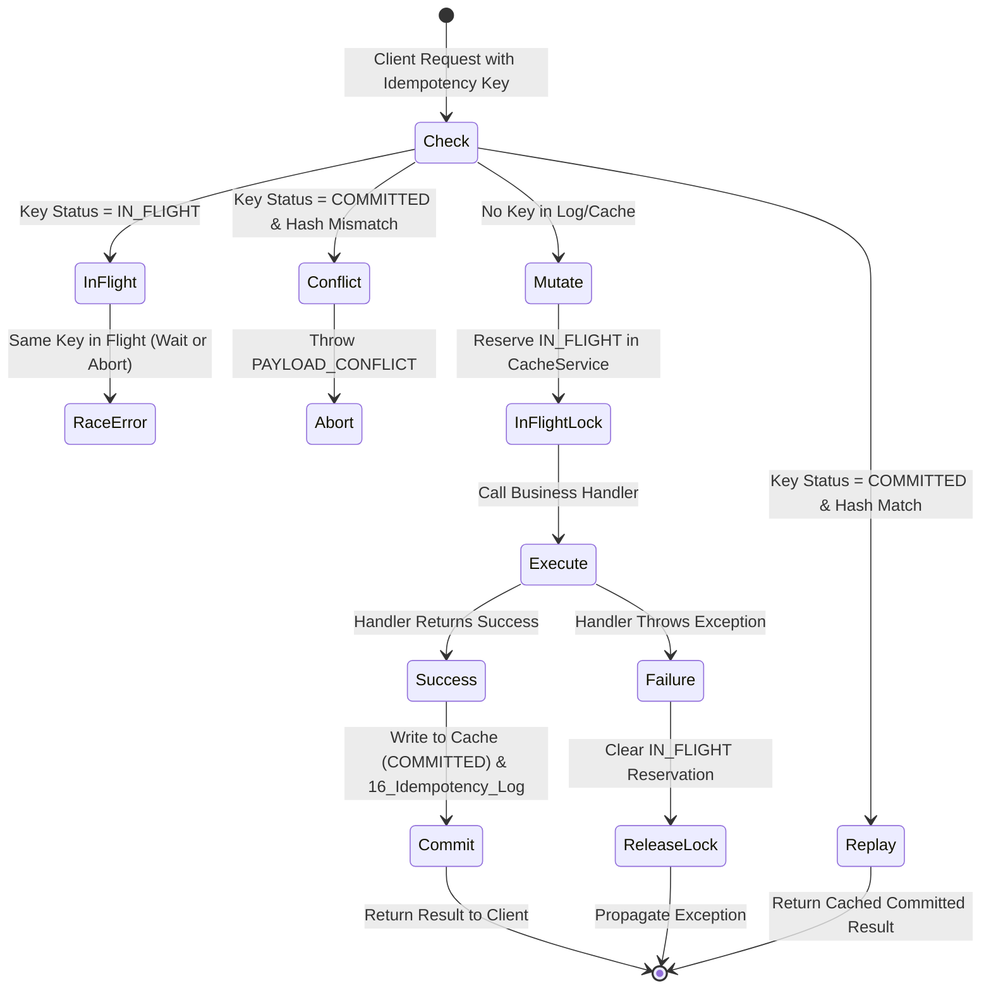

# HRT Inventory System — Idempotency Contract & Specification
**Document Version:** v1.1  
**Baseline:** `v2.7.0-rc.5`  
**Target:** Candidate `v2.7.0-rc.6`  
**Status:** Implemented & Verified in `Api.gs` / `Write.gs`  

---

## 1. Idempotency Key Semantics

All mutable business actions (`stock.receive`, `stock.issue`, `stock.adjust`, `requisitions.create`, `requisitions.approve`, `requisitions.reject`, `requisitions.confirmReceipt`, `fiscalYear.close`) support an idempotent execution header/field:

- Parameter: `idempotency_key` or `idempotencyKey`
- Format: Non-empty ASCII string $\le 128$ characters (e.g., UUIDv4 or client prefix + timestamp + nonce).
- Scope: Scoped per `caller.email` + `action`.
- Retention: 6 hours in `CacheService`; permanently retained in sheet `16_Idempotency_Log`.

---

## 2. Canonical Payload Hashing (`canonicalizePayload`)

To distinguish legitimate retries from key re-use with different parameters, the server computes a deterministic SHA-256 hash of the payload:

1. **Excluded Volatile Fields:**
   - Security/transport tokens: `id_token`, `idToken`, `authToken`, `token`, `bearer`
   - Request tracking IDs: `requestId`, `reqId`, `_t`, `timestamp`
   - Key itself: `idempotency_key`, `idempotencyKey`
   - Server-assigned actor: `caller`, `_serverActor`
2. **Deterministic Object Key Sorting:**
   - Object keys are recursively sorted alphabetically using `Object.keys(obj).sort()`.
3. **Array Order Preservation:**
   - Array element ordering is strictly preserved as semantic meaning depends on row/item index.
4. **Hashing Algorithm:**
   - SHA-256 (`Utilities.computeDigest(Utilities.DigestAlgorithm.SHA_256, canonicalJson)`).
   - If the cryptographic hash engine is unavailable, the router **fails closed** (`HASH_UNAVAILABLE`), preventing unhashed writes.

---

## 3. Idempotency State Machine

---

## 4. Contract Error Codes

| Error Code | HTTP / RPC Status | Description | Action Required |
| :--- | :--- | :--- | :--- |
| `IDEMPOTENCY_IN_FLIGHT` | 409 Conflict | Another transaction with the same key is currently running. | Wait and retry after exponential backoff. |
| `PAYLOAD_CONFLICT` | 422 Unprocessable | The same idempotency key was submitted with different payload parameters. | Generate a fresh idempotency key for the new payload. |
| `HASH_UNAVAILABLE` | 500 Internal Error | Cryptographic hash engine failed or returned malformed digest. | Fail closed; no writes performed. |
