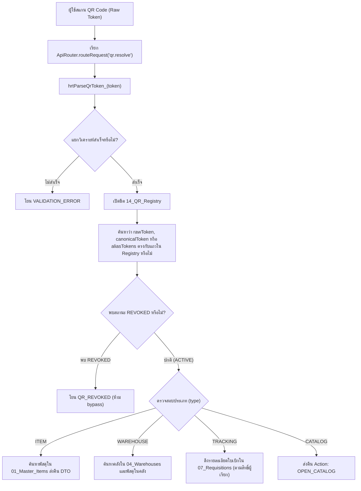

# HRT Inventory System — QR Code Support Matrix
**Document Version:** v1.1  
**Target Release Pipeline:** `v2.7.0-rc.5` (Working Tree) $\rightarrow$ Candidate `v2.7.0-rc.6` (Post Prompts 13–20)  
**Specification Date:** 30 ตุลาคม 2569  
**Organization:** โรงเรียนหรเทพ(รุ่งเรืองประชาสามัคคี)  

---

## 1. Overview & Architectural Policy

ระบบ HRT Inventory รองรับการระบุตัวตนและเรียกดูข้อมูลผ่านรหัส QR Code แบบหลายมิติ (Multi-prefix QR Resolution) โดยเชื่อมต่อระหว่าง **MiniUI (Self-Service Mobile Client)** และ **Backend API (`qr.resolve` / `hrtResolveQr_`)** ตามหลักการดังนี้:

1. **Anti-Bypass Revocation Enforcement:**  
   หากรหัส QR Code ถูกเพิกถอนในชีต `14_QR_Registry` (สถานะ `REVOKED`) ระบบจะทำการบล็อกทุก Alias และ Token ที่เกี่ยวข้อง (ทั้ง Raw Token, Canonical Token และ Alias Variants) ทันที โดยปฏิเสธการเข้าถึงด้วย Error Code `QR_REVOKED`
2. **Zero Silent Fallback Policy:**  
   เมื่อ Server ปฏิเสธหรือ Token ไม่ถูกต้อง MiniUI จะต้องไม่ทำ Silent Fallback ไปแสดงรายการสินค้าทดแทนโดยพลการ ต้องแสดงแจ้งเตือนข้อผิดพลาดจริงต่อผู้ใช้
3. **Explicit Manual Search:**  
   แยกส่วนการสแกนด้วยกล้อง (Camera Stream) ออกจากการค้นหาด้วยรหัสด้วยตนเองอย่างชัดเจน โดยช่องค้นหาต้องมีป้ายกำกับ `[ค้นหาด้วยรหัส]`
4. **Unified Prefix Parsing:**  
   ใช้ Regular Expression มาตรฐาน `/^(?:QR:)?(ITEM|ROOM|WH|TRACK|TRK):(.*)$/i` และ `/^(?:QR:)?CATALOG$/i` ในการแยก Prefix และ Target Reference

---

## 2. QR Code Resolution Support Matrix

| Prefix / Token Format | Canonical Form | Aliases | Target Type | Target Sheet / Entity | Resolver Function | Client Action in MiniUI | Revocation Check | Fallback Policy |
| :--- | :--- | :--- | :--- | :--- | :--- | :--- | :--- | :--- |
| `QR:ITEM:<item_code>`<br>`ITEM:<item_code>`<br>`<item_code>` (Direct) | `QR:ITEM:<CODE>` | `QR:ITEM:<CODE>`<br>`ITEM:<CODE>`<br>`<CODE>` | `ITEM` | `01_Master_Items`<br>(Primary Key: `item_code`) | `hrtResolveQr_`<br>`hrtParseQrToken_` | เปิด Modal รายละเอียดพัสดุ พร้อมปุ่มกดเพิ่มลงตะกร้า (`addToCart`) ตรวจสอบ Stock และสถานะ Inactive | ตรวจสอบใน `14_QR_Registry` เทียบกับ `rawToken`, `canonicalToken`, และ `aliasTokens` หากสถานะเป็น `REVOKED` จะโยน `QR_REVOKED` | **ห้าม Silent Fallback** หากไม่พบพัสดุโยน `NOT_FOUND` ผู้ใช้สามารถกดปุ่ม `[ค้นหาด้วยรหัส]` เพื่อพิมพ์ค้นหาด้วยตนเอง |
| `QR:ROOM:<wh_id>`<br>`ROOM:<wh_id>`<br>`QR:WH:<wh_id>`<br>`WH:<wh_id>` | `QR:ROOM:<TARGET>` | `QR:ROOM:<TARGET>`<br>`ROOM:<TARGET>`<br>`QR:WH:<TARGET>`<br>`WH:<TARGET>` | `WAREHOUSE` | `04_Warehouses`<br>& `01_Master_Items` | `hrtResolveQr_`<br>`hrtParseQrToken_` | นำทางไปยังแท็บแคตตาล็อก และทำการกรองรายการพัสดุเฉพาะคลัง/ห้องที่ระบุ (`warehouse`) | ตรวจสอบใน `14_QR_Registry` ต่อทั้ง Prefix `ROOM` และ `WH` หากตัวใดตัวหนึ่งถูกเพิกถอนจะบล็อกทั้งหมด | หากไม่พบคลังโยน `NOT_FOUND` แสดง Toast แจ้งเตือนข้อผิดพลาด ไม่แสดงผลมโน |
| `QR:TRACK:<req_id>`<br>`TRACK:<req_id>`<br>`QR:TRK:<req_id>`<br>`TRK:<req_id>` | `QR:TRACK:<REQ_ID>` | `QR:TRACK:<TARGET>`<br>`TRACK:<TARGET>`<br>`QR:TRK:<TARGET>`<br>`TRK:<TARGET>` | `TRACKING` | `07_Requisitions`<br>(Primary Key: `req_id`) | `hrtResolveQr_`<br>`hrtGetRequisitionDetail_` | เปิด Modal ติดตามใบเบิก (`openRequestModal`) แสดงสถานะปัจจุบันและ Timeline (SUBMITTED $\rightarrow$ APPROVED $\rightarrow$ ISSUED $\rightarrow$ RECEIVED) | ตรวจสอบใน `14_QR_Registry` ป้องกันการสแกนใบเบิกที่ถูกเพิกถอนสิทธิ์ | หากไม่พบใบเบิกหรือผู้ใช้ไม่มีสิทธิ์อ่าน (Non-owner / Non-admin) ตอบกลับ `ACCESS_DENIED` หรือ `NOT_FOUND` |
| `QR:CATALOG`<br>`CATALOG` | `QR:CATALOG` | `QR:CATALOG`<br>`CATALOG` | `CATALOG` | `01_Master_Items`<br>(Catalog View) | `hrtResolveQr_`<br>`hrtParseQrToken_` | นำทางผู้ใช้ไปยังแท็บแคตตาล็อกรวม (`showTab('catalog')`) รีเซ็ตตัวกรองทั้งหมด | ตรวจสอบใน `14_QR_Registry` หากสัญลักษณ์แคตตาล็อกถูกสั่งยกเลิก | หาก Server ปฏิเสธ จะแสดง Error Alert แก่ผู้ใช้ |

---

## 3. Regular Expression & Token Parsing Logic

การแยกประเภท Token ใน `Read.gs:hrtParseQrToken_`:

```javascript
function hrtParseQrToken_(rawToken) {
  if (!rawToken || typeof rawToken !== 'string') return null;
  const token = rawToken.trim();
  if (!token) return null;

  // 0. CATALOG Reference
  if (/^(?:QR:)?CATALOG$/i.test(token)) {
    return {
      type: 'CATALOG',
      target: '',
      canonicalToken: 'QR:CATALOG',
      rawToken: token,
      aliasTokens: ['QR:CATALOG', 'CATALOG']
    };
  }

  // 1. Matched prefix pattern: (QR:)?(ITEM|ROOM|WH|TRACK|TRK):(.*)
  const prefixMatch = token.match(/^(?:QR:)?(ITEM|ROOM|WH|TRACK|TRK):(.*)$/i);
  if (prefixMatch) {
    const rawPrefix = prefixMatch[1].toUpperCase();
    const target = prefixMatch[2].trim();
    if (!target) {
      const err = new Error(`VALIDATION_ERROR: Target reference is missing in QR code "${token}".`);
      err.code = 'VALIDATION_ERROR';
      throw err;
    }

    if (rawPrefix === 'ITEM') {
      const code = target.toUpperCase();
      return {
        type: 'ITEM',
        target: code,
        canonicalToken: `QR:ITEM:${code}`,
        rawToken: token,
        aliasTokens: [`QR:ITEM:${code}`, `ITEM:${code}`, code]
      };
    }

    if (rawPrefix === 'ROOM' || rawPrefix === 'WH') {
      return {
        type: 'WAREHOUSE',
        target: target,
        canonicalToken: `QR:ROOM:${target}`,
        rawToken: token,
        aliasTokens: [`QR:ROOM:${target}`, `ROOM:${target}`, `QR:WH:${target}`, `WH:${target}`]
      };
    }

    if (rawPrefix === 'TRACK' || rawPrefix === 'TRK') {
      return {
        type: 'TRACKING',
        target: target,
        canonicalToken: `QR:TRACK:${target}`,
        rawToken: token,
        aliasTokens: [`QR:TRACK:${target}`, `TRACK:${target}`, `QR:TRK:${target}`, `TRK:${target}`]
      };
    }
  }

  // 2. Direct Item Code Fallback (e.g. "OFF-001")
  const code = token.toUpperCase();
  return {
    type: 'ITEM',
    target: code,
    canonicalToken: `QR:ITEM:${code}`,
    rawToken: token,
    aliasTokens: [`QR:ITEM:${code}`, `ITEM:${code}`, code]
  };
}
```

---

## 4. Anti-Bypass Revocation Verification Flow

ขั้นตอนการตรวจสอบการเพิกถอนใน `Read.gs:hrtResolveQr_`:



---

## 5. Client Handling & Fallback Protocol in MiniUI

1. **สตรีมกล้องจริง (WebRTC MediaStream):**
   - MiniUI เรียกใช้งาน `navigator.mediaDevices.getUserMedia({ video: { facingMode: 'environment' } })`
   - เมื่ออ่านรหัสสำเร็จ หรือเมื่อผู้ใช้ปิดหน้าต่าง/ออกจากระบบ ระบบจะเรียก `stopCameraStream()` เพื่อคืนสิทธิ์ฮาร์ดแวร์ทันที
2. **การแยกช่องทางค้นหาอย่างโปร่งใส:**
   - การสแกนผ่านกล้อง: ดำเนินการผ่าน Video Element และ BarcodeDetector API
   - การค้นหาด้วยรหัสด้วยตนเอง: ดำเนินการผ่าน Text Input แยกต่างหากที่มีป้ายกำกับชัดเจน `[ค้นหาด้วยรหัส]`
3. **การจัดการข้อผิดพลาด (Zero Silent Fallback):**
   - หาก Server ส่งคืนสถานะ `QR_REVOKED` $\rightarrow$ แสดง Toast เตือน: *"รหัส QR Code นี้ถูกยกเลิกการใช้งานแล้ว"*
   - หาก Server ส่งคืนสถานะ `NOT_FOUND` $\rightarrow$ แสดง Toast เตือน: *"ไม่พบข้อมูลพัสดุหรือเอกสารที่ระบุในระบบ"*
   - ห้ามไม่ให้ดักจับ Error แล้วแอบเติมพัสดุลงในตะกร้าโดยพลการ
