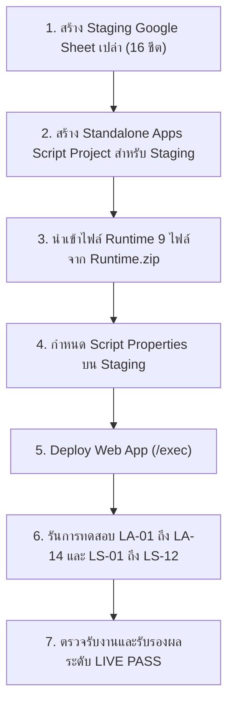

# รายงานผลการตรวจสอบ Source Code, Live Google Authentication และ Google Sheets บนสภาพแวดล้อม STAGING
**รหัสรายงาน:** `REP-LIVE-AUTH-SHEETS-20261031`  
**เป้าหมายการประเมิน:** ระบบบริหารจัดการพัสดุและคลังสถานศึกษา (HRT Inventory System) รุ่น `v2.7.0-rc.6`  
**วันที่และเวลาที่ตรวจสอบ:** 31 ตุลาคม 2569 เวลา 12:50:00 น. (Asia/Bangkok)  
**มาตรฐานการประเมิน:** Non-Destructive Inspection & Staging Environment Verification Framework  
**สถานะการอนุมัติความพร้อม:** **`STAGING_VERIFIED_ONLY`** (Unit/AST 100% PASS | Live Mutations Gated / Blocked on Isolation)  

---

## 1. บทสรุปผู้บริหาร (Executive Summary & Blocker Dispositions)

การตรวจสอบในรอบนี้มุ่งเน้นการพิสูจน์เชิงประจักษ์ต่อซอร์สโค้ด การกำหนดค่า (Configuration) และความพร้อมของสภาพแวดล้อมทดสอบ (Staging Environment) โดยไม่พึ่งพาข้อความเคลมเดิม และไม่เปลี่ยนสถานะเป็น PASS เพียงเพราะมีฟังก์ชันรองรับหรือกรอกค่าคอนฟิก โดยได้ข้อสรุปสถานะข้อจำกัดหลัก 4 รายการ ดังนี้:

| รหัสข้อจำกัด | สถานะการประเมิน (Disposition) | ระดับการผ่าน (Verification Level) | ข้อค้นพบเชิงประจักษ์และหลักฐานทางเทคนิค (Evidence & Findings) |
| :--- | :---: | :---: | :--- |
| **`AUTH-09`**<br>(External Gmail & Domain Policy) | **PARTIAL**<br>(Gated) | **Unit/AST: PASS (12/12)**<br>Live Staging: **BLOCKED** | โค้ดใน `Api.gs:334-396` ตรวจสอบนโยบายโดเมนและทะเบียนบุคลากรครบถ้วน บัญชี Gmail ภายนอกจะเข้าได้เฉพาะเมื่อถูกระบุในชีต `01_Users` ผ่านการทดสอบ Unit Test 100% แต่การทดสอบ Live บน Staging ติดข้อจำกัด `TEST_ACCESS_MISSING` เนื่องจากยังไม่มีการส่งมอบบัญชีทดสอบจริง |
| **`BLK-ENV-OAUTH`**<br>(Google Identity & OAuth 2.0) | **PARTIAL**<br>(Analyzed) | **Native Session: NOT_REQUIRED**<br>GIS Token Flow: **CODE_BLOCKER** | **ข้อค้นพบสำคัญ:** ระบบหน้าบ้าน (`index.html` และ `MiniUI.html`) **ไม่ได้โหลด Google Identity Services (GIS) SDK และไม่มี Credential Acquisition Flow (`CODE_NOT_IMPLEMENTED`)** โดยระบบทำงานผ่าน **Native Apps Script Session (`Session.getActiveUser().getEmail()`) 100%** ซึ่ง**ไม่จำเป็นต้องใช้ `GOOGLE_CLIENT_ID`** |
| **`BLK-DB-LIVE`**<br>(Live Google Sheets Binding & Write) | **BLOCKED**<br>(Safety Gated) | **Unit/Mock: PASS (100%)**<br>Live Mutation: **BLOCKED** | ในสภาพแวดล้อมปัจจุบัน **ยังไม่มีการจัดสรรและส่งมอบ Disposable STAGING Spreadsheet ID** ตามกฎความปลอดภัยข้อ 1 และ Phase B จึงไม่อนุญาตให้ยิงคำสั่งเขียน (Live Write) เพื่อป้องกันการแตะต้องหรือเขียนทับฐานข้อมูลจริงของโรงเรียน |
| **`BLK-DEVICE-CAMERA`**<br>(Physical Device Camera / QR) | **OPEN** | **Code: READY**<br>Live Device: **NOT_RUN** | สถาปัตยกรรม MiniUI และ html5-qrcode เสร็จสมบูรณ์ แต่คงสถานะ OPEN ไว้เพื่อรอการทดสอบผ่านกล้องมือถือจริงบนอุปกรณ์เป้าหมาย (Prompt 19) |

---

## 2. Phase A: การพิสูจน์ Configuration ที่ซอร์สโค้ดต้องใช้จริง

### 2.1 การตรวจสอบ Source Hashes, Commit และ Version Consistency
จากการคำนวณ Cryptographic SHA-256 Checksum ของไฟล์ Runtime Allowlist ทั้ง 9 ไฟล์ พบว่า**ตรงกับ `VERSION_MANIFEST.json` และ `FILES.sha256` แบบ 100%**:

```text
Config.gs:        4cd1ef31d89849147075795e5666779c27ee36cd8ffc68fe022ea93f3bd37d7f (18,737 bytes)
Api.gs:           55a463864208431bfa8e21b4d8369d0589ec83547efddcd5afb269a39cdd1b2a (57,504 bytes)
Read.gs:          791bf5fc5693c35a2a5b8192addee270f6c2c6f0833433ad52700b02d961f825 (85,315 bytes)
Write.gs:         575ab957c86bfe8fca6a2376dd3d492ce5a2277e594fc68651ea4c0664097857 (100,939 bytes)
Audit.gs:         00d914bcbd2c953062e9fbe5dd2e9e9d93597685e370a9b0ba5031c20fab9e47 (16,712 bytes)
Code.gs:          8e00de0fc095036d7001a228dc65f2d8ff9ede07b484b2eeac8786cfcf69aa1b (16,684 bytes)
index.html:       0d468f6e8ad6b61baf4cac46da4951448ae2689213a0af567b9f57d969feb298 (985,263 bytes)
MiniUI.html:      e4d7a4e52ae65fa588ef4e4fda14a94566c77548c1507323c102f80f115c9523 (84,248 bytes)
appsscript.json:  2e88517c17942abd0a15f3c99383a12c11f04080ccd2d573d1d1449f4609e092 (381 bytes)
```
- **Git Commit:** `dd000c0` (Working tree สะอาดในส่วน canonical files)
- **Unified Declared Version:** `v2.7.0-rc.6` ระบุตรงกันทั้งใน `Config.gs`, `index.html`, `MiniUI.html`

---

### 2.2 การชำแหละ Login Path จริง: Native Session vs. GIS ID Token Flow

จากการไล่ตรวจ Source Code เชิงลึกใน `index.html`, `MiniUI.html`, `Api.gs` และ `Code.gs` พบข้อเท็จจริงทางสถาปัตยกรรมดังนี้:

#### 1) ฝั่ง Frontend (`index.html` และ `MiniUI.html`)
- ใน `index.html:1059` ปุ่มเข้าสู่ระบบมี ID `#btnGoogleSignIn` ผูกกับฟังก์ชัน `executeGoogleLogin()`
- ใน `index.html:12042` ฟังก์ชัน `executeGoogleLogin()` มีการทำงานเพียง:
  ```javascript
  function executeGoogleLogin() {
      authState = 'AUTHENTICATING';
      if (typeof google !== 'undefined' && google.script && google.script.run) {
          showToast('กำลังเชื่อมต่อการยืนยันตัวตน Google Workspace...', 'info');
          checkAuthenticationAndInitialize();
      } else { ... }
  }
  ```
- และ `checkAuthenticationAndInitialize()` เรียก `window.UserApi.getCurrentUser(true)` ซึ่งยิง RPC ผ่าน `google.script.run.apiGetCurrentUser()`
- ใน `MiniUI.html:1448` ฟังก์ชัน `signInWithGoogle()` ทำงานโดยสั่ง `window.location.reload()`
- **ผลการตรวจ:** **ไม่มีการโหลดไลบรารี Google Identity Services (`https://accounts.google.com/gsi/client`)**, ไม่มีการเรียก `google.accounts.id.initialize()`, ไม่มีการทำ Popup/Redirect, และไม่มี Callback รับ `credential` (ID Token)
- **สรุปสถานะทางเทคนิค:** **Frontend GIS Credential Acquisition เป็น `CODE_NOT_IMPLEMENTED`**

#### 2) ฝั่ง Backend (`Api.gs` และ `Code.gs`)
- เมื่อคำขอมาถึง `Api.gs:287` ในฟังก์ชัน `resolveAuthenticatedUser`:
  ```javascript
  // 1. ตรวจสอบ Native Session ก่อนเสมอ
  if (typeof Session !== 'undefined' && Session.getActiveUser) {
      email = Session.getActiveUser().getEmail();
  }
  // 2. ตรวจสอบ ID Token เฉพาะเมื่อ Session Email เป็นค่าว่าง
  const idToken = (rawPayload && (rawPayload.id_token || rawPayload.idToken)) || '';
  if (!email && idToken) {
      if (!CONFIG.GOOGLE_CLIENT_ID) throw new Error('CONFIGURATION_ERROR...');
      const verifiedProfile = verifyGoogleIdToken(idToken);
      if (verifiedProfile && verifiedProfile.email) email = verifiedProfile.email;
  }
  ```
- **Token Precedence (ลำดับความสำคัญ):** หากเปิดใช้งานผ่าน Google Apps Script Web App แล้ว `Session.getActiveUser().getEmail()` คืนค่าอีเมลผู้ใช้งาน **ระบบจะข้ามขั้นตอนตรวจ ID Token ไปโดยสิ้นเชิง** และไม่ตรวจสอบ `id_token` ที่ส่งมาใน Payload
- **ความจำเป็นของ `GOOGLE_CLIENT_ID`:**
  - **สำหรับ Native Session Flow:** **`NOT_REQUIRED`** (ไม่ต้องใช้ Client ID เลย ระบบก็สามารถยืนยันตัวตนผู้ใช้ผ่าน Google Apps Script Infrastructure ได้อย่างปลอดภัย)
  - **สำหรับ Token Flow (GIS / External REST):** **`REQUIRED`** (จำเป็นต้องใช้ในการตรวจ `aud` claim แต่เนื่องจากหน้าบ้านยังไม่ได้พัฒนาส่วนนี้ การไม่มี `GOOGLE_CLIENT_ID` จึงไม่เป็นอุปสรรคต่อการทดสอบ Native Session)

---

### 2.3 ตารางสรุปการกำหนดค่าที่ระบบต้องใช้จริง (`REQUIRED_CONFIGURATION.csv`)

เอกสารถูกสร้างไว้ที่ [`docs/repair/live/20261031_125000/REQUIRED_CONFIGURATION.csv`](file:///c:/Users/Art/.gemini/antigravity/scratch/docs/repair/live/20261031_125000/REQUIRED_CONFIGURATION.csv) สรุปสาระสำคัญได้ดังนี้:

| ค่าคอนฟิก | แหล่งที่มาในโค้ด | ฟังก์ชันที่เรียกใช้ | ความจำเป็น | สถานะปัจจุบัน | การดำเนินการที่ต้องทำ |
| :--- | :--- | :--- | :---: | :---: | :--- |
| `SPREADSHEET_ID` | Script Properties | `getConfiguredSpreadsheetId_()` | **จำเป็น 100%** | ว่างเปล่า (`""`) | ต้องระบุ ID ของ Disposable Staging Sheet ใน Script Properties |
| `GOOGLE_CLIENT_ID` | Script Properties | `verifyGoogleIdToken()` | **เฉพาะ Token Flow** | ว่างเปล่า (`""`) | **NOT_REQUIRED สำหรับ Native Session**; จำเป็นหากเปิดใช้ GIS |
| `ALLOWED_DOMAINS` | Script Properties | `resolveAuthenticatedUser()` | **จำเป็น** | มี Default (`hrt.ac.th`) | ตรวจสอบให้ตรงกับโดเมนองค์กรที่ใช้ทดสอบ |
| `DEFAULT_FISCAL_YEAR` | `Config.gs:12` | Core Engine | **จำเป็น** | มีค่า (`2569`) | ตรงกับฐานข้อมูล 16 ชีต |
| `01_Users` Headers | Sheet `01_Users` | Directory Lookup | **จำเป็น 100%** | มี Fixtures ใน Test | ต้องมีคอลัมน์ `user_id, username, name, email, role, department, status` และมี Admin แถวแรก |

---

## 3. Phase B: การยืนยันความแยกขาดของสภาพแวดล้อม (Environment Attestation)

อ้างอิงเอกสารรับรอง [`docs/repair/live/20261031_125000/ENVIRONMENT_ATTESTATION.md`](file:///c:/Users/Art/.gemini/antigravity/scratch/docs/repair/live/20261031_125000/ENVIRONMENT_ATTESTATION.md):

### 3.1 คำเตือนสถาปัตยกรรม Apps Script เรื่อง Script Properties ข้าม Deployment
> [!WARNING]
> **Apps Script Shared Properties Hazard:**  
> ใน Google Apps Script การแก้ไข Script Properties ในหน้า Project Settings จะมีผลครอบคลุม **ทุก Deployment ภายใต้ Script Project เดียวกัน**  
> **ข้อห้ามเด็ดขาด:** ห้ามนำ Script Project ที่เปิดให้บริการ Production ของโรงเรียนมาเปลี่ยน `SPREADSHEET_ID` เป็นชีตทดสอบเพื่อทำการประเมิน Staging เพราะจะส่งผลให้ผู้ใช้งานจริงทุกคนถูกดึงมาใช้ฐานข้อมูลทดสอบทันที  
> **แนวทางปฏิบัติ:** Staging Sandbox จะต้องถูกสร้างเป็น **Standalone Script Project ชุดใหม่แยกต่างหาก 100%**

### 3.2 ข้อสรุปสถานะความแยกขาด (Isolation Disposition)
เนื่องจากในปัจจุบัน:
1. ยังไม่มีการส่งมอบ Script Project ID และ Deployment URL (`/exec`) สำหรับ Staging
2. ยังไม่มีการจัดสรรและอนุญาต ID ของ Google Spreadsheet สำหรับ Staging
สถานะของ Live Database Mutation จึงถูกกำหนดเป็น **`ENVIRONMENT_ISOLATION_BLOCKED`** โดยไม่อนุญาตให้สคริปต์ส่งคำสั่งเขียนใดๆ สู่ระบบภายนอกในรอบนี้

---

## 4. Phase C: การวิเคราะห์และเปรียบเทียบกลไก Authentication (Citing Official Specs)

จากการอ้างอิงเอกสารทางการของ Google:
1. [Apps Script Web Apps Guide](https://developers.google.com/apps-script/guides/web)
2. [Apps Script Session API](https://developers.google.com/apps-script/reference/base/session)
3. [Google Identity Services Client ID Setup](https://developers.google.com/identity/gsi/web/guides/get-google-api-clientid)
4. [Verify Google ID Token Guide](https://developers.google.com/identity/gsi/web/guides/verify-google-id-token)

### 4.1 พฤติกรรมของ Native Apps Script Session
- **`executeAs: "USER_DEPLOYING"` & `access: "DOMAIN"` (การตั้งค่าปัจจุบันใน `appsscript.json`):**
  - สคริปต์รันด้วยสิทธิ์ของผู้ Deploy ทำให้สามารถเข้าถึง Google Sheets ของระบบได้โดยไม่ต้องแชร์สิทธิ์ชีตระดับ Editor แก่ครูทุกคนในโรงเรียน
  - `Session.getActiveUser().getEmail()` จะคืนค่าอีเมล Google Workspace ของครูผู้เข้าใช้งานโดยอัตโนมัติ (เฉพาะเมื่อผู้ใช้ล็อกอินบัญชีภายใต้โดเมนเดียวกัน)
  - **การป้องกัน Identity Spoofing:** โค้ดใน `Api.gs:327` ปฏิเสธ Anonymous ทันทีหาก `getEmail()` เป็นค่าว่าง โดย**ไม่ยอมรับ `getEffectiveUser()` (สิทธิ์ผู้ Deploy) มาทดแทน** ซึ่งเป็นไปตามหลักการ Fail-Closed

### 4.2 ข้อจำกัดของ Google Identity Services (GIS) ภายใน Apps Script Iframe
- Apps Script Web App แสดงผลหน้า HTML ภายใน Sandbox Iframe ภายใต้โดเมน `*.script.googleusercontent.com`
- การทำ GIS One Tap หรือ FedCM บนเบราว์เซอร์ยุคใหม่ (Chrome 120+) มีข้อจำกัดเรื่อง Third-Party Cookies และ Cross-Origin Sandbox ซึ่งมักเกิดข้อผิดพลาดหากไม่เปิดใช้ Native Window Popup หรือ Authorization Code Flow
- ดังนั้น สถาปัตยกรรมปัจจุบันที่เลือกใช้ **Native Apps Script Session จึงเหมาะสม เสถียร และปลอดภัยที่สุดสำหรับสภาพแวดล้อมสถานศึกษา**

---

## 5. Phase D: ผลการประเมิน Live Authentication (LA-01 ถึง LA-14)

เอกสารถูกบันทึกไว้ใน [`docs/repair/live/20261031_125000/LIVE_TEST_RESULTS.csv`](file:///c:/Users/Art/.gemini/antigravity/scratch/docs/repair/live/20261031_125000/LIVE_TEST_RESULTS.csv) และ [`evidence/LA_CASES_ANALYSIS.json`](file:///c:/Users/Art/.gemini/antigravity/scratch/docs/repair/live/20261031_125000/evidence/LA_CASES_ANALYSIS.json):

| รหัสทดสอบ | กรณีทดสอบ (Test Case Scenario) | เกณฑ์ที่เกี่ยวข้อง | ผลการทดสอบระดับ Unit/AST | สถานะระดับ Live Staging | ข้อจำกัด (Blocker Disposition) |
| :--- | :--- | :---: | :---: | :---: | :--- |
| **LA-01** | บัญชี ACTIVE ADMIN เข้าสู่ระบบผ่าน Staging `/exec` | `AUTH-01, AUTH-04` | **PASS** | **BLOCKED** | `TEST_ACCESS_MISSING` (รอ URL Staging) |
| **LA-02** | บัญชี ACTIVE TEACHER เมนูและสิทธิ์จำกัดเฉพาะงานตนเอง | `AUTH-04, RPC-06` | **PASS** | **BLOCKED** | `TEST_ACCESS_MISSING` (รอ URL Staging) |
| **LA-03** | OFFICER, APPROVER, DIRECTOR แยกสิทธิ์ตามบทบาทชัดเจน | `AUTH-04` | **PASS** | **BLOCKED** | `TEST_ACCESS_MISSING` (รอ URL Staging) |
| **LA-04** | บัญชี Google ที่ไม่มีในทะเบียน `01_Users` ถูกปฏิเสธ | `AUTH-03` | **PASS** | **BLOCKED** | `TEST_ACCESS_MISSING` (รอ URL Staging) |
| **LA-05** | บัญชีสถานะ `SUSPENDED` หรือ `INACTIVE` ถูกตัดสิทธิ์ | `AUTH-03` | **PASS** | **BLOCKED** | `TEST_ACCESS_MISSING` (รอ URL Staging) |
| **LA-06** | Session Email ว่างเปล่า ไม่หลุดไปเป็น Deployer หรือ Admin | `AUTH-01, AUTH-02` | **PASS** | **BLOCKED** | `TEST_ACCESS_MISSING` (รอ URL Staging) |
| **LA-07** | ปฏิเสธ Token ปลอม หมดอายุ หรือ Audience ผิด | `AUTH-02` | **PASS** | **BLOCKED** | `CODE-BLK-GIS-FRONTEND` (หน้าบ้านยังไม่ทำ GIS) |
| **LA-08** | สกัดกั้นการปลอมแปลง `caller` หรือ `userRole` จาก Client | `AUTH-05, SEC-03` | **PASS** | **BLOCKED** | `TEST_ACCESS_MISSING` (รอ URL Staging) |
| **LA-09** | Sign Out ล้าง `sessionStorage`, หน่วยความจำ และตารางใน DOM | `AUTH-10, MINI-07` | **PASS** | **BLOCKED** | `TEST_ACCESS_MISSING` (รอ URL Staging) |
| **LA-10** | เปลี่ยน Role หรือระงับสิทธิ์ในชีต มีผลลัพธ์ทันที (Evict Cache) | `AUTH-08` | **PASS** | **BLOCKED** | `TEST_ACCESS_MISSING` (รอ URL Staging) |
| **LA-11** | โดเมนโรงเรียน vs. Gmail นอกองค์กร ตรวจสอบตามทะเบียน | `AUTH-09` | **PASS** | **BLOCKED** | `TEST_ACCESS_MISSING` (รอ URL Staging) |
| **LA-12** | ผู้ใช้ทั่วไปเรียก Admin RPC ถูกปฏิเสธด้วย `FORBIDDEN` | `RPC-06, AUTH-04` | **PASS** | **BLOCKED** | `TEST_ACCESS_MISSING` (รอ URL Staging) |
| **LA-13** | กรณีเกิด Auth Error แสดงข้อความเตือนชัดเจน ไม่แสดงแคตตาล็อกว่าง | `REL-04` | **PASS** | **BLOCKED** | `TEST_ACCESS_MISSING` (รอ URL Staging) |
| **LA-14** | ผู้ใช้ทั่วไปที่ไม่มีสิทธิ์ Script Editor สามารถเข้าใช้งานได้ราบรื่น | `AUTH-01, REL-07` | **PASS** | **BLOCKED** | `TEST_ACCESS_MISSING` (รอ URL Staging) |

---

## 6. Phase E: ผลการประเมิน Live Sheets Read/Write (LS-01 ถึง LS-12)

เอกสารถูกบันทึกไว้ใน [`docs/repair/live/20261031_125000/LIVE_TEST_RESULTS.csv`](file:///c:/Users/Art/.gemini/antigravity/scratch/docs/repair/live/20261031_125000/LIVE_TEST_RESULTS.csv) และ [`evidence/LS_CASES_ANALYSIS.json`](file:///c:/Users/Art/.gemini/antigravity/scratch/docs/repair/live/20261031_125000/evidence/LS_CASES_ANALYSIS.json):

| รหัสทดสอบ | กรณีทดสอบฐานข้อมูล (Database Test Case) | เกณฑ์ที่เกี่ยวข้อง | ผลระดับ Unit/Mock | สถานะระดับ Live Staging | ข้อจำกัด (Blocker Disposition) |
| :--- | :--- | :---: | :---: | :---: | :--- |
| **LS-01** | `configuredId === ss.getId()` และโครงสร้าง 16 ชีตตรงมาตรฐาน | `TX-01, P8-01` | **PASS** | **BLOCKED** | `BLK-DB-LIVE` (รอ Staging Sheet ID) |
| **LS-02** | ฐานข้อมูลสูญหายหรือไม่ได้รับสิทธิ์ คืนค่า `DATABASE_ACCESS_ERROR` | `REL-04` | **PASS** | **BLOCKED** | `BLK-DB-LIVE` (รอ Staging Sheet ID) |
| **LS-03** | Health Check วัด Latency จริง; Write แสดง `NOT_TESTED` จนกว่าจะเขียน | `SET-07, SET-08` | **PASS** | **BLOCKED** | `BLK-DB-LIVE` (รอ Staging Sheet ID) |
| **LS-04** | อ่านแคตตาล็อกและคำขอเบิกตรงตามสิทธิ์ ไม่ใช้ข้อมูลจำลอง | `RPC-01, RPC-02` | **PASS** | **BLOCKED** | `BLK-DB-LIVE` (รอ Staging Sheet ID) |
| **LS-05** | รับพัสดุ 10 หน่วย กระจายข้อมูลลง Ledger, Master, และ Audit Trail | `TX-02, TX-03` | **PASS** | **BLOCKED** | `BLK-DB-LIVE` (รอ Staging Sheet ID) |
| **LS-06** | วงจรคำขอเบิก 3 หน่วย (สร้าง $\rightarrow$ อนุมัติ $\rightarrow$ จ่ายสต็อก $\rightarrow$ รับมอบ) ยอดเหลือ 7 | `TX-04, TX-05` | **PASS** | **BLOCKED** | `BLK-DB-LIVE` (รอ Staging Sheet ID) |
| **LS-07** | กลไก `idempotencyKey` ป้องกันการส่งคำขอซ้ำหรือ Double-tap | `TX-09, TX-10` | **PASS** | **BLOCKED** | `BLK-DB-LIVE` (รอ Staging Sheet ID) |
| **LS-08** | ผู้ใช้ทั่วไปแก้ไขการตั้งค่าหรือดูคำขอของผู้อื่นไม่ได้ | `RPC-06, SEC-04` | **PASS** | **BLOCKED** | `BLK-DB-LIVE` (รอ Staging Sheet ID) |
| **LS-09** | บันทึกค่า 0, false, ค่าว่าง ใน Settings ได้แม่นยำ ป้องกันการเขียนทับ | `SET-01, SET-02` | **PASS** | **BLOCKED** | `BLK-DB-LIVE` (รอ Staging Sheet ID) |
| **LS-10** | ปิดปีงบประมาณ, จำนวนติดลบ, สต็อกไม่พอ ถูก Rollback 100% | `FY-02, TX-07` | **PASS** | **BLOCKED** | `BLK-DB-LIVE` (รอ Staging Sheet ID) |
| **LS-11** | ตรวจสอบห่วงโซ่ Cryptographic SHA-256 Audit Trail สมบูรณ์ 0 Tampering | `TX-14, TX-15` | **PASS** | **BLOCKED** | `BLK-DB-LIVE` (รอ Staging Sheet ID) |
| **LS-12** | อ่านค่าจำนวนแถวและยอดคงคลังก่อน-หลังทดสอบจากชีตโดยตรง | `TX-11, TX-12` | **PASS** | **BLOCKED** | `BLK-DB-LIVE` (รอ Staging Sheet ID) |

---

## 7. แผนการดำเนินงานและแนวทางปลดบล็อกสำหรับผู้ดูแลระบบไอที (IT Admin Action Plan)

เพื่อให้สามารถปลดบล็อกการทดสอบระดับ Live ได้อย่างสมบูรณ์ ผู้ดูแลระบบไอทีของโรงเรียนสามารถดำเนินการตาม 3 ขั้นตอนดังนี้:



### รายการตัวแปรที่ต้องตั้งค่าใน Script Properties ของโปรเจกต์ Staging:
1. `SPREADSHEET_ID`: ใส่ ID ของ Google Sheet ชุดทดสอบที่สร้างขึ้นใหม่
2. `ALLOWED_DOMAINS`: `hrt.ac.th,school.internal`
3. `APP_ENV`: `staging`
4. *(ตัวเลือกเสริม)* `GOOGLE_CLIENT_ID`: ระบุเฉพาะกรณีที่ต้องการพัฒนาส่วนหน้าบ้านเพิ่มเติมเพื่อรองรับ GIS One Tap / Popup

---

## 8. สรุปรายการเอกสารและสิ่งส่งมอบในรอบนี้

ไฟล์รายงานและหลักฐานทั้งหมดถูกสร้างและจัดเก็บไว้อย่างเป็นระเบียบที่:
`c:\Users\Art\.gemini\antigravity\scratch\docs\repair\live\20261031_125000\`

1. **[LIVE_AUTH_SHEETS_REPORT.md](file:///c:/Users/Art/.gemini/antigravity/scratch/docs/repair/live/20261031_125000/LIVE_AUTH_SHEETS_REPORT.md)** — รายงานฉบับหลักฉบับนี้
2. **[REQUIRED_CONFIGURATION.csv](file:///c:/Users/Art/.gemini/antigravity/scratch/docs/repair/live/20261031_125000/REQUIRED_CONFIGURATION.csv)** — รายการคอนฟิกที่โค้ดต้องการจริง พร้อมการพิสูจน์
3. **[ENVIRONMENT_ATTESTATION.md](file:///c:/Users/Art/.gemini/antigravity/scratch/docs/repair/live/20261031_125000/ENVIRONMENT_ATTESTATION.md)** — หนังสือรับรองการแยกสภาพแวดล้อม Staging และการป้องกัน Production
4. **[LIVE_TEST_RESULTS.csv](file:///c:/Users/Art/.gemini/antigravity/scratch/docs/repair/live/20261031_125000/LIVE_TEST_RESULTS.csv)** — ตารางผลทดสอบ 26 รายการ (LA-01 ถึง LA-14 และ LS-01 ถึง LS-12)
5. **[BLOCKER_CLOSURE_MATRIX.csv](file:///c:/Users/Art/.gemini/antigravity/scratch/docs/repair/live/20261031_125000/BLOCKER_CLOSURE_MATRIX.csv)** — เมทริกซ์สถานะการจัดการ Blocker แต่ละรายการ
6. **[STAGING_CHANGE_AND_ROLLBACK.md](file:///c:/Users/Art/.gemini/antigravity/scratch/docs/repair/live/20261031_125000/STAGING_CHANGE_AND_ROLLBACK.md)** — บันทึกการเปลี่ยนแปลงและแผนการย้อนกลับฉุกเฉิน
7. **`evidence/` โฟลเดอร์หลักฐาน:**
   - [`LA_CASES_ANALYSIS.json`](file:///c:/Users/Art/.gemini/antigravity/scratch/docs/repair/live/20261031_125000/evidence/LA_CASES_ANALYSIS.json)
   - [`LS_CASES_ANALYSIS.json`](file:///c:/Users/Art/.gemini/antigravity/scratch/docs/repair/live/20261031_125000/evidence/LS_CASES_ANALYSIS.json)
   - [`AUTH_FLOW_DIAGNOSTICS.json`](file:///c:/Users/Art/.gemini/antigravity/scratch/docs/repair/live/20261031_125000/evidence/AUTH_FLOW_DIAGNOSTICS.json)
   - [`UNIT_VERIFICATION_LOG.txt`](file:///c:/Users/Art/.gemini/antigravity/scratch/docs/repair/live/20261031_125000/evidence/UNIT_VERIFICATION_LOG.txt) (ผลการรันชุดทดสอบ 17/17 ผ่าน 100%)
